> [Robin Rombach](https://ommer-lab.com/) [+equal-contribution], [Andreas Blattmann](https://andreasbl.com/), [Dominik Lorenz](https://www.linkedin.com/in/dominik-lorenz/), [Patrick Esser](https://www.linkedin.com/in/patrick-esser/), and [Björn Ommer](https://ommer-lab.com/). [High-Resolution Image Synthesis with Latent Diffusion Models](https://arxiv.org/abs/2112.10752), first submitted to arXiv on December 20, 2021; current arXiv version v2, revised April 13, 2022. Published at CVPR 2022. [CVPR paper page](https://openaccess.thecvf.com/content/CVPR2022/html/Rombach_High-Resolution_Image_Synthesis_With_Latent_Diffusion_Models_CVPR_2022_paper.html), [DOI](https://doi.org/10.48550/arXiv.2112.10752), and [TeX source](https://export.arxiv.org/e-print/2112.10752v2). <a href="/paper/latent-diffusion-models.pdf" target="_blank" rel="noopener noreferrer">Original PDF</a>. The original PDF remains authoritative for the exact print layout and bibliography.

## Abstract

By decomposing the image formation process into a sequential application of denoising autoencoders, diffusion models (DMs) achieve state-of-the-art synthesis results on image data and beyond. Additionally, their formulation allows for a guiding mechanism to control the image generation process without retraining. However, since these models typically operate directly in pixel space, optimization of powerful DMs often consumes hundreds of GPU days and inference is expensive due to sequential evaluations. To enable DM training on limited computational resources while retaining their quality and flexibility, we apply them in the latent space of powerful pretrained autoencoders. In contrast to previous work, training diffusion models on such a representation allows for the first time to reach a near-optimal point between complexity reduction and detail preservation, greatly boosting visual fidelity. By introducing cross-attention layers into the model architecture, we turn diffusion models into powerful and flexible generators for general conditioning inputs such as text or bounding boxes and high-resolution synthesis becomes possible in a convolutional manner. Our latent diffusion models (LDMs) achieve new state-of-the-art scores for image inpainting and class-conditional image synthesis and highly competitive performance on various tasks, including text-to-image synthesis, unconditional image generation and super-resolution, while significantly reducing computational requirements compared to pixel-based DMs.

## 1 Introduction

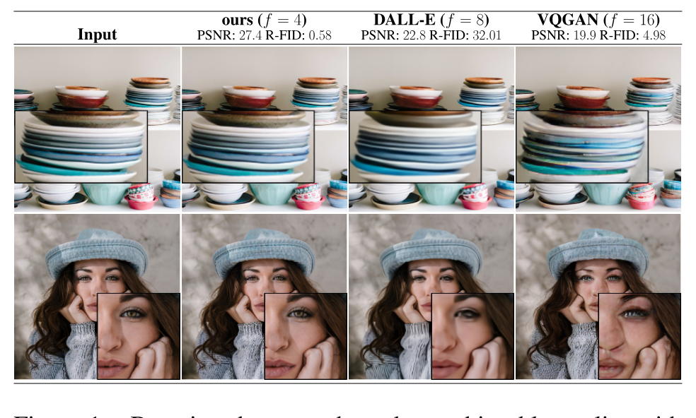

**Figure 1.** Boosting the upper bound on achievable quality with less agressive downsampling. Since diffusion models offer excellent inductive biases for spatial data, we do not need the heavy spatial downsampling of related generative models in latent space, but can still greatly reduce the dimensionality of the data via suitable autoencoding models, see [Section 3](#section-3). Images are from the DIV2K [Agu17a] validation set, evaluated at $512^{2}$ px. We denote the spatial downsampling factor by $f$. Reconstruction FIDs [Heu17] and PSNR are calculated on ImageNet-val. [Den09a]; see also [Table 8](#table-08).

Image synthesis is one of the computer vision fields with the most spectacular recent development, but also among those with the greatest computational demands. Especially high-resolution synthesis of complex, natural scenes is presently dominated by scaling up likelihood-based models, potentially containing billions of parameters in autoregressive (AR) transformers [Ram21, Raz19]. In contrast, the promising results of GANs [Goo14, Bro19, Kar19] have been revealed to be mostly confined to data with comparably limited variability as their adversarial learning procedure does not easily scale to modeling complex, multi-modal distributions. Recently, diffusion models [Soh15], which are built from a hierarchy of denoising autoencoders, have shown to achieve impressive results in image synthesis [Ho20a, Son20] and beyond [Kin21, Che21n, Kon21, Mit21], and define the state-of-the-art in class-conditional image synthesis [Dha21, Ho21a] and super-resolution [Sah21]. Moreover, even unconditional DMs can readily be applied to tasks such as inpainting and colorization [Son20] or stroke-based synthesis [Men21], in contrast to other types of generative models [Kin14, Rez14, Din17]. Being likelihood-based models, they do not exhibit mode-collapse and training instabilities as GANs and, by heavily exploiting parameter sharing, they can model highly complex distributions of natural images without involving billions of parameters as in AR models [Raz19].

**Democratizing High-Resolution Image Synthesis.** DMs belong to the class of likelihood-based models, whose mode-covering behavior makes them prone to spend excessive amounts of capacity (and thus compute resources) on modeling imperceptible details of the data [Die20, Sal17]. Although the reweighted variational objective [Ho20a] aims to address this by undersampling the initial denoising steps, DMs are still computationally demanding, since training and evaluating such a model requires repeated function evaluations (and gradient computations) in the high-dimensional space of RGB images. As an example, training the most powerful DMs often takes hundreds of GPU days (*e.g*. 150 - 1000 V100 days in [Dha21]) and repeated evaluations on a noisy version of the input space render also inference expensive, so that producing 50k samples takes approximately 5 days [Dha21] on a single A100 GPU. This has two consequences for the research community and users in general: Firstly, training such a model requires massive computational resources only available to a small fraction of the field, and leaves a huge carbon footprint [Pat21a, Str20]. Secondly, evaluating an already trained model is also expensive in time and memory, since the same model architecture must run sequentially for a large number of steps (*e.g*. 25 - 1000 steps in [Dha21]).

To increase the accessibility of this powerful model class and at the same time reduce its significant resource consumption, a method is needed that reduces the computational complexity for both training and sampling. Reducing the computational demands of DMs without impairing their performance is, therefore, key to enhance their accessibility.

**Departure to Latent Space.** Our approach starts with the analysis of already trained diffusion models in pixel space: [Figure 2](#figure-02) shows the rate-distortion trade-off of a trained model. As with any likelihood-based model, learning can be roughly divided into two stages: First is a *perceptual compression* stage which removes high-frequency details but still learns little semantic variation. In the second stage, the actual generative model learns the semantic and conceptual composition of the data (*semantic compression*). We thus aim to first find a perceptually equivalent, but computationally more suitable space, in which we will train diffusion models for high-resolution image synthesis.

Following common practice [Oor17, Raz19, Ess20a, Dai19a, Ram21], we separate training into two distinct phases: First, we train an autoencoder which provides a lower-dimensional (and thereby efficient) representational space which is perceptually equivalent to the data space. Importantly, and in contrast to previous work [Ess20a, Ram21], we do not need to rely on excessive spatial compression, as we train DMs in the learned latent space, which exhibits better scaling properties with respect to the spatial dimensionality. The reduced complexity also provides efficient image generation from the latent space with a single network pass. We dub the resulting model class *Latent Diffusion Models* (LDMs).

A notable advantage of this approach is that we need to train the universal autoencoding stage only once and can therefore reuse it for multiple DM trainings or to explore possibly completely different tasks [Sne21]. This enables efficient exploration of a large number of diffusion models for various image-to-image and text-to-image tasks. For the latter, we design an architecture that connects transformers to the DM’s UNet backbone [Ron15] and enables arbitrary types of token-based conditioning mechanisms, see [Section 3.3](#section-3-3).

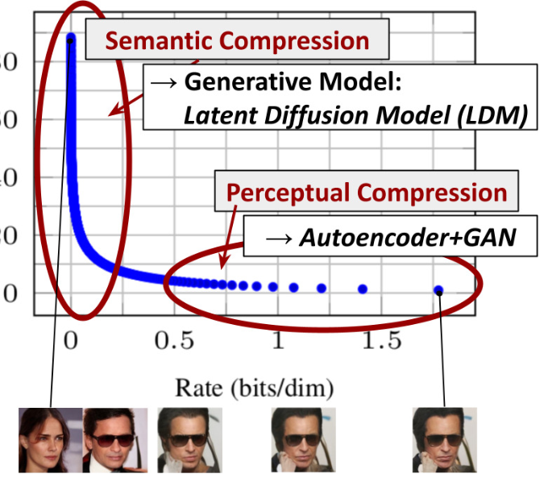

**Figure 2.** Illustrating perceptual and semantic compression: Most bits of a digital image correspond to imperceptible details. While DMs allow to suppress this semantically meaningless information by minimizing the responsible loss term, gradients (during training) and the neural network backbone (training and inference) still need to be evaluated on all pixels, leading to superfluous computations and unnecessarily expensive optimization and inference.  We propose *latent diffusion models (LDMs)* as an effective generative model and a separate mild compression stage that only eliminates imperceptible details. Data and images from [Ho20a].

In sum, our work makes the following contributions:

(i) In contrast to purely transformer-based approaches [Ess20a, Ram21], our method scales more graceful to higher dimensional data and can thus (a) work on a compression level which provides more faithful and detailed reconstructions than previous work (see [Figure 1](#figure-01)) and (b) can be efficiently applied to high-resolution synthesis of megapixel images.

(ii) We achieve competitive performance on multiple tasks (unconditional image synthesis, inpainting, stochastic super-resolution) and datasets while significantly lowering computational costs. Compared to pixel-based diffusion approaches, we also significantly decrease inference costs.

(iii) We show that, in contrast to previous work [Vah21] which learns both an encoder/decoder architecture and a score-based prior simultaneously, our approach does not require a delicate weighting of reconstruction and generative abilities. This ensures extremely faithful reconstructions and requires very little regularization of the latent space.

(iv) We find that for densely conditioned tasks such as super-resolution, inpainting and semantic synthesis, our model can be applied in a convolutional fashion and render large, consistent images of $\sim 1024^{2}$ px.

(v) Moreover, we design a general-purpose conditioning mechanism based on cross-attention, enabling multi-modal training. We use it to train class-conditional, text-to-image and layout-to-image models.

(vi) Finally, we release pretrained latent diffusion and autoencoding models at https://github.com/CompVis/latent-diffusion which might be reusable for a various tasks besides training of DMs [Sne21].

## 2 Related Work

Generative Models for Image Synthesis The high dimensional nature of images presents distinct challenges to generative modeling. Generative Adversarial Networks (GAN) [Goo14] allow for efficient sampling of high resolution images with good perceptual quality [Bro19, Kar20b], but are difficult to optimize [Mes18a, Arj17, Gul17] and struggle to capture the full data distribution [Met17]. In contrast, likelihood-based methods emphasize good density estimation which renders optimization more well-behaved. Variational autoencoders (VAE) [Kin14] and flow-based models [Din15, Din17] enable efficient synthesis of high resolution images [Chi20b, Vah20, Kin18], but sample quality is not on par with GANs. While autoregressive models (ARM) [Oor16b, Oor16a, Che20b, Chi19] achieve strong performance in density estimation, computationally demanding architectures [Vas17d] and a sequential sampling process limit them to low resolution images. Because pixel based representations of images contain barely perceptible, high-frequency details [Die20, Sal17], maximum-likelihood training spends a disproportionate amount of capacity on modeling them, resulting in long training times. To scale to higher resolutions, several two-stage approaches [Yan21a, Raz19, Ess20a, Yu21a] use ARMs to model a compressed latent image space instead of raw pixels.

Recently, Diffusion Probabilistic Models (DM) [Soh15], have achieved state-of-the-art results in density estimation [Kin21] as well as in sample quality [Dha21]. The generative power of these models stems from a natural fit to the inductive biases of image-like data when their underlying neural backbone is implemented as a UNet [Ron15, Ho20a, Son20, Dha21]. The best synthesis quality is usually achieved when a reweighted objective [Ho20a] is used for training. In this case, the DM corresponds to a lossy compressor and allow to trade image quality for compression capabilities. Evaluating and optimizing these models in pixel space, however, has the downside of low inference speed and very high training costs. While the former can be partially adressed by advanced sampling strategies [Son21a, San21a, Kon21a] and hierarchical approaches [Ho21a, Vah21], training on high-resolution image data always requires to calculate expensive gradients. We adress both drawbacks with our proposed *LDMs*, which work on a compressed latent space of lower dimensionality. This renders training computationally cheaper and speeds up inference with almost no reduction in synthesis quality (see [Figure 1](#figure-01)).

Two-Stage Image Synthesis To mitigate the shortcomings of individual generative approaches, a lot of research [Dai19a, Rom20, Ess20a, Yu21a, Yan21a, Raz19] has gone into combining the strengths of different methods into more efficient and performant models via a two stage approach. VQ-VAEs [Yan21a, Raz19] use autoregressive models to learn an expressive prior over a discretized latent space. [Ram21] extend this approach to text-to-image generation by learning a joint distributation over discretized image and text representations. More generally, [Rom20] uses conditionally invertible networks to provide a generic transfer between latent spaces of diverse domains. Different from VQ-VAEs, VQGANs [Ess20a, Yu21a] employ a first stage with an adversarial and perceptual objective to scale autoregressive transformers to larger images. However, the high compression rates required for feasible ARM training, which introduces billions of trainable parameters [Ram21, Ess20a], limit the overall performance of such approaches and less compression comes at the price of high computational cost [Ram21, Ess20a]. Our work prevents such trade-offs, as our proposed *LDMs* scale more gently to higher dimensional latent spaces due to their convolutional backbone. Thus, we are free to choose the level of compression which optimally mediates between learning a powerful first stage, without leaving too much perceptual compression up to the generative diffusion model while guaranteeing high-fidelity reconstructions (see [Figure 1](#figure-01)).

While approaches to jointly [Vah21] or separately [Sin21] learn an encoding/decoding model together with a score-based prior exist, the former still require a difficult weighting between reconstruction and generative capabilities [Dai19a] and are outperformed by our approach ([Section 4](#section-4)), and the latter focus on highly structured images such as human faces.

## 3 Method

To lower the computational demands of training diffusion models towards high-resolution image synthesis, we observe that although diffusion models allow to ignore perceptually irrelevant details by undersampling the corresponding loss terms [Ho20a], they still require costly function evaluations in pixel space, which causes huge demands in computation time and energy resources.

We propose to circumvent this drawback by introducing an explicit separation of the compressive from the generative learning phase (see [Figure 2](#figure-02)). To achieve this, we utilize an autoencoding model which learns a space that is perceptually equivalent to the image space, but offers significantly reduced computational complexity.

Such an approach offers several advantages: (i) By leaving the high-dimensional image space, we obtain DMs which are computationally much more efficient because sampling is performed on a low-dimensional space. (ii) We exploit the inductive bias of DMs inherited from their UNet architecture [Ron15], which makes them particularly effective for data with spatial structure and therefore alleviates the need for aggressive, quality-reducing compression levels as required by previous approaches [Ess20a, Ram21]. (iii) Finally, we obtain general-purpose compression models whose latent space can be used to train multiple generative models and which can also be utilized for other downstream applications such as single-image CLIP-guided synthesis [Fra21a].

### 3.1 Perceptual Image Compression

Our perceptual compression model is based on previous work [Ess20a] and consists of an autoencoder trained by combination of a perceptual loss [Zha18d] and a patch-based [Iso17] adversarial objective [Dos16, Ess20a, Yu21a]. This ensures that the reconstructions are confined to the image manifold by enforcing local realism and avoids bluriness introduced by relying solely on pixel-space losses such as $L_{2}$ or $L_{1}$ objectives.

More precisely, given an image $x\in\mathbb{R}^{H\times W\times 3}$ in RGB space, the encoder $\mathcal{E}$ encodes $x$ into a latent representation $z=\mathcal{E}(x)$, and the decoder $\mathcal{D}$ reconstructs the image from the latent, giving $\tilde{x}=\mathcal{D}(z)=\mathcal{D}(\mathcal{E}(x))$, where $z\in\mathbb{R}^{h\times w\times c}$. Importantly, the encoder *downsamples* the image by a factor $f=H/h=W/w$, and we investigate different downsampling factors $f=2^{m}$, with $m\in\mathbb{N}$.

In order to avoid arbitrarily high-variance latent spaces, we experiment with two different kinds of regularizations. The first variant, *KL-reg.*, imposes a slight KL-penalty towards a standard normal on the learned latent, similar to a VAE [Kin14, Rez14], whereas *VQ-reg.* uses a vector quantization layer [Oor17] within the decoder. This model can be interpreted as a VQGAN [Ess20a] but with the quantization layer absorbed by the decoder. Because our subsequent DM is designed to work with the two-dimensional structure of our learned latent space $z=\mathcal{E}(x)$, we can use relatively mild compression rates and achieve very good reconstructions. This is in contrast to previous works [Ess20a, Ram21], which relied on an arbitrary 1D ordering of the learned space $z$ to model its distribution autoregressively and thereby ignored much of the inherent structure of $z$. Hence, our compression model preserves details of $x$ better (see [Table 8](#table-08)). The full objective and training details can be found in the supplement.

### 3.2 Latent Diffusion Models

Diffusion Models [Soh15] are probabilistic models designed to learn a data distribution $p(x)$ by gradually denoising a normally distributed variable, which corresponds to learning the reverse process of a fixed Markov Chain of length $T$. For image synthesis, the most successful models [Ho20a, Dha21, Sah21] rely on a reweighted variant of the variational lower bound on $p(x)$, which mirrors denoising score-matching [Son20]. These models can be interpreted as an equally weighted sequence of denoising autoencoders $\epsilon_{\theta}(x_{t},t);\,t=1\dots T$, which are trained to predict a denoised variant of their input $x_{t}$, where $x_{t}$ is a noisy version of the input $x$. The corresponding objective can be simplified to ([Section 8](#section-8))

$$
L_{DM}=\mathbb{E}_{x,\epsilon\sim\mathcal{N}(0,1),t}\Big[\|\epsilon-\epsilon_{\theta}(x_{t},t)\|_{2}^{2}\Big]\,,
$$

with $t$ uniformly sampled from $\{1,\dots,T\}$.

Generative Modeling of Latent Representations With our trained perceptual compression models consisting of $\mathcal{E}$ and $\mathcal{D}$, we now have access to an efficient, low-dimensional latent space in which high-frequency, imperceptible details are abstracted away. Compared to the high-dimensional pixel space, this space is more suitable for likelihood-based generative models, as they can now (i) focus on the important, semantic bits of the data and (ii) train in a lower dimensional, computationally much more efficient space.

Unlike previous work that relied on autoregressive, attention-based transformer models in a highly compressed, discrete latent space [Ram21, Ess20a, Yu21a], we can take advantage of image-specific inductive biases that our model offers. This includes the ability to build the underlying UNet primarily from 2D convolutional layers, and further focusing the objective on the perceptually most relevant bits using the reweighted bound, which now reads

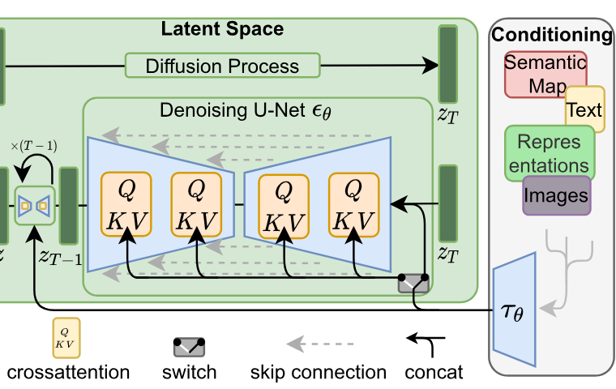

**Figure 3.** We condition LDMs either via concatenation or by a more general cross-attention mechanism. See [Section 3.3](#section-3-3)

$$
L_{LDM}:=\mathbb{E}_{\mathcal{E}(x),\epsilon\sim\mathcal{N}(0,1),t}\Big[\|\epsilon-\epsilon_{\theta}(z_{t},t)\|_{2}^{2}\Big]\,.
$$

The neural backbone $\epsilon_{\theta}(\circ,t)$ of our model is realized as a time-conditional UNet [Ron15]. Since the forward process is fixed, $z_{t}$ can be efficiently obtained from $\mathcal{E}$ during training, and samples from $p(z)$ can be decoded to image space with a single pass through $\mathcal{D}$.

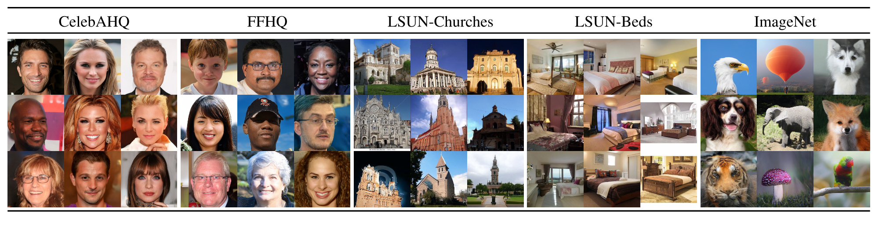

**Figure 4.** Samples from *LDMs* trained on CelebAHQ [Kar17], FFHQ [Kar19a], LSUN-Churches [Yu15a], LSUN-Bedrooms [Yu15a] and class-conditional ImageNet [Den09a], each with a resolution of $256\times 256$. Best viewed when zoomed in. For more samples *cf*. the supplement.

### 3.3 Conditioning Mechanisms

Similar to other types of generative models [Mir14, Soh15a], diffusion models are in principle capable of modeling conditional distributions of the form $p(z|y)$. This can be implemented with a conditional denoising autoencoder $\epsilon_{\theta}(z_{t},t,y)$ and paves the way to controlling the synthesis process through inputs $y$ such as text [Ree16], semantic maps [Par19c, Iso17] or other image-to-image translation tasks [Iso17a].

In the context of image synthesis, however, combining the generative power of DMs with other types of conditionings beyond class-labels [Dha21] or blurred variants of the input image [Sah21] is so far an under-explored area of research.

We turn DMs into more flexible conditional image generators by augmenting their underlying UNet backbone with the cross-attention mechanism [Vas17d], which is effective for learning attention-based models of various input modalities [Jae21, Jae21a]. To pre-process $y$ from various modalities (such as language prompts) we introduce a domain specific encoder $\tau_{\theta}$ that projects $y$ to an intermediate representation $\tau_{\theta}(y)\in\mathbb{R}^{M\times d_{\tau}}$, which is then mapped to the intermediate layers of the UNet via a cross-attention layer implementing $\text{Attention}(Q,K,V)=\text{softmax}\left(\frac{QK^{T}}{\sqrt{d}}\right)\cdot V$, with

$$
Q=W^{(i)}_{Q}\cdot\varphi_{i}(z_{t}),\;K=W^{(i)}_{K}\cdot\tau_{\theta}(y),\;V=W^{(i)}_{V}\cdot\tau_{\theta}(y).
$$

Here, $\varphi_{i}(z_{t})\in\mathbb{R}^{N\times d^{i}_{\epsilon}}$ denotes a (flattened) intermediate representation of the UNet implementing $\epsilon_{\theta}$ and $W^{(i)}_{V}\in\mathbb{R}^{d\times d^{i}_{\epsilon}}$, $W^{(i)}_{Q}\in\mathbb{R}^{d\times d_{\tau}}$ & $W^{(i)}_{K}\in\mathbb{R}^{d\times d_{\tau}}$ are learnable projection matrices [Vas17d, Jae21]. See [Figure 3](#figure-03) for a visual depiction.

Based on image-conditioning pairs, we then learn the conditional LDM via

$$
L_{LDM}:=\mathbb{E}_{\mathcal{E}(x),y,\epsilon\sim\mathcal{N}(0,1),t}\Big[\|\epsilon-\epsilon_{\theta}(z_{t},t,\tau_{\theta}(y))\|_{2}^{2}\Big]\,,
$$

where both $\tau_{\theta}$ and $\epsilon_{\theta}$ are jointly optimized via [Equation 3](#equation-03). This conditioning mechanism is flexible as $\tau_{\theta}$ can be parameterized with domain-specific experts, *e.g*. (unmasked) transformers [Vas17d] when $y$ are text prompts (see [Section 4.3.1](#section-4-3-1))

## 4 Experiments

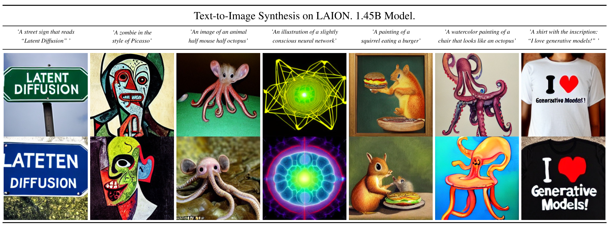

**Figure 5.** Samples for user-defined text prompts from our model for text-to-image synthesis, *LDM-8 (KL)*, which was trained on the LAION [Sch21a] database. Samples generated with 200 DDIM steps and $\eta=1.0$. We use unconditional guidance [Ho21] with $s=10.0$.

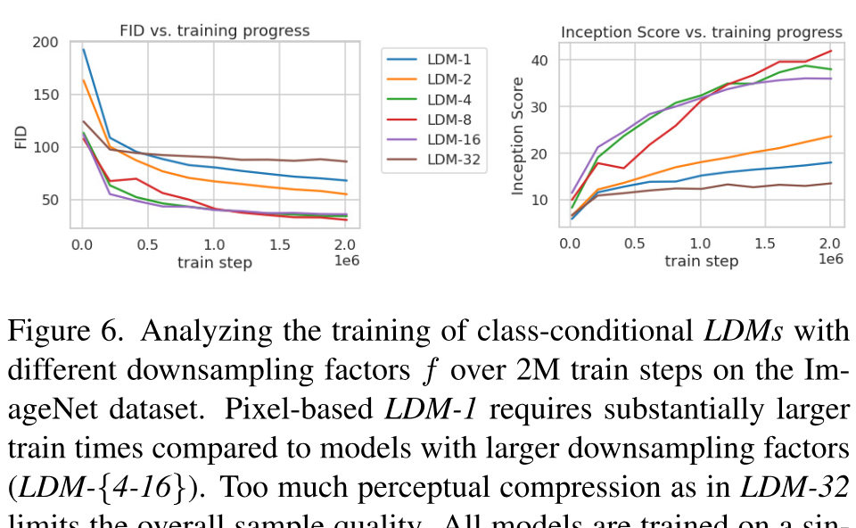

**Figure 6.** Analyzing the training of class-conditional *LDMs* with different downsampling factors $f$ over 2M train steps on the ImageNet dataset. Pixel-based *LDM-1* requires substantially larger train times compared to models with larger downsampling factors (*LDM-$\{$4-16$\}$*). Too much perceptual compression as in *LDM-32* limits the overall sample quality. All models are trained on a single NVIDIA A100 with the same computational budget. Results obtained with 100 DDIM steps [Son21a] and $\kappa=0$.

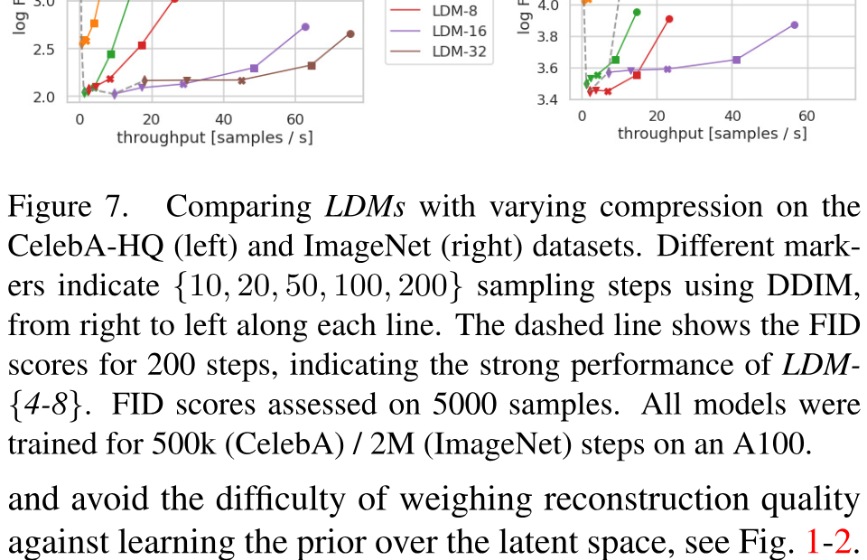

**Figure 7.** Comparing *LDMs* with varying compression on the CelebA-HQ (left) and ImageNet (right) datasets. Different markers indicate $\{10,20,50,100,200\}$ sampling steps using DDIM, from right to left along each line. The dashed line shows the FID scores for 200 steps, indicating the strong performance of *LDM-$\{$4-8$\}$*. FID scores assessed on 5000 samples. All models were trained for 500k (CelebA) / 2M (ImageNet) steps on an A100.

*LDMs* provide means to flexible and computationally tractable diffusion based image synthesis of various image modalities, which we empirically show in the following. Firstly, however, we analyze the gains of our models compared to pixel-based diffusion models in both training and inference. Interestingly, we find that *LDMs* trained in *VQ*-regularized latent spaces sometimes achieve better sample quality, even though the reconstruction capabilities of *VQ*-regularized first stage models slightly fall behind those of their continuous counterparts, *cf*. [Table 8](#table-08). A visual comparison between the effects of first stage regularization schemes on *LDM* training and their generalization abilities to resolutions $>256^{2}$ can be found in Appendix [Section 10.1](#section-10-1). In [Section 11.2](#section-11-2) we list details on architecture, implementation, training and evaluation for all results presented in this section.

### 4.1 On Perceptual Compression Tradeoffs

This section analyzes the behavior of our LDMs with different downsampling factors $f\in\{1,2,4,8,16,32\}$ (abbreviated as *LDM-*$f$, where *LDM-1* corresponds to pixel-based DMs). To obtain a comparable test-field, we fix the computational resources to a single NVIDIA A100 for all experiments in this section and train all models for the same number of steps and with the same number of parameters.

[Table 8](#table-08) shows hyperparameters and reconstruction performance of the first stage models used for the *LDMs* compared in this section. [Figure 6](#figure-06) shows sample quality as a function of training progress for 2M steps of class-conditional models on the ImageNet [Den09a] dataset. We see that, i) small downsampling factors for *LDM-*$\{$*1,2*$\}$ result in slow training progress, whereas ii) overly large values of $f$ cause stagnating fidelity after comparably few training steps. Revisiting the analysis above ([Figure 1](#figure-01) and [Figure 2](#figure-02)) we attribute this to i) leaving most of perceptual compression to the diffusion model and ii) too strong first stage compression resulting in information loss and thus limiting the achievable quality. *LDM-$\{$4-16$\}$* strike a good balance between efficiency and perceptually faithful results, which manifests in a significant FID [Heu17] gap of 38 between pixel-based diffusion (*LDM-1*) and *LDM-8* after 2M training steps.

In [Figure 7](#figure-07), we compare models trained on CelebA-HQ [Kar17] and ImageNet in terms sampling speed for different numbers of denoising steps with the DDIM sampler [Son21a] and plot it against FID-scores [Heu17]. *LDM-$\{$4-8$\}$* outperform models with unsuitable ratios of perceptual and conceptual compression. Especially compared to pixel-based *LDM-1*, they achieve much lower FID scores while simultaneously significantly increasing sample throughput. Complex datasets such as ImageNet require reduced compression rates to avoid reducing quality. In summary, *LDM-4* and *-8* offer the best conditions for achieving high-quality synthesis results.

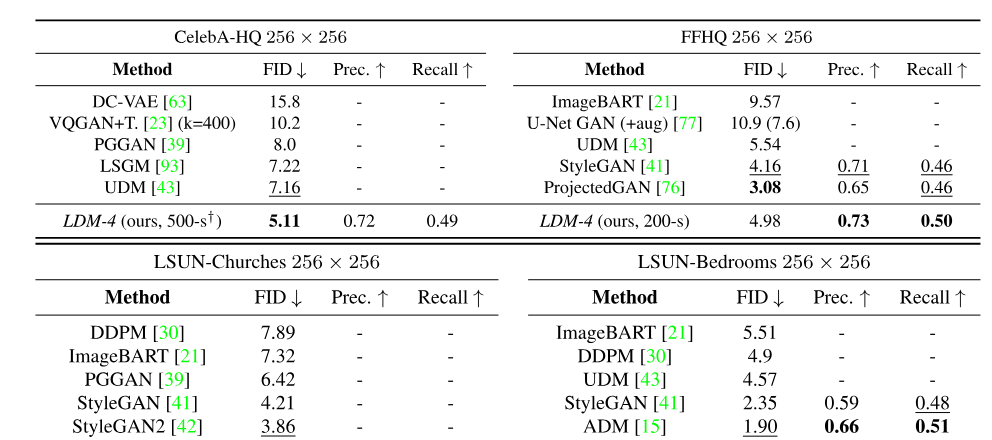

**Table 1.** Evaluation metrics for unconditional image synthesis. CelebA-HQ results reproduced from [Par21, Xia21a, Kim21a], FFHQ from [Kar20b, Kim21a]. ^†: $N$-s refers to $N$ sampling steps with the DDIM [Son21a] sampler. ^∗: trained in *KL*-regularized latent space. Additional results can be found in the supplementary.

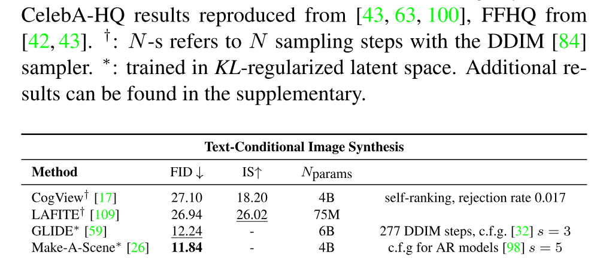

**Table 2.** Evaluation of text-conditional image synthesis on the $256\times 256$-sized MS-COCO [Lin14a] dataset: with 250 DDIM [Son21a] steps our model is on par with the most recent diffusion [Nic22] and autoregressive [Gaf22] methods despite using significantly less parameters. ^†/^∗:Numbers from [Zho21a]/ [Gaf22]

### 4.2 Image Generation with Latent Diffusion

We train unconditional models of $256^{2}$ images on CelebA-HQ [Kar17], FFHQ [Kar19a], LSUN-Churches and -Bedrooms [Yu15a] and evaluate the i) sample quality and ii) their coverage of the data manifold using ii) FID [Heu17] and ii) Precision-and-Recall [Kyn19]. [Table 1](#table-01) summarizes our results. On CelebA-HQ, we report a new state-of-the-art FID of $5.11$, outperforming previous likelihood-based models as well as GANs. We also outperform LSGM [Vah21] where a latent diffusion model is trained jointly together with the first stage. In contrast, we train diffusion models in a fixed space and avoid the difficulty of weighing reconstruction quality against learning the prior over the latent space, see [Figure 1](#figure-01)-[Figure 2](#figure-02).

We outperform prior diffusion based approaches on all but the LSUN-Bedrooms dataset, where our score is close to ADM [Dha21], despite utilizing half its parameters and requiring 4-times less train resources (see Appendix [Section 11.3.5](#section-11-3-5)). Moreover, *LDMs* consistently improve upon GAN-based methods in Precision and Recall, thus confirming the advantages of their mode-covering likelihood-based training objective over adversarial approaches. In [Figure 4](#figure-04) we also show qualitative results on each dataset.

### 4.3 Conditional Latent Diffusion

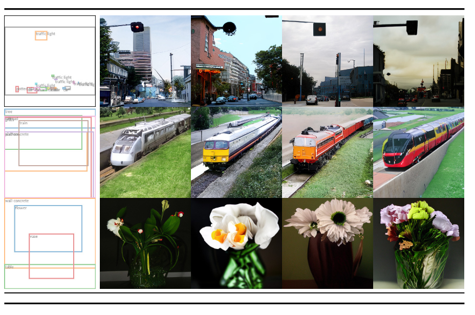

**Figure 8.** Layout-to-image synthesis with an *LDM* on COCO [Cae18], see [Section 4.3.1](#section-4-3-1). Quantitative evaluation in the supplement [Section 10.3](#section-10-3).

#### 4.3.1 Transformer Encoders for LDMs

By introducing cross-attention based conditioning into LDMs we open them up for various conditioning modalities previously unexplored for diffusion models. For text-to-image image modeling, we train a 1.45B parameter *KL*-regularized *LDM* conditioned on language prompts on LAION-400M [Sch21a]. We employ the BERT-tokenizer [Dev18] and implement $\tau_{\theta}$ as a transformer [Vas17d] to infer a latent code which is mapped into the UNet via (multi-head) cross-attention ([Section 3.3](#section-3-3)). This combination of domain specific experts for learning a language representation and visual synthesis results in a powerful model, which generalizes well to complex, user-defined text prompts, *cf*. [Figure 8](#figure-08) and [Figure 5](#figure-05). For quantitative analysis, we follow prior work and evaluate text-to-image generation on the MS-COCO [Lin14a] validation set, where our model improves upon powerful AR [Ram21, Din21] and GAN-based [Zho21a] methods, *cf*. [Table 2](#table-02). We note that applying classifier-free diffusion guidance [Ho21] greatly boosts sample quality, such that the guided *LDM-KL-8-G* is on par with the recent state-of-the-art AR [Gaf22] and diffusion models [Nic22] for text-to-image synthesis, while substantially reducing parameter count. To further analyze the flexibility of the cross-attention based conditioning mechanism we also train models to synthesize images based on semantic layouts on OpenImages [Kuz18], and finetune on COCO [Cae18], see [Figure 8](#figure-08). See [Section 10.3](#section-10-3) for the quantitative evaluation and implementation details.

Lastly, following prior work [Dha21, Bro19, Ess20a, Ess21], we evaluate our best-performing class-conditional ImageNet models with $f\in\{4,8\}$ from [Section 4.1](#section-4-1) in [Table 3](#table-03), [Figure 4](#figure-04) and [Section 10.4](#section-10-4). Here we outperform the state of the art diffusion model ADM [Dha21] while significantly reducing computational requirements and parameter count, *cf*. [Table 18](#table-18).

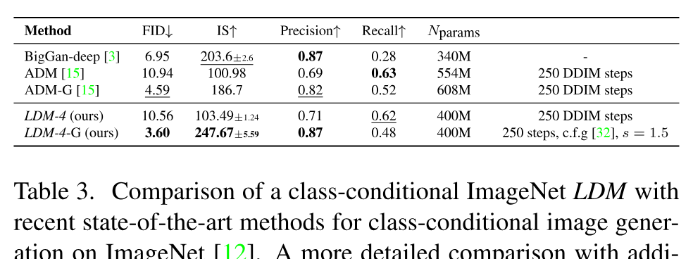

**Table 3.** Comparison of a class-conditional ImageNet *LDM* with recent state-of-the-art methods for class-conditional image generation on ImageNet [Den09a]. A more detailed comparison with additional baselines can be found in [Section 10.4](#section-10-4), [Table 10](#table-10) and [Section 12](#section-12). *c.f.g.* denotes classifier-free guidance with a scale $s$ as proposed in [Ho21].

#### 4.3.2 Convolutional Sampling Beyond $256^{2}$

By concatenating spatially aligned conditioning information to the input of $\epsilon_{\theta}$, *LDMs* can serve as efficient general-purpose image-to-image translation models. We use this to train models for semantic synthesis, super-resolution ([Section 4.4](#section-4-4)) and inpainting ([Section 4.5](#section-4-5)). For semantic synthesis, we use images of landscapes paired with semantic maps [Par19c, Ess20a] and concatenate downsampled versions of the semantic maps with the latent image representation of a $f=4$ model (VQ-reg., see [Table 8](#table-08)). We train on an input resolution of $256^{2}$ (crops from $384^{2}$) but find that our model generalizes to larger resolutions and can generate images up to the megapixel regime when evaluated in a convolutional manner (see [Figure 9](#figure-09)). We exploit this behavior to also apply the super-resolution models in [Section 4.4](#section-4-4) and the inpainting models in [Section 4.5](#section-4-5) to generate large images between $512^{2}$ and $1024^{2}$. For this application, the signal-to-noise ratio (induced by the scale of the latent space) significantly affects the results. In [Section 10.1](#section-10-1) we illustrate this when learning an LDM on (i) the latent space as provided by a $f=4$ model (KL-reg., see [Table 8](#table-08)), and (ii) a rescaled version, scaled by the component-wise standard deviation.

The latter, in combination with classifier-free guidance [Ho21], also enables the direct synthesis of $>256^{2}$ images for the text-conditional *LDM-KL-8-G* as in [Figure 13](#figure-13).

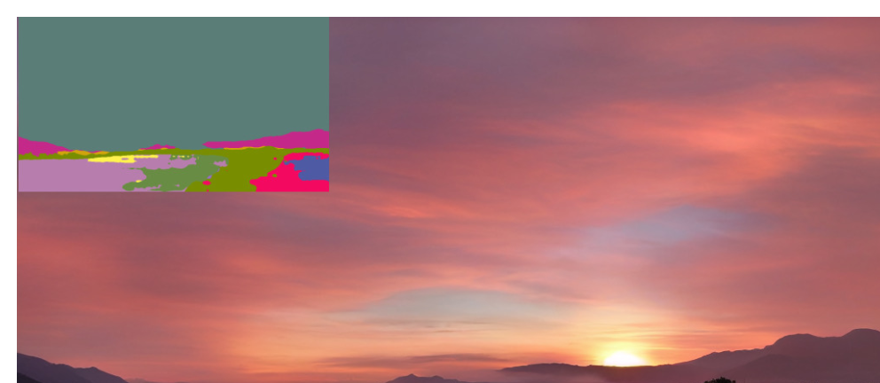

**Figure 9.** A *LDM* trained on $256^{2}$ resolution can generalize to larger resolution (here: $512\times 1024$) for spatially conditioned tasks such as semantic synthesis of landscape images. See [Section 4.3.2](#section-4-3-2).

### 4.4 Super-Resolution with Latent Diffusion

LDMs can be efficiently trained for super-resolution by diretly conditioning on low-resolution images via concatenation (*cf*. [Section 3.3](#section-3-3)). In a first experiment, we follow SR3 [Sah21] and fix the image degradation to a bicubic interpolation with $4\times$-downsampling and train on ImageNet following SR3’s data processing pipeline. We use the $f=4$ autoencoding model pretrained on OpenImages (VQ-reg., *cf*. [Table 8](#table-08)) and concatenate the low-resolution conditioning $y$ and the inputs to the UNet, *i.e*. $\tau_{\theta}$ is the identity. Our qualitative and quantitative results (see [Figure 10](#figure-10) and [Table 5](#table-05)) show competitive performance and LDM-SR outperforms SR3 in FID while SR3 has a better IS. A simple image regression model achieves the highest PSNR and SSIM scores; however these metrics do not align well with human perception [Zha18d] and favor blurriness over imperfectly aligned high frequency details [Sah21]. Further, we conduct a user study comparing the pixel-baseline with LDM-SR. We follow SR3 [Sah21] where human subjects were shown a low-res image in between two high-res images and asked for preference. The results in [Table 4](#table-04) affirm the good performance of LDM-SR. PSNR and SSIM can be pushed by using a post-hoc guiding mechanism [Dha21] and we implement this *image-based guider* via a perceptual loss, see [Section 10.6](#section-10-6).

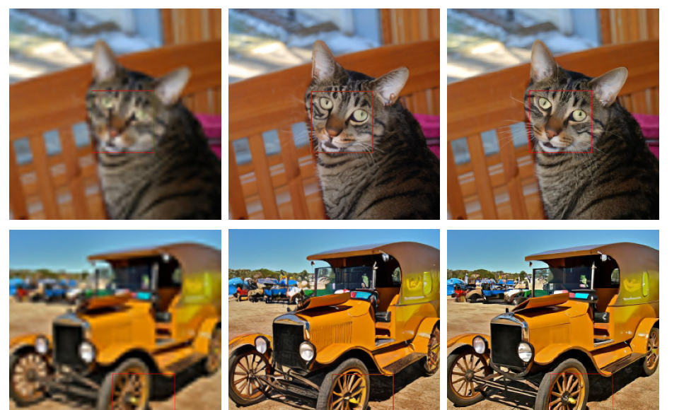

**Figure 10.** ImageNet 64$\rightarrow$256 super-resolution on ImageNet-Val. *LDM-SR* has advantages at rendering realistic textures but SR3 can synthesize more coherent fine structures. See appendix for additional samples and cropouts. SR3 results from [Sah21].

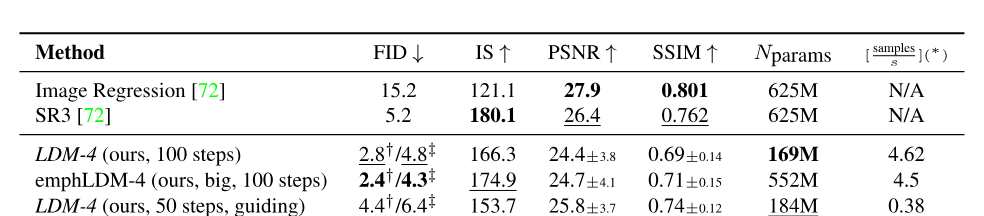

**Table 4.** Task 1: Subjects were shown ground truth and generated image and asked for preference. Task 2: Subjects had to decide between two generated images. More details in [Section 11.3.6](#section-11-3-6)

Since the bicubic degradation process does not generalize well to images which do not follow this pre-processing, we also train a generic model, *LDM-BSR*, by using more diverse degradation. The results are shown in [Section 10.6.1](#section-10-6-1).

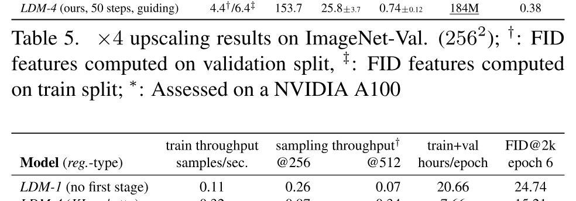

**Table 5.** $\times 4$ upscaling results on ImageNet-Val. ($256^{2}$); ^†: FID features computed on validation split, ^‡: FID features computed on train split; ^∗: Assessed on a NVIDIA A100

### 4.5 Inpainting with Latent Diffusion

Inpainting is the task of filling masked regions of an image with new content either because parts of the image are are corrupted or to replace existing but undesired content within the image. We evaluate how our general approach for conditional image generation compares to more specialized, state-of-the-art approaches for this task. Our evaluation follows the protocol of LaMa [Suv21], a recent inpainting model that introduces a specialized architecture relying on Fast Fourier Convolutions [Chi20a]. The exact training & evaluation protocol on Places [Zho18a] is described in [Section 11.2.2](#section-11-2-2).

We first analyze the effect of different design choices for the first stage.

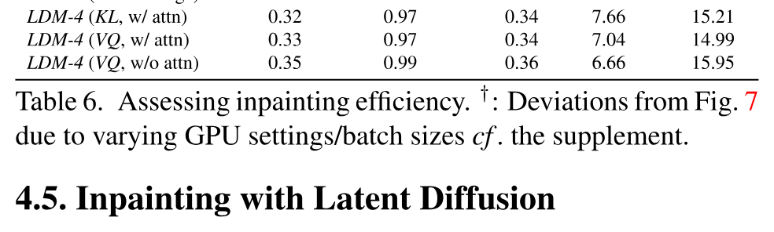

**Table 6.** Assessing inpainting efficiency. ^†: Deviations from [Figure 7](#figure-07) due to varying GPU settings/batch sizes *cf*. the supplement.

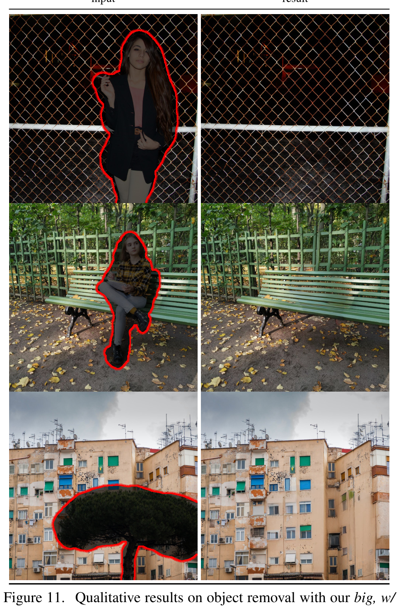

**Figure 11.** Qualitative results on object removal with our *big, w/ ft* inpainting model. For more results, see [Figure 22](#figure-22).

In particular, we compare the inpainting efficiency of *LDM-1* (*i.e*. a pixel-based conditional DM) with *LDM-4*, for both *KL* and *VQ* regularizations, as well as *VQ-LDM-4* without any attention in the first stage (see [Table 8](#table-08)), where the latter reduces GPU memory for decoding at high resolutions. For comparability, we fix the number of parameters for all models. [Table 6](#table-06) reports the training and sampling throughput at resolution $256^{2}$ and $512^{2}$, the total training time in hours per epoch and the FID score on the validation split after six epochs. Overall, we observe a speed-up of at least $2.7\times$ between pixel- and latent-based diffusion models while improving FID scores by a factor of at least $1.6\times$.

The comparison with other inpainting approaches in [Table 7](#table-07) shows that our model with attention improves the overall image quality as measured by FID over that of [Suv21]. LPIPS between the unmasked images and our samples is slightly higher than that of [Suv21]. We attribute this to [Suv21] only producing a single result which tends to recover more of an average image compared to the diverse results produced by our LDM *cf*. [Figure 21](#figure-21). Additionally in a user study ([Table 4](#table-04)) human subjects favor our results over those of [Suv21].

Based on these initial results, we also trained a larger diffusion model (*big* in [Table 7](#table-07)) in the latent space of the *VQ*-regularized first stage without attention. Following [Dha21], the UNet of this diffusion model uses attention layers on three levels of its feature hierarchy, the BigGAN [Bro19] residual block for up- and downsampling and has 387M parameters instead of 215M. After training, we noticed a discrepancy in the quality of samples produced at resolutions $256^{2}$ and $512^{2}$, which we hypothesize to be caused by the additional attention modules. However, fine-tuning the model for half an epoch at resolution $512^{2}$ allows the model to adjust to the new feature statistics and sets a new state of the art FID on image inpainting (*big, w/o attn, w/ ft* in [Table 7](#table-07), [Figure 11](#figure-11).).

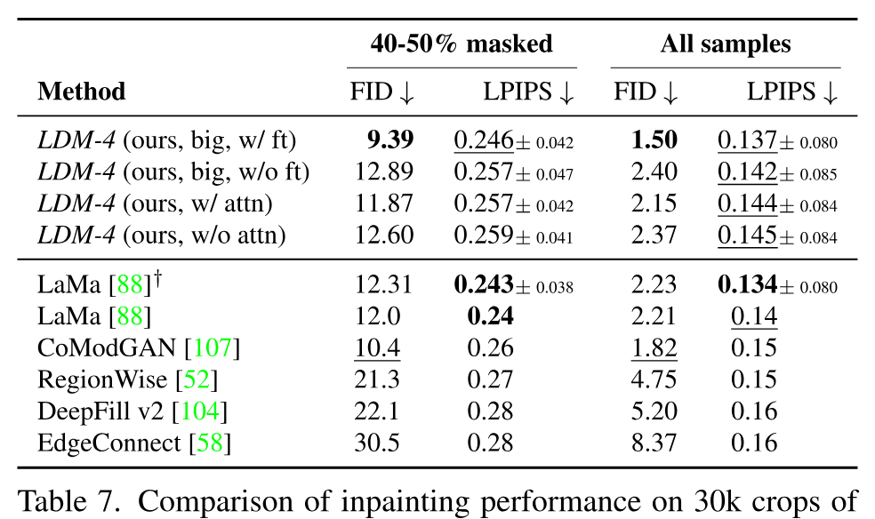

**Table 7.** Comparison of inpainting performance on 30k crops of size $512\times 512$ from test images of Places[Zho18a]. The column *40-50%* reports metrics computed over hard examples where 40-50% of the image region have to be inpainted. ^†recomputed on our test set, since the original test set used in [Suv21] was not available.

## 5 Limitations & Societal Impact

**Limitations.** While LDMs significantly reduce computational requirements compared to pixel-based approaches, their sequential sampling process is still slower than that of GANs. Moreover, the use of LDMs can be questionable when high precision is required: although the loss of image quality is very small in our $f=4$ autoencoding models (see [Figure 1](#figure-01)), their reconstruction capability can become a bottleneck for tasks that require fine-grained accuracy in pixel space. We assume that our superresolution models ([Section 4.4](#section-4-4)) are already somewhat limited in this respect.

**Societal Impact.** Generative models for media like imagery are a double-edged sword: On the one hand, they enable various creative applications, and in particular approaches like ours that reduce the cost of training and inference have the potential to facilitate access to this technology and democratize its exploration. On the other hand, it also means that it becomes easier to create and disseminate manipulated data or spread misinformation and spam. In particular, the deliberate manipulation of images (“deep fakes”) is a common problem in this context, and women in particular are disproportionately affected by it [Den21, Fra18a].

Generative models can also reveal their training data [Car21, Tin21], which is of great concern when the data contain sensitive or personal information and were collected without explicit consent. However, the extent to which this also applies to DMs of images is not yet fully understood.

Finally, deep learning modules tend to reproduce or exacerbate biases that are already present in the data [Efr11, Jai20b, Ess20]. While diffusion models achieve better coverage of the data distribution than *e.g*. GAN-based approaches, the extent to which our two-stage approach that combines adversarial training and a likelihood-based objective misrepresents the data remains an important research question.

For a more general, detailed discussion of the ethical considerations of deep generative models, see *e.g*. [Den21].

## 6 Conclusion

We have presented latent diffusion models, a simple and efficient way to significantly improve both the training and sampling efficiency of denoising diffusion models without degrading their quality. Based on this and our cross-attention conditioning mechanism, our experiments could demonstrate favorable results compared to state-of-the-art methods across a wide range of conditional image synthesis tasks without task-specific architectures. [+ack] This work has been supported by the German Federal Ministry for Economic Affairs and Energy within the project ’KI-Absicherung - Safe AI for automated driving’ and by the German Research Foundation (DFG) project 421703927.

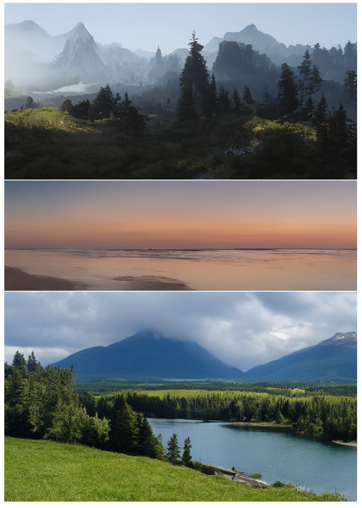

**Figure 12.** Convolutional samples from the semantic landscapes model as in [Section 4.3.2](#section-4-3-2), finetuned on $512^{2}$ images.

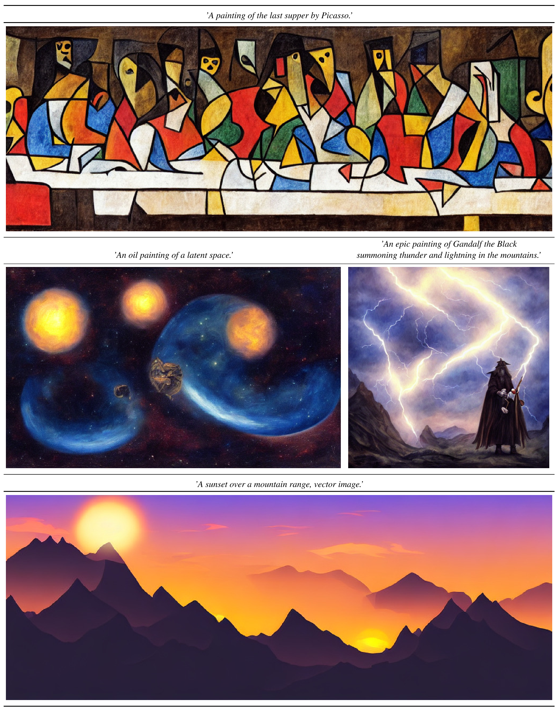

**Figure 13.** Combining classifier free diffusion guidance with the convolutional sampling strategy from [Section 4.3.2](#section-4-3-2), our 1.45B parameter text-to-image model can be used for rendering images larger than the native $256^{2}$ resolution the model was trained on.

## 7 Changelog

Here we list changes between this version (https://arxiv.org/abs/2112.10752v2) of the paper and the previous version, *i.e*. https://arxiv.org/abs/2112.10752v1.

- • We updated the results on text-to-image synthesis in [Section 4.3](#section-4-3) which were obtained by training a new, larger model (1.45B parameters). This also includes a new comparison to very recent competing methods on this task that were published on arXiv at the same time as ([Nic22, Zho21a]) or after ([Gaf22]) the publication of our work.
- • We updated results on class-conditional synthesis on ImageNet in [Section 4.1](#section-4-1), [Table 3](#table-03) (see also [Section 10.4](#section-10-4)) obtained by retraining the model with a larger batch size. The corresponding qualitative results in [Figure 26](#figure-26) and [Figure 27](#figure-27) were also updated. Both the updated text-to-image and the class-conditional model now use classifier-free guidance [Ho21] as a measure to increase visual fidelity.
- • We conducted a user study (following the scheme suggested by Saharia et al [Sah21]) which provides additional evaluation for our inpainting ([Section 4.5](#section-4-5)) and superresolution models ([Section 4.4](#section-4-4)).
- • Added [Figure 5](#figure-05) to the main paper, moved [Figure 18](#figure-18) to the appendix, added [Figure 13](#figure-13) to the appendix.

## 8 Detailed Information on Denoising Diffusion Models

Diffusion models can be specified in terms of a signal-to-noise ratio $\text{SNR}(t)=\frac{\alpha_{t}^{2}}{\sigma_{t}^{2}}$ consisting of sequences $(\alpha_{t})_{t=1}^{T}$ and $(\sigma_{t})_{t=1}^{T}$ which, starting from a data sample $x_{0}$, define a forward diffusion process $q$ as

$$
q(x_{t}|x_{0})=\mathcal{N}(x_{t}|\alpha_{t}x_{0},\sigma_{t}^{2}\mathbb{I})
$$

with the Markov structure for $s<t$:

$$
\displaystyle q(x_{t}|x_{s})
$$

Denoising diffusion models are generative models $p(x_{0})$ which revert this process with a similar Markov structure running backward in time, *i.e*. they are specified as

$$
p(x_{0})=\int_{z}p(x_{T})\prod_{t=1}^{T}p(x_{t-1}|x_{t})
$$

The evidence lower bound (ELBO) associated with this model then decomposes over the discrete time steps as

$$
-\log p(x_{0})\leq\mathbb{KL}(q(x_{T}|x_{0})|p(x_{T}))+\sum_{t=1}^{T}\mathbb{E}_{q(x_{t}|x_{0})}\mathbb{KL}(q(x_{t-1}|x_{t},x_{0})|p(x_{t-1}|x_{t}))
$$

The prior $p(x_{T})$ is typically choosen as a standard normal distribution and the first term of the ELBO then depends only on the final signal-to-noise ratio $\text{SNR}(T)$. To minimize the remaining terms, a common choice to parameterize $p(x_{t-1}|x_{t})$ is to specify it in terms of the true posterior $q(x_{t-1}|x_{t},x_{0})$ but with the unknown $x_{0}$ replaced by an estimate $x_{\theta}(x_{t},t)$ based on the current step $x_{t}$. This gives [Kin21]

$$
\displaystyle p(x_{t-1}|x_{t})
$$

where the mean can be expressed as

$$
\mu_{\theta}(x_{t},t)=\frac{\alpha_{t|t-1}\sigma_{t-1}^{2}}{\sigma_{t}^{2}}x_{t}+\frac{\alpha_{t-1}\sigma_{t|t-1}^{2}}{\sigma_{t}^{2}}x_{\theta}(x_{t},t).
$$

In this case, the sum of the ELBO simplify to

$$
\sum_{t=1}^{T}\mathbb{E}_{q(x_{t}|x_{0})}\mathbb{KL}(q(x_{t-1}|x_{t},x_{0})|p(x_{t-1})=\sum_{t=1}^{T}\mathbb{E}_{\mathcal{N}(\epsilon|0,\mathbb{I})}\frac{1}{2}(\text{SNR}(t-1)-\text{SNR}(t))\|x_{0}-x_{\theta}(\alpha_{t}x_{0}+\sigma_{t}\epsilon,t)\|^{2}
$$

Following [Ho20a], we use the reparameterization

$$
\epsilon_{\theta}(x_{t},t)=(x_{t}-\alpha_{t}x_{\theta}(x_{t},t))/\sigma_{t}
$$

to express the reconstruction term as a denoising objective,

$$
\|x_{0}-x_{\theta}(\alpha_{t}x_{0}+\sigma_{t}\epsilon,t)\|^{2}=\frac{\sigma_{t}^{2}}{\alpha_{t}^{2}}\|\epsilon-\epsilon_{\theta}(\alpha_{t}x_{0}+\sigma_{t}\epsilon,t)\|^{2}
$$

and the reweighting, which assigns each of the terms the same weight and results in [Equation 1](#equation-01).

## 9 Image Guiding Mechanisms

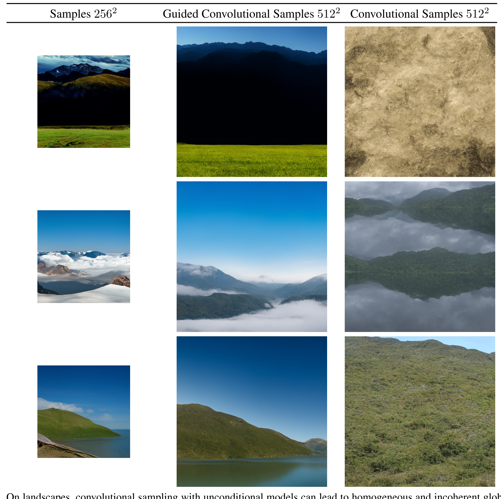

**Figure 14.** On landscapes, convolutional sampling with unconditional models can lead to homogeneous and incoherent global structures (see column 2). $L_{2}$-guiding with a low resolution image can help to reestablish coherent global structures.

An intriguing feature of diffusion models is that unconditional models can be conditioned at test-time [Son20, Soh15, Dha21]. In particular, [Dha21] presented an algorithm to guide both unconditional and conditional models trained on the ImageNet dataset with a classifier $\log p_{\Phi}(y|x_{t})$, trained on each $x_{t}$ of the diffusion process. We directly build on this formulation and introduce post-hoc *image-guiding*:

For an epsilon-parameterized model with fixed variance, the guiding algorithm as introduced in [Dha21] reads:

$$
\hat{\epsilon}\leftarrow\epsilon_{\theta}(z_{t},t)+\sqrt{1-\alpha_{t}^{2}}\;\nabla_{z_{t}}\log p_{\Phi}(y|z_{t})\;.
$$

This can be interpreted as an update correcting the “score” $\epsilon_{\theta}$ with a conditional distribution $\log p_{\Phi}(y|z_{t})$.

So far, this scenario has only been applied to single-class classification models. We re-interpret the guiding distribution $p_{\Phi}(y|T(\mathcal{D}(z_{0}(z_{t}))))$ as a general purpose image-to-image translation task given a target image $y$, where $T$ can be any differentiable transformation adopted to the image-to-image translation task at hand, such as the identity, a downsampling operation or similar.  As an example, we can assume a Gaussian guider with fixed variance $\sigma^{2}=1$, such that

$$
\log p_{\Phi}(y|z_{t})=-\frac{1}{2}\|y-T(\mathcal{D}(z_{0}(z_{t})))\|^{2}_{2}
$$

becomes a $L_{2}$ regression objective.

[Figure 14](#figure-14) demonstrates how this formulation can serve as an upsampling mechanism of an unconditional model trained on $256^{2}$ images, where unconditional samples of size $256^{2}$ guide the convolutional synthesis of $512^{2}$ images and $T$ is a $2\times$ bicubic downsampling. Following this motivation, we also experiment with a perceptual similarity guiding and replace the $L_{2}$ objective with the LPIPS [Zha18d] metric, see [Section 4.4](#section-4-4).

## 10 Additional Results

### 10.1 Choosing the Signal-to-Noise Ratio for High-Resolution Synthesis

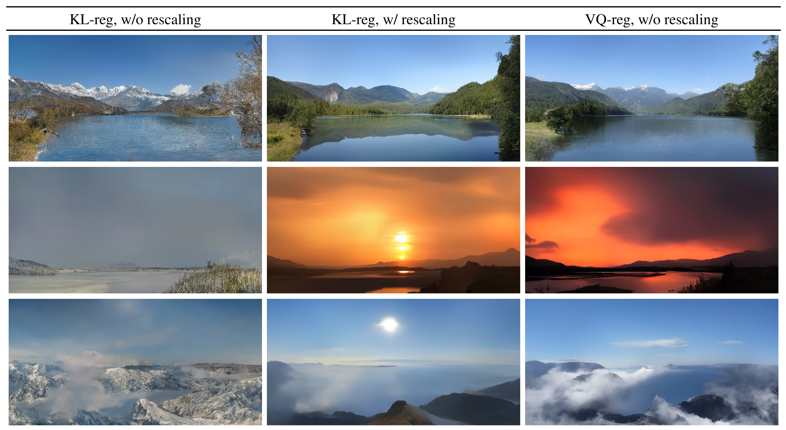

**Figure 15.** Illustrating the effect of latent space rescaling on convolutional sampling, here for semantic image synthesis on landscapes. See [Section 4.3.2](#section-4-3-2) and [Section 10.1](#section-10-1).

As discussed in [Section 4.3.2](#section-4-3-2), the signal-to-noise ratio induced by the variance of the latent space (*i.e*. $\text{Var(z)}/\sigma^{2}_{t}$) significantly affects the results for convolutional sampling. For example, when training a LDM directly in the latent space of a KL-regularized model (see [Table 8](#table-08)), this ratio is very high, such that the model allocates a lot of semantic detail early on in the reverse denoising process. In contrast, when rescaling the latent space by the component-wise standard deviation of the latents as described in [Section 13](#section-13), the SNR is descreased. We illustrate the effect on convolutional sampling for semantic image synthesis in [Figure 15](#figure-15). Note that the VQ-regularized space has a variance close to $1$, such that it does not have to be rescaled.

### 10.2 Full List of all First Stage Models

We provide a complete list of various autoenconding models trained on the OpenImages dataset in [Table 8](#table-08).

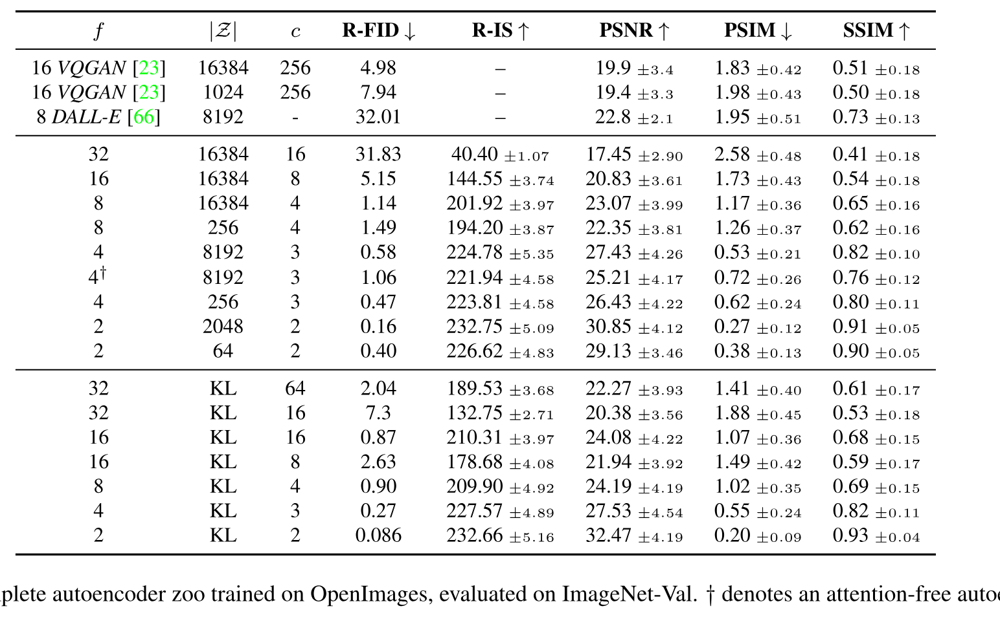

**Table 8.** Complete autoencoder zoo trained on OpenImages, evaluated on ImageNet-Val. $\dagger$ denotes an attention-free autoencoder.

### 10.3 Layout-to-Image Synthesis

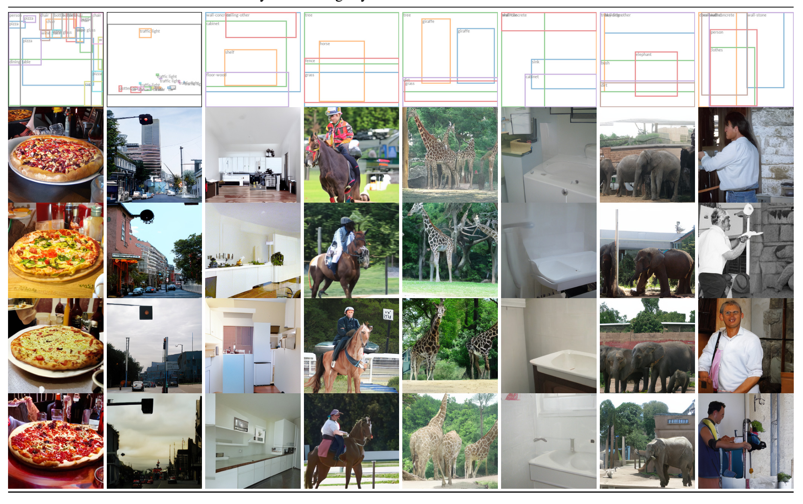

**Figure 16.** More samples from our best model for layout-to-image synthesis, *LDM-4*, which was trained on the OpenImages dataset and finetuned on the COCO dataset. Samples generated with 100 DDIM steps and $\eta=0$. Layouts are from the COCO validation set.

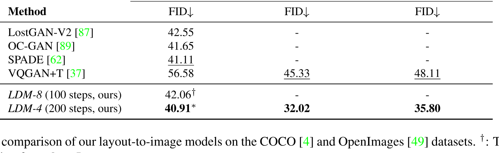

**Table 9.** Quantitative comparison of our layout-to-image models on the COCO [Cae18] and OpenImages [Kuz18] datasets. ^†: Training from scratch on COCO; ^∗: Finetuning from OpenImages.

Here we provide the quantitative evaluation and additional samples for our layout-to-image models from [Section 4.3.1](#section-4-3-1). We train a model on the COCO [Cae18] and one on the OpenImages [Kuz18] dataset, which we subsequently additionally finetune on COCO. [Table 9](#table-09) shows the result. Our COCO model reaches the performance of recent state-of-the-art models in layout-to-image synthesis, when following their training and evaluation protocol [Syl21]. When finetuning from the OpenImages model, we surpass these works. Our OpenImages model surpasses the results of Jahn et al [Jah21] by a margin of nearly 11 in terms of FID. In [Figure 16](#figure-16) we show additional samples of the model finetuned on COCO.

### 10.4 Class-Conditional Image Synthesis on ImageNet

[Table 10](#table-10) contains the results for our class-conditional LDM measured in FID and Inception score (IS). LDM-8 requires significantly fewer parameters and compute requirements (see [Table 18](#table-18)) to achieve very competitive performance. Similar to previous work, we can further boost the performance by training a classifier on each noise scale and guiding with it, see [Section 9](#section-9). Unlike the pixel-based methods, this classifier is trained very cheaply in latent space. For additional qualitative results, see [Figure 26](#figure-26) and [Figure 27](#figure-27).

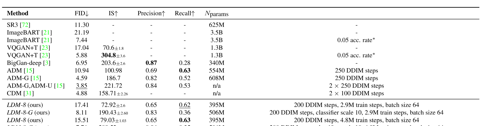

**Table 10.** Comparison of a class-conditional ImageNet *LDM* with recent state-of-the-art methods for class-conditional image generation on the ImageNet [Den09a] dataset.^∗: Classifier rejection sampling with the given rejection rate as proposed in [Raz19].

### 10.5 Sample Quality vs. V100 Days (Continued from Sec. 4.1)

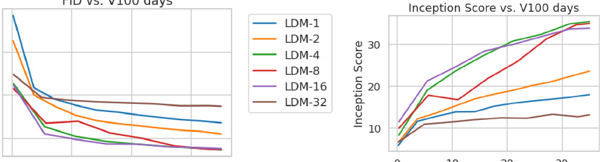

**Figure 17.** For completeness we also report the training progress of class-conditional *LDMs* on the ImageNet dataset for a fixed number of 35 V100 days. Results obtained with 100 DDIM steps [Son21a] and $\kappa=0$. FIDs computed on 5000 samples for efficiency reasons.

For the assessment of sample quality over the training progress in [Section 4.1](#section-4-1), we reported FID and IS scores as a function of train steps. Another possibility is to report these metrics over the used resources in V100 days. Such an analysis is additionally provided in [Figure 17](#figure-17), showing qualitatively similar results.

### 10.6 Super-Resolution

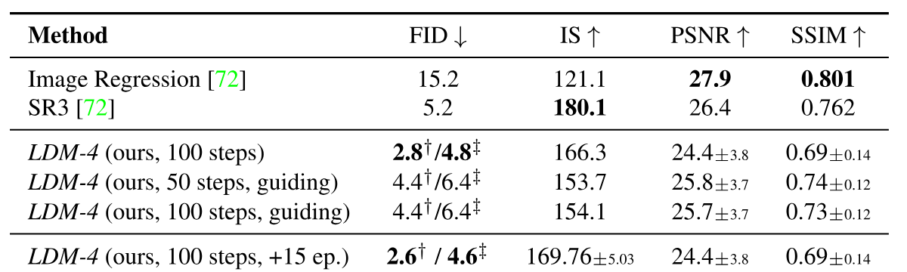

**Table 11.** $\times 4$ upscaling results on ImageNet-Val. ($256^{2}$); ^†: FID features computed on validation split, ^‡: FID features computed on train split. We also include a pixel-space baseline that receives the same amount of compute as *LDM-4*. The last two rows received 15 epochs of additional training compared to the former results.

For better comparability between LDMs and diffusion models in pixel space, we extend our analysis from [Table 5](#table-05) by comparing a diffusion model trained for the same number of steps and with a comparable number [+1] of parameters to our LDM. The results of this comparison are shown in the last two rows of [Table 11](#table-11) and demonstrate that LDM achieves better performance while allowing for significantly faster sampling. A qualitative comparison is given in [Figure 20](#figure-20) which shows random samples from both LDM and the diffusion model in pixel space.

#### 10.6.1 LDM-BSR: General Purpose SR Model via Diverse Image Degradation

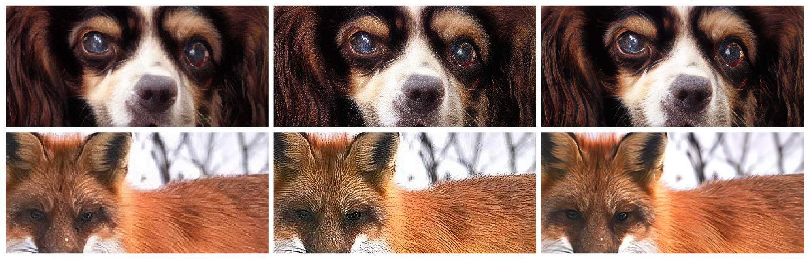

**Figure 18.** *LDM-BSR* generalizes to arbitrary inputs and can be used as a general-purpose upsampler, upscaling samples from a class-conditional *LDM* (image *cf*. [Figure 4](#figure-04)) to $1024^{2}$ resolution. In contrast, using a fixed degradation process (see [Section 4.4](#section-4-4)) hinders generalization.

To evaluate generalization of our LDM-SR, we apply it both on synthetic LDM samples from a class-conditional ImageNet model ([Section 4.1](#section-4-1)) and images crawled from the internet. Interestingly, we observe that LDM-SR, trained only with a bicubicly downsampled conditioning as in [Sah21], does not generalize well to images which do not follow this pre-processing. Hence, to obtain a superresolution model for a wide range of real world images, which can contain complex superpositions of camera noise, compression artifacts, blurr and interpolations, we replace the bicubic downsampling operation in LDM-SR with the degration pipeline from [Zha21p]. The BSR-degradation process is a degradation pipline which applies JPEG compressions noise, camera sensor noise, different image interpolations for downsampling, Gaussian blur kernels and Gaussian noise in a random order to an image. We found that using the bsr-degredation process with the original parameters as in [Zha21p] leads to a very strong degradation process. Since a more moderate degradation process seemed apppropiate for our application, we adapted the parameters of the bsr-degradation (our adapted degradation process can be found in our code base at https://github.com/CompVis/latent-diffusion). [Figure 18](#figure-18) illustrates the effectiveness of this approach by directly comparing *LDM-SR* with *LDM-BSR*. The latter produces images much sharper than the models confined to a fixed pre-processing, making it suitable for real-world applications. Further results of *LDM-BSR* are shown on LSUN-cows in [Figure 19](#figure-19).

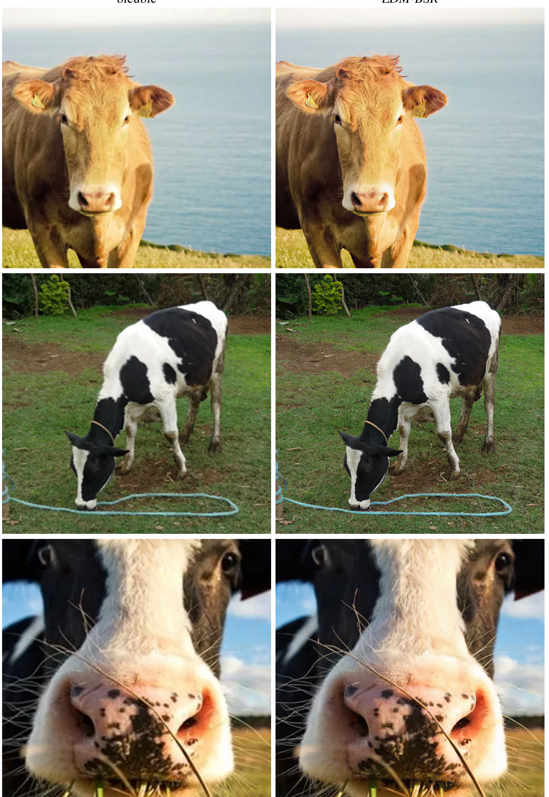

**Figure 19.** *LDM-BSR* generalizes to arbitrary inputs and can be used as a general-purpose upsampler, upscaling samples from the LSUN-Cows dataset to $1024^{2}$ resolution.

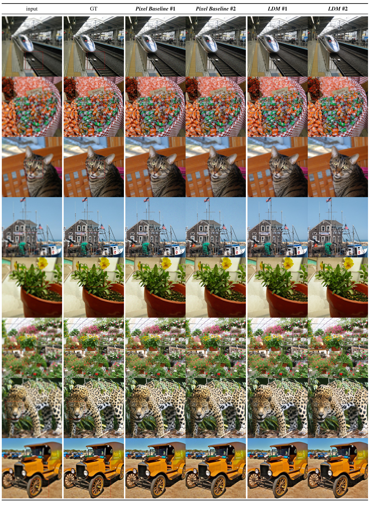

**Figure 20.** Qualitative superresolution comparison of two random samples between LDM-SR and baseline-diffusionmodel in Pixelspace. Evaluated on imagenet validation-set after same amount of training steps.

## 11 Implementation Details and Hyperparameters

### 11.1 Hyperparameters

We provide an overview of the hyperparameters of all trained *LDM* models in [Table 12](#table-12), [Table 13](#table-13), [Table 14](#table-14) and [Table 15](#table-15).

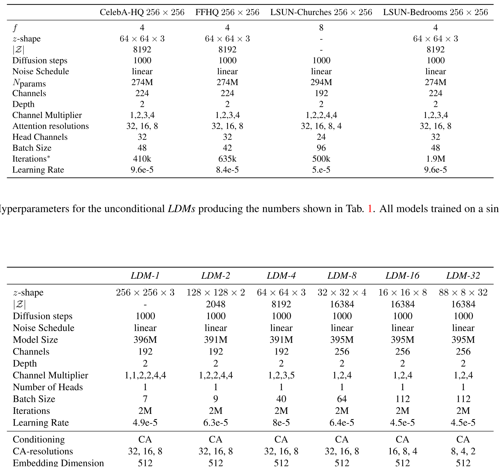

**Table 12.** Hyperparameters for the unconditional *LDMs* producing the numbers shown in [Table 1](#table-01). All models trained on a single NVIDIA A100.

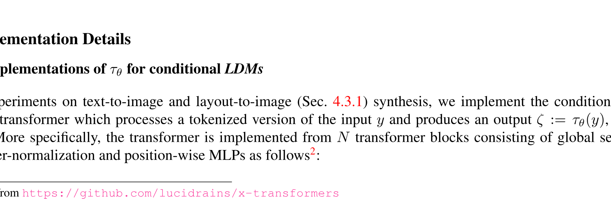

**Table 13.** Hyperparameters for the conditional *LDMs* trained on the ImageNet dataset for the analysis in [Section 4.1](#section-4-1). All models trained on a single NVIDIA A100.

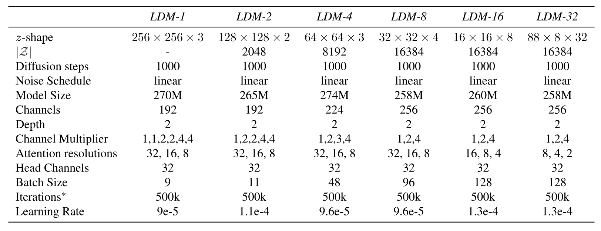

**Table 14.** Hyperparameters for the unconditional *LDMs* trained on the CelebA dataset for the analysis in [Figure 7](#figure-07). All models trained on a single NVIDIA A100. ^∗: All models are trained for 500k iterations. If converging earlier, we used the best checkpoint for assessing the provided FID scores.

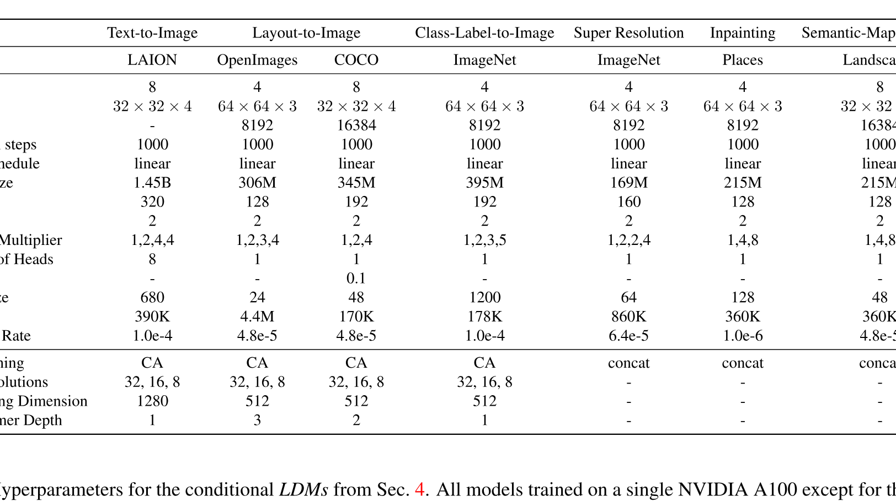

**Table 15.** Hyperparameters for the conditional *LDMs* from [Section 4](#section-4). All models trained on a single NVIDIA A100 except for the inpainting model which was trained on eight V100.

### 11.2 Implementation Details

#### 11.2.1 Implementations of τθ\tau_{\theta} for conditional LDMs

For the experiments on text-to-image and layout-to-image ([Section 4.3.1](#section-4-3-1)) synthesis, we implement the conditioner $\tau_{\theta}$ as an unmasked transformer which processes a tokenized version of the input $y$ and produces an output $\zeta:=\tau_{\theta}(y)$, where $\zeta\in\mathbb{R}^{M\times d_{\tau}}$. More specifically, the transformer is implemented from $N$ transformer blocks consisting of global self-attention layers, layer-normalization and position-wise MLPs as follows [+2]:

$$
\displaystyle\zeta\leftarrow\text{TokEmb}(y)+\text{PosEmb(y)}
$$

With $\zeta$ available, the conditioning is mapped into the UNet via the cross-attention mechanism as depicted in [Figure 3](#figure-03). We modify the “ablated UNet” [Dha21] architecture and replace the self-attention layer with a shallow (unmasked) transformer consisting of $T$ blocks with alternating layers of (i) self-attention, (ii) a position-wise MLP and (iii) a cross-attention layer; see [Table 16](#table-16). Note that without (ii) and (iii), this architecture is equivalent to the “ablated UNet”.

While it would be possible to increase the representational power of $\tau_{\theta}$ by additionally conditioning on the time step $t$, we do not pursue this choice as it reduces the speed of inference. We leave a more detailed analysis of this modification to future work.

For the text-to-image model, we rely on a publicly available [+3] tokenizer [Wol19]. The layout-to-image model discretizes the spatial locations of the bounding boxes and encodes each box as a $(l,b,c)$-tuple, where $l$ denotes the (discrete) top-left and $b$ the bottom-right position. Class information is contained in $c$.  See [Table 17](#table-17) for the hyperparameters of $\tau_{\theta}$ and [Table 13](#table-13) for those of the UNet for both of the above tasks.  

Note that the class-conditional model as described in [Section 4.1](#section-4-1) is also implemented via cross-attention, where $\tau_{\theta}$ is a single learnable embedding layer with a dimensionality of 512, mapping classes $y$ to $\zeta\in\mathbb{R}^{1\times 512}$.

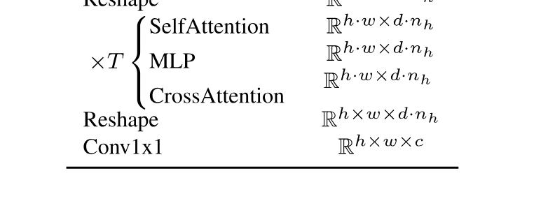

**Table 16.** Architecture of a transformer block as described in [Section 11.2.1](#section-11-2-1), replacing the self-attention layer of the standard “ablated UNet” architecture [Dha21]. Here, $n_{h}$ denotes the number of attention heads and $d$ the dimensionality per head.

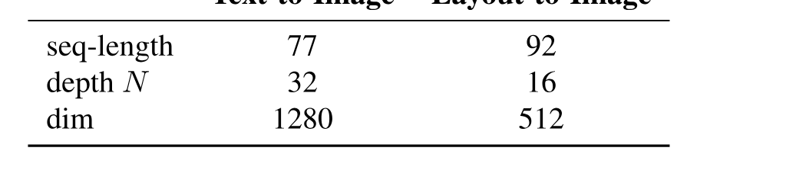

**Table 17.** Hyperparameters for the experiments with transformer encoders in [Section 4.3](#section-4-3).

#### 11.2.2 Inpainting

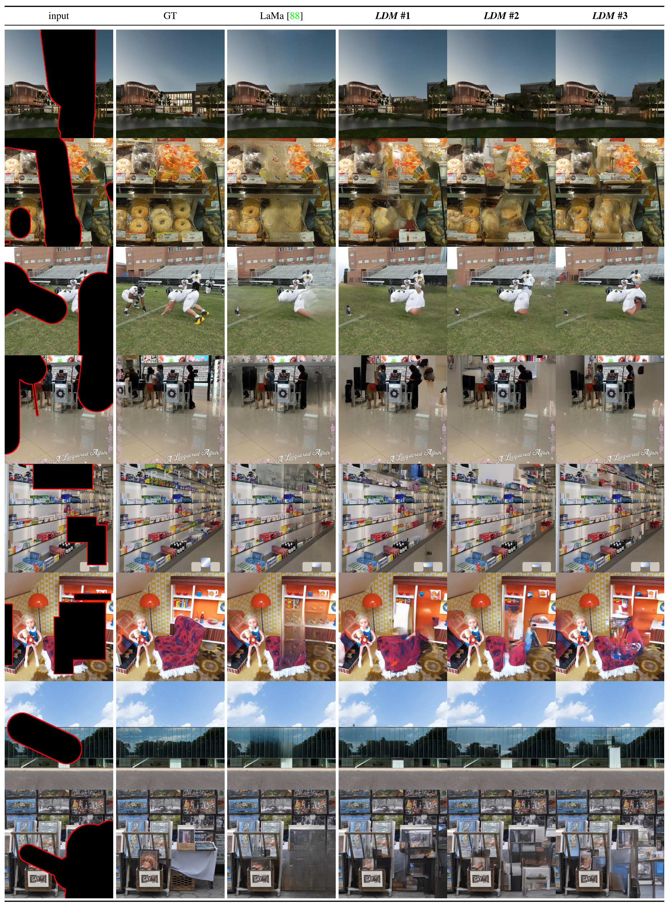

**Figure 21.** Qualitative results on image inpainting. In contrast to [Suv21], our generative approach enables generation of multiple diverse samples for a given input.

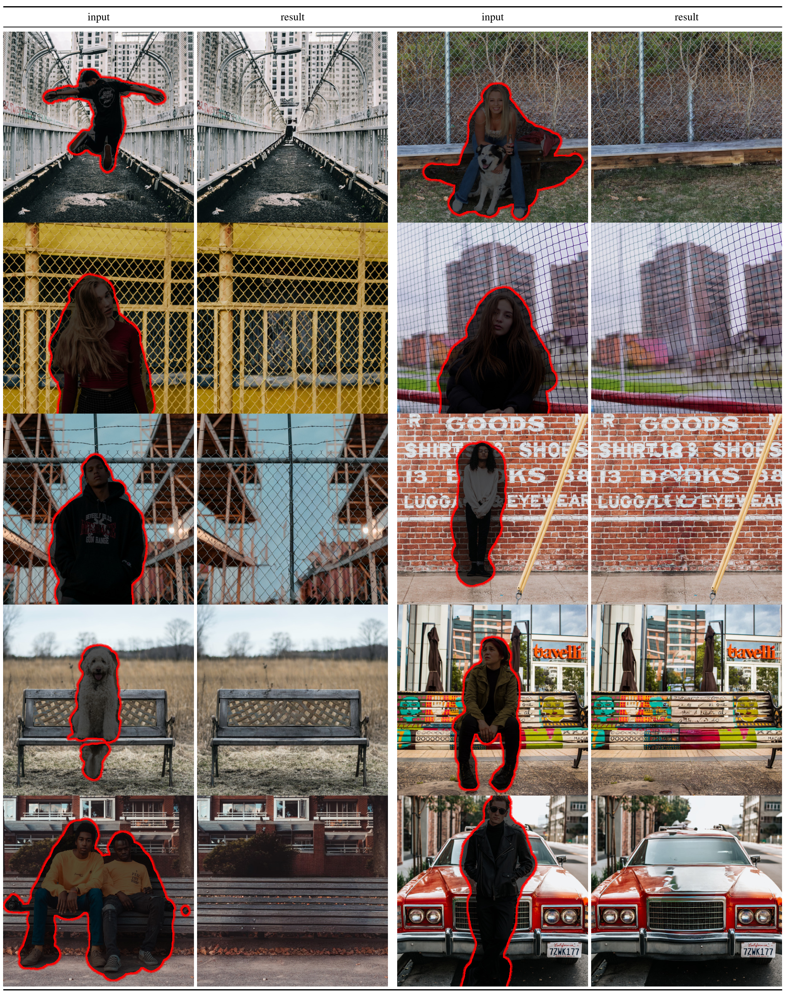

**Figure 22.** More qualitative results on object removal as in [Figure 11](#figure-11).

For our experiments on image-inpainting in [Section 4.5](#section-4-5), we used the code of [Suv21] to generate synthetic masks. We use a fixed set of 2k validation and 30k testing samples from Places[Zho18a]. During training, we use random crops of size $256\times 256$ and evaluate on crops of size $512\times 512$. This follows the training and testing protocol in [Suv21] and reproduces their reported metrics (see ^† in [Table 7](#table-07)). We include additional qualitative results of *LDM-4, w/ attn* in [Figure 21](#figure-21) and of *LDM-4, w/o attn, big, w/ ft* in [Figure 22](#figure-22).

### 11.3 Evaluation Details

This section provides additional details on evaluation for the experiments shown in [Section 4](#section-4).

#### 11.3.1 Quantitative Results in Unconditional and Class-Conditional Image Synthesis

We follow common practice and estimate the statistics for calculating the FID-, Precision- and Recall-scores [Heu17, Kyn19] shown in [Table 1](#table-01) and [Table 10](#table-10) based on 50k samples from our models and the entire training set of each of the shown datasets. For calculating FID scores we use the torch-fidelity package [Obu20]. However, since different data processing pipelines might lead to different results [Par21a], we also evaluate our models with the script provided by Dhariwal and Nichol [Dha21]. We find that results mainly coincide, except for the ImageNet and LSUN-Bedrooms datasets, where we notice slightly varying scores of 7.76 (torch-fidelity) vs. 7.77 (Nichol and Dhariwal) and 2.95 vs 3.0. For the future we emphasize the importance of a unified procedure for sample quality assessment. Precision and Recall are also computed by using the script provided by Nichol and Dhariwal.

#### 11.3.2 Text-to-Image Synthesis

Following the evaluation protocol of [Ram21] we compute FID and Inception Score for the Text-to-Image models from [Table 2](#table-02) by comparing generated samples with 30000 samples from the validation set of the MS-COCO dataset [Lin14a]. FID and Inception Scores are computed with torch-fidelity.

#### 11.3.3 Layout-to-Image Synthesis

For assessing the sample quality of our Layout-to-Image models from [Table 9](#table-09) on the COCO dataset, we follow common practice [Syl21, Jah21, Wu20] and compute FID scores the 2048 unaugmented examples of the COCO Segmentation Challenge split. To obtain better comparability, we use the exact same samples as in [Jah21]. For the OpenImages dataset we similarly follow their protocol and use 2048 center-cropped test images from the validation set.

#### 11.3.4 Super Resolution

We evaluate the super-resolution models on ImageNet following the pipeline suggested in [Sah21], *i.e*. images with a shorter size less than $256$ px are removed (both for training and evaluation). On ImageNet, the low-resolution images are produced using bicubic interpolation with anti-aliasing. FIDs are evaluated using torch-fidelity [Obu20], and we produce samples on the validation split. For FID scores, we additionally compare to reference features computed on the train split, see [Table 5](#table-05) and [Table 11](#table-11).

#### 11.3.5 Efficiency Analysis

For efficiency reasons we compute the sample quality metrics plotted in [Figure 6](#figure-06), [Figure 17](#figure-17) and [Figure 7](#figure-07) based on 5k samples. Therefore, the results might vary from those shown in [Table 1](#table-01) and [Table 10](#table-10). All models have a comparable number of parameters as provided in [Table 13](#table-13) and [Table 14](#table-14). We maximize the learning rates of the individual models such that they still train stably. Therefore, the learning rates slightly vary between different runs *cf*. [Table 13](#table-13) and [Table 14](#table-14).

#### 11.3.6 User Study

For the results of the user study presented in [Table 4](#table-04) we followed the protocoll of [Sah21] and and use the 2-alternative force-choice paradigm to assess human preference scores for two distinct tasks. In Task-1 subjects were shown a low resolution/masked image between the corresponding ground truth high resolution/unmasked version and a synthesized image, which was generated by using the middle image as conditioning. For SuperResolution subjects were asked: *’Which of the two images is a better high quality version of the low resolution image in the middle?’*. For Inpainting we asked *’Which of the two images contains more realistic inpainted regions of the image in the middle?’*. In Task-2, humans were similarly shown the low-res/masked version and asked for preference between two corresponding images generated by the two competing methods. As in [Sah21] humans viewed the images for 3 seconds before responding.

## 12 Computational Requirements

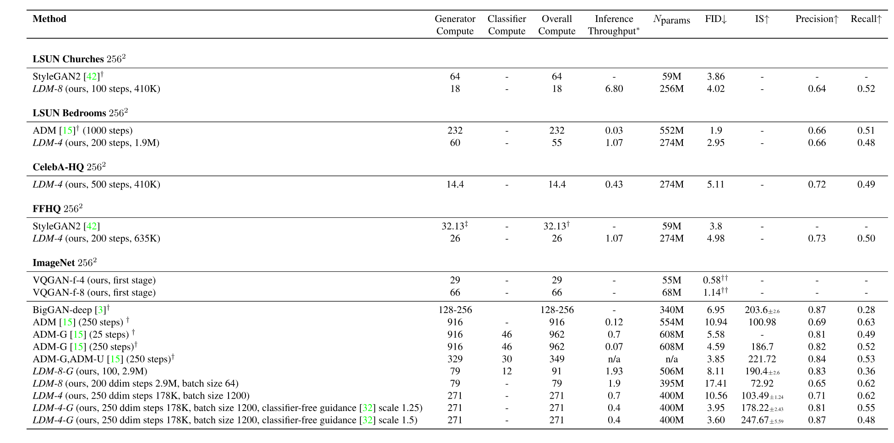

**Table 18.** Comparing compute requirements during training and inference throughput with state-of-the-art generative models. Compute during training in V100-days, numbers of competing methods taken from [Dha21] unless stated differently;^∗: Throughput measured in samples/sec on a single NVIDIA A100;^†: Numbers taken from [Dha21];^‡: Assumed to be trained on 25M train examples; ^††: R-FID vs. ImageNet validation set

In [Table 18](#table-18) we provide a more detailed analysis on our used compute ressources and compare our best performing models on the CelebA-HQ, FFHQ, LSUN and ImageNet datasets with the recent state of the art models by using their provided numbers, *cf*. [Dha21]. As they report their used compute in V100 days and we train all our models on a single NVIDIA A100 GPU, we convert the A100 days to V100 days by assuming a $\times 2.2$ speedup of A100 vs V100 [Sal20] [+4]. To assess sample quality, we additionally report FID scores on the reported datasets. We closely reach the performance of state of the art methods as StyleGAN2 [Kar20b] and ADM [Dha21] while significantly reducing the required compute resources.

## 13 Details on Autoencoder Models

We train all our autoencoder models in an adversarial manner following [Ess20a], such that a patch-based discriminator $D_{\psi}$ is optimized to differentiate original images from reconstructions $\mathcal{D}(\mathcal{E}(x))$. To avoid arbitrarily scaled latent spaces, we regularize the latent $z$ to be zero centered and obtain small variance by introducing an regularizing loss term $L_{reg}$.  We investigate two different regularization methods: (i) a low-weighted Kullback-Leibler-term between $q_{\mathcal{E}}(z|x)=\mathcal{N}(z;\mathcal{E}_{\mu},\mathcal{E}_{\sigma^{2}})$ and a standard normal distribution $\mathcal{N}(z;0,1)$ as in a standard variational autoencoder [Kin14, Rez14], and, (ii) regularizing the latent space with a vector quantization layer by learning a codebook of $|\mathcal{Z}|$ different exemplars [Oor17].  To obtain high-fidelity reconstructions we only use a very small regularization for both scenarios, *i.e*. we either weight the $\mathbb{KL}$ term by a factor $\sim 10^{-6}$ or choose a high codebook dimensionality $|\mathcal{Z}|$.

The full objective to train the autoencoding model $(\mathcal{E},\mathcal{D})$ reads:

$$
L_{\text{Autoencoder}}=\min_{\mathcal{E},\mathcal{D}}\max_{\psi}\Big(L_{rec}(x,\mathcal{D}(\mathcal{E}(x)))-L_{adv}(\mathcal{D}(\mathcal{E}(x)))+\log D_{\psi}(x)+L_{reg}(x;\mathcal{E},\mathcal{D})\Big)
$$

**DM Training in Latent Space.** Note that for training diffusion models on the learned latent space, we again distinguish two cases when learning $p(z)$ or $p(z|y)$ ([Section 4.3](#section-4-3)): (i) For a KL-regularized latent space, we sample $z=\mathcal{E}_{\mu}(x)+\mathcal{E}_{\sigma}(x)\cdot\varepsilon=:\mathcal{E}(x)$, where $\varepsilon\sim\mathcal{N}(0,1)$. When rescaling the latent, we estimate the component-wise variance

$$
\hat{\sigma}^{2}=\frac{1}{bchw}\sum_{b,c,h,w}(z^{b,c,h,w}-\hat{\mu})^{2}
$$

from the first batch in the data, where $\hat{\mu}=\frac{1}{bchw}\sum_{b,c,h,w}z^{b,c,h,w}$. The output of $\mathcal{E}$ is scaled such that the rescaled latent has unit standard deviation, *i.e*. $z\leftarrow\frac{z}{\hat{\sigma}}=\frac{\mathcal{E}(x)}{\hat{\sigma}}$. (ii) For a VQ-regularized latent space, we extract $z$ *before* the quantization layer and absorb the quantization operation into the decoder, *i.e*. it can be interpreted as the first layer of $\mathcal{D}$.

## 14 Additional Qualitative Results

Finally, we provide additional qualitative results for our landscapes model ([Figure 12](#figure-12), [Figure 23](#figure-23), [Figure 24](#figure-24) and [Figure 25](#figure-25)), our class-conditional ImageNet model ([Figure 26](#figure-26) - [Figure 27](#figure-27)) and our unconditional models for the CelebA-HQ, FFHQ and LSUN datasets ([Figure 28](#figure-28) - [Figure 31](#figure-31)). Similar as for the inpainting model in [Section 4.5](#section-4-5) we also fine-tuned the semantic landscapes model from [Section 4.3.2](#section-4-3-2) directly on $512^{2}$ images and depict qualitative results in [Figure 12](#figure-12) and [Figure 23](#figure-23). For our those models trained on comparably small datasets, we additionally show nearest neighbors in VGG [Sim15] feature space for samples from our models in [Figure 32](#figure-32) - [Figure 34](#figure-34).

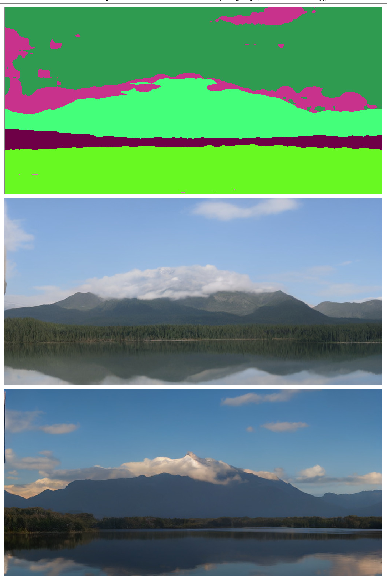

**Figure 23.** Convolutional samples from the semantic landscapes model as in [Section 4.3.2](#section-4-3-2), finetuned on $512^{2}$ images.

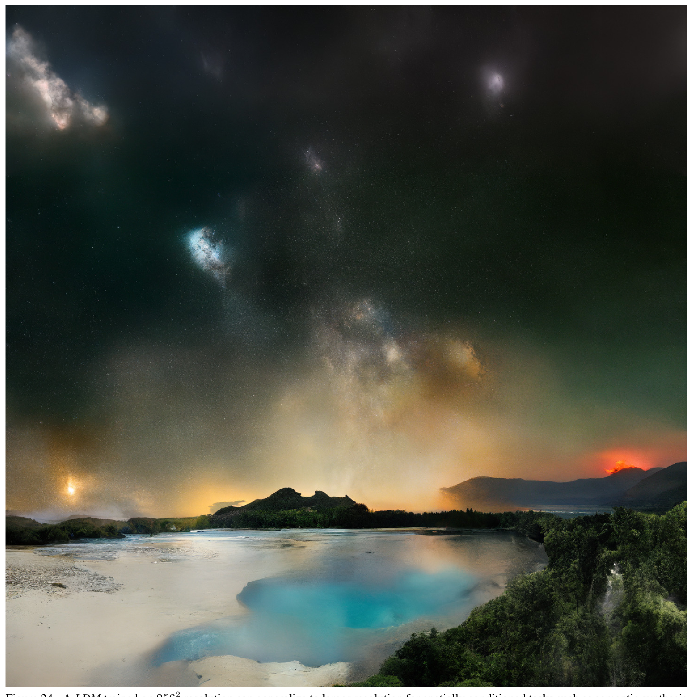

**Figure 24.** A *LDM* trained on $256^{2}$ resolution can generalize to larger resolution for spatially conditioned tasks such as semantic synthesis of landscape images. See [Section 4.3.2](#section-4-3-2).

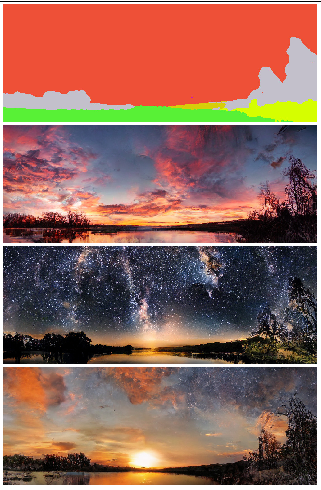

**Figure 25.** When provided a semantic map as conditioning, our *LDMs* generalize to substantially larger resolutions than those seen during training. Although this model was trained on inputs of size $256^{2}$ it can be used to create high-resolution samples as the ones shown here, which are of resolution $1024\times 384$.

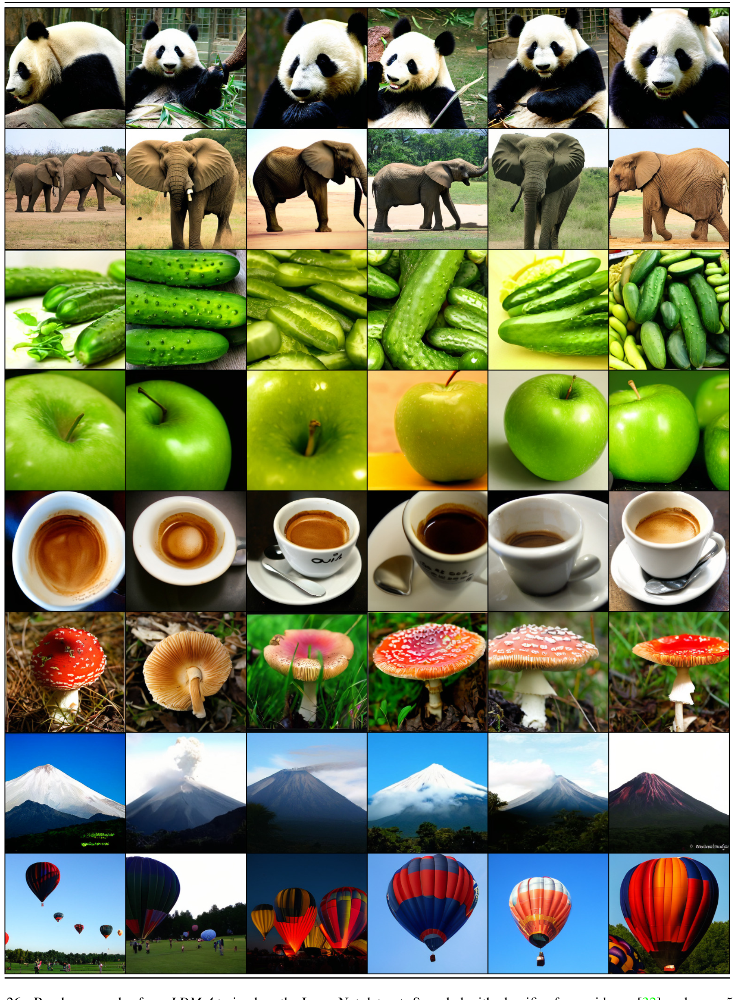

**Figure 26.** Random samples from *LDM-4* trained on the ImageNet dataset. Sampled with classifier-free guidance [Ho21] scale $s=5.0$ and 200 DDIM steps with $\eta=1.0$.

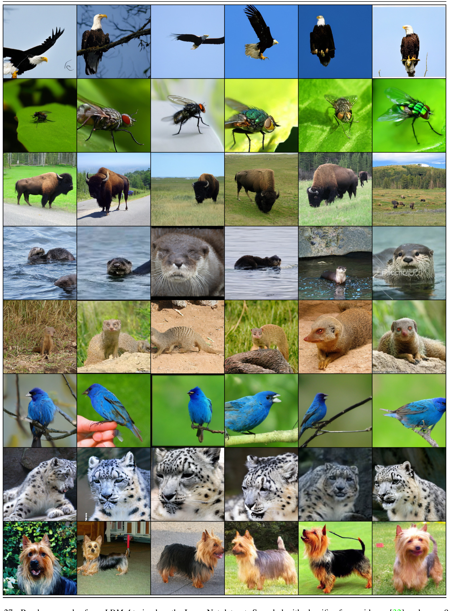

**Figure 27.** Random samples from *LDM-4* trained on the ImageNet dataset. Sampled with classifier-free guidance [Ho21] scale $s=3.0$ and 200 DDIM steps with $\eta=1.0$.

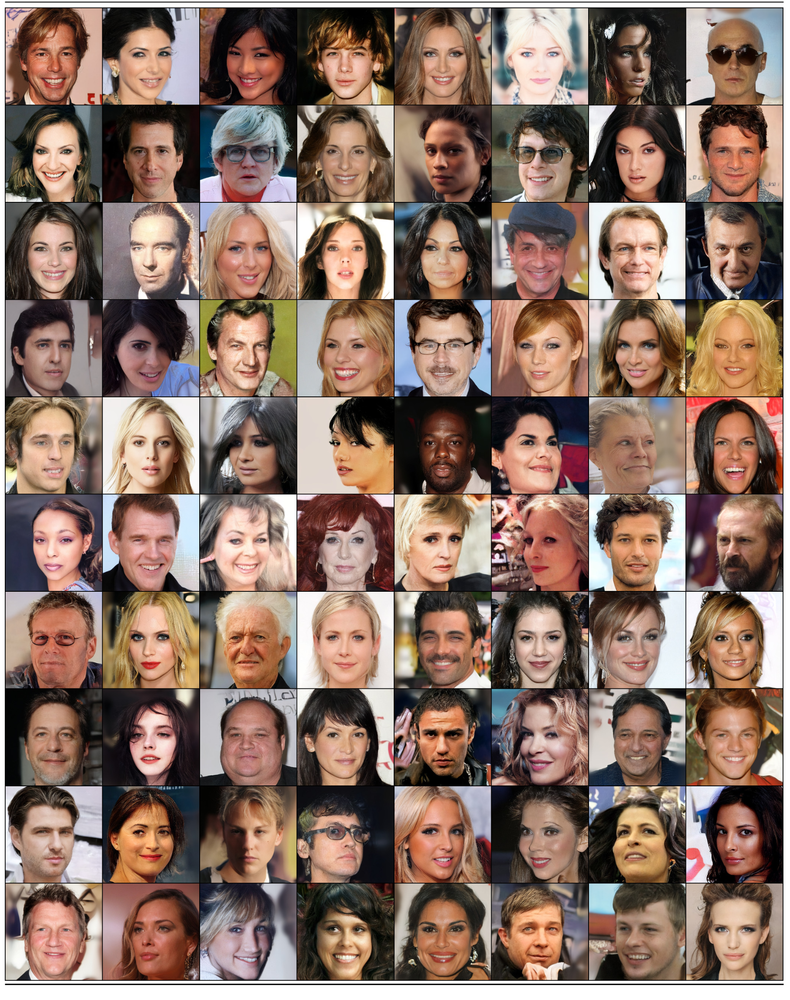

**Figure 28.** Random samples of our best performing model *LDM-4* on the CelebA-HQ dataset. Sampled with 500 DDIM steps and $\eta=0$ (FID = 5.15).

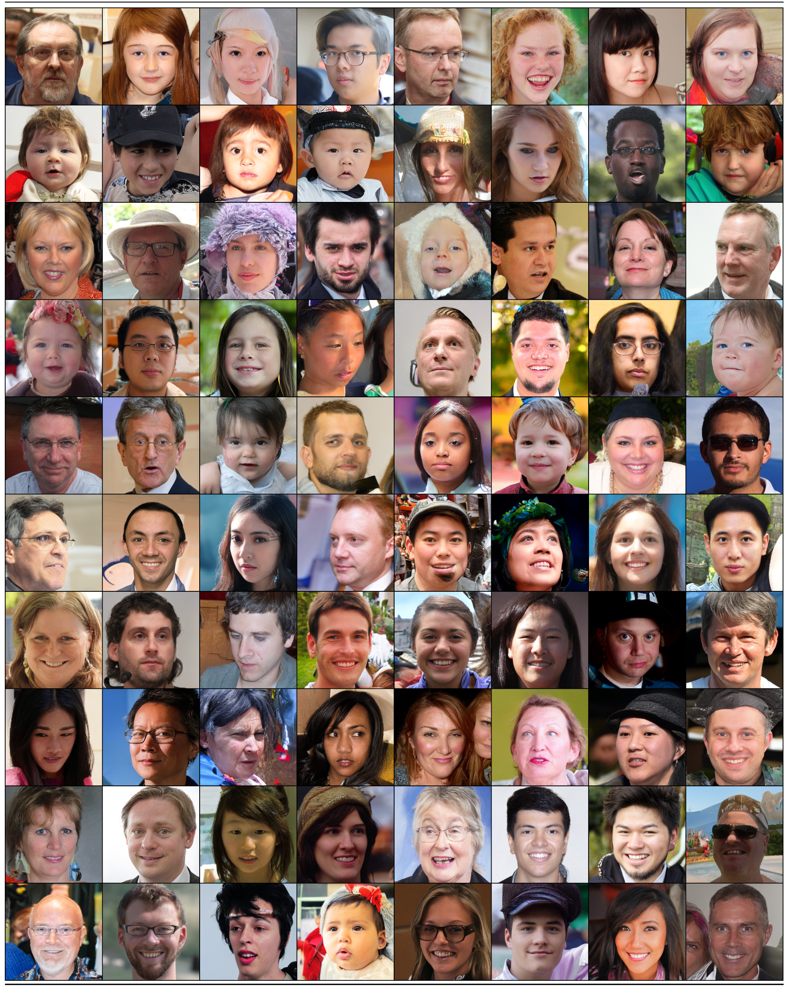

**Figure 29.** Random samples of our best performing model *LDM-4* on the FFHQ dataset. Sampled with 200 DDIM steps and $\eta=1$ (FID = 4.98).

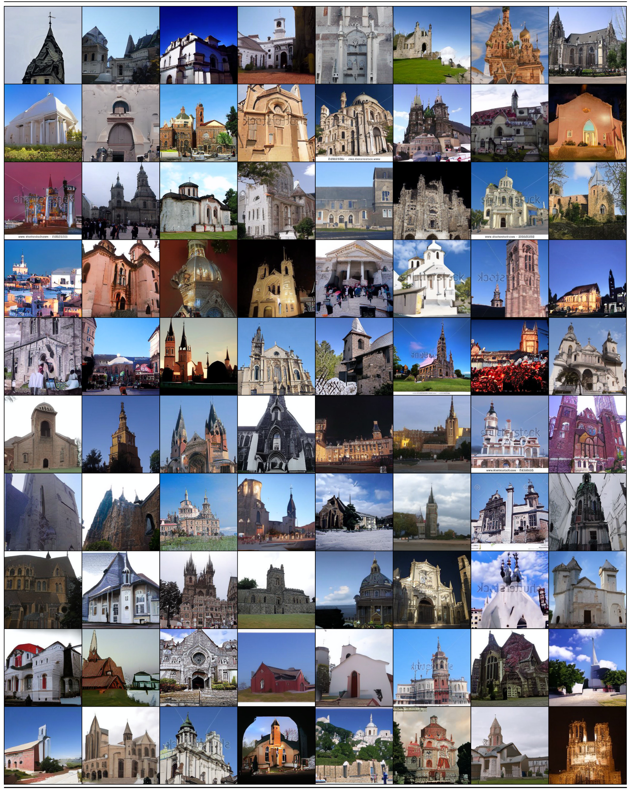

**Figure 30.** Random samples of our best performing model *LDM-8* on the LSUN-Churches dataset. Sampled with 200 DDIM steps and $\eta=0$ (FID = 4.48).

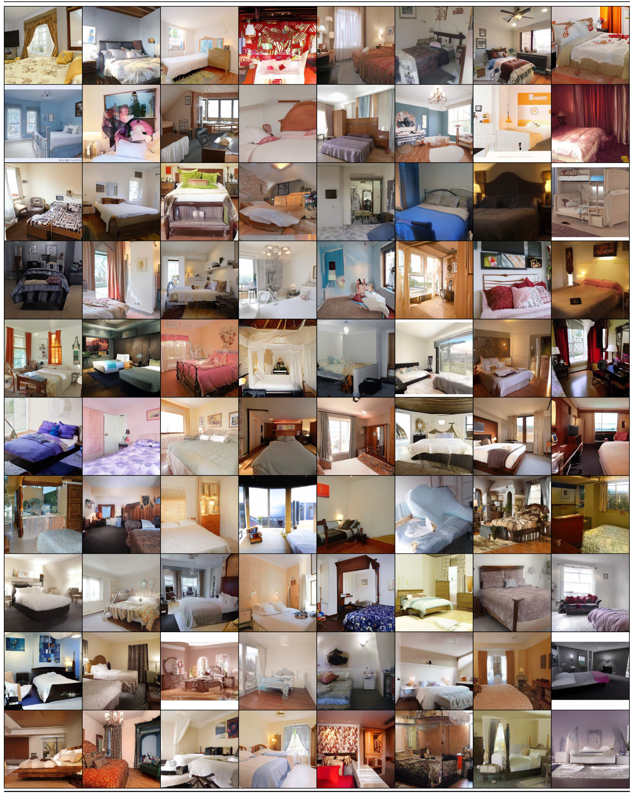

**Figure 31.** Random samples of our best performing model *LDM-4* on the LSUN-Bedrooms dataset. Sampled with 200 DDIM steps and $\eta=1$ (FID = 2.95).

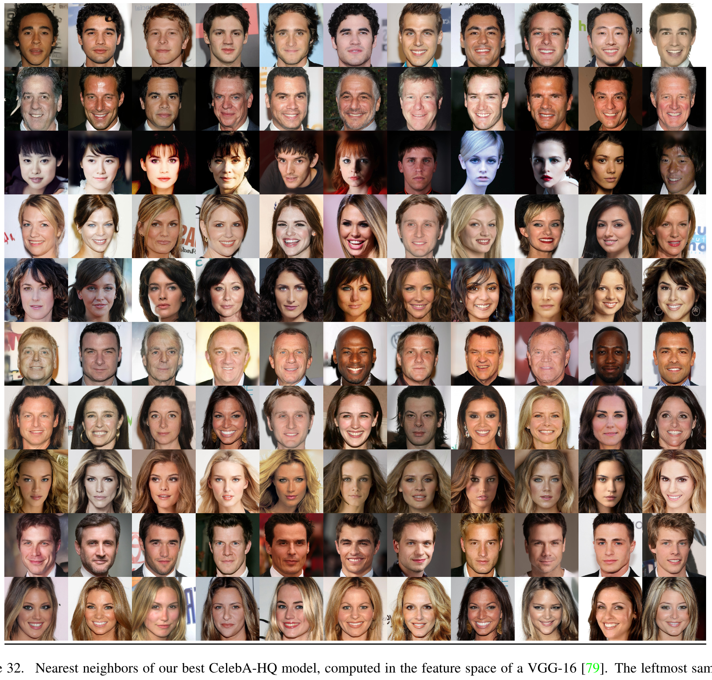

**Figure 32.** Nearest neighbors of our best CelebA-HQ model, computed in the feature space of a VGG-16 [Sim15]. The leftmost sample is from our model. The remaining samples in each row are its 10 nearest neighbors.

**Figure 33.** Nearest neighbors of our best FFHQ model, computed in the feature space of a VGG-16 [Sim15]. The leftmost sample is from our model. The remaining samples in each row are its 10 nearest neighbors.

**Figure 34.** Nearest neighbors of our best LSUN-Churches model, computed in the feature space of a VGG-16 [Sim15]. The leftmost sample is from our model. The remaining samples in each row are its 10 nearest neighbors.

[+equal-contribution]: The first two authors contributed equally to this work.
[+ack]: This work has been supported by the German Federal Ministry for Economic Affairs and Energy within the project “KI-Absicherung - Safe AI for automated driving” and by the German Research Foundation (DFG) project 421703927.
[+1]: It is not possible to exactly match both architectures since the diffusion model operates in the pixel space.
[+2]: Adapted from <https://github.com/lucidrains/x-transformers>.
[+3]: <https://huggingface.co/transformers/model_doc/bert.html#berttokenizerfast>.
[+4]: This factor corresponds to the speedup of the A100 over the V100 for a U-Net, as defined in [Figure 1](#figure-01) in [Pat21a].
