> [Susheel Suresh](https://susheels.github.io/) [+equal] [+susheel-email], [Hazel Mak](https://www.linkedin.com/in/s-n-hazel-mak) [+equal] [+hazel-email], [Shangpo Chou](https://www.linkedin.com/in/shangpochou), [Fred Kroon](https://ca.linkedin.com/in/fredkroon), [Sahil Bhatnagar](https://dblp.org/pid/273/7895.html). Microsoft Corporation. 2026 年 5 月 7 日に arXiv へ初回投稿、現行版は v1。[AgenticRAG: Agentic Retrieval for Enterprise Knowledge Bases](https://arxiv.org/abs/2605.05538)、[TeX ソース](https://arxiv.org/e-print/2605.05538)、<a href="/paper/agenticrag.pdf" target="_blank" rel="noopener noreferrer">原 PDF</a>。正確な印刷レイアウトと参考文献については原 PDF を正本とする。

## 概要

本研究では、企業知識ベースの検索と分析を行う実用的なエージェント型ハーネス **AgenticRAG** を提示する。標準的な RAG パイプラインでは、グラウンディングの大きな負担を検索スタックが担い、言語モデルは検索処理の深部で選ばれた固定候補集合に制約される。本手法は、既存の企業検索基盤の上に軽量なハーネスを重ね、推論 LLM に search、find、open、summarize の各ツールを与えることで、この過度な依存を減らす。モデルは情報を反復的に検索し、文書内を移動し、証拠を自律的に分析できる。3 つの公開ベンチマークで大幅な向上を確認した。BRIGHT の recall@1 は 49.6%（最良の埋め込みベースラインより 21.8 ポイント高い）、WixQA の factuality は 0.96（相対 13% 向上）、FinanceBench の回答正解率は 92%（真の証拠を直接利用するオラクルとの差は 2 ポイント以内）である。アブレーション研究では、最も大きな要因は単発検索からエージェント型ツール利用への移行（$5.9\times$ の向上）であり、複数クエリ検索と文書内ナビゲーションも品質と効率の双方に寄与することが分かった。さらに、プリプロダクション環境への導入で得た知見に基づく、エージェント型ハーネスの各種設計判断を示す。結果は、現実の企業本番環境に適用できることを示している。

## 1 はじめに

標準的な検索拡張生成（RAG）パイプラインは、静的な検索後生成パラダイムに従う [Lew20]。この設計では、検索スタックが大規模言語モデル（LLM）の最終的な候補集合を事実上決定し、モデルの推論もその集合に制約される。現代の企業向け検索スタックは、スケーラビリティ、レイテンシ、ならびに転置インデックス、確率的検索、学習型ランキングモデルからなる多段ランキングパイプラインに対して高度に最適化されている [Liu09, Nog19, Tha21]。これらのシステムはキーワード検索と短い意味検索に優れ、高再現率の候補生成に強い。しかし、状況依存、複数文書、または分析的に複雑な情報要求、すなわち技術マニュアル、コンプライアンス文書、財務報告書などの密なコーパスに対して知識労働者が行う種類の問い合わせを解決するようには設計されていない。

実際の RAG システム [Azu26] は、HyDE [Gao23a]、複数クエリへの再定式化 [Wan23o]、適応的または反復的な検索戦略 [Tri22a, Jeo24b] などの検索拡張手法により、これらの限界を補おうとしている。これらの手法は問い合わせ表現への頑健性と検索範囲を高めるが、実質的な推論の前に検索判断を確定するという同じアーキテクチャ上の前提を概ね維持している。LLM は依然として検索スタックの深部で選ばれた固定候補集合を処理し、文書を反復的に移動したり、複数ソースの証拠を統合したり、より高い視点から結果を再評価したりできない。

近年の推論能力を持つ言語モデルは、計画と外部ツールの反復利用で高い性能を示している [Yao23b, Sch23]。検索手順をハードコードする代わりに、何を検索するか、どの文書をさらに調べるべきか、十分な証拠がいつ集まったかをモデル自身に判断させ、処理を駆動させることができる。これにより検索スタックへの圧力は弱まり、検索スタックは高い再現率を実現すればよく、モデルが広い文脈から最終的な適合率を担う。本研究では、既存の企業検索基盤の上に、推論 LLM へ **search**、**find**、**open**、**summarize** の 4 ツールを与える実用的なハーネス *AgenticRAG* を提示する。search は基盤となる検索スタックに広範な候補発見を委ね、find と open は文書内検索と全文取得（ローリングウィンドウアクセス）により候補文書を掘り下げる精密な手段として機能する。長い推論連鎖で増大するコンテキストを管理するため、ハーネスはトークン使用量を監視し、閾値に達すると summarize を起動する。これにより、モデルは重要な参照を保ちながら調査結果を集約できる。本研究の貢献はシステムレベルにある。軽量な推論時ツールハーネスであり、モデルのファインチューニング、独自埋め込みモデル、グラフ構築、あるいは既存の企業検索バックエンドへの文書索引付けを超えるコーパス固有の前処理を必要としない。

検索、企業 QA、財務文書推論にまたがる 3 ベンチマークで評価する。本手法は BRIGHT で 49.6% recall@1（最良の埋め込みベースラインより 21.8 ポイント高い）、WixQA で 0.96 factuality（相対 13% 向上）、FinanceBench で 92.00% の回答正解率（オラクルアクセスとの差は 2 ポイント以内）を達成した。本手法はプリプロダクション評価に導入されており、導入から得た知見が設計判断に直接反映されている。各ツールの寄与、複数クエリ検索の効果、モデルごとの検索戦略の違いを詳細なアブレーションで分析する。

## 2 関連研究

検索拡張生成（RAG）は、パラメトリックメモリの限界を緩和するため、LLM の生成を外部コーパスにグラウンディングする [Lew20, Guu20]。初期の手法は、疎または密なベクトル検索で関連文書を特定し [Kha20b, Iza21]、知識集約型 NLP タスクの性能を高めることに注力した。コンテキストウィンドウの拡大に伴い、研究は数兆トークン規模の検索 [Bor22] とコンテキスト内学習の最適化 [Ram23a, Shi23f] に移った。こうした進展にもかかわらず、標準 RAG パイプラインは「ロングテール」知識を扱いにくく、検索に失敗するとハルシネーションを生じることがある [Mal22, Gao24e]。また、静的な「検索後生成」パラダイムは、反復的な情報収集を要する複雑なマルチホップ問い合わせを扱う柔軟性に欠ける [Jia23c, Lew23]。

静的パイプラインの脆弱性に対処するため、自律エージェント（LLM）が検索処理を動的に編成する *Agentic* パターンへ研究分野は発展してきた [Sin25b, Och25]。ReAct [Yao23b] や Toolformer [Sch23] など、エージェント行動の基礎研究は、LLM が外部ツールを効果的に使って推論問題を解けることを示した。このパラダイムは Self-RAG [Asa23] や Corrective RAG [Yan24o] などのシステムで形式化され、自己内省機構によって取得内容を批評し、必要に応じて Web 検索などのフォールバックを起動する。近年は検索を計画へ統合する手法も提案されている。PlanRAG [Lee24e] と Search-o1 [Li25k] は高レベル計画と低レベル実行を分離し、エージェントが複雑な問い合わせをサブタスクへ分解できるようにする。同様に Search-R1 [Jin25b] は、強化学習によって LLM に自律的な検索判断を学習させる。これらのシステムは有効だが、多くはオープンドメイン検索向けであるか、ファインチューニング、強化学習、専用の検索ポリシーを必要とする。そのため、学習用に持ち出せない企業固有コーパスへ直接適用しにくい。再帰的な推論ループにより、レイテンシとトークン費用も高くなり得る [Tri22a]。

標準 RAG のもう一つの重大な限界は、文書を分離したチャンクへ「平坦化」し、見出しや文書境界など有用な構造事前知識を捨てる点である。RAPTOR [Sar24] はテキストチャンクを再帰的にクラスタリング、要約して木構造を作り、異なる抽象度での検索を可能にする。同様に HiQA [Che24x] は複数文書の階層コンテキストを構築する。Graph RAG [Edg24, Sca25a] は、問い合わせ指向の要約を支える知識グラフを文書から構築しようとする。知識の統合には強力だが [Pan24h, Wan24ah]、グラフ構築は動的な企業環境では計算負荷が大きすぎることが多い。

対照的に、Agentic RAG ハーネスは推論時システムであり、高速な企業向け検索スタックを使う「search」ツールと、より深い情報収集および推論を行う「find」「open」ツールを推論モデルに提供する。したがって本研究は、企業ファイルシステムへ展開可能なシステム統合として位置付けられる。既存の検索基盤を利用し、文書アクセス制御を維持し、大規模な事前計算や再学習を避ける。

## 3 手法

### 3.1 システム概要

大規模ファイルシステム上の企業文書検索と質問応答を行うエージェント型 RAG システムを提示する。従来の単発 RAG パイプラインと異なり、本システムは反復推論ループを用いる。大規模言語モデル（LLM）が、文書をいつ検索するか、特定箇所をいつ掘り下げるか、最終回答を生成する前に全文をいつ取得するかを自律的に決める。

本システムは、企業 RAG における複数の課題へ対応する。（1）多段推論：複雑な問い合わせは複数文書の情報を必要とする。（2）コンテキストウィンドウ制約：蓄積した検索結果を LLM の上限内に収めなければならない。（3）グラウンディングされた応答：回答に原文書まで追跡可能な引用が必要である。（4）複数ターン効率：後続の問い合わせでは、冗長な検索を再実行せず、以前に取得した内容を再利用すべきである。本アーキテクチャは複数のモデル系列をサポートし、検索ツールのバックエンド実装に既存の検索基盤を再利用する。軽量とは、ハーネスが 4 ツールだけで構成され、モデルのファインチューニングもグラフ構築も不要であり、文書発見用に既に導入された企業検索スタック以外の独自埋め込み索引も必要としないことを意味する。システム全体は 3 つの主要構成要素からなる。

1. **エージェントループ**：最大反復回数で制限しながら LLM とツールの相互作用を編成する。
2. **検索ツール**：3 ツール（*search*、*find*、*open*）が企業文書への階層的アクセスを提供する。長い推論連鎖のコンテキスト管理には *summarize* を用いる。
3. **会話状態**：メッセージ履歴、トークン計数、反復間で文書を追跡する参照 ID 対応関係を維持する。

### 3.2 エージェントループ

エージェントは、各問い合わせを有界な反復ループで処理する（[図 1](#figure-01)）。各反復で現在の会話を受け取ると、ツールを選択して呼び出し結果を会話へ追加するか、引用付きの最終回答を返す。

ループは、（1）モデルがテキスト応答を生成する、または（2）反復回数が上限（既定値 15）へ達する、のいずれかで終了する。最終回答なしに最大反復回数へ達した場合、エージェントは強制完了要求を発し、利用可能な情報でモデルに回答させる。実行中にトークン予算を超えた場合、エージェントはコンテキスト管理（[第 3.4 節](#section-3-4)）を起動して空きを作り、ループを継続する。アルゴリズムの詳細は[第 7.1 節](#section-7-1)を参照されたい。

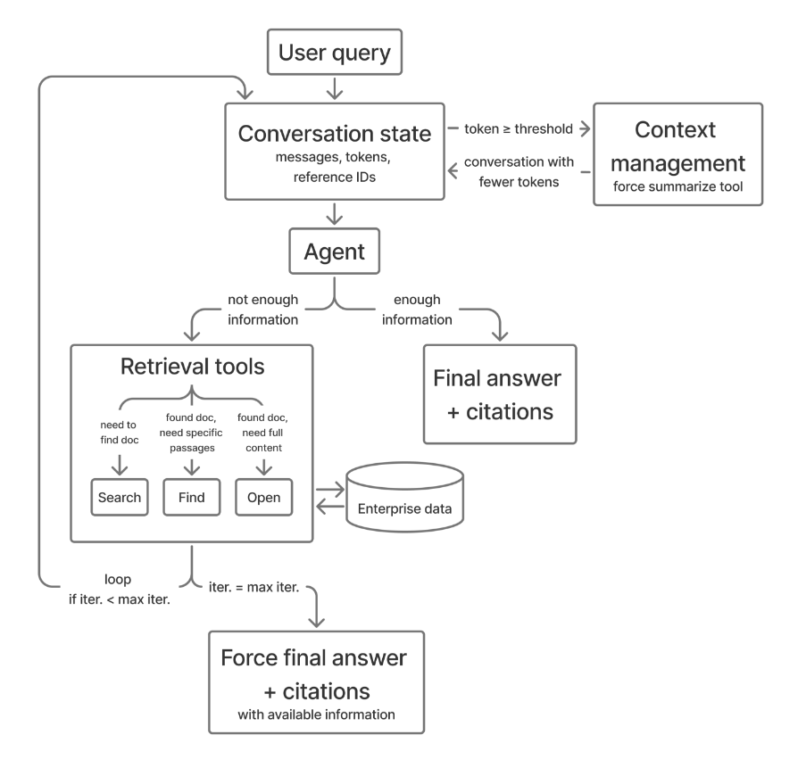

**図 1.** エージェントループ。

### 3.3 検索ツール

システムは、文書を階層的に探索する 3 種類の検索ツールを提供する（[表 1](#table-01)）。エージェントは現在の情報要求に基づいて呼び出すツールを決める。

**Search** は、既存の企業検索スタックへ委譲して企業全体から文書を発見する。既定の構成では、モデルは 1 回のツール呼び出しで最大 5 個のクエリ再定式化を発行できる。各クエリは最大 10 件の結果を返し、各結果にはスニペット、タイトル、ファイル名、ファイル種別、その他の利用可能なメタデータが含まれる。複数クエリの結果は結合、重複排除される。各結果にはグローバルに増加するカウンタによる一意の参照 ID（形式：$\mathrm{turn}m\mathrm{search}n$）が与えられ、後続の find と open 操作で利用できる。

**Find** は、参照 ID で指定された単一文書内を対象に検索する。キーワードパターンのリストに対し、字句一致は大文字小文字を区別しない部分文字列一致を使う。任意で意味検索モードも有効化できる。各パターンについて最大 2 個の一致箇所を返す。結果は内容で重複排除され、有界なトークン上限（$\sim 11\mathrm{k}$ トークン）で切り詰められる。収益指標や長い申告書内の固有概念など、モデルが*何を*探すか分かっている場合に Find は最も有用である。

**Open** は固定行ウィンドウで文書全文を取得する。各呼び出しは、先頭（0 行目）またはエージェントが選んだ行番号から、既定で 1,800 行のウィンドウを返す。応答ヘッダには表示範囲と文書の総行数も示される（例：「Viewing lines [0-1799] of 3000 lines」）。同じファイルの複数箇所へアクセスするには、後続呼び出しで行番号を明示する。これにより、各応答を有界に保ちながらウィンドウを超える文書を移動できる。表、節見出し、行番号付きプレビュー付近の文脈など、モデルが*どこを*読むか分かっている場合に Open は最も有用である。システムプロンプトは効果的なツール利用を案内する。詳細は[第 7.2 節](#section-7-2)に示す。

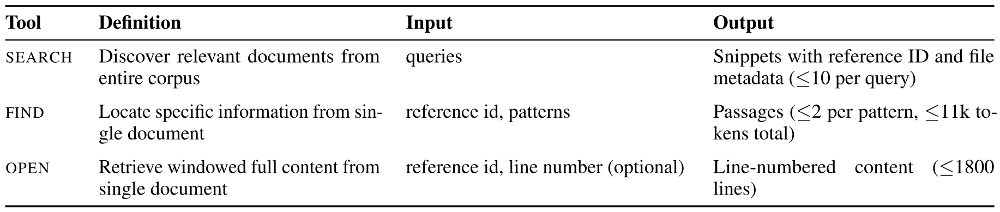

**表 1.** 検索ツールの仕様。

### 3.4 コンテキスト管理

検索ツールはファイルから 1 回に $\sim 11\mathrm{k}$ トークンを読み込むため、コンテキストウィンドウはすぐに消費される。そこでハーネスは 128K トークンの閾値に対して使用量を監視する。会話が予算の 90% に達すると内部警告を出し、閾値では要約を強制する。summarize により、モデルは現在の推論を記録し、保持する参照を指定できる。次にシステムはツールメッセージを走査し、保持対象の参照 ID と結び付かない内容を削除して、引用証拠を保ちながらトークンを解放する。この方法は実効コンテキスト容量を拡張する。[図 2](#figure-02) に、コンテキスト管理前後の会話履歴例を示す。

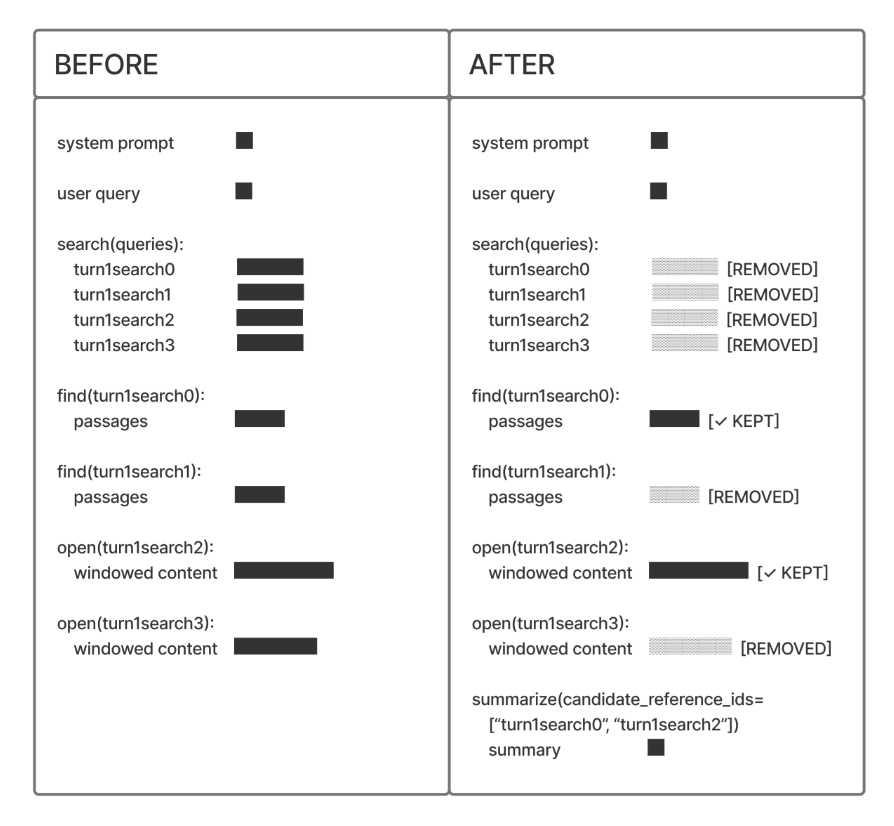

**図 2.** summarize ツールの強制呼び出しによるコンテキスト管理を伴う会話履歴例。

## 4 実験設定

長いドメイン固有文書の大規模コーパスに対し、知識労働者が多段推論を要する複雑で状況依存の問い合わせを行う現実的な企業環境で AgenticRAG を評価する。このため、8 ドメインの StackExchange 質問を含む **BRIGHT ベンチマーク** [Su24a] を採用する。文書がスニペットではなく Web ページ全体に対応し、与えられた問い合わせについて関連する完全な文書を取得する BRIGHT の長コンテキスト設定で評価する。エージェント設定では、BRIGHT の完全な Web ページを文書ファイルへ変換し、search が利用するのと同じ企業検索バックエンドへ索引付けする。Search はメタデータと参照 ID を伴うスニペットプレビューを返し、find と open はその ID から文書全文へアクセスする。取得文書の関連性を Recall@1 で測る標準プロトコルを採用する [Su24a]。AgenticRAG のモデルには、回答生成時に使う引用へ関連度スコアを付けさせ、評価用の文書順位を得る。さらに、手続き的回答に複数文書と多段推論を要する現実の企業サポート、トラブルシューティングを対象とする **WixQA** [Coh25] でも試験する。WixQA で定義された同じ LLM ベースの factuality 指標を採用する。最後に、大規模な企業財務文書に対する深い推論を要する財務質問を含む **FinanceBench** [Isl23] で評価する。各質問は単一文書に関係するため、ここでは正確な情報検索の代理として回答正解率を用いる。ベンチマークの詳細、問い合わせ集合、コーパス統計は[第 8 節](#section-8)に示す。

## 5 結果

### 5.1 BRIGHT の長コンテキスト検索

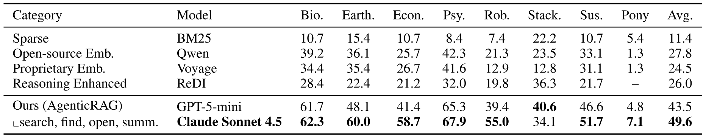

**表 2.** BRIGHT ベンチマークの未分割 StackExchange Web ページに対する長コンテキスト検索性能。スコアは recall@1。各カテゴリの最良ベースラインを示し、全結果は[表 9](#table-09)に示す。

[表 2](#table-02) は、各カテゴリで最良のベースラインを示しながら BRIGHT の検索性能を報告する。全モデルの結果は[表 9](#table-09)にあり、BM25/SBERT に対する LLM 再ランキングや ReDI などの推論拡張ベースラインを含む。search、find、open、summarize を備えたエージェント型ハーネスにより、Claude Sonnet 4.5 と GPT-5-mini はともに、8 つのベンチマーク分割すべてで全ベースラインを上回る recall@1 を達成する。AgenticRAG 検索ハーネスを用いた Claude Sonnet 4.5 は平均 recall@1 **49.6%**（最良の埋め込みモデル Qwen の 27.8% より 21.8 ポイント高い）、GPT-5-mini は 43.5%（15.7 ポイント高い）に達する。向上は各ドメインで一貫し、Economics（+33.0 ポイント）、Earth Science（+24.6 ポイント）、Robotics（+33.7 ポイント）、Psychology（+25.6 ポイント）で特に大きい。平均 16K トークンの長文書 5.65K 件という巨大コーパスでも、本手法は search による従来検索、open / find による深い推論、summarize による効果的なコンテキスト管理を組み合わせてスケールする。最良の推論拡張ベースライン ReDI は、ファインチューニング済み Qwen3-8B の分解、検索融合モデルを使い、BRIGHT 長文書設定で 26.0% recall@1 を達成する。本手法は Claude で 23.6 ポイント、GPT-5-mini で 17.5 ポイント上回る。1 回のクエリ書換えや LLM ベース再ランキングなどの静的手法は本ハーネスの反復推論に及ばず、その差はすべての分割で明確である。

### 5.2 WixQA の企業 QA

[図 3](#figure-03) は、企業サポート質問への回答に複数文書分析を要する WixQA での factuality を示す。意味埋め込みだけでは必要な文書横断推論を捉えられない一方、本ハーネスの反復検索と推論は高い性能を示す。*Expert Written* 分割では、GPT-5-mini を用いた本手法の factuality は **0.96** であり、E5 検索の 0.85、BM25 の 0.83 に対して、最良ベースラインより相対 **13%** 高い。*Simulated* 分割でも同様の向上を確認した。詳細は[第 9.3 節](#section-9-3)に示す。

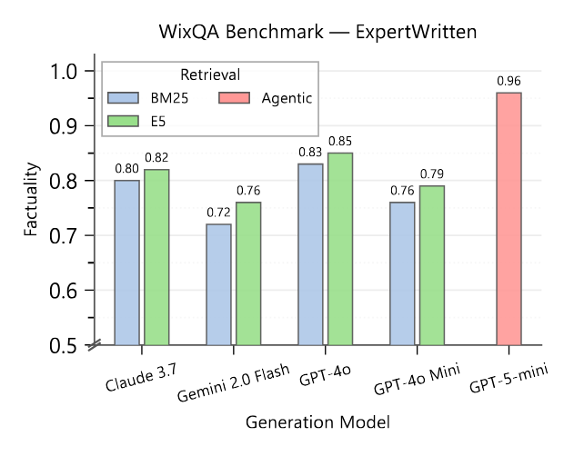

**図 3.** WixQA Expert Written データセットでの factuality（N=200）。すべての生成モデルで、エージェント型手法（赤）は BM25（青）と E5（緑）の検索ベースラインを大きく上回る。

### 5.3 FinanceBench の財務文書 QA

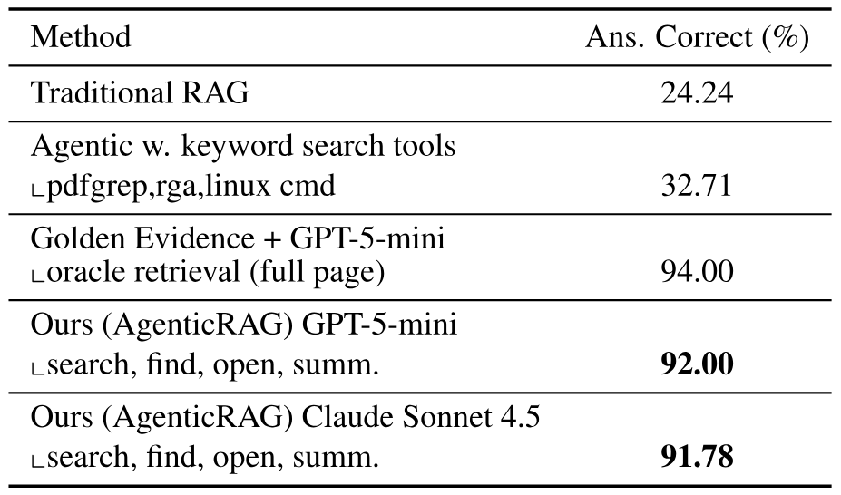

**表 3.** FinanceBench の評価結果（N=150）。

[表 3](#table-03) は、実際の財務申告書に対する質問応答を評価する FinanceBench の回答正解率を示す。検索コーパスは平均 $\sim 116\mathrm{K}$ トークン（PDF 約 $\sim 140$ ページ）の長い財務文書 84 件からなる。GPT-5-mini を用いる本エージェント型手法は **92.00%** の正解率を達成し、従来 RAG（**$3.8\times$**）を大幅に上回る。さらに、pdfgrep、rga、Linux コマンドなどのキーワード検索ツールに依存するエージェント型ツール利用ベースライン [Sub26] より一般的で、その正解率の **$2.8\times$** である。また、正解の完全なページ証拠を GPT-5-mini へ直接与え、エージェント検索を完全に迂回するベースラインも採用する。このオラクル設定は 94.00% となり、完全な証拠がある場合のモデルの推論能力上限を定める。本システムはこの上限から 2 ポイント以内であり、有効性を示している。GPT-5-mini と Claude Sonnet 4.5 のどちらに対しても、本ハーネスは同程度に有効である。

### 5.4 トークン費用と検索効率

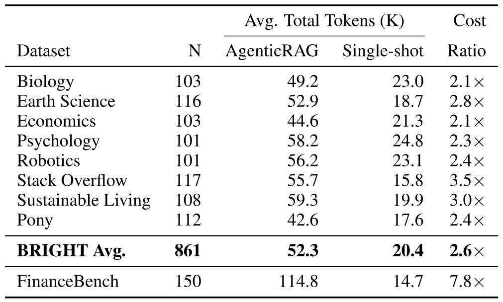

**表 4.** BRIGHT の各分割と FinanceBench における AgenticRAG と Single-shot Search の総トークン使用量比較。値は問い合わせごとの平均（千単位）で、システムプロンプト、ツール呼び出し、ツール結果、思考トークンをすべて含む。費用比は AgenticRAG の総トークン数を Single-shot Search の総トークン数で割った値である。

[表 4](#table-04) はエージェント検索のエンドツーエンドなトークン費用を定量化する。モデルの思考、ツール呼び出し引数、取得されたツール結果、最終回答生成を含む、対話全体の総トークンを測定する。BRIGHT では AgenticRAG は問い合わせ当たり平均 52.3K トークン、Single-shot Search は 20.4K で、$2.6\times$ のトークンオーバーヘッドとなる。この費用は、それ以上の品質向上をもたらす。Claude Sonnet 4.5 と AgenticRAG の recall@1 は 49.6% で、Single-shot Search の 8.41% に対して $5.9\times$ 高い。FinanceBench はより高価で、問い合わせ当たり平均 114.8K トークン、単発検索の $7.8\times$ となる。これは長い財務申告書内を深く移動することを反映する。この高い費用に対し回答正解率は 92.00% で、オラクル証拠の上限 94.00% に近い。[表 5](#table-05) のツール利用は、問い合わせ当たり平均 4.48-4.79 回で、システムが 15 反復予算の十分内側で動作することも示す。複数クエリのアブレーションは効率を直接比較できる。完全なシステムは平均 4.79 回のツール呼び出しで同程度の再現率を達成するのに対し、複数クエリ検索なしでは 6.79 回となり、呼び出し回数を 29% 削減する。

### 5.5 アブレーション研究

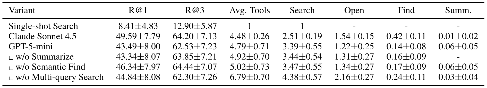

**表 5.** BRIGHT 全分割で平均したエージェント構成要素のアブレーション。性能は再現率（R@k）、平均ツール使用量、ツール別統計で測定する。分割別の結果は[表 10](#table-10)に示す。

**単発検索とエージェント検索。** [表 5](#table-05) で最も顕著な結果は、単発検索から完全なエージェント型ツール利用への移行による大幅な向上である。単発検索の平均 recall@1 は 8.41% にすぎないが、エージェント型ツール利用は GPT-5-mini で **43.49%**、Claude Sonnet 4.5 で **49.59%** に達し、それぞれ **$5.2\times$**、**$5.9\times$** の向上である。search の背後にある専有検索スタックは、[表 2](#table-02) の最先端埋め込み検索器と比べ、速度、巨大規模、可用性のために生の検索品質をトレードオフしている。しかし、推論言語モデルとともにエージェント型ハーネスを用いると、この品質差は消える。向上は全分割で一貫している（[表 10](#table-10) 参照）。

**モデル比較とツール利用パターン。** Claude Sonnet 4.5 は GPT-5-mini より **6.1 ポイント**高く、8 分割中 7 分割で上回る（詳細は[表 10](#table-10)）。2 モデルは探索と活用のトレードオフを反映した異なる戦略を示す。Claude は*活用*を好み、search 呼び出しは少ない（2.51 対 3.39）が、開く文書は多く（1.54 対 1.22）、意味 find への依存も強い（0.42 対 0.14、$3\times$ 増加）ため、候補文書をより深く読む。GPT-5-mini は*探索*を好み、文書内 find より再定式化した問い合わせによる search を多く発行し、コーパスへ広く網を張る。BRIGHT 長文書設定では、大規模コーパス内で問い合わせ当たりの正解文書は平均 $\sim 1.9$ 件だけである。関連文書が疎なため、広い探索は無関係な結果を見つけることが多い。

**失敗パターン。** 主な弱点は広範な複数証拠検索であり、特に Pony 分割で顕著である。BRIGHT 全体では問い合わせ当たり平均 $\sim 1.9$ 件だが、Pony では正解文書が平均 $\sim 6.9$ 件ある。この設定は多数の関連文書を回収するほど有利だが、本ハーネスは少数の価値が高い証拠へ向かう粗密ナビゲーションに最適化されている。関連文書が疎な科学、技術分割で大きく向上する一方、両モデルが Pony を難しく感じる理由はここにある。このパターンから、将来の軌跡ポリシーは広範な証拠要求をよりよく検出し、最終ランキング前に深さ優先の文書読解から幅広い被覆へ移る必要がある。

**構成要素の寄与。** GPT-5-mini で個々の構成要素を除き、寄与を調べる。最も顕著な結果は複数クエリ検索に関するものである。既定構成では、モデルは 1 回の search 呼び出しで最大 5 個のクエリを並列に発行でき、結果は重複排除してまとめて提示される。単一クエリ検索（**w/o Multi-query Search**、44.84%）へ制限し、各 search 呼び出しで 1 クエリのみ発行しながら同数の結果を受け取ると、recall@1 は完全なシステムと同程度だが、ツール利用は平均 4.79 回から 6.79 回へ増える。search 操作（3.39 から 4.38）と文書 open（1.22 から 2.16）が特に増える。複数クエリ検索は、少ない反復で関連文書を発見して効率を高めることを示している。詳細は[第 9.2 節](#section-9-2)に示す。

**プリプロダクション導入からの知見** プリプロダクション評価では、モデルをより適切な軌跡へ導く設計を複数確認した。（1）**検索結果に文書メタデータを表示すること**：タイトル、ファイル名、ファイル種別により、意味が似たスニペットを区別し、重複検索を避けられる。（2）**行番号付き文書プレビュー**：特定内容を基準にし、後続の open 呼び出しで関連節へ移動できる。（3）**要約後も候補参照をコンテキストウィンドウへ保持すること**：再定式化クエリで検索を再開せず、open/find で有望な候補を掘り下げられる。（4）**切替器を用いること**：複雑な複数意図の問い合わせを Agentic RAG ハーネスへ送り、深く分析する。単純な問い合わせは高速な回答のため従来 RAG へ送る。これはユーザー体験、費用、モデル可用性のトレードオフに不可欠である。初期段階で良好な兆候があり、このハイブリッド手法を引き続き追究する。

## 6 結論

推論言語モデルへ search、find、open、summarize を与え、大規模企業コーパスから自律的に検索、推論する実用的な AgenticRAG ハーネスを提示した。3 ベンチマークで、BRIGHT の recall@1 49.6%（最良の埋め込みベースラインより 21.8 ポイント高い）、WixQA の factuality 0.96（相対 13% 向上）、FinanceBench の回答正解率 92.00%（オラクルアクセスとの差は 2 ポイント以内）を達成した。トークン分析では、BRIGHT における単発検索比で中程度の $2.6\times$ オーバーヘッドにより、recall@1 を $5.9\times$ 向上できることを示した。深い多段推論を必要とする企業情報検索タスクにおいて、本ハーネスが推論モデルの価値を効果的に引き出すことを結果は示している。今後は、大規模導入、従来 RAG と Agentic RAG の予算認識ルーティング、より深い失敗分析、反復回数とウィンドウサイズ予算のアブレーション、ファインチューニングによる高速な反復推論のための検索軌跡最適化に取り組む。

## 謝辞

社内実験におけるフィードバックと議論について、Eli Coon、Kinfe Mengistu、Copilot Studio チームのメンバーに感謝する。技術指導とプロジェクト支援を提供した James Cai と Alejandro Gutierrez Munoz に特に感謝する。

## 7 手法の詳細

### 7.1 エージェントループのアルゴリズム

詳細なエージェントループを[アルゴリズム 1](#algorithm-01)に示す。

**アルゴリズム 1：エージェントループ。**

- **要求：** $\mathrm{user\_query}$、$\mathrm{max\_calls}$、$\mathrm{token\_threshold}$。
- **保証：** 引用付きの整形済み回答。
- $\mathrm{conversation}.\mathrm{add}(\mathrm{user\_query})$。
- $i=1$ **から** $\mathrm{max\_calls}$ **まで反復：**
  - **もし** $\mathrm{tokens}(\mathrm{conversation})\geq\mathrm{token\_threshold}$ **なら：**
    - $\mathrm{ManageContext}()$。*要約を強制する。*
  - $\mathrm{response}\leftarrow\mathrm{LLM}(\mathrm{conversation},\mathrm{tool\_schemas})$。
  - **もし** $\mathrm{response}.\mathrm{has\_tool\_calls}$ **なら：**
    - $\mathrm{response}.\mathrm{tool\_calls}$ **内の各** $\mathrm{tool\_call}$ **について：**
      - $\mathrm{result}\leftarrow\mathrm{ExecuteTool}(\mathrm{tool\_call})$。
      - $\mathrm{conversation}.\mathrm{add}(\mathrm{tool\_call},\mathrm{result})$。
  - **それ以外：**
    - **返す：** $\mathrm{FormatAnswer}(\mathrm{response}.\mathrm{text})$。
- **返す：** $\mathrm{ForceFinalAnswer}()$。

### 7.2 ツール利用のシステム指示

全体的な指示：

- 不確かな場合は回答前に検索する。
- スニペットが不十分なら find または open で段階的に探索する。
- 再検索せず、以前の結果を再利用する。
- ツール出力の情報を利用するたびに引用する。

search を使う場合：

- 企業コーパス全体の主要検索ツール。
- あらゆる業務関連問い合わせで最初に選ぶ。
- 現在または変化する情報、企業固有の用語、略語にユーザーが言及した場合。
- 推測せず詳細を確認する場合。

find を使う場合：

- 検索結果の関連ファイル内でパターンを検索する場合。
- 検索結果に十分な詳細がない場合。
- 特定用語に関係する結果を絞って見る場合。

open を使う場合：

- 検索結果の関連ファイルからウィンドウ化した全文を取得する場合。
- 検索結果スニペットが不十分な場合。
- 最も有望な結果からさらに内容を得る場合。
- 複数の検索結果を開ける。
- 関連内容に近い行番号を選べる。

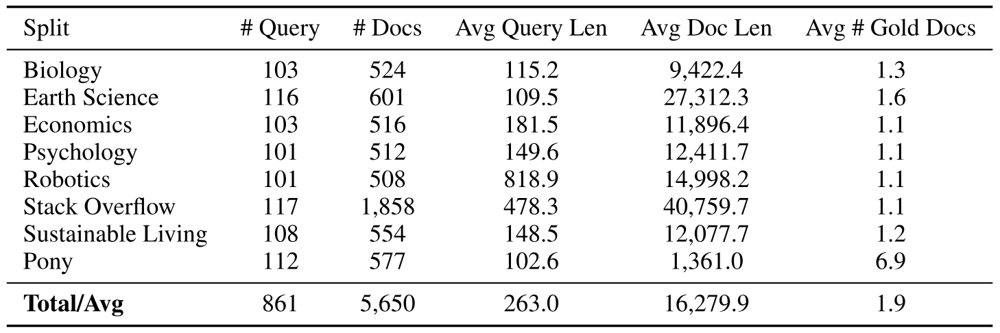

**表 6.** 評価に用いた BRIGHT ベンチマーク [Su24a] の長コンテキスト分割に関するデータ統計。

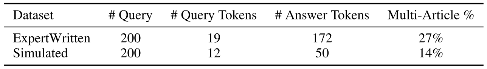

**表 7.** WixQA [Coh25] ベンチマークのデータ統計（中央値）。

## 8 データセットの詳細

### 8.1 BRIGHT ベンチマーク

現実的な企業情報検索シナリオを捉えるよう設計された BRIGHT ベンチマーク [Su24a] を採用する。BRIGHT は StackExchange 投稿から問い合わせを作り、人間が書いた高度に状況依存かつドメイン固有の情報要求を反映する。各問い合わせについて、コーパスには高得票回答で引用され人手で検証された正例文書と、検索エンジンで収集された負例文書が含まれる。コーパスは Wikipedia ページ、ブログ、報告書などの正規化 Web コンテンツである。この構成は、関連文書と非関連文書の間に大きな意味的重複を持つ現実的な検索プールを生成することが示されている。文書がスニペットではなく Web ページ全体に対応し、完全な関連文書を取得する BRIGHT の長コンテキスト設定で評価する。実験は Biology、Earth Science、Economics、Psychology、Robotics、Stack Overflow、Sustainable Living、Pony の 8 ドメインにわたる。これらは企業情報検索で一般的な科学、技術、専門分野を広く覆う。各ドメインのコーパスには数百から数千文書があり、平均文書長は数千から 40K トークン超である。問い合わせも短くなく、多くのドメインで平均 100 トークンを超え、Robotics や Stack Overflow などでは数百トークンに達する。統計は[表 6](#table-06)に示す。BRIGHT の標準評価プロトコルに従い、長コンテキスト文書検索の Recall@1 を報告する。

### 8.2 WixQA ベンチマーク

WixQA は、多段推論と企業固有の語彙を必要とする手続き的な長文問い合わせを対象とし、実際のサポートとトラブルシューティングに近い。実験では WiXQA の 2 サブセットを用いる。*Expert Written* は、実際の顧客問い合わせと、人間のドメイン専門家が執筆、検証した段階的回答を含む。*Simulated* は、複数ターンのユーザーとチャットボットの対話を単一ターンの問い合わせへ整理し、手続き的な正しさを専門家が検証したものである。WixQA の特徴は複数記事への依存であり、1 問への回答に複数文書からの情報検索と統合を要することがある。全問い合わせは、ドメイン固有のヘルプ記事 6,221 件からなる共通の企業規模知識ベースに基づく。このため WixQA は、複雑な複数文書企業コーパス上で検索と推論を協調させる Agentic RAG の評価に適している。データセット統計は[表 7](#table-07)に示す。

### 8.3 FinanceBench

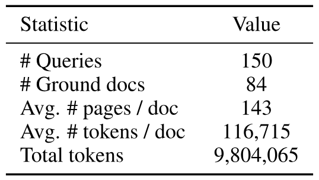

**表 8.** FinanceBench [Isl23] のデータ統計。

FinanceBench [Isl23] は、公開企業の申告書（PDF の 10-K、10-Q、8-K、決算報告書）に関する財務質問からなる、人手評価ベンチマークである。質問は指標生成型とドメイン関連型に分かれる。指標生成型は特定の財務項目または比率を対象とし、モデルが文書内のデータを見つけ、多くの場合に計算する必要がある。各問に一意で曖昧さのない回答があるため検証しやすい。ドメイン関連型は、利益率変化の要因特定や資本集約度の評価など、より深い財務推論を要する。各問い合わせは 1 文書に関係する。文書が大きい（PDF 当たり平均 $\sim 143$ ページ、$\sim 117\mathrm{K}$ トークン）ため、知識労働者が日常的に扱う情報量の多いマニュアル、報告書、規制申告書を代表するものとして採用した。コーパス統計は[表 8](#table-08)に示す。評価指標は回答正解率である。LLM を判定器として用い、結果の手動確認も行う。

## 9 追加結果

### 9.1 BRIGHT の全検索結果

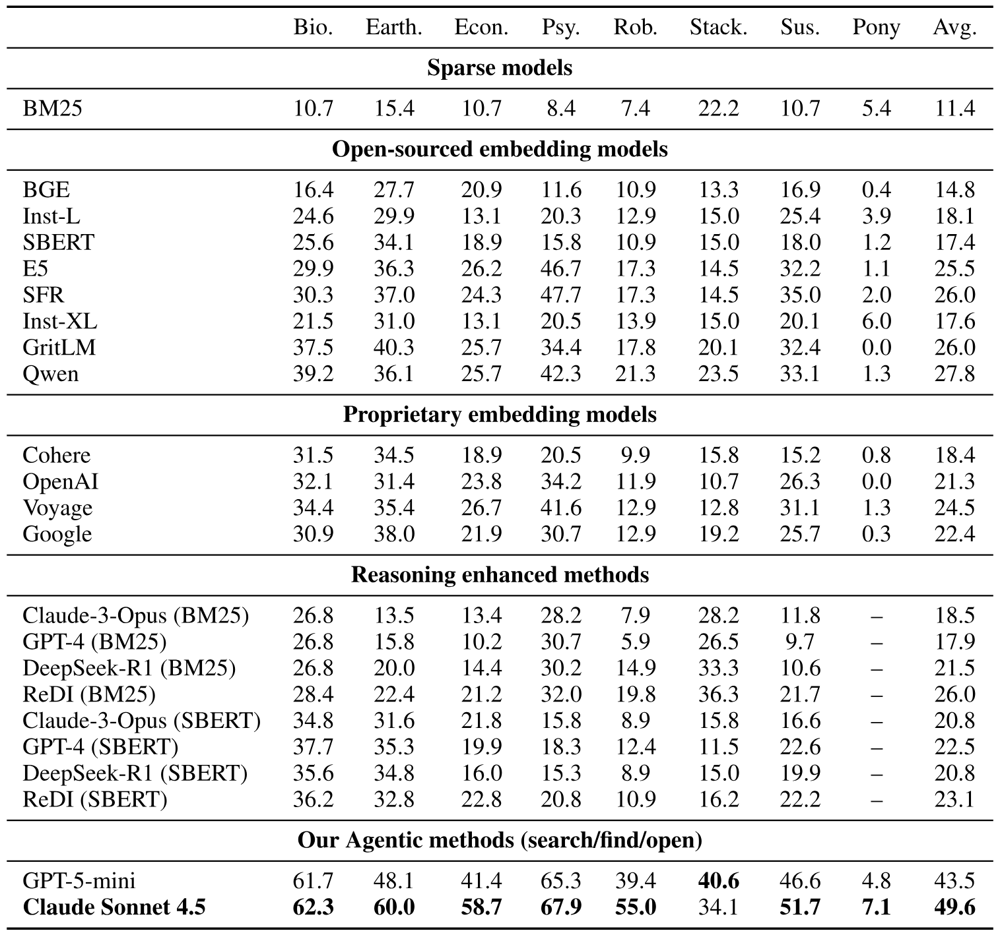

**表 9.** BRIGHT の未分割 StackExchange Web ページに対する完全な長コンテキスト検索性能。スコアは recall@1。

[表 9](#table-09) は BRIGHT における全ベースラインモデルの完全な検索結果を示す。

### 9.2 詳細なアブレーション分析

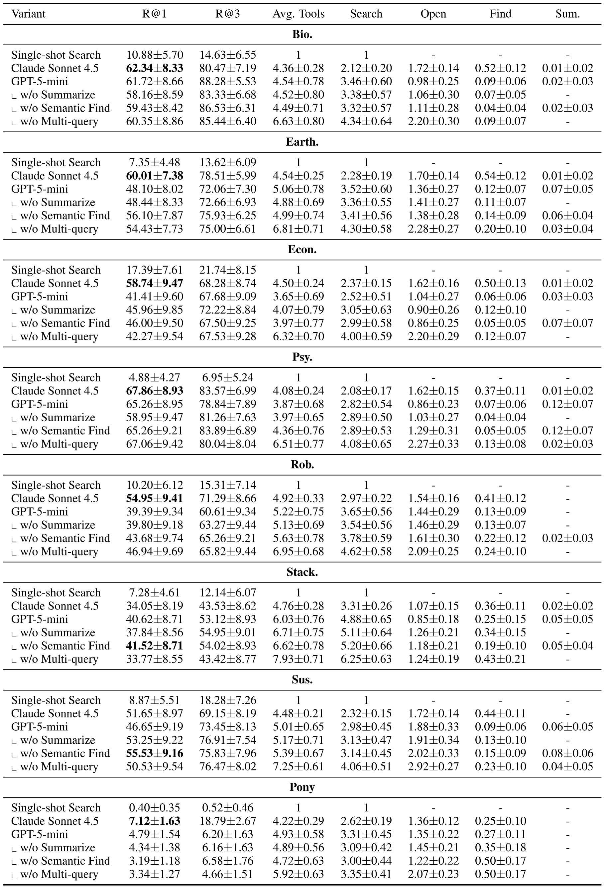

**表 10.** BRIGHT の分割別エージェント構成要素アブレーション。性能は再現率（R@k）、平均ツール使用量、ツール別使用統計で測定する。

[表 10](#table-10) は BRIGHT 全ドメインの分割別アブレーション結果を示す。要約ツールを除く（**w/o Summarize**、平均 recall@1 43.34%）影響は小さく、検索タスクでこの構成要素が必要になることは少ないと分かる。意味 find を除く（**w/o Semantic Find**、46.34%）と平均 recall@1 はわずかに*向上*する。字句 find のフォールバックが大半の文書内検索に十分であり、意味オプションを除くとレイテンシが下がり、同じ計算予算で検索反復を増やせるためと考えられる。

### 9.3 WixQA Simulated の結果

[図 4](#figure-04) に示すように、専門家が検証した正解を持つ模擬質問、すなわち WixQA の *Simulated* 分割で、本手法の factuality は **0.94** であり、E5+GPT-4o と E5+Claude 3.7 はともに 0.77 である。このデータセットでは差がさらに大きく、相対 **22%** 向上する。より複雑な推論またはマルチホップ情報収集を要する質問で、エージェント検索が特に有効であることを示唆する。

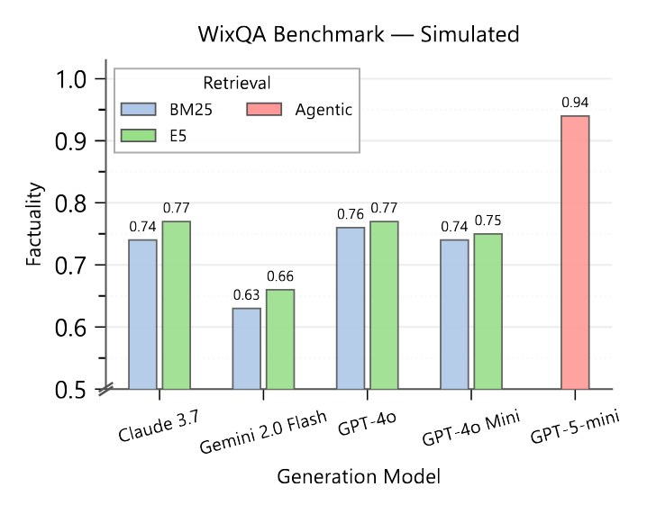

**図 4.** WixQA Simulated データセットでの factuality。複雑な推論を要する合成質問では、エージェント検索と従来手法の性能差がさらに大きい。

### 9.4 会話例

[図 5](#figure-05) は FinanceBench の会話例を示す。

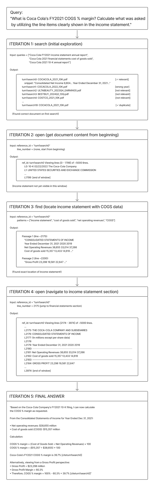

**図 5.** FinanceBench の会話例。

[+equal]: 同等の貢献。

[+susheel-email]: `sussuresh@microsoft.com`

[+hazel-email]: `hazelmak@microsoft.com`
