> [Minguk Kang](https://mingukkang.github.io/), [Jun-Yan Zhu](https://www.cs.cmu.edu/~junyanz/), [Richard Zhang](https://richzhang.github.io/), [Jaesik Park](https://jaesik.info/), [Eli Shechtman](https://research.adobe.com/person/eli-shechtman/), [Sylvain Paris](https://www.sylvainparis.com/), and [Taesung Park](https://taesung.me/). First submitted to arXiv on March 9, 2023; current version v2. Published in the [2023 IEEE/CVF Conference on Computer Vision and Pattern Recognition](https://openaccess.thecvf.com/content/CVPR2023/html/Kang_GigaGAN_A_Unified_Approach_to_Generative_Adversarial_Networks_for_Text-to-Image_CVPR_2023_paper.html). [Scaling up GANs for Text-to-Image Synthesis](https://arxiv.org/abs/2303.05511). <a href="/paper/gigagan.pdf" target="_blank" rel="noopener noreferrer">原 PDF</a>. [TeX ソース](https://export.arxiv.org/e-print/2303.05511v2). 正確な印刷レイアウトと参考文献については原 PDF を正とする。

## 概要

テキストから画像への生成の最近の成功は世界を席巻し、一般の人々の想像力を捉えた。技術的な観点から見ると、この成功は生成画像モデルを設計するための好まれるアーキテクチャを劇的に変えたことも意味する。GAN は StyleGAN のような手法により、かつては当然の選択肢だった。DALL$\cdot$E 2 の登場とともに、自己回帰モデルと拡散モデルが一夜にして大規模生成モデルの新しい標準となった。この急速な転換は、基本的な疑問を提起する。LAION のような大規模データセットから利益を得るために GAN をスケールアップできるだろうか。StyleGAN アーキテクチャの容量を単純に増やしても、すぐに不安定になることが分かった。本稿では、この限界を大きく超える新しい GAN アーキテクチャ GigaGAN を導入し、GAN がテキストから画像への生成の実行可能な選択肢であることを示す。GigaGAN は 3 つの主要な利点を提供する。第一に、推論時に桁違いに高速であり、512px 画像の生成に 0.13 秒しかかからない。第二に、高解像度画像を生成でき、例えば 16 メガピクセルの画像を 3.66 秒で生成できる。最後に、GigaGAN は潜在空間補間、スタイル混合、ベクトル演算のようなさまざまな潜在空間編集アプリケーションを支援する。

## 1 はじめに

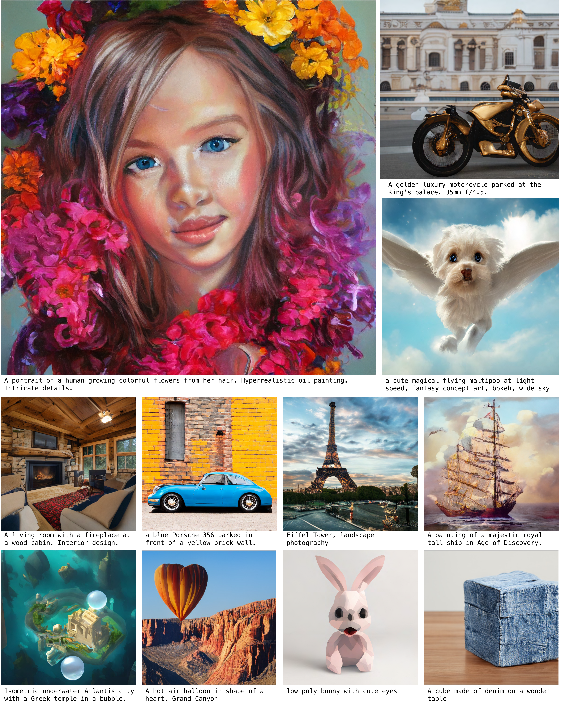

**図 1.** 本モデル GigaGAN は、GAN フレームワークも一般のテキストから画像への生成タスクにスケールアップできることを示し、0.13 秒の対話的な速度で 512px 出力を生成し、4096px を 3.7 秒で生成する。2K または 4K 解像度での選別例を示す。詳細は拡大して確認してほしい。未選別の比較については付録 8 とウェブサイトを参照。

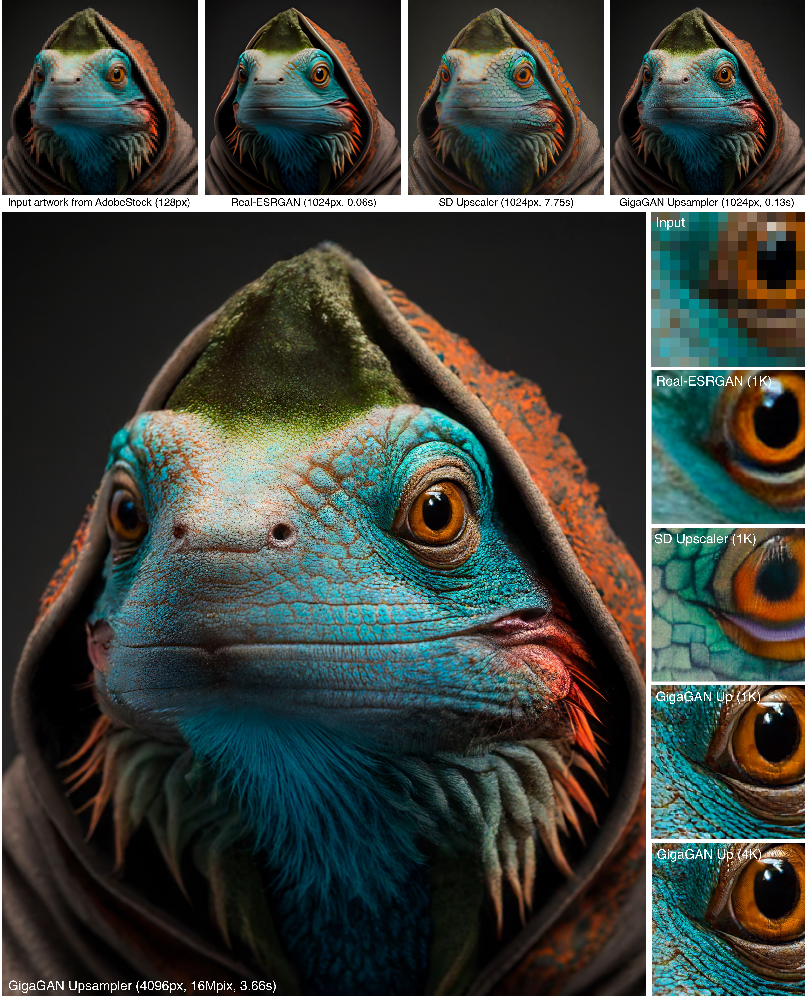

**図 2.** GAN ベースのアップサンプラーは、64px や 128px のような低解像度で初期出力を生成することが多い多くのテキストから画像へのモデルのアップサンプリングパイプラインに利用できる。本稿では、テキスト条件付き 8$\times$ 超解像モデルを低解像度 128px のアートワークに適用して 1K 出力を得ることで、このような利用をシミュレートする。プロンプトは "Portrait of a colored iguana dressed in a hoodie" を用いる。その後、モデルを再適用して 4K を超える出力を得られる。Stable Diffusion のテキスト条件付きアップサンプラー [Sta22] と無条件の Real-ESRGAN [Wan21i] と比較する。1K と 4K の比較には拡大を推奨する。

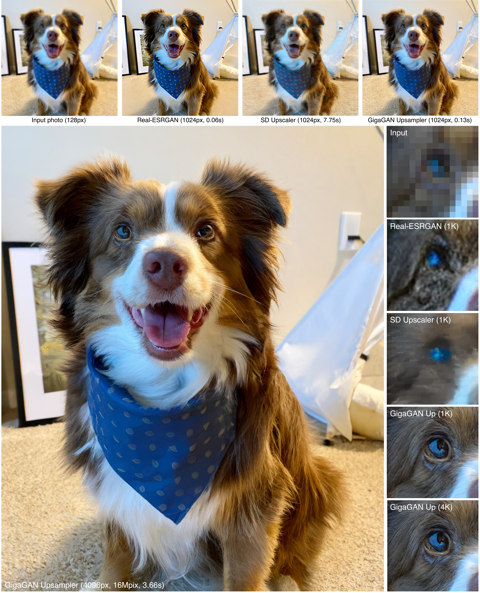

**図 3.** [図 2](#figure-02) と同様に、GAN ベースのアップサンプラーは、画像に適切な説明を与えることで、実画像に対するオフ・ザ・シェルフの超解像モデルとしても使える。テキスト条件付き 8$\times$ 超解像モデルを低解像度 128px の写真に適用し、プロンプト "A dog sitting in front of a mini tipi tent" を用いて 1K 出力を得る。その後、モデルを再適用して 4K を超える出力を得られる。Stable Diffusion のテキスト条件付きアップサンプラー [Sta22] と無条件の Real-ESRGAN [Wan21i] と比較する。1K と 4K の比較には拡大を推奨する。

最近公開された DALL$\cdot$E 2 [Ram22]、Imagen [Sah22a]、Parti [Yu22]、Stable Diffusion [Rom22] といったモデルは、画像生成の新たな時代を切り開き、かつてない画像品質とモデルの柔軟性を達成した。現在主流のパラダイムである拡散モデルと自己回帰モデルは、いずれも反復的な推論に依存する。これは両刃の剣であり、反復的手法は単純な目的関数で安定した学習を可能にする一方、推論時の計算コストが高くなる。

これに対し、単一の順伝播で画像を生成するため本質的に効率的な Generative Adversarial Networks (GAN) [Goo14a, Rad15, Kar19, Bro19] がある。このようなモデルは以前の生成モデリングの「時代」を支配していたが、学習手順の不安定性のため、ネットワークアーキテクチャと学習上の考慮事項を慎重に調整しなければスケールできない。そのため GAN は単一または複数の物体クラスのモデリングでは優れていたが、複雑なデータセット、ましてやオープンワールドへのスケールは困難だった。結果として、超大規模モデル、データ、計算資源は拡散モデルと自己回帰モデルに集中している。本研究では、GAN をさらにスケールアップし、そのような資源から利益を得られるのか、それとも頭打ちなのか、という問いを立てる。何がさらなるスケールを妨げているのか、そしてそれらの障壁を克服できるのか。

まず StyleGAN2 [Kar20b] を用いて実験し、バックボーンを単純にスケールすると学習が不安定になることを観察した。いくつかの主要な問題を特定し、モデル容量を増やしながら学習を安定化する技法を提案する。第一に、フィルタのバンクを保持し、サンプル固有の線形結合を取ることで、生成器の容量を効果的にスケールする。また、拡散の文脈でよく用いられる技法をいくつか適用し、GAN に対しても同様の利点をもたらすことを確認した。例えば、畳み込み層と自己注意（画像のみ）および交差注意（画像-テキスト）の両方を交互に配置すると性能が向上する。

さらに、マルチスケール学習を再導入し、画像-テキストの整合性と生成出力の低周波詳細を改善する新しいスキームを見出した。マルチスケール学習により、GAN ベースの生成器は低解像度ブロックのパラメータをより効果的に使えるようになり、画像-テキスト整合性と画像品質が向上する。慎重な調整の結果、LAION2B-en [Sch22b] のような大規模データセット上で 10 億パラメータの GAN (GigaGAN) を安定かつスケーラブルに学習できた。結果は [図 1](#figure-01) に示す。

また、本手法は多段階アプローチ [Den15, Zha17c] を用いる。まず $64\times 64$ で生成し、その後 $512\times 512$ にアップサンプリングする。これら 2 つのネットワークはモジュール化されており、プラグ・アンド・プレイ方式で使えるほど堅牢である。学習時に拡散画像を一度も見ていないにもかかわらず、テキスト条件付き GAN ベースのアップサンプリングネットワークが DALL$\cdot$E 2 のようなベース拡散モデルの効率的で高品質なアップサンプラーとして使えることを示す ([図 2](#figure-02))。

これらの進歩により、GigaGAN は従来の GAN を大きく超える。StyleGAN2 [Kar20b] の 36 倍、StyleGAN-XL [Sau22] と XMC-GAN [Zha21n] の 6 倍の規模である。10 億パラメータは Imagen (3.0B)、DALL$\cdot$E 2 (5.5B)、Parti (20B) といった最近の大規模合成モデルよりまだ少ないが、モデルサイズに関して品質の飽和はまだ観察していない。GigaGAN は COCO2014 データセットでゼロショット FID 9.09 を達成し、DALL$\cdot$E 2、Parti-750M、Stable Diffusion の FID を下回る。

さらに、GigaGAN には拡散モデルや自己回帰モデルと比較して 3 つの主要な実用上の利点がある。第一に桁違いに高速で、512px 画像を 0.13 秒で生成できる ([図 1](#figure-01))。第二に、4k 解像度の超高解像度画像を 3.66 秒で合成できる。第三に、制御可能な潜在ベクトル空間を備え、スタイル混合 ([図 6](#figure-06))、プロンプト補間 ([図 7](#figure-07))、プロンプト混合 ([図 8](#figure-08)) といった十分に研究された制御可能な画像合成アプリケーションに適している。

要約すると、本モデルは数十億の実世界の複雑なインターネット画像上で 10 億規模のモデルを学習することに成功した最初の GAN ベースの手法である。これは GAN がテキストから画像への生成に対して依然として実行可能な選択肢であり、今後の積極的なスケーリングにおいて考慮されるべきであることを示唆する。追加の結果は [ウェブサイト](https://mingukkang.github.io/GigaGAN/) を参照。

## 2 関連研究
**テキストから画像への合成。**
テキスト記述から写実的な画像を生成することは難しい課題であり、初期の研究 [Zhu07, Man16] から探究されてきた。一般的なアプローチは、特定領域 [Wel10] と閉じた世界の仮定を置くデータセット [Lin14a] に対して、テキスト条件付き GAN [Ree16a, Ree16, Zha17c, Xu18a, Zhu19b, Tao22] を用いることである。拡散モデル [Den20, Dha21]、自己回帰 (AR) Transformer [Che20b]、大規模言語エンコーダ [Raf20a, Rad21] の発展により、任意のテキスト記述を扱うオープンワールドで、テキストから画像への合成は大きく改善した。GLIDE [Nic22]、DALL$\cdot$E 2 [Ram22]、Imagen [Sah22a] は、事前学習済み言語エンコーダ [Rad21, Raf20a] の助けを借りて写実的な出力を生成する代表的な拡散モデルである。DALL$\cdot$E [Ram21]、Make-A-Scene [Gaf22]、CogView [Din21, Din22a]、Parti [Yu22] などの AR モデルも優れた結果を達成している。これらのモデルは前例のない画像合成能力を示す一方、高品質なサンプリングには時間のかかる反復処理を必要とする。

サンプリングを高速化するため、いくつかの手法はサンプリングステップを減らす [Men22a, Sal22, Son21a, Lu22c]、または事前計算済みの特徴を再利用する [Li22g] ことを提案している。Latent Diffusion Model (LDM) [Rom22] は、ピクセル空間ではなく低次元の潜在空間で逆過程を実行する。しかし、連続する逆過程には依然として大きな計算コストがかかり、大規模なテキストから画像へのモデルをインタラクティブなアプリケーションで利用することを制限している。
**GAN に基づく画像合成。**
GAN [Goo14a] は自然画像合成の主要な生成モデル群の 1 つである。GAN のサンプリング品質と多様性が向上するにつれて [Rad15, Kar18a, Kar19, Kar20b, Kar21, Kum22a, Sau21]、GAN はテキストから画像への合成 [Ree16]、画像から画像への変換 [Iso17, Zhu17, Hua18b, Lee18d, Par19c, Par20c]、画像編集 [Zhu16, Bro17, Abd19a, Pat21] など、さまざまなコンピュータビジョンとグラフィックスの応用に使われてきた。特に StyleGAN 系列のモデル [Kar20b, Kar21] は、単一カテゴリの領域における画像合成タスクで高い能力を示している [Abd19a, Zhu20a, Wul20, Har20c, Pat21]。他の研究では、物体カテゴリが固定されたデータセット上でクラス条件付き GAN [Zha19m, Bro19, Kan21, Zha20c, Sau22] が探究されている。

本稿では、データの条件を単一または複数カテゴリのデータセットから、データが極めて豊富な状況へ変更する。LAION2B-en [Sch22b] や COYO-700M [Bye22] のような大量のウェブクロール済みテキスト画像ペアを使い、テキストから画像への生成のための大規模 GAN を学習することに初めて取り組む。既存の GAN ベースのテキストから画像への合成モデル [Ree16, Zha17c, Xu18a, Zhu19b, Lia20, Zha21n, Tao22] は、CUB-200 (12k の学習ペア)、MSCOCO (82k)、LN-OpenImages (507k) など、比較的小規模なデータセットで学習されている。また、これらのモデルは対応する検証データセットで評価されているが、それらが拡散モデルや AR モデルのような大規模なテキスト画像合成を実行できることは検証されていない。

本手法と同時期に、StyleGAN-T [Sau23] と GALIP [Tao23a] も同様の目標を共有し、補完的な知見を示している。
**大規模テキストから画像へのモデルの超解像。**
大規模モデルは、学習と推論の両方で非常に大きな計算コストを必要とする。メモリ使用量と実行時間を減らすため、最先端のテキストから画像へのモデル [Nic22, Ram22, Sah22a, Yu22] はカスケード型の生成過程を採用している。この過程では、まず $64\times64$ の解像度で画像を生成し、続いて $256\times256$ と $1024\times1024$ へ順にアップサンプリングする。しかし、超解像ネットワークは主に拡散モデルに基づいており、多くの反復を必要とする。これに対し、低解像度画像の生成器とアップサンプラーを GAN に基づいて構成することで、両段階の計算コストを減らす。圧縮アーティファクトのような画像劣化を扱う、または低解像度入力を忠実に再現する従来の超解像技術 [Don15, Led17, Wan18h, Anw20] とは異なり、大規模モデル用のアップサンプラーには別の目的がある。より大きなアップサンプリング倍率で処理しつつ、入力テキストプロンプトを利用できる必要がある。

## 3 方法

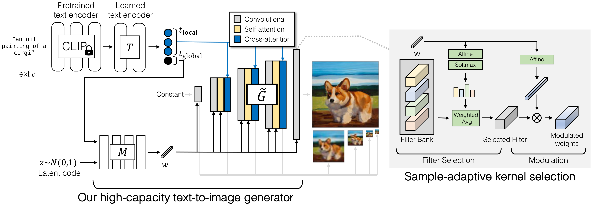

**図 4.** GigaGAN の高容量テキストから画像への生成器。まず、事前学習済みの CLIP モデルと学習済みエンコーダ $T$ を使用してテキスト埋め込みを抽出する。局所テキスト記述子はクロスアテンションで生成器に供給される。グローバルテキスト記述子と潜在コード $\mathbf{z}$ は、スタイルコード $\mathbf{w}$ を生成するスタイルマッピングネットワーク $M$ に供給される。スタイルコードは、右側に示すスタイル適応カーネル選択を使用してメインの生成器を変調する。生成器は、中間特徴を RGB 画像に変換することで画像ピラミッドを出力する。より高い容量を達成するため、各スケールで複数の注意層と畳み込み層を使用する ([表 A2](#table-07))。別途示されていないアップサンプラーモデルも使用される。

潜在コード $\mathbf{z} \sim \mathcal{N}(0, 1) \in \mathbb{R}^{128}$ とテキスト条件付き信号 $\mathbf{c}$ が与えられたとき、生成器 $G(\mathbf{z}, \mathbf{c})$ が画像 $\mathbf{x}\in \mathbb{R}^{H\times W\times 3}$ を予測するように学習する。生成された画像のリアルさを判断するために、画像-テキストペアを含む学習データベース $\mathcal{D}$ からのサンプルと比較して判別器 $D(\mathbf{x}, \mathbf{c})$ を使用する。

GANs [Kar18a, Kar19, Bro19] は単一カテゴリデータセットやマルチカテゴリデータセット [Kar19, Yu15a, Den09a] で現実的な画像を生成できるが、インターネット画像上のオープンエンドなテキスト条件付き合成は依然として困難である。現在の限界は畳み込み層への依存に起因すると仮説する。つまり、同じ畳み込みフィルタが、画像内のすべての場所におけるすべてのテキスト条件に対する一般画像合成関数をモデル化しなければならないという点にある。この観点から、入力条件に基づいて動的に畳み込みフィルタを選択し、注意機構によって長距離依存を捉えることで、パラメータ化にさらなる表現性を注入することを目指す。

以下では、ConvNet をより表現力豊かにするための主要な貢献について論じる ([第 3.1 節](#section-3-1))。続いて生成器の設計 ([第 3.2 節](#section-3-2)) と判別器の設計 ([第 3.3 節](#section-3-3)) について述べる。最後に、当社の手法や Imagen [Sah22a] や DALL$\cdot$E 2 [Ram22] のような拡散モデルの推論品質と速度を向上させる、新しい高速 GAN ベースのアップサンプラーモデルを紹介する。

### 3.1 複雑な文脈相互作用のモデル化
**Baseline StyleGAN generator.**
生成器のアーキテクチャは、StyleGAN2 [Kar20b] の条件付きバージョンをベースとし、2 つのネットワーク $G = \widetilde{G}\circ M$ で構成される。マッピングネットワーク $\mathbf{w}=M(\mathbf{z},\mathbf{c})$ は入力を「スタイル」ベクトル $\mathbf{w}$ にマッピングし、このベクトルが合成ネットワーク $\widetilde{G}(\mathbf{w})$ 内の一連のアップサンプリング畳み込み層を変調して、学習済みの定数テンソルを出力画像 $\mathbf{x}$ にマッピングする。畳み込みはすべての出力ピクセルを生成する主なエンジンであり、$\mathbf{w}$ ベクトルが条件付けをモデル化する唯一の情報源である。
**Sample-adaptive kernel selection.**
インターネット画像の非常に多様な分布を扱うため、畳み込みカーネルの容量を増やすことを目指す。しかし、畳み込み層の幅を増やすと、同じ操作がすべての場所で繰り返されるため、要求が高くなりすぎる。

畳み込みカーネルの表現性を高める効率的な方法を提案する。テキスト条件に基づいてカーネルをその場で作成することで、実現する。このスキームでは、単一のフィルタではなく、各層で特徴 $\mathbf{f} \in \mathbb{R}^{C_\text{in}}$ を取る $N$ 個のフィルタのバンク $\{\mathbf{K}_i \in \mathbb{R}^{C_{\text{in}} \times C_{\text{out}} \times K \times K} \}_{i=1}^N$ をインスタンス化する。スタイルベクトル $\mathbf{w} \in \mathbb{R}^{d}$ は、アフィン層 $[W_\text{filter}, b_\text{filter}] \in \mathbb{R}^{(d + 1) \times N}$ を経由してフィルタ全体の平均を取るための重みセットを予測し、集約フィルタ $\mathbf{K} \in \mathbb{R}^{C_{\text{in}} \times C_{\text{out}} \times K \times K}$ を生成する。

$$
\mathbf{K} = \sum_{i=1}^N \mathbf{K}_i \cdot \text{softmax}\big( W_\text{filter}^{\top}\mathbf{w} + b_\text{filter}\big)_i
$$
フィルタは StyleGAN2 の通常の畳み込みパイプラインで使用され、2 つ目のアフィン層 $[W_\text{mod}, b_\text{mod}] \in \mathbb{R}^{(d + 1) \times C_\text{in}}$ は重みの (de-)modulation [Kar20b] に使用される。
$$
g_\text{adaconv}(\mathbf{f}, \mathbf{w}) = \big((W_{\text{mod}}^{\top}\mathbf{w} + b_\text{mod} \big) \otimes \mathbf{K}) *\mathbf{f},
$$
$\otimes$ と $*$ はそれぞれ (de-)modulation と畳み込みを表す。

高レベルで見ると、softmax ベースの重み付けは、入力条件に基づく差分可能なフィルタ選択プロセスと見なせる。さらに、フィルタ選択プロセスは各層で 1 回のみ実行されるため、実際の畳み込みよりもはるかに高速であり、計算の複雑さを解像度から切り離す。当社の手法は動的畳み込み [Jia16, Wu18d, Ha17, Tan20b] と精神を共有する。すなわち、畳み込みフィルタはサンプルごとに動的に変化する。しかし、動的畳み込みとは異なり、当社は明示的に大きなフィルタバンクをインスタンス化し、StyleGAN の $\mathbf{w}$-空間に条件付けられた別の経路に基づいて重みを選択する点が異なる。
**Interleaving attention with convolution.**
畳み込みフィルタはその受容野内で動作するため、画像の遠方の部分との関係を文脈化できない。そのような長距離関係を組み込む方法の一つは、注意層 $g_\text{attention}$ を使用することである。最近の拡散ベースモデル [Dha21, Ho22b, Rom22] は一般的に注意機構を採用しているが、StyleGAN アーキテクチャは主に畳み込みであり、BigGAN [Bro19]、GANformer [Hud21]、ViTGAN [Lee22a] のような顕著な例外がある。

当社は注意層を畳み込みバックボーンと統合することで StyleGAN の性能を向上させることを目指す。しかし、StyleGAN に単純に注意層を追加すると、学習の崩壊につながることが多い。おそらく、内積自己注意は Lipschitz ではないためであり、Kim et al. [Kim21b] が指摘している。安定した学習において識別子の Lipschitz 連続性が重要な役割を果たしてきた [Arj17, Gul17, Mes18] ため、当社は点積の代わりに L2 距離をアテンションロジットとして使用し、Lipschitz 連続性を促進する [Kim21b]。これは ViTGAN [Lee22a] と類似する。

性能をさらに向上させるため、等化学習率 [Kar18a] や単位正規分布からの重み初期化など、StyleGAN のアーキテクチャの詳細を一致させることが重要であることを発見した。L2 距離ロジットを初期化時に単位正規分布に概ね一致するようスケールダウンし、注意層からの残差ゲインを減らす。さらに、キーとクエリ行列を結合 [Lee22a] し、重み減衰を適用することで安定性を向上させる。

合成ネットワーク $\widetilde{G}$ では、各畳み込みブロックに注意層を交互に配置し、スタイルベクトル $\mathbf{w}$ を追加トークンとして活用する。各注意ブロックでは、個別の単語埋め込み [Bah15] にアテンションを向けるため、独立したクロスアテンション機構 $g_\text{cross-attention}$ を追加する。各入力特徴テンソルをクエリとして使用し、テキスト埋め込みをキーおよび値とする。

### 3.2 生成器の設計
**Text and latent-code conditioning.**
まず、プロンプトからテキスト埋め込みを抽出する。先行研究 [Ram21, Sah22a] は、強力な言語モデルを活用することが強い結果を出すために不可欠であることを示している。そのために、入力プロンプトを (ベストプラクティス [Ram21, Sah22a] に従い $C=77$ 語にパディングした後) トークン化し、条件付けベクトル $\mathbf{c}\in \mathbb{R}^{C\times 768}$ を生成し、凍結された CLIP 特徴抽出器 [Rad21] の最後から 2 番目の層 [Sah22a] から特徴を取得する。さらに柔軟性を持たせるため、単語埋め込みを処理してから MLP ベースのマッピングネットワークに渡す前に、追加の注意層 $T$ を適用する。これによりテキスト埋め込み $\mathbf{t}=T(\mathcal{E}_{\text{txt}}(\mathbf{c})) \in \mathbb{R}^{C\times 768}$ が得られる。$\mathbf{t}$ の各成分 $\mathbf{t}_i$ は文中の $i^{\text{th}}$ 単語の埋め込みを捉える。これらを $\mathbf{t}_\text{local} = \mathbf{t}_{\{1:C\} \setminus \text{EOT}} \in \mathbb{R}^{(C - 1)\times 768}$ と呼ぶ。$\mathbf{t}$ の EOT ("end of text") 成分はグローバル情報を集約し、$\mathbf{t}_\text{global} \in \mathbb{R}^{768}$ と呼ばれる。このグローバルテキスト記述子を潜在コード $\mathbf{z} \sim \mathcal{N}(0, 1)$ とともに MLP マッピングネットワークで処理し、スタイル $\mathbf{w} = M(\mathbf{z},\mathbf{t}_\text{global})$ を抽出する。
$$
\begin{split}
    (\mathbf{t}_\text{local}&, \mathbf{t}_\text{global}) = T(\mathcal{E}_{\text{txt}}(\mathbf{c})), \\
    &\mathbf{w} = M(\mathbf{z},\mathbf{t}_\text{global}).
\end{split}
$$
元の StyleGAN とは異なり、当社はテキストベースのスタイルコード $\mathbf{w}$ で合成ネットワーク $\widetilde{G}$ を変調し、単語埋め込み $\mathbf{t}_\text{local}$ をクロスアテンションの特徴として使用する。
$$
\mathbf{x} = \widetilde{G}(\mathbf{w}, \mathbf{t}_\text{local}).
$$
先行研究 [Man16, Sah22a, Ram22] と同様に、クロスアテンションにより画像とテキストの整合性が視覚的に改善する。
**Synthesis network.**
当社の合成ネットワークは一連のアップサンプリング畳み込み層で構成され、各層は適応カーネル選択 ([式 1](#equation-01)) で強化され、その後に注意層が続く。
$$
\hspace{-1ex}\mathbf{f}_{\ell+1}=g^\ell_\text{xa}(g^\ell_\text{attn}(g^\ell_\text{adaconv}(\mathbf{f}_\ell, \mathbf{w}), \mathbf{w}), \mathbf{t}_\text{local}),
$$
$g^\ell_\text{xa}$、$g^\ell_\text{attn}$、$g^\ell_\text{adaconv}$ はそれぞれクロスアテンション、自己注意、重み (de-)modulation 層の $l$ 番目の層を表す。各層にブロックを追加することでネットワークの深さを増やすことが有益であることが分かった。さらに、生成器は MSG-GAN [Kar20c] や AnycostGAN [Lin21b] と同様に、最高解像度の単一画像の代わりに $L=5$ レベルのマルチスケール画像ピラミッドを出力する。ピラミッドを $\{\mathbf{x}_i\}_{i=0}^{L-1} = \{\mathbf{x}_0, \mathbf{x}_1, ..., \mathbf{x}_4\}$、空間解像度を $\{S_i\}_{i=0}^{L-1} = \{64, 32, 16, 8, 4\}$ とする。ベースレベル $\mathbf{x}_0$ は出力画像 $\mathbf{x}$ である。ピラミッドの各画像は、[第 3.3 節](#section-3-3) で述べる GAN 損失の計算に独立して使用される。StyleGAN-XL [Sau22] の知見に従い、スタイル混合と経路長正則化 [Kar20b] を無効にする。訓練の詳細は [第 6.1 節](#section-6-1) に記載する。

### 3.3 判別器の設計
[図 5](#figure-05) に示すように、判別器は関数 $\mathbf{t}_D$ でテキストを処理する分岐と関数 $\phi$ で画像を処理する分岐で構成される。本物と偽物の予測は、関数 $\psi$ を使用して 2 つの分岐からの特徴を比較して行う。複数のスケールで予測を行う新しい方法を導入する。最後に、安定性を向上させるために追加の CLIP および Vision-Aided GAN 損失 [Kum22a] を使用する。
**Text conditioning.**
まず、条件付けを判別器に組み込むために、テキスト $\mathbf{c}$ からテキスト記述子 $\mathbf{t}_\text{D}$ を抽出する。生成器と同様に、CLIP [Rad21] などの事前学習済みテキストエンコーダーを適用し、その後にいくつかの学習可能な注意層を続ける。この場合、グローバル記述子のみを使用する。

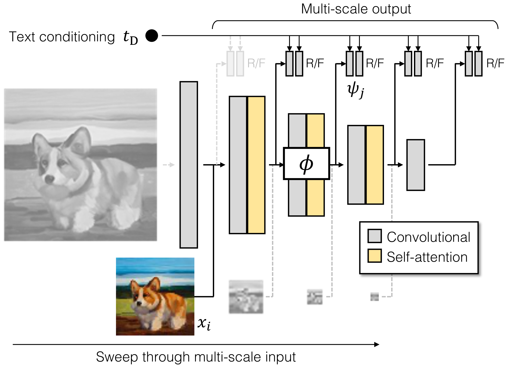

**図 5.** 当社の判別器は、画像とテキスト条件 $t_D$ を処理する 2 つの分岐で構成される。テキスト分岐は生成器と同様にテキストを処理する ([図 4](#figure-04))。画像分岐は画像ピラミッドを受け取り、各画像スケールに対して独立した予測を行う。さらに、ダウンサンプリング層の後続するすべてのスケールで予測が行われるため、マルチスケール入力・マルチスケール出力 (MS-I/O) 判別器となる。
**Multiscale image processing.**
生成器の初期の低解像度層が非活性化しており、与えられたプロンプトに関係なく小さなダイナミックレンジを使用していることが観察される。StyleGAN2 [Kar20b] もこの現象を観察し、モデルサイズが大きくなるとネットワークが高解像度層に依存すると結論している。複雑な構造情報を含む低周波数での性能回復が重要であるため、モデルアーキテクチャを再設計し、複数のスケールにわたって学習信号を提供する。

生成器がピラミッドのベースに完全画像 $\mathbf{x}_0$ を含むピラミッド $\{\mathbf{x}_i\}_{i=0}^{L-1}$ を生成することを思い出してほしい。MSG-GAN [Kar20c] は、ピラミッド全体に対して一度に予測を行い、スケール間の整合性を強制することで性能を改善する。しかし、大規模な設定では、これが安定性を損なう。初期の低解像度出力に対する生成器の調整を制限するためである。

代わりに、ピラミッドの各レベルを独立して処理する。[図 5](#figure-05) に示すように、各レベル $\mathbf{x}_i$ は複数のスケール $i < j \leq L$ で本物/偽物の予測を行う。例えば、完全な $\mathbf{x}_0$ は $L=5$ スケールで予測を行い、次のレベル $\mathbf{x}_1$ は 4 スケールで予測を行う。合計で、判別器は $\frac{L(L+1)}{2}$ 個の予測を生成し、複数のスケールでマルチスケール生成を監督する。

異なるスケールで特徴を抽出するため、特徴抽出器 $\phi_{i\rightarrow j}: \mathbb{R}^{X_i\times X_i\times 3} \rightarrow \mathbb{R}^{X_j^D\times X_j^D\times C_j}$ を定義する。実際には、各サブネットワーク $\phi_{i\rightarrow j}$ は完全な $\phi\triangleq \phi_{0\rightarrow L}$ のサブセットであり、$i>0$ は遅いエントリを、$j<L$ は早い終了を示す。$\phi$ の各層は自己注意とストライド 2 の畳み込みで構成される。最終層は空間的な広がりを $1\times 1$ テンソルに平坦化する。これにより $\{X_j^D\} = \{32, 16, 8, 4, 1\}$ の出力解像度が得られる。これにより、ピラミッド上の低解像度画像を中間層に注入できる [Kar18a]。異なるレベル間で共有された特徴抽出器を使用し、追加された予測の大部分が低解像度で行われるため、計算オーバーヘッドの増加は管理可能である。
**Multi-scale input, multi-scale output adversarial loss.** 合計で、学習目的関数は判別器の損失と、提案したマッチング損失で構成される。マッチング損失は条件付けを考慮するよう判別器に促す。

$$
\mathcal{V}_\text{MS-I/O}(G, D) = \sum_{i=0}^{L-1} \sum_{j=i+1}^{L} \mathcal{V}_\text{GAN}(G_i, D_{ij}) + \mathcal{V}_\text{match}(G_i, D_{ij}),
$$

$\mathcal{V}_\text{GAN}$ は標準的な非飽和 GAN 損失 [Goo14a] である。

判別器出力を計算するため、テキスト特徴 $\mathbf{t}_\text{D}$ を使用して画像特徴 $\phi(\mathbf{x})$ を変調する予測器 $\psi$ を学習する。

$$
D_{ij}(\mathbf{x}, \mathbf{c}) = \psi_j(\phi_{i\rightarrow j}(\mathbf{x}_i), \mathbf{t}_D) + \text{Conv}_{1\times 1}(\phi_{i\rightarrow j}(\mathbf{x}_i)),
$$

$\psi_j$ は 4 層の $1\times 1$ 変調畳み込みとして実装され、$\text{Conv}_{1\times 1}$ は無条件予測分岐を明示的に維持するためのスキップ接続として追加される [Miy18]。

**Matching-aware loss.** 前の GAN 項は、画像 $\mathbf{x}$ が条件付け $\mathbf{c}$ とどれだけ密接に一致するか、および条件付けに関係なく $\mathbf{x}$ がどれだけ現実的に見えるかを測定する。しかし、早期の学習中にアーティファクトが明白な場合、判別器は条件付けに依存しない意思決定に大きく依存し、条件付けを考慮することをためらう。

条件付けを組み込むよう判別器に強制するため、$\mathbf{x}$ を独立にサンプリングされたランダム条件 $\hat{\mathbf{c}}$ と照合し、それらを偽ペアとして提示する。

$$
\mathcal{V}_{\text{match}} = \mathbb{E}_{\mathbf{x},\mathbf{c},\hat{\mathbf{c}}} \Big[ \log(1 + \exp(D(\mathbf{x}, \hat{\mathbf{c}}))) + \log(1 + \exp(D(G(\mathbf{c}), \hat{\mathbf{c}}))) \Big],
$$

$(\mathbf{x}, \mathbf{c})$ と $\hat{\mathbf{c}}$ は $p_{\text{data}}$ から別々にサンプリングされる。この損失は以前にもテキストから画像への GAN 研究 [Ree16, Zha17c] で探求されている。ただし、$G$ から生成された画像と実画像 $\mathbf{x}$ の両方に対してマッチング対応損失を強制すると、明確な性能向上が得られることを発見した ([表 1](#table-01))。

**CLIP contrastive loss.** さらに、既存の事前学習済みモデルを損失関数として活用する [Sau21, Kum22a, Sun18]。特に、事前学習済み CLIP 画像およびテキストエンコーダー [Rad21] の $\mathcal{E}_\text{img}$ と $\mathcal{E}_\text{txt}$ で識別可能な出力を生成するよう生成器に強制する。使用する損失は、それらを最初に学習するために使用されたコントラスト交差エントロピー損失である。

$$
\mathcal{L}_\text{CLIP} = \mathbb{E}_{\{\mathbf{c}_n\}} \Bigg[ -\log \frac{\exp(\mathcal{E}_\text{img}(G(\mathbf{c}_0))^\top \mathcal{E}_\text{txt}(\mathbf{c}_0))}{\sum_n \exp(\mathcal{E}_\text{img}(G(\mathbf{c}_0))^\top \mathcal{E}_\text{txt}(\mathbf{c}_n))} \Bigg].
$$

$\{\mathbf{c}_n\} = \{\mathbf{c}_0, \dots\}$ は学習データからサンプリングされたキャプションである。

**Vision-aided adversarial loss.** 最後に、CLIP モデルをバックボーンとして使用する追加の判別器を構築する。これは Vision-Aided GAN [Kum22a] として知られる。CLIP 画像エンコーダーを凍結し、中間層から特徴を抽出し、$3\times 3$ 畳み込み層を持つ単純なネットワークで処理して本物/偽物の予測を行う。条件付けは [式 3](#equation-03) のように変調を通じて組み込む。学習を安定させるため、Projected GAN [Sau21] が提案した固定ランダム射影層も追加する。これを $\mathcal{L}_\text{Vision}(G)$ と呼ぶ (明確化のため学習可能な判別器パラメータは省略する)。

最終目的関数は $\mathcal{V}(G, D) = \mathcal{V}_\text{MS-I/O}(G,D) + \mathcal{L}_\text{CLIP}(G) + \mathcal{L}_\text{Vision}(G)$ であり、項間の重み付けは [表 A2](#table-07) に指定される。

### 3.4 GAN ベースのアップサンプラー
さらに、GigaGAN フレームワークは、テキスト条件付き超解像モデルを学習するように容易に拡張でき、ベース GigaGAN 生成器の出力をアップサンプリングして 512px または 2k 解像度の高解像度画像を得ることができる。パイプラインを 2 つの別々の段階で学習することで、同じ計算資源の範囲内でより高容量の 64px ベースモデルを扱える。

アップサンプラーでは、合成ネットワークを非対称 U-Net アーキテクチャに再配置し、64px 入力を 3 つのダウンサンプリング残差ブロックで処理し、続いて注意層を持つ 6 つのアップサンプリング残差ブロックで 512px 画像を生成する。同じ解像度にスキップ接続があり、CoModGAN [Zha21o] と類似する。モデルはベースモデルと同じ損失に加え、正解の高解像度画像に対する LPIPS 知覚損失 [Zha18d] で学習される。Vision-aided GAN はアップサンプラーには使用されない。学習時と推論時に、実画像と GAN 生成画像のギャップを減らすため、適度なガウスノイズ拡張を適用する。詳細は [第 6.3 節](#section-6-3) を参照。

GigaGAN フレームワークは、高解像度でベースモデルほど多くのサンプリングステップを許容できない拡散ベースモデルと比較して、超解像タスクで特に効果的になる。LPIPS 回帰損失も安定した学習信号を提供する。当社の GAN アップサンプラーは、他の生成モデルの超解像段階のドロップイン置換として機能できると信じている。

## 4 実験

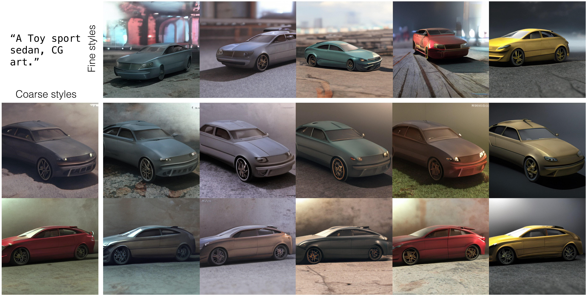

**図 6.** スタイル混合。GAN ベースのアーキテクチャは分離された潜在空間を保持し、あるサンプルの粗いスタイルと別のサンプルの細かいスタイルをブレンドできる。すべての出力はプロンプト "A Toy sport sedan, CG art." で生成される。対応する潜在コードを接続してスタイル交換グリッドを作成する。

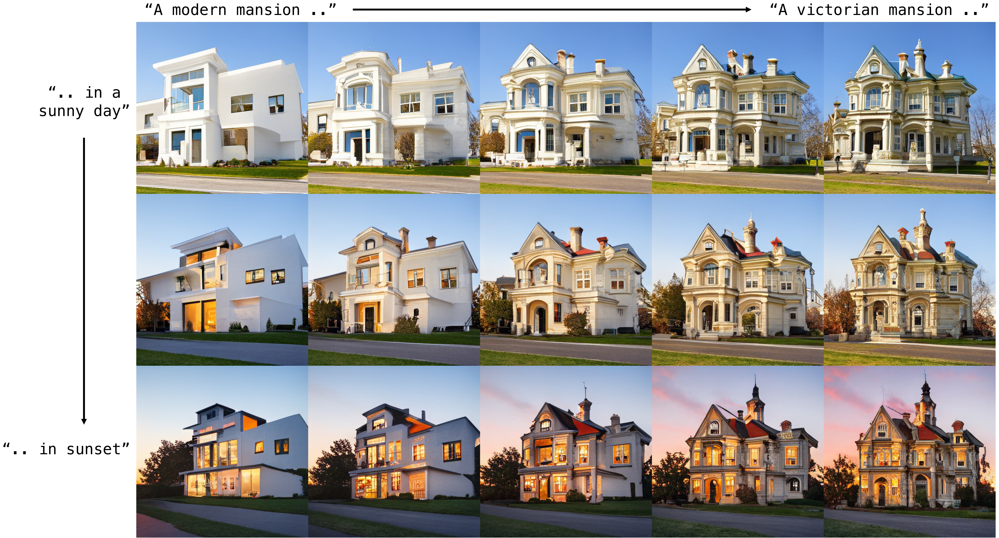

**図 7.** プロンプト補間。GigaGAN は補間グリッドに示すように、プロンプト間の滑らかな補間を可能にする。4 つの角は同じ潜在 $\mathbf{z}$ から生成されるが、テキストプロンプトは異なる。対応するテキスト埋め込み $\mathbf{t}$ とスタイルベクトル $\mathbf{w}$ を補間して滑らかな遷移を作成する。同じ $\mathbf{z}$ は類似のレイアウトをもたらす。より正確な制御については [図 8](#figure-08) を参照。

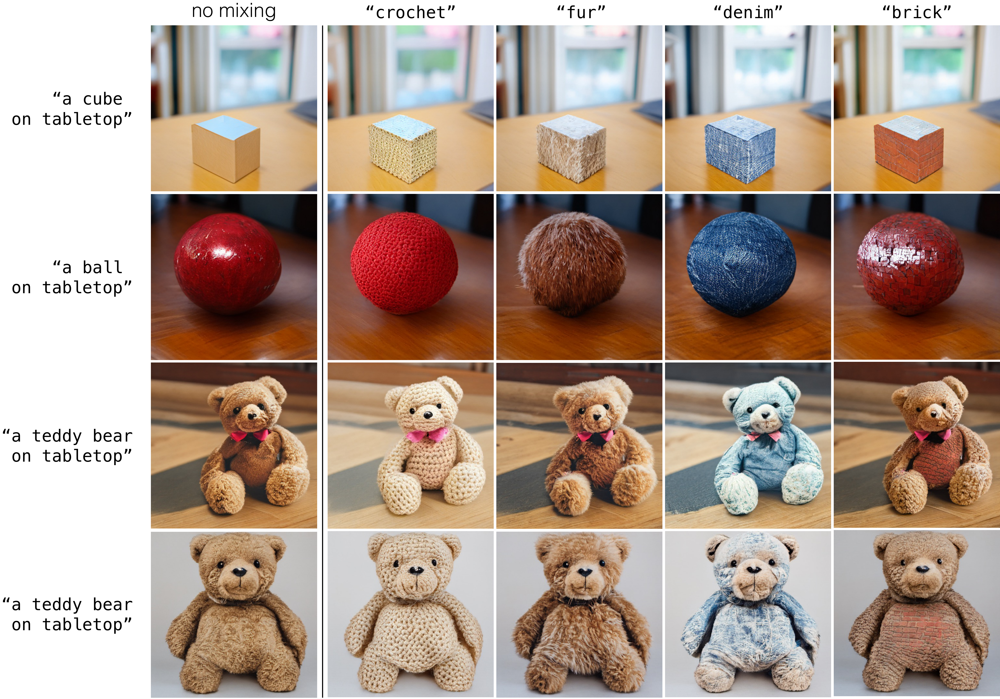

**図 8.** プロンプト混合。GigaGAN は分離された潜在空間を保持し、あるサンプルの粗いスタイルと別のサンプルの細かいスタイルを組み合わせられる。さらに、GigaGAN はテキストプロンプトでスタイルを直接制御できる。ここでは、"a X on tabletop" というプロンプトを使用して 4 つの出力を生成し、"no mixing" 列に示す。次に、"a cube with the texture of crochet on tabletop" のような新しいプロンプト "a X with the texture of Y on tabletop" を使用してテキスト埋め込み $\mathbf{t}$ とスタイルコード $\mathbf{w}$ を再計算し、生成器の後半層に適用して、レイアウトを保持した細かいスタイル制御を達成する。クロスアテンション機構は、関心のあるオブジェクトにスタイルを自動的に局所化する。

大規模テキストから画像への合成タスクの体系的な制御評価は、既存のモデルのほとんどが公開されていないため困難である。学習コードが利用可能であっても、新しいモデルをゼロから学習するのは法外なコストがかかる。それでも、当社は利用可能な情報に基づいて、Imagen [Sah22a]、Latent Diffusion Models (LDM) [Rom22]、Stable Diffusion [Sta22]、Parti [Yu22] のような最近のテキストから画像へのモデルと比較し、学習データセット、反復回数、バッチサイズ、モデルサイズの大きな違いを認める。テキストから画像への結果に加えて、より制御された設定で他の手法と公平に比較するため、[第 7 節](#section-7) で ImageNet クラス条件付き生成についても評価する。

定量評価には、主に出力分布のリアルさを測定する Fréchet Inception Distance (FID) [Heu17] と、画像-テキスト整合性を評価する CLIP スコアを使用する。

5 つの異なる実験を行う。第一に、各技術コンポーネントを 1 つずつ段階的に組み込むことで、手法の有効性を示す ([第 4.2 節](#section-4-2))。第二に、テキストから画像への合成結果により、GigaGAN が Stable Diffusion (SD-v1.5) [Rom22] と同等の FID を示し、拡散モデルや自己回帰モデルより数百倍高速に結果を生成することを示す ([第 4.3 節](#section-4-3))。第三に、GigaGAN を蒸留ベースの拡散モデル [Men22a] と比較し、GigaGAN が蒸留ベースの拡散モデルより高速に高品質画像を合成できることを示す。第四に、条件付きおよび無条件の超解像タスクの両方で、GigaGAN のアップサンプラーが他のアップサンプラーより優れていることを検証する。最後に、大規模 GAN が依然として GAN の連続的で分離された潜在空間操作を享受し、新しい画像編集モードを可能にすることを示す ([第 4.6 節](#section-4-6))。

### 4.1 訓練と評価の詳細
特に断らない限り、StudioGAN PyTorch ライブラリ [Kan22] に基づいて GigaGAN を実装し、アンチエイリアシングのバイキュービックリサイズ関数 [Par22c] を用いた標準的な FID 評価プロトコルに従う。テキストから画像への合成では、Adobe の内部 Stock 画像で学習された 128-to-1024 アップサンプラーモデルを除き、LAION2B-en [Sch22b] と COYO-700M [Bye22] データセットの和集合でモデルを学習する。画像-テキストペアは、先行研究 [Sta22] と同様に、CLIP スコア [Hes21]、画像解像度、美的スコア [Sch00] に基づいて前処理される。事前学習済みテキストエンコーダーには CLIP ViT-L/14 [Rad21] を、CLIP スコア計算 [Hes21] には OpenCLIP ViT-G/14 [Ilh21] を使用する ([表 1](#table-01) を除く)。すべてのモデルは A100 GPU で学習および評価される。訓練と評価の詳細は [第 6 節](#section-6) に記載する。

### 4.2 提案コンポーネントの有効性

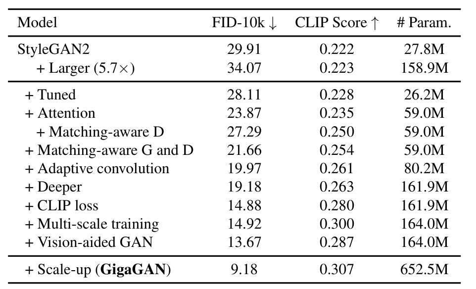

**表 1.** 64px テキストから画像への合成に関するアブレーション研究。コンポーネントの有効性を評価するため、テキスト条件付け用に修正した StyleGAN から始める。ネットワーク幅を増やしても満足のいく改善は見られないが、当社の貢献を追加するたびに指標が改善し続ける。最後に、ネットワーク幅を増やし、訓練をスケールアップして最終モデルに到達する。スケールアップ行 (より大きなバッチサイズで 1350k 反復) を除き、すべてのアブレーションモデルはバッチサイズ 256 で 100k ステップ訓練される。CLIP スコアは CLIP ViT-B/32 [Rad21] を使用して計算される。

まず、[表 1](#table-01) のアブレーション研究を通じて定式化の有効性を示す。StyleGAN2 にテキスト条件付けを追加し、StyleGAN-XL の知見に基づいて設定を調整してベースラインを設定する。最初にこのベースラインのモデルサイズを直接増やすが、FID と CLIP スコアは改善しないことが分かる。次に、コンポーネントを 1 つずつ追加し、性能が一貫して向上することを観察する。特に、最終定式化の高容量バージョンがより良い性能を達成するため、モデルはよりスケーラブルである。

### 4.3 テキストから画像への合成
ベース生成器とアップサンプラーの容量をそれぞれ 652.5M と 359.1M に増やして、より大きなモデルを学習する。これにより、総パラメータ数 1.0B という前例のない規模の GAN モデルが得られる。[表 2](#table-02) は、エンドツーエンドパイプラインの性能をさまざまなテキストから画像への生成モデル [Ram21, Nic22, Rom22, Ram22, Sah22a, Bal22, Yu22, Zho22d, Sta22, Cha23e] と比較する。学習データセット、事前学習済みテキストエンコーダー、さらには画像解像度に違いがあることに注意。例えば、GigaGAN は最初に 512px 画像を合成し、評価前に 256px にリサイズする。

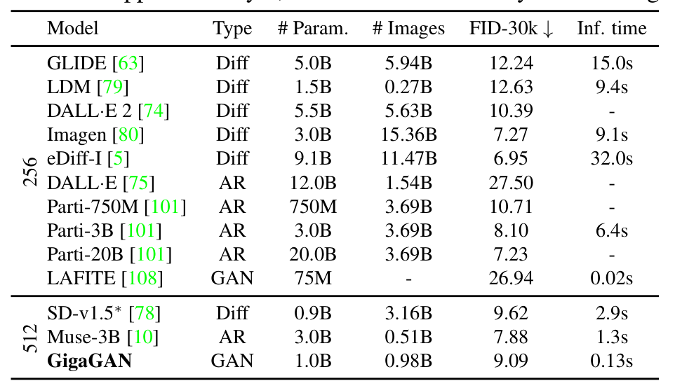

**表 2.** 30k サンプルを用いた COCO ゼロショット FID による 256px テキストから画像への生成の比較。LDM [Rom22]、Stable Diffusion [Sta22]、Parti [Yu22] は当社と同程度のサイズのモデルを提供する。[Base] と [Upsampler] は各コンポーネントのモデルサイズを示す。[Steps] は推論時のモデルの順伝播回数を示す。[MAC] は積和演算数を測定する。

[表 2](#table-02) は、GigaGAN が DALL$\cdot$E 2 [Ram22]、Stable Diffusion [Sta22]、Parti-750M [Yu22] より低い FID を示すことを示している。当社のモデルは既存モデルより実画像の特徴分布にうまく一致するよう最適化できるが、生成画像の品質が必ずしも優れているわけではない ([第 8 節](#section-8) でより多くのサンプルを参照)。これは COCO2014 データセットにおけるゼロショット FID のコーナーケースかもしれず、テキストから画像へのモデルを改善するにはより良い評価指標の研究が必要であると認識している。それでも、GigaGAN が任意のテキストプロンプトから有望な画像を合成できる最初の GAN モデルであり、他のテキストから画像へのモデルと競争力のあるゼロショット FID を示すことを強調する。

### 4.4 蒸留拡散モデルとの比較
GigaGAN は上記の拡散モデルより少なくとも 20 倍高速であるが、拡散モデルの推論速度を改善する取り組みも存在する。GigaGAN を段階的に蒸留した Stable Diffusion (SD-distilled) [Men22a] と比較する。

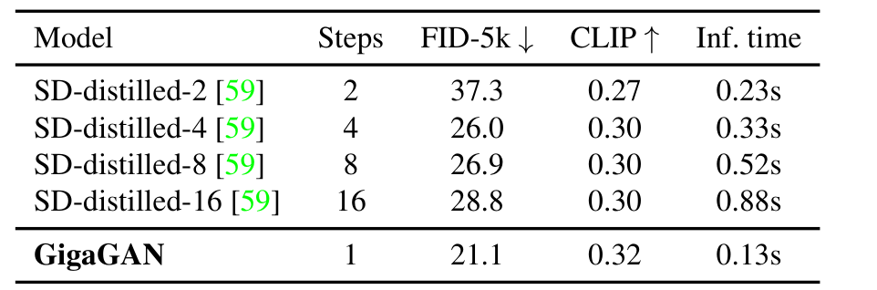

**表 3.** 蒸留拡散モデルとの比較は、GigaGAN が高速推論のための段階的蒸留拡散モデル [Men22a] と比較して、より良い FID と CLIP スコアを達成することを示す。GigaGAN は単一の順伝播で出力を生成するため、推論速度は依然として高速である。評価設定は SD-distilled のプロトコル [Men22a] に合わせるため [表 2](#table-02) とは異なる。

[表 3](#table-03) は、GigaGAN が蒸留 Stable Diffusion より高速であり、FID 21.1 と CLIP スコア 0.32 というより良い結果を示すことを示している。SD-distilled [Men22a] の評価プロトコルに従い、画像を 512px にリサイズした COCO2017 データセット [Lin14a] で FID と CLIP スコアを報告する。

### 4.5 大規模画像合成のための超解像
GigaGAN アップサンプラーの性能を別途評価する。評価は 2 つの部分で構成される。第一に、GigaGAN を一般的に使用されるいくつかのアップサンプラーと比較する。テキスト条件付きアップサンプリングタスクでは、Stable Diffusion [Sta22] の 4x Upscaler と 2x Latent Upscaler を組み合わせて 8x アップスケーリングモデル (SD Upscaler) を構築する。無条件の Real-ESRGAN [Wan21i] も別のベースラインとして使用する。

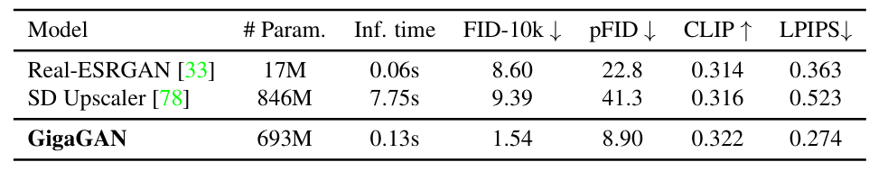

**表 4.** ランダムな 10K の LAION サンプルに対するテキスト条件付き 128→1024 超解像を、無条件 Real-ESRGAN [Wan21i] と Stable Diffusion Upscaler [Sta22] と比較する。GigaGAN は GAN ベースモデルの高速性を享受しながら、より良い FID、patch-FID [Cha22c]、CLIP スコア、LPIPS [Zha18d] を達成する。

[表 4](#table-04) は、LAION データセットからランダムに取得した 10K 画像でアップサンプラーの性能を測定し、GigaGAN アップサンプラーがリアルさのスコア (FID と patch-FID [Cha22c])、テキスト整合性 (CLIP スコア)、正解との近さ (LPIPS [Zha18d]) で他のアップサンプラーを大きく上回ることを示している。さらに、より制御された比較のため、ImageNet の *無条件* 超解像タスクでモデルを学習し、SR3 [Sah22b] や LDM [Rom22] などの拡散ベースモデルと性能を比較する。

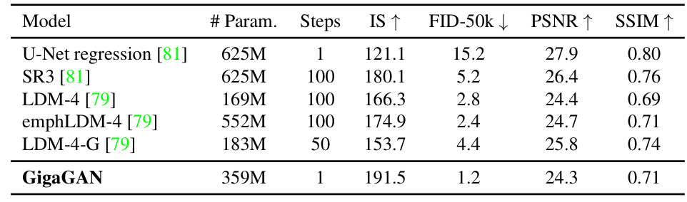

**表 5.** ImageNet での無条件 64→256 超解像。ピクセル回帰損失で学習した単純な U-Net (U-Net regression) と拡散ベース手法 (SR3 [Sah22b]、LDM [Rom22]) と比較する。当社の手法は Inception Score (IS) と FID で表されるより高いリアルさスコアを達成する。

[表 5](#table-05) に示すように、GigaGAN は単一の順伝播で最高の IS と FID スコアを達成する。

### 4.6 制御可能な画像合成
StyleGAN は、$\mathcal{W}$-空間と呼ばれる画像操作に有用な線形潜在空間を持つことで知られている。同様に、スタイルベクトル $\mathbf{w}$ を使用して粗いスタイルと細かいスタイルの交換を行う。StyleGAN の $\mathcal{W}$-空間と同様に、[図 6](#figure-06) は GigaGAN が分離された $\mathcal{W}$-空間を維持することを示しており、StyleGAN の既存の潜在操作技法が GigaGAN に移行できることを示唆している。さらに、当社のモデルは $\mathcal{W}$ の前にテキスト埋め込み $\mathbf{t} = [\mathbf{t}_\text{local}, \mathbf{t}_\text{global}]$ という別の潜在空間を持ち、画像合成への可能性を探求する。[図 8](#figure-08) では、テキスト入力によって分離されたスタイル操作を制御できることを示す。具体的には、異なるプロンプトを使用してテキスト埋め込み $\mathbf{t}$ とスタイルコード $\mathbf{w}$ を計算し、生成器の異なる層に適用できる。これにより、粗いスタイルと細かいスタイルの分離だけでなく、スタイル空間での直感的なプロンプトベースの操作も得られる。

## 5 考察と限界

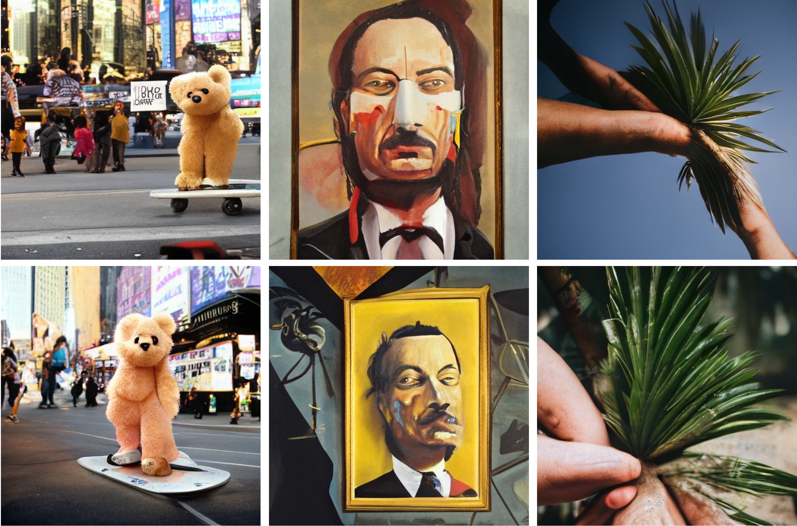

**図 9.** 失敗例。同じプロンプトを DALL$\cdot$E 2 で使用した場合の出力例を示す。各列は "a teddy bear on a skateboard in Times Square"、"a Vibrant portrait painting of Salvador Dali with a robotic half face"、"A close up of a handpalm with leaves growing from it" というプロンプトで条件付けられる。製品品質モデルの DALL$\cdot$E 2 と比較すると、本手法は現実性や構成性の面で制限を示す。参考：附録 8 の未選別の比較を参照。

本実験は、GANs がテキストから画像へスケールアップできるか、そしてそこまでの資源から利益を得られるか、という GANs のスケーラビリティについての明確な回答を提供する。しかし、出力の視覚的品質はまだ製品品質モデルの DALL$\cdot$E 2 と比べて優れていない。[図 9](#figure-09) は、同じプロンプトを使用した場合の DALL$\cdot$E 2 と比較して、現実性やテキストから画像への整合性における本手法の制限をいくつか示している。

それでも、単純なアプローチではなく、大規模な容量を試すことで、同様のリソースで訓練された自己回帰モデルや拡散モデルに比べて競争力のある結果を達成したことを示した。GigaGAN アーキテクチャは、自己回帰モデルや拡散モデルへの転換の中で失われた主要な編集機能を取り戻し、大規模生成モデルの新たな設計空間を開く。当社のパフォーマンスは、[表 1](#table-01) に示すように大規模モデルで向上すると予想される。

## 謝辞

Simon Niklaus、Alexandru Chiculita、Markus Woodson による分散学習パイプラインの構築に感謝する。Nupur Kumari、Gaurav Parmar、Bill Peebles、Phillip Isola、Alyosha Efros、Joonghyuk Shin の役立つコメントに感謝する。Chenlin Meng、Chitwan Saharia、Jiahui Yu への多くの質問に答えてくれたことに感謝する。Kevin Duarte が 4K 超越のためのアップサンプリングについての議論に感謝する。一部の作業は Adobe Research のインターンとして Minguk Kang が行った。Minguk Kang と Jaesik Park は韓国政府 (MSIT) の IITP 奨励金の下、POSTECH GSAI: 2019-0-01906 および Image restoration: 2021-0-00537 のために支援された。

[第 6 節](#section-6) で訓練と評価の詳細を先に提示する。次に、既存手法と比較した可視的な結果を示すため、ImageNet での結果 ([第 7 節](#section-7)) を示す。最後に[第 8 節](#section-8) では、テキストから画像への合成結果の可視化を示し、LDM [Rom22]、Stable Diffusion [Sta22]、DALL$\cdot$E 2 [Ram22] と比較する。

## 6 訓練と評価の詳細

### 6.1 テキストから画像への合成

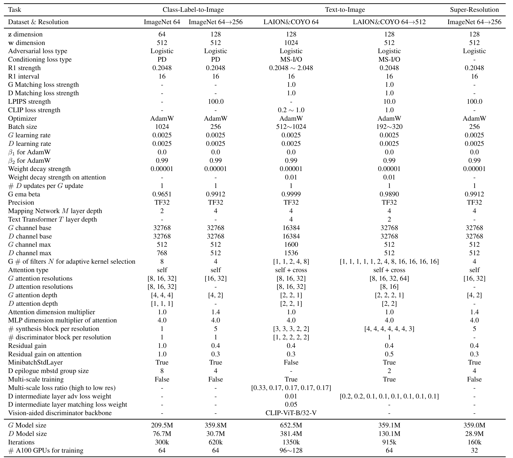

**表 A2.** GigaGAN の学習ハイパーパラメータ。Projection Discriminator [Miy18] を PD、R1 正則化 [Mes18] を R1、Learned Perceptual Image Patch Similarity [Zha18d] を LPIPS、分離重み減衰を用いる Adam [Los19] を AdamW、事前学習済み VIT-B/32 視覚エンコーダ [Rad21] を CLIP-ViT-B/32-V と表記する。
LAION2B-en [Sch22b] と COYO-700M [Bye22] を組み合わせたデータセット上で、PyTorch フレームワーク [Pas19a] を用いて GigaGAN を学習する。学習では中央切り抜きを適用し、元画像の短い辺と同じ長さを持つ正方形の画像にする。次に、アンチエイリアシングをサポートする PIL.LANCZOS [Tur90] リサイザを使って画像を $64\times64$ の解像度にリサイズする [Par22c]。画像解像度 ($\geq512$)、CLIP スコア ($>0.3$) [Hes21]、美的スコア ($>5.0$) [Sch00] に基づいて学習用の画像テキストペアをフィルタリングし、透かし入り画像を除去する。[表 A2](#table-07) の第 4 列と第 5 列に示す設定で GigaGAN を学習する。
評価には、Imagen [Sah22a] の説明に従い、COCO2014 [Lin14a] 検証データセットから 40,504 枚の実画像と 30,000 枚の生成画像を使用する。中央切り抜きを適用し、clean-fid [Par22c] が推奨する PIL.BICUBIC を用いて実画像と生成画像を $299\times299$ の解像度にリサイズする。FID の計算には clean-fid ライブラリ [Par22c] を使用する。

### 6.2 ImageNet における条件付き画像合成
他の最先端生成モデルと公平に比較するため、Kang *et al*. [Kan22] が提案した学習および評価プロトコルに従う。テキストから画像への実験と同じ切り抜き方法で、学習用と評価用の画像を処理する。次に、アンチエイリアシングをサポートする PIL.LANCZOS [Tur90] リサイザを用いて、画像を目標解像度 ($64\times64$ はベース生成器、$256\times256$ は超解像スタック) にリサイズする [Par22c]。[表 A2](#table-07) の第 2 列と第 3 列に示す設定で、前処理済みの学習画像を使って GigaGAN を学習する。
評価では、PIL.BICUBIC リサイザを用いて実画像と生成画像を $299\times299$ の解像度にアップサンプリングする。FID の計算では、切り捨てトリックを使わずに 50k 枚の画像を生成し [Kar19, Bro19]、それらを学習データセット全体と比較する。StudioGAN [Kan22] が提供する実画像の事前計算済み特徴と、生成した 50k 枚の画像を使って Precision & Recall [Kyn19] を計算する。

### 6.3 超解像結果
モデルの学習では、[第 6.2 節](#section-6-2) と同じ方法で ImageNet を前処理し、[表 A2](#table-07) の最後の列の設定を使う。SR3 [Sah22b] および LDM と本手法を公平に比較するため、SR3 と LDM の論文に記載された評価手順に従う。

## 7 ImageNet 実験

### 7.1 定性的結果
同じデータセットと評価パイプラインを使って直接比較できる ImageNet データセット [Den09a] 上で、クラス条件付き GAN を学習する。事前学習済み ImageNet 分類器を使わずに、当社の GAN は最先端生成モデルと同等の生成品質を達成する。事前学習済み分類器は自動評価指標に有利に働く可能性がある [Kyn22]。本モデルには L2 自己注意、スタイル適応畳み込みカーネル、マッチング認識損失を適用し、バッチサイズ 1024 でベースの 64px モデルを学習するため、より幅の広い合成ネットワークを使用する。さらに、256px のクラス条件付きアップサンプラーを別に学習し、エンドツーエンドのファインチューニング段階で両者を組み合わせる。

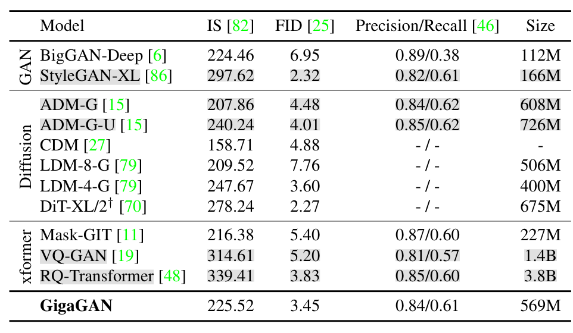

**表 A1.** ImageNet 256px におけるクラス条件付き合成。本手法は大規模な拡散モデルや Transformer モデルに対して競争力を持つ。網掛けの手法は学習時または推論時に事前学習済み ImageNet 分類器を利用しており、自動評価指標に有利に働く可能性がある [Kyn22]。
[表 A1](#table-06) は、本手法が高忠実度の画像を生成することを示す。

### 7.2 定量的結果
ADM-G-U、LDM、StyleGAN-XL [Sau22]、GigaGAN の可視化結果を [図 A1](#figure-10) と [図 A2](#figure-11) に示す。StyleGAN-XL は FID が最も低いものの、視覚品質は ADM や GigaGAN より悪く見える。StyleGAN-XL は画像全体の構造の合成に苦戦し、そのため画像の写実性が低くなる。これに対して GigaGAN は StyleGAN-XL より全体構造をうまく合成し、オオカバマダラの翅の模様やホッキョクギツネの白い毛など、細かなディテールを忠実に捉えているように見える。GigaGAN と比べると、ADM-G-U は画像構造をより合理的に合成するが、前述の細かなディテールの反映に欠ける。

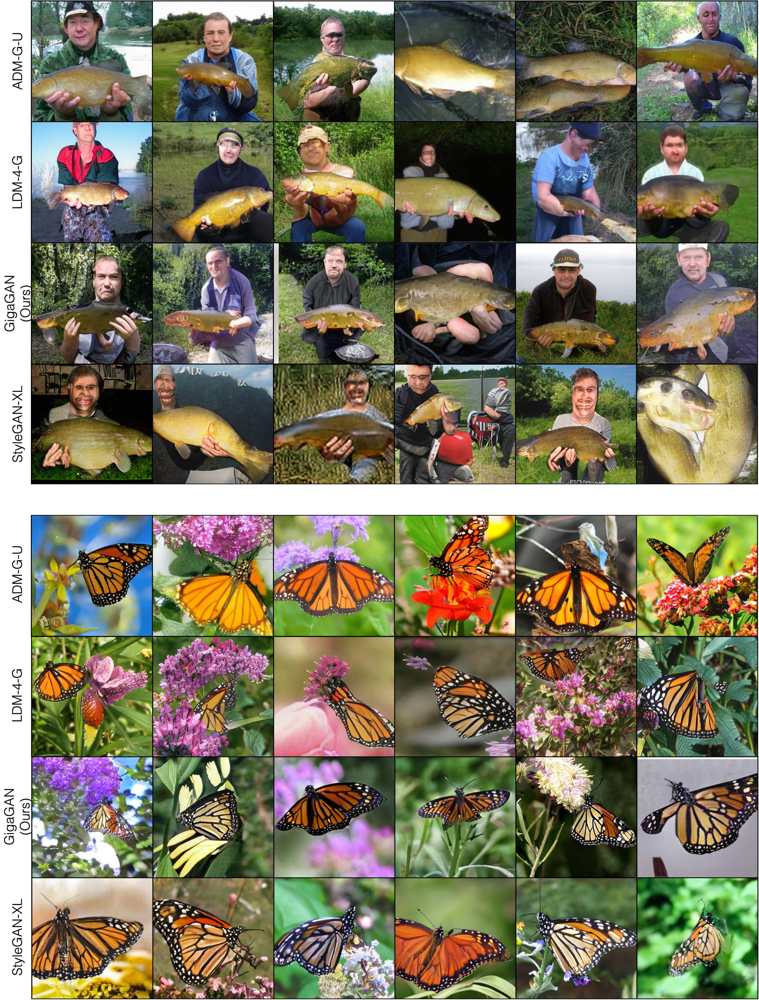

**図 A1.** ADM-G-U [Dha21]、LDM-4-G [Rom22]、GigaGAN (本手法)、StyleGAN-XL [Sau22] から得た未選別画像（上は Tench、下は Monarch）。各生成モデルの FID はそれぞれ 4.01、3.60、3.45、2.32 である。

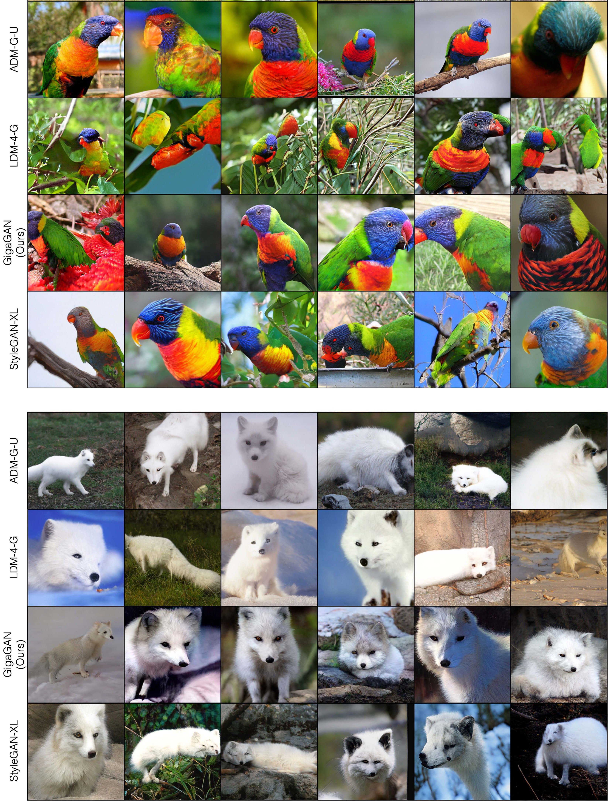

**図 A2.** ADM-G-U [Dha21]、LDM-4-G [Rom22]、GigaGAN (本手法)、StyleGAN-XL [Sau22] から得た未選別画像（上は Lorikeet、下は Arctic fox）。各生成モデルの FID はそれぞれ 4.01、3.60、3.45、2.32 である。

## 8 テキストから画像への合成結果

### 8.1 推論時の切り捨てトリック
LDM などの拡散モデルで使われる classifier guidance [Dha21] や classifier-free guidance [Ho22d] と同様に、GAN モデルでも推論時に切り捨てトリック [Bro19, Kar19] を利用できる。
$$
\mathbf{w_{\text{trunc}}} = \text{lerp}(\mathbf{w_\text{mean}}, \mathbf{w}, \psi),
$$
ここで $\mathbf{w_\text{mean}}$ はデータセット全体における $\mathbf{w}$ の平均であり、事前に計算できる。切り捨てトリックは、潜在ベクトルを分布の平均へ補間して出力をより典型的にすることで、多様性と忠実度のトレードオフを可能にする。$\psi = 1.0$ のときは $\mathbf{w_\text{mean}}$ を使わず、切り捨ては行われない。$\psi = 0.0$ のときは $\mathbf{w}$ が平均に収束し、多様性が失われる。
無条件の場合に切り捨てトリックを適用するのは簡単だが、テキスト条件付き画像生成でこれを実現する方法は明確ではない。全分布の平均と、テキストプロンプトに条件付けられた $\mathbf{w}$ の平均の両方に向かって潜在ベクトルを補間すると、望ましい結果が得られることが分かった。
$$
\mathbf{w_{\text{trunc}}} = \text{lerp}(\mathbf{w_{\text{mean}, \mathbf{c}}}, \text{lerp}( \mathbf{w_\text{mean}}, \mathbf{w}, \psi ), \psi ),
$$
ここで $\mathbf{w}_{\text{mean}, \mathbf{c}}$ は、推論時に同じ $\mathbf{c}$ で $\mathbf{w} = M(\mathbf{z}, \mathbf{c})$ を 16 回サンプリングし、その平均を取ることで計算できる。この操作のオーバーヘッドは、マッピングネットワーク $M$ が合成ネットワークと比べて軽量であるため無視できる。$\psi = 1.0$ のとき、$\mathbf{w_{\text{trunc}}}$ は $\mathbf{w_{\text{trunc}}} = \mathbf{w}$ となり、切り捨ては行われない。[図 A4](#figure-13) はテキスト条件付き切り捨てトリックの効果を示す。
定量的には、切り捨ての効果は拡散モデルの guidance 技術に似ている。[図 A3](#figure-12) に示すように、切り捨てを強くすると CLIP スコアは上昇し、多様性が低下するため FID は上昇する。

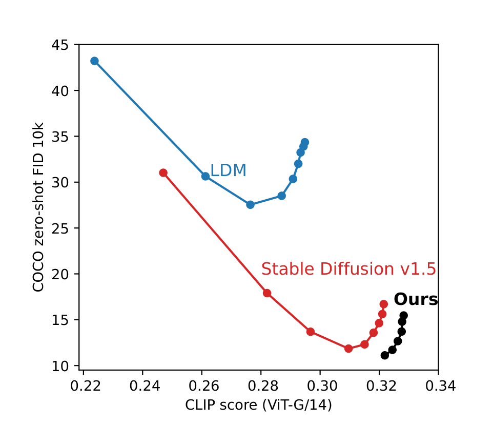

**図 A3.** 異なる切り捨て値 [1.0, 0.9, 0.8, 0.7, 0.6, 0.5] に対して FID と CLIP スコアがどのように変化するかを調べ、LDM と Stable Diffusion という公開された 2 つの大規模拡散モデルの FID-CLIP スコア曲線とともに可視化する。切り捨てを強くすると CLIP スコアは上昇するが、FID の上昇が示すように多様性が低下する。拡散モデルの guidance 値は [1.0, 1.25, 1.5, 1.75, 2, 4, 6, 8, 10] である。

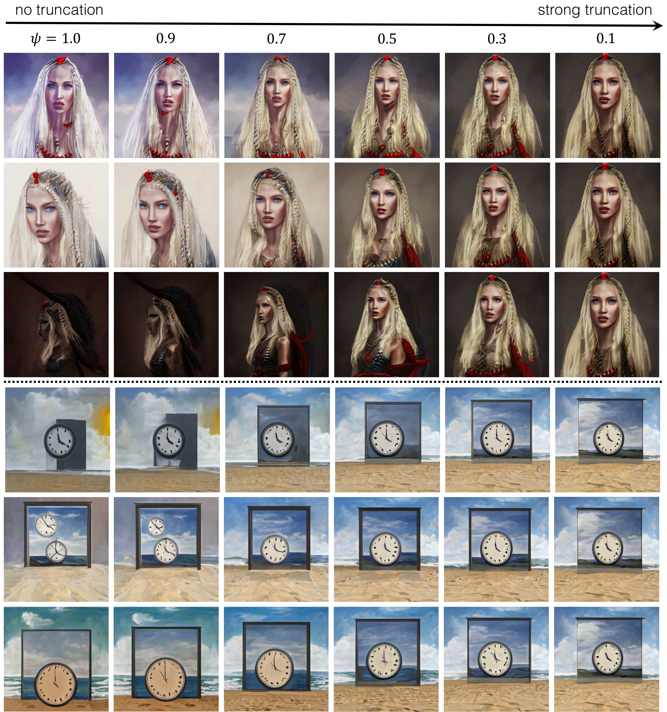

**図 A4.** 本手法の切り捨てトリックの視覚的効果。切り捨て値 $\psi$ を 1.0 から下げることで効果を示す。テキストプロンプト “digital painting of a confident and severe looking northern war goddess, extremely long blond braided hair, beautiful blue eyes and red lips.” と “Magritte painting of a clock on a beach.” を使った 6 つの出力例を示す。1.0（切り捨てなし）では多様性が高いが、整合性は十分ではない。切り捨てを強くするとテキストと画像の整合性は向上する一方、多様性が低下する。0.8 から 0.7 の間の切り捨て値が最良の結果を生むことが分かった。

### 8.2 拡散モデルとの比較
最後に、本モデルのランダムサンプリング結果を示し、公開されている拡散モデル LDM [Rom22]、Stable Diffusion [Sta22]、DALL$\cdot$E 2 [Ram22] と比較する。

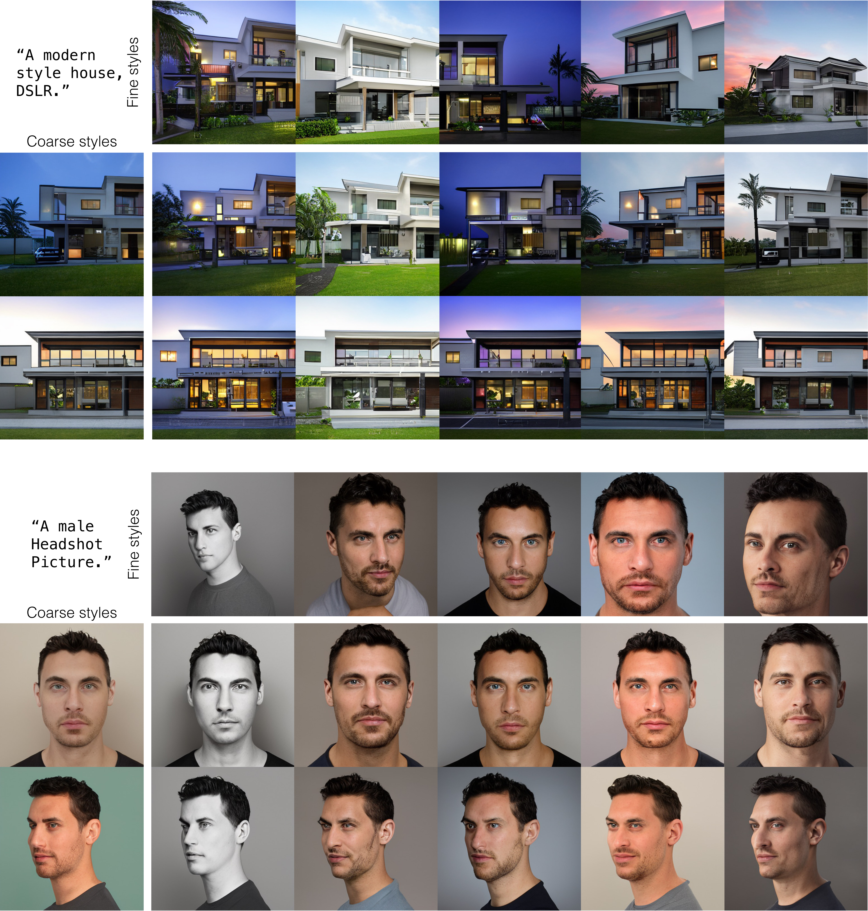

**図 A5.** スタイル混合。GigaGAN は分離された潜在空間を維持しており、あるサンプルの粗いスタイルと別のサンプルの細かいスタイルを混ぜられる。対応する潜在コードをつなぎ合わせて、スタイル交換グリッドを生成する。出力は同じプロンプトと異なる潜在コードから生成する。

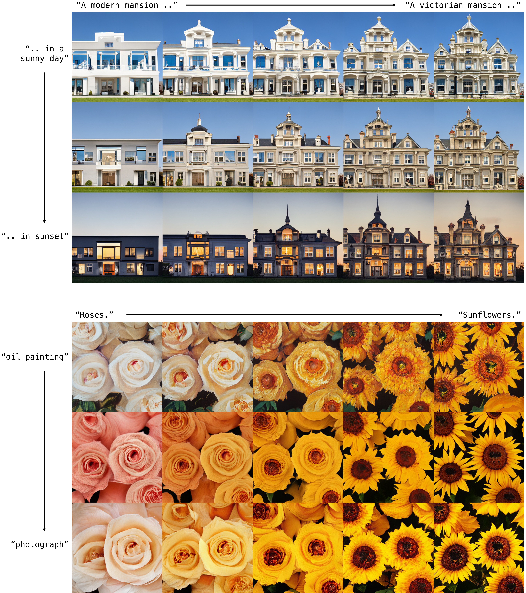

**図 A6.** プロンプト補間。GigaGAN は補間グリッドに示すように、プロンプト間の滑らかな補間を可能にする。4 隅は同じ潜在コードと異なるテキストプロンプトから生成する。対応するテキスト埋め込みとスタイルベクトルを補間して滑らかな遷移を作る。同じ潜在コードは似たレイアウトを生む。

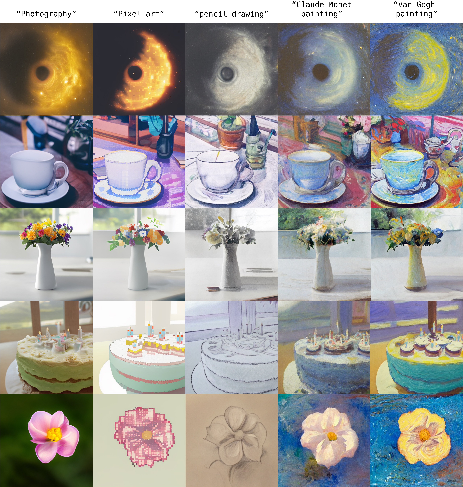

**図 A7.** プロンプト混合。GigaGAN はテキストプロンプトでスタイルを直接制御できる。ここでは “Photography of X” というプロンプトを使って 5 つの出力を生成し、「Photography」列に示す。次に “Y of X” という新しいプロンプト、例えば “Van Gogh painting of the black hole in the space” を使ってテキスト埋め込み $\mathbf{t}$ とスタイルコード $\mathbf{w}$ を再計算し、生成器の後半の層に適用することで、レイアウトを保ったスタイル制御を実現する。クロスアテンション機構は関心対象にスタイルを自動的に局在化する。上の行から順に、次のプロンプトを使用する。(1) the black hole in the space。(2) a teacup on the desk。(3) a table top with a vase of flowers on it。(4) a birthday cake。(5) a beautiful flower。GigaGAN のプロンプトベースのスタイル転移は、単一で単純な物体の画像に対してのみ可能であることが分かった。

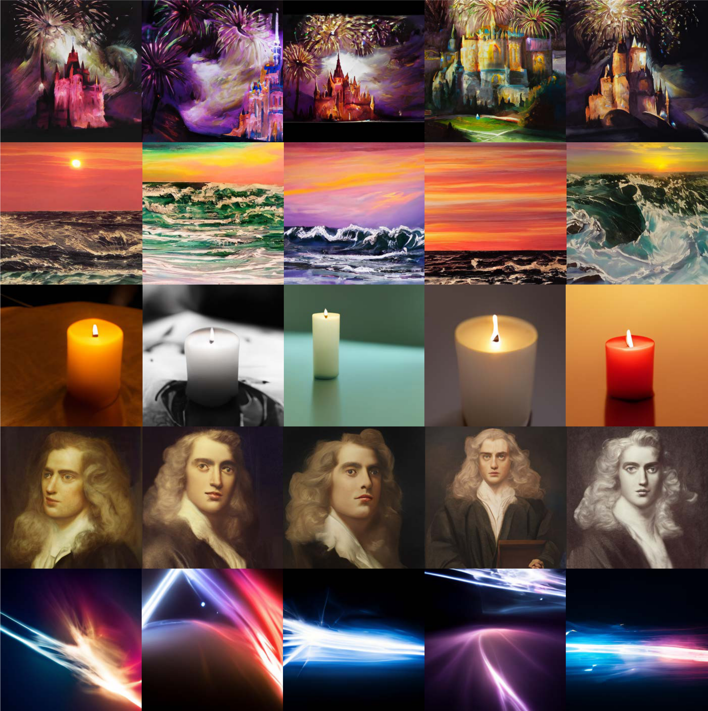

**図 A8.** GigaGAN で合成した画像の多様性。GigaGAN は与えられたプロンプトに対して多様な画像を合成できる。上の行から順に、次のプロンプトを使用する。(1) Majestic castle and fireworks, art work, oil painting, 2k。(2) Oil-painting depicting a sunset over the sea with waves。(3) A burning candle with tho wicks, detailed photo, studio lighting。(4) Portrait of Isaac Newton, long hair。(5) An abstract representation of the speed of light。

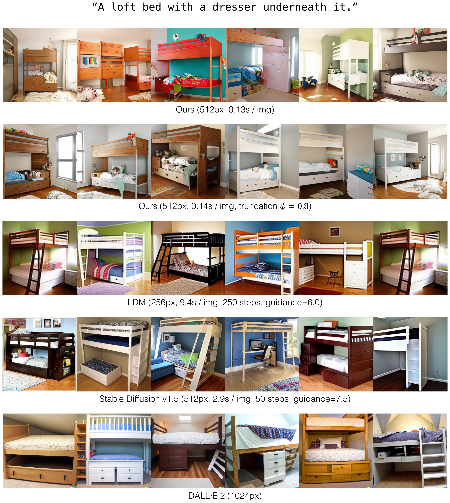

**図 A9.** プロンプト “A loft bed with a dresser underneath it” を使った本モデル、Latent Diffusion Model [Rom22]、Stable Diffusion [Sta22]、DALL$\cdot$E 2 [Ram22] のランダム出力。本モデルは切り捨てなしと切り捨てありの 2 つのバージョンを示す。拡散モデルより高速だが、ベッドフレームの脚の本数など、構造の一貫性では劣る。LDM と Stable Diffusion には、それぞれ DDIM / PLMS [Liu22h] の 250 ステップと 50 ステップを使用する。DALL$\cdot$E 2 では公式 DALL$\cdot$E サービス [Dal22] を使って画像を生成する。

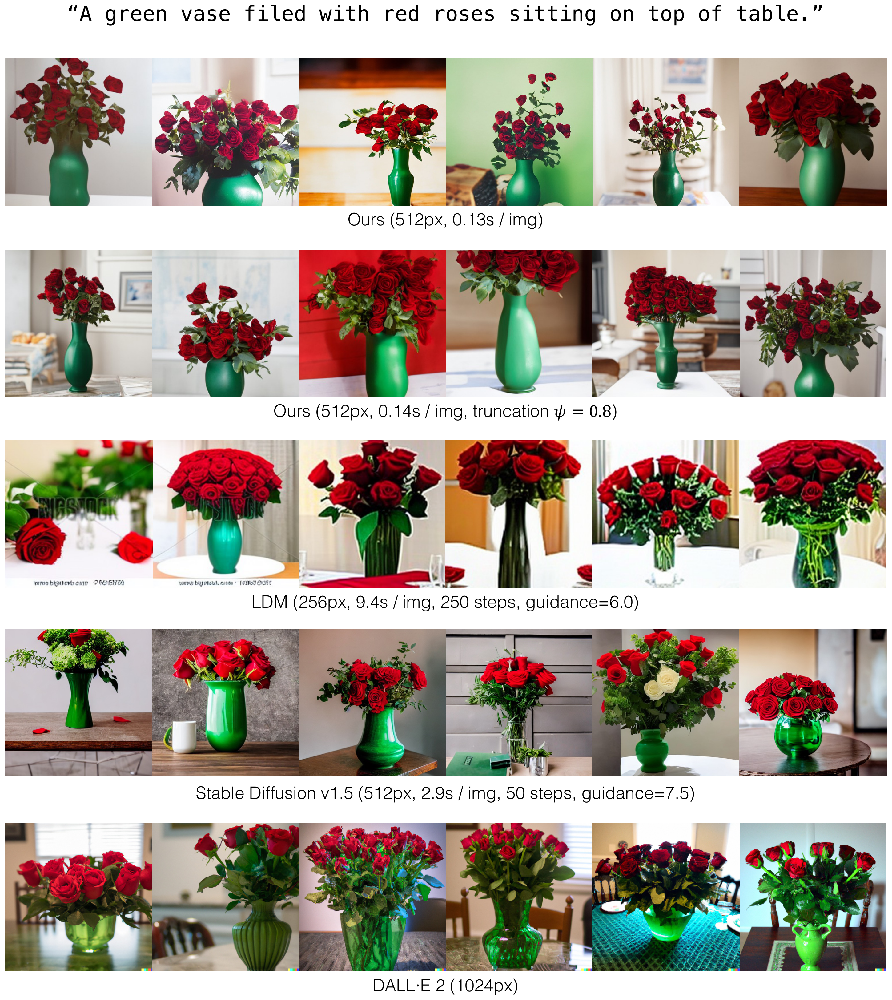

**図 A10.** プロンプト “A green vase filed with red roses sitting on top of table” を使った本モデル、Latent Diffusion Model [Rom22]、Stable Diffusion [Sta22]、DALL$\cdot$E 2 [Ram22] のランダム出力。本モデルは切り捨てなしと切り捨てありの 2 つのバージョンを示す。どちらの場合も拡散モデルより高速だが、花瓶の対称性など構造の一貫性では劣る。LDM と Stable Diffusion には、それぞれ DDIM / PLMS [Liu22h] の 250 ステップと 50 ステップを使用する。DALL$\cdot$E 2 では公式 DALL$\cdot$E サービス [Dal22] を使って画像を生成する。

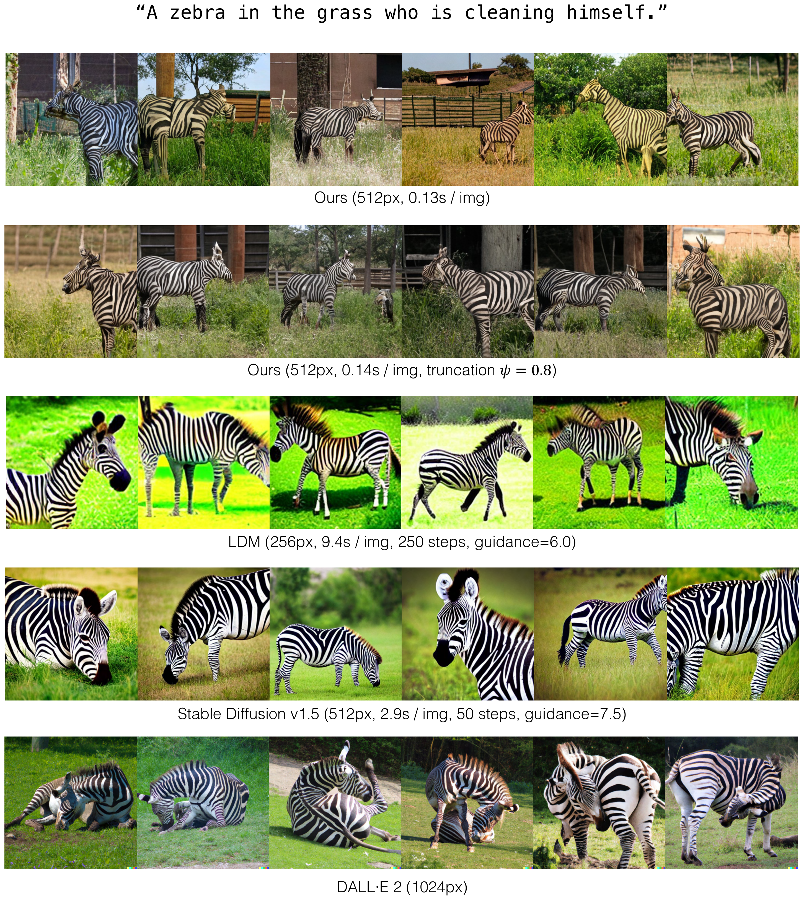

**図 A11.** プロンプト “A zebra in the grass who is cleaning himself” を使った本モデル、Latent Diffusion Model [Rom22]、Stable Diffusion [Sta22]、DALL$\cdot$E 2 [Ram22] のランダム出力。本モデルは切り捨てなしと切り捨てありの 2 つのバージョンを示す。拡散モデルより高速だが、目の位置の正確な縞模様など、細部では劣る。LDM と Stable Diffusion には、それぞれ DDIM / PLMS [Liu22h] の 250 ステップと 50 ステップを使用する。DALL$\cdot$E 2 では公式 DALL$\cdot$E サービス [Dal22] を使って画像を生成する。

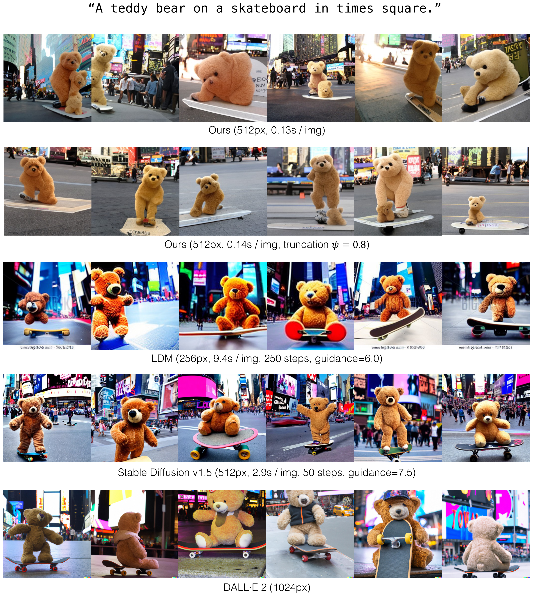

**図 A12.** プロンプト “A teddy bear on a skateboard in times square” を使った本モデル、Latent Diffusion Model [Rom22]、Stable Diffusion [Sta22]、DALL$\cdot$E 2 [Ram22] のランダム出力。本モデルは切り捨てなしと切り捨てありの 2 つのバージョンを示す。拡散モデルより高速だが、スケートボードの正確な形状など、細部では劣る。LDM と Stable Diffusion には、それぞれ DDIM / PLMS [Liu22h] の 250 ステップと 50 ステップを使用する。DALL$\cdot$E 2 では公式 DALL$\cdot$E サービス [Dal22] を使って画像を生成する。

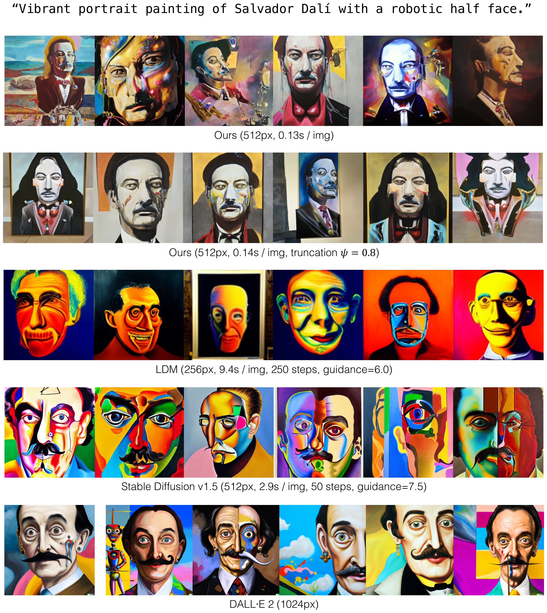

**図 A13.** プロンプト “Vibrant portrait painting of Salvador Dalí with a robotic half face” を使った本モデル、Latent Diffusion Model [Rom22]、Stable Diffusion [Sta22]、DALL$\cdot$E 2 [Ram22] のランダム出力。本モデルは切り捨てなしと切り捨てありの 2 つのバージョンを示す。拡散モデルより高速だが、目の形の細かな描写など、構造的なディテールでは劣る。LDM と Stable Diffusion には、それぞれ DDIM / PLMS [Liu22h] の 250 ステップと 50 ステップを使用する。DALL$\cdot$E 2 では公式 DALL$\cdot$E サービス [Dal22] を使って画像を生成する。

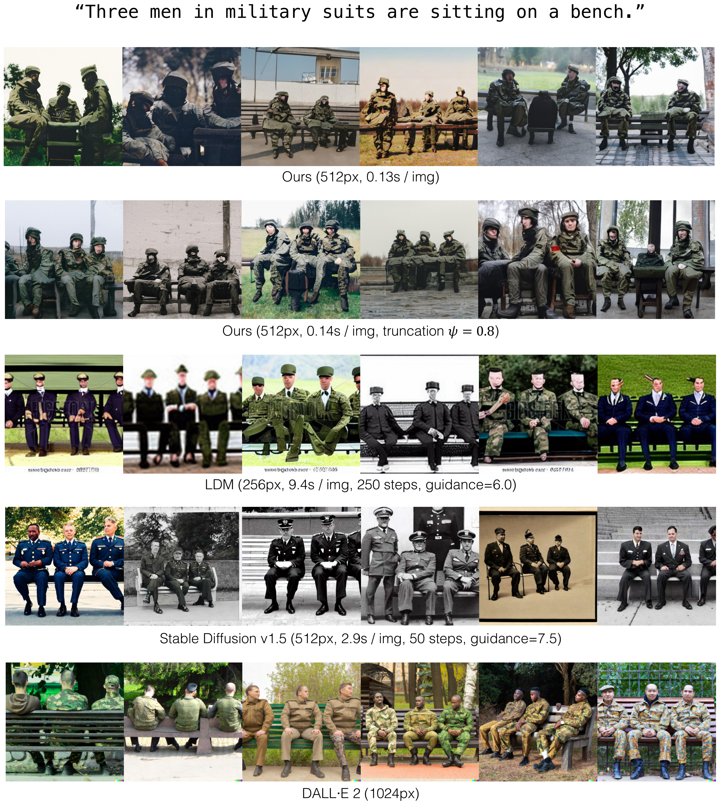

**図 A14.** プロンプト “Three men in military suits are sitting on a bench” を使った本モデル、Latent Diffusion Model [Rom22]、Stable Diffusion [Sta22]、DALL$\cdot$E 2 [Ram22] のランダム出力。本モデルは切り捨てなしと切り捨てありの 2 つのバージョンを示す。拡散モデルより高速だが、表情や服装の細部では劣る。LDM と Stable Diffusion には、それぞれ DDIM / PLMS [Liu22h] の 250 ステップと 50 ステップを使用する。DALL$\cdot$E 2 では公式 DALL$\cdot$E サービス [Dal22] を使って画像を生成する。

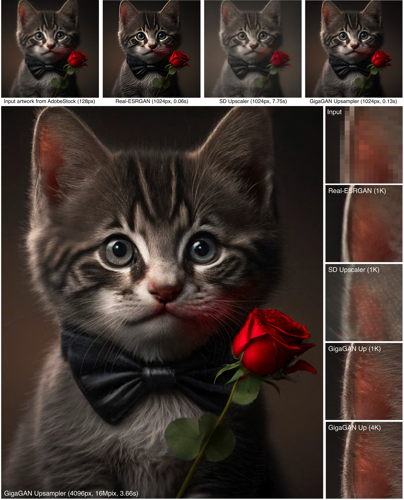

**図 A15.** 当社の GAN ベースのアップサンプラーは、64px や 128px などの低解像度で初期出力を生成する多くのテキストから画像へのモデルに対するアップサンプラーとして利用できる。テキスト条件付きの 8$\times$ 超解像モデルを低解像度 128px のアートワークに適用し、プロンプト “Portrait of a kitten dressed in a bow tie. Red Rose. Valentine’s day.” を使って 1K 出力を得る。その後モデルを再適用して 4K を超える出力を得られる。Stable Diffusion のテキスト条件付きアップスケーラ [Sta22] と無条件 Real-ESRGAN [Wan21i] と比較する。1K と 4K の出力の比較には拡大を推奨する。

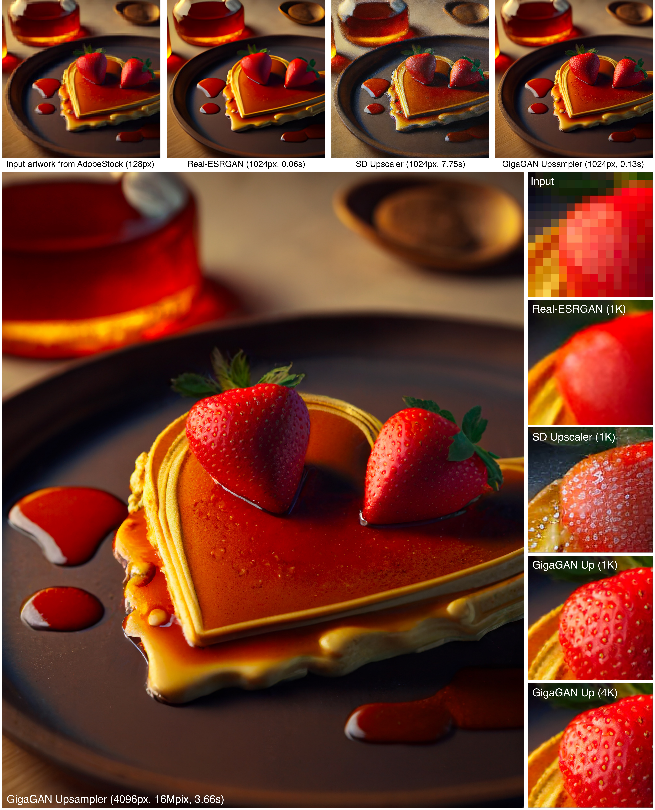

**図 A16.** 当社の GAN ベースのアップサンプラーは、64px や 128px などの低解像度で初期出力を生成する多くのテキストから画像へのモデルに対するアップサンプラーとして利用できる。テキスト条件付きの 8$\times$ 超解像モデルを低解像度 128px のアートワークに適用し、プロンプト “Heart shaped pancakes with honey and strawberry for Valentine’s Day” を使って 1K 出力を得る。その後モデルを再適用して 4K を超える出力を得られる。Stable Diffusion のテキスト条件付きアップスケーラ [Sta22] と無条件 Real-ESRGAN [Wan21i] と比較する。1K と 4K の出力の比較には拡大を推奨する。

**図 A17.** 当社の GAN ベースのアップサンプラーは、画像に適切な説明を与えることで、実画像の大きな拡大率に対応する既製の超解像モデルとしても利用できる。テキスト条件付きの 8$\times$ 超解像モデルを低解像度 128px の写真に適用し、プロンプト “An elephant spraying water with its trunk” を使って 1K 出力を得る。その後モデルを再適用して 4K を超える出力を得られる。Stable Diffusion のテキスト条件付きアップスケーラ [Sta22] と無条件 Real-ESRGAN [Wan21i] と比較する。1K と 4K の出力の比較には拡大を推奨する。
