> [Robin Rombach](https://ommer-lab.com/) [+equal-contribution]、[Andreas Blattmann](https://andreasbl.com/)、[Dominik Lorenz](https://www.linkedin.com/in/dominik-lorenz/)、[Patrick Esser](https://www.linkedin.com/in/patrick-esser/)、[Björn Ommer](https://ommer-lab.com/)。[High-Resolution Image Synthesis with Latent Diffusion Models](https://arxiv.org/abs/2112.10752) は 2021 年 12 月 20 日に arXiv へ初投稿され、現行の arXiv 版は v2（2022 年 4 月 13 日改訂）である。CVPR 2022 に掲載。[CVPR 論文ページ](https://openaccess.thecvf.com/content/CVPR2022/html/Rombach_High-Resolution_Image_Synthesis_With_Latent_Diffusion_Models_CVPR_2022_paper.html)、[DOI](https://doi.org/10.48550/arXiv.2112.10752)、[TeX ソース](https://export.arxiv.org/e-print/2112.10752v2)。<a href="/paper/latent-diffusion-models.pdf" target="_blank" rel="noopener noreferrer">原論文 PDF</a>。正確な印刷レイアウトと参考文献については、原論文 PDF を正とする。

## 概要

画像形成過程をノイズ除去オートエンコーダの逐次適用に分解することで、拡散モデル（DM）は画像データなどに対して最高水準の合成結果を達成する。さらに、その定式化により、再学習なしで画像生成過程を制御する誘導機構を利用できる。しかし、これらのモデルは通常ピクセル空間で直接動作するため、高性能な DM の最適化には数百 GPU 日を要することが多く、逐次評価のため推論にもコストがかかる。品質と柔軟性を保ちながら限られた計算資源で DM を学習できるようにするため、私たちは強力な事前学習済みオートエンコーダの潜在空間で DM を適用する。先行研究とは異なり、このような表現上で拡散モデルを学習すると、複雑性の削減と詳細の保持の間でほぼ最適な点に初めて到達でき、視覚的忠実度が大きく向上する。モデルアーキテクチャに cross-attention 層を導入することで、テキストやバウンディングボックスなどの一般的な条件入力に対応する強力で柔軟な生成器へ拡散モデルを変換し、高解像度合成を畳み込み方式で可能にする。私たちの潜在拡散モデル（LDM）は、画像修復とクラス条件付き画像合成で新たな最高水準のスコアを達成し、テキストから画像への合成、無条件画像生成、超解像などのさまざまなタスクでも、ピクセルベースの DM と比べて計算要件を大幅に削減しながら、非常に競争力のある性能を示す。

## 1 はじめに

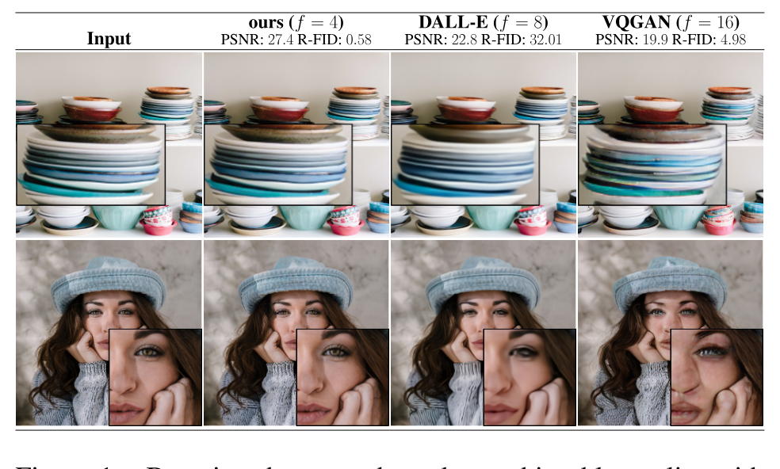

**図 1.** より穏やかなダウンサンプリングによる達成可能な品質の上限の向上。拡散モデルは空間データに対する優れた帰納バイアスをもつため、潜在空間で関連する生成モデルが用いる強い空間ダウンサンプリングは必要ないが、適切なオートエンコーダモデルによってデータの次元を大幅に削減できる。[第 3 節](#section-3)を参照。画像は DIV2K [Agu17a] の検証セットから取得し、$512^{2}$ px で評価した。空間ダウンサンプリング係数を $f$ とする。再構成 FID [Heu17] と PSNR は ImageNet-val [Den09a] 上で計算した。[表 8](#table-08)も参照。

画像合成は、近年もっとも目覚ましい発展を遂げたコンピュータビジョン分野の一つであると同時に、計算要求がもっとも大きい分野の一つでもある。特に複雑で自然なシーンの高解像度合成は現在、自己回帰（AR）Transformer [Ram21, Raz19] など、数十億個のパラメータを含み得る尤度ベースモデルの大規模化が中心となっている。一方、GAN [Goo14, Bro19, Kar19] の有望な結果は、敵対的学習手順が複雑でマルチモーダルな分布のモデル化へ容易にスケールしないため、変動性が比較的限られたデータにほぼ限られることが明らかになっている。最近では、ノイズ除去オートエンコーダの階層から構成される拡散モデル [Soh15] が、画像合成 [Ho20a, Son20] だけでなく [Kin21, Che21n, Kon21, Mit21] にも印象的な結果を示し、クラス条件付き画像合成 [Dha21, Ho21a] と超解像 [Sah21] で最高水準を定めている。さらに、無条件 DM であっても、画像修復やカラー化 [Son20]、ストロークベース合成 [Men21] などのタスクへ容易に適用でき、他の種類の生成モデル [Kin14, Rez14, Din17] とは異なる。尤度ベースモデルであるため、GAN のようなモード崩壊や学習不安定性を示さず、パラメータ共有を大いに活用することで、AR モデル [Raz19] のように数十億個のパラメータを必要とせず、自然画像の非常に複雑な分布をモデル化できる。

**高解像度画像合成の民主化。** DM は尤度ベースモデルの一種であり、そのモードを広く覆う性質によって、データの知覚できない詳細のモデル化に過剰な容量（したがって計算資源）を費やしやすい [Die20, Sal17]。再重み付け変分目的 [Ho20a] は初期のノイズ除去ステップを間引くことでこの問題に対処しようとするが、DM は依然として計算負荷が高い。というのも、このようなモデルの学習と評価には、高次元の RGB 画像空間で関数評価（および勾配計算）を繰り返す必要があるからである。たとえば、最も強力な DM の学習には数百 GPU 日（*e.g*. [Dha21] では 150～1000 V100 日）を要することが多く、入力空間のノイズ版に対する反復評価は推論も高コストにするため、単一の A100 GPU で 50k サンプルを生成するのに約 5 日かかる [Dha21]。これは研究コミュニティと一般の利用者に二つの帰結をもたらす。第一に、このようなモデルの学習には分野のごく一部しか利用できない大規模な計算資源が必要であり、大きなカーボンフットプリントを残す [Pat21a, Str20]。第二に、学習済みモデルの評価にも時間とメモリの面で大きなコストがかかる。これは、同じモデルアーキテクチャを多数のステップ（*e.g*. [Dha21] では 25～1000 ステップ）にわたって逐次実行しなければならないためである。

この強力なモデル群をより利用しやすくすると同時に、大きな資源消費を削減するには、学習とサンプリングの双方の計算複雑性を下げる方法が必要である。性能を損なわずに DM の計算要求を削減することが、利用しやすさを高める鍵となる。

**潜在空間への移行。** 私たちの手法は、ピクセル空間ですでに学習された拡散モデルの分析から始まる。[図 2](#figure-02)は学習済みモデルのレート・歪みトレードオフを示す。あらゆる尤度ベースモデルと同様に、学習はおおまかに二段階へ分けられる。第一段階は高周波の詳細を除去する一方で、意味的な変動はほとんど学習しない*知覚的圧縮*の段階である。第二段階では、実際の生成モデルがデータの意味的・概念的な構成（*意味的圧縮*）を学習する。そこで私たちはまず、知覚的には同等だが計算上より適した空間を見つけ、そこで高解像度画像合成用の拡散モデルを学習することを目指す。

一般的な慣行 [Oor17, Raz19, Ess20a, Dai19a, Ram21] に従い、学習を二つの異なる段階に分ける。まず、データ空間と知覚的に同等な、より低次元（したがって効率的）な表現空間を提供するオートエンコーダを学習する。重要なのは、先行研究 [Ess20a, Ram21] とは異なり、学習した潜在空間で DM を学習するため、過度な空間圧縮に頼る必要がないことである。この潜在空間は空間次元に対してより優れたスケーリング特性を示す。複雑性の低下により、単一のネットワークパスで潜在空間から効率的に画像を生成できる。得られたモデル群を*潜在拡散モデル*（LDM）と呼ぶ。

この手法の顕著な利点は、汎用オートエンコーディング段階を一度だけ学習すればよく、それを複数の DM 学習に再利用したり、まったく異なる可能性のあるタスクを探索したりできることである [Sne21]。これにより、さまざまな画像から画像へのタスクやテキストから画像へのタスクに対して、多数の拡散モデルを効率的に探索できる。後者のために、Transformer と DM の UNet バックボーン [Ron15] を接続し、任意の種類のトークンベース条件付け機構を可能にするアーキテクチャを設計した。[第 3.3 節](#section-3-3)を参照。

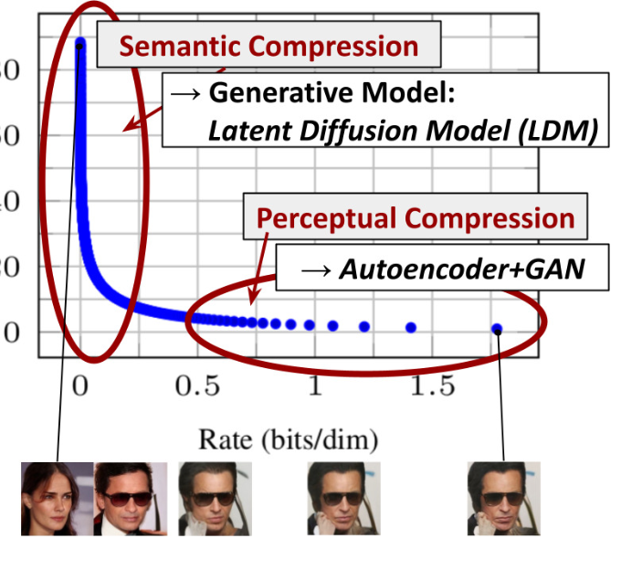

**図 2.** 知覚的圧縮と意味的圧縮の説明。デジタル画像の大部分のビットは知覚できない詳細に対応する。DM は対応する損失項を最小化することでこの意味のない情報を抑制できるが、（学習中の）勾配と（学習および推論中の）ニューラルネットワークバックボーンは依然として全ピクセル上で評価する必要があるため、余分な計算が生じ、最適化と推論が不必要に高コストになる。 私たちは、効果的な生成モデルであり、知覚できない詳細だけを除去する独立した穏やかな圧縮段階でもある*潜在拡散モデル（LDM）*を提案する。データと画像は [Ho20a] から引用。

以上をまとめると、本研究の貢献は次のとおりである。

(i) 純粋に Transformer ベースの手法 [Ess20a, Ram21] とは異なり、私たちの手法はより高次元のデータへより穏やかにスケールする。そのため、(a) 先行研究より忠実で詳細な再構成をもたらす圧縮レベルで動作でき（[図 1](#figure-01)を参照）、(b) メガピクセル画像の高解像度合成へ効率的に適用できる。

(ii) 無条件画像合成、画像修復、確率的超解像など複数のタスクとデータセットで競争力のある性能を達成し、計算コストを大幅に削減する。ピクセルベースの拡散手法と比べて、推論コストも大幅に低下する。

(iii) エンコーダ／デコーダアーキテクチャとスコアベースの事前分布を同時に学習する先行研究 [Vah21] とは異なり、私たちの手法では再構成能力と生成能力を慎重に重み付けする必要がないことを示す。これにより非常に忠実な再構成が得られ、潜在空間の正則化もごく少量で済む。

(iv) 超解像、画像修復、意味的合成のような密に条件付けられたタスクでは、私たちのモデルを畳み込み方式で適用でき、$\sim 1024^{2}$ px の大きく一貫した画像を生成できることを見いだす。

(v) さらに、cross-attention に基づく汎用条件付け機構を設計し、マルチモーダル学習を可能にする。これを用いて、クラス条件付き、テキストから画像へのモデル、レイアウトから画像へのモデルを学習する。

(vi) 最後に、事前学習済みの潜在拡散モデルとオートエンコーディングモデルを https://github.com/CompVis/latent-diffusion で公開する。これらは DM の学習以外にもさまざまなタスクへ再利用できる可能性がある [Sne21]。

## 2 関連研究

画像合成のための生成モデル 画像の高次元性は生成モデリングに固有の課題をもたらす。敵対的生成ネットワーク（GAN）[Goo14] は、知覚品質の高い高解像度画像を効率的にサンプリングできる [Bro19, Kar20b] が、最適化が難しく [Mes18a, Arj17, Gul17]、データ分布全体の捕捉にも苦労する [Met17]。これに対して尤度ベースの手法は良好な密度推定を重視するため、最適化がより扱いやすくなる。変分オートエンコーダ（VAE）[Kin14] とフローベースモデル [Din15, Din17] は高解像度画像を効率的に合成できる [Chi20b, Vah20, Kin18] が、サンプル品質は GAN に及ばない。自己回帰モデル（ARM）[Oor16b, Oor16a, Che20b, Chi19] は密度推定で高い性能を達成する一方、計算負荷の高いアーキテクチャ [Vas17d] と逐次サンプリング過程によって低解像度画像に制限される。画像のピクセルベース表現にはほとんど知覚できない高周波詳細が含まれるため [Die20, Sal17]、最尤学習はそれらのモデル化に不釣り合いな容量を費やし、学習時間が長くなる。より高い解像度へスケールするため、複数の二段階手法 [Yan21a, Raz19, Ess20a, Yu21a] は、生のピクセルではなく圧縮された潜在画像空間を ARM でモデル化する。

最近、拡散確率モデル（DM）[Soh15] は、密度推定 [Kin21] とサンプル品質 [Dha21] の双方で最高水準の結果を達成している。これらのモデルの生成力は、基礎となるニューラルバックボーンを UNet [Ron15, Ho20a, Son20, Dha21] として実装したとき、画像様データの帰納バイアスに自然に適合することから生じる。通常、再重み付けされた目的 [Ho20a] を学習に用いると最高の合成品質が得られる。この場合、DM は非可逆圧縮器に対応し、画像品質と圧縮能力をトレードオフできる。しかし、これらのモデルをピクセル空間で評価・最適化すると、推論速度が遅く、学習コストが非常に高いという欠点がある。前者は高度なサンプリング戦略 [Son21a, San21a, Kon21a] や階層的手法 [Ho21a, Vah21] で部分的に対処できるが、高解像度画像データ上での学習には常に高コストな勾配計算が必要となる。私たちは、低次元の圧縮潜在空間で動作する提案手法 *LDM* によって、この二つの欠点に対処する。これにより、合成品質をほとんど低下させずに学習を安価にし、推論を高速化できる（[図 1](#figure-01)を参照）。

画像合成の二段階手法 個々の生成手法の短所を緩和するため、二段階手法によって異なる手法の長所を組み合わせ、より効率的で高性能なモデルを構築する研究が数多く行われてきた [Dai19a, Rom20, Ess20a, Yu21a, Yan21a, Raz19]。VQ-VAE [Yan21a, Raz19] は自己回帰モデルを用いて離散化された潜在空間上の表現力豊かな事前分布を学習する。[Ram21] はこの手法を拡張し、離散化された画像表現とテキスト表現の同時分布を学習することでテキストから画像を生成する。より一般には、[Rom20] は条件付き可逆ネットワークを用いて、異なるドメインの潜在空間間で汎用的な変換を実現する。VQ-VAE とは異なり、VQGAN [Ess20a, Yu21a] は敵対的目的と知覚的目的をもつ第一段階を用いて、自己回帰 Transformer をより大きな画像へスケールする。しかし、実用的な ARM 学習に必要な高い圧縮率は、数十億個の学習可能パラメータを導入するため [Ram21, Ess20a]、このような手法の全体性能を制限し、圧縮を弱めると高い計算コストを招く [Ram21, Ess20a]。私たちの手法は、このようなトレードオフを避ける。提案する *LDM* は畳み込みバックボーンによって、より高次元の潜在空間へ穏やかにスケールするからである。そのため、強力な第一段階を学習しつつ、生成拡散モデルに過度な知覚的圧縮を任せず、高忠実度の再構成を保証するという条件を最適に両立する圧縮レベルを自由に選べる（[図 1](#figure-01)を参照）。

エンコーディング／デコーディングモデルとスコアベースの事前分布を同時に [Vah21] または別々に [Sin21] 学習する手法も存在するが、前者は再構成能力と生成能力の間で依然として難しい重み付けを必要とし [Dai19a]、私たちの手法に劣る（[第 4 節](#section-4)）。後者は人間の顔のような高度に構造化された画像に焦点を当てている。

## 3 手法

高解像度画像合成に向けた拡散モデル学習の計算要求を下げるため、拡散モデルは対応する損失項を間引くことで知覚的に無関係な詳細を無視できる [Ho20a] ものの、依然としてピクセル空間で高コストな関数評価を必要とし、計算時間とエネルギー資源に大きな要求を生じることに着目する。

この欠点を回避するため、圧縮学習段階と生成学習段階を明示的に分離する手法を導入する（[図 2](#figure-02)を参照）。そのために、画像空間と知覚的に同等でありながら、計算複雑性を大幅に削減できる空間を学習するオートエンコーディングモデルを利用する。

この手法にはいくつかの利点がある。(i) 高次元画像空間を離れることで、低次元空間上でサンプリングを行う、計算効率のはるかに高い DM が得られる。(ii) DM が UNet アーキテクチャ [Ron15] から受け継ぐ帰納バイアスを活用する。このバイアスは空間構造をもつデータに特に有効であり、先行手法 [Ess20a, Ram21] が必要とした、品質を損なう強い圧縮レベルの必要性を和らげる。(iii) 最後に、潜在空間を複数の生成モデルの学習に利用でき、単一画像の CLIP 誘導合成 [Fra21a] など他の下流アプリケーションにも使える汎用圧縮モデルを得る。

### 3.1 知覚的画像圧縮

私たちの知覚的圧縮モデルは先行研究 [Ess20a] に基づき、知覚損失 [Zha18d] とパッチベース [Iso17] の敵対的目的 [Dos16, Ess20a, Yu21a] を組み合わせて学習したオートエンコーダから構成される。局所的なリアリズムを強制することで再構成を画像多様体内にとどめ、$L_{2}$ や $L_{1}$ のようなピクセル空間損失だけに依存した場合に生じるぼけを避ける。

より正確には、RGB 空間の画像 $x\in\mathbb{R}^{H\times W\times 3}$ が与えられると、エンコーダ $\mathcal{E}$ は $x$ を潜在表現 $z=\mathcal{E}(x)$ へ符号化し、デコーダ $\mathcal{D}$ は潜在表現から画像を再構成して $\tilde{x}=\mathcal{D}(z)=\mathcal{D}(\mathcal{E}(x))$ を得る。ここで $z\in\mathbb{R}^{h\times w\times c}$ である。重要なのは、エンコーダが画像を係数 $f=H/h=W/w$ で*ダウンサンプリング*する点であり、異なるダウンサンプリング係数 $f=2^{m}$ を調べ、$m\in\mathbb{N}$ とする。

潜在空間の分散が任意に大きくなることを避けるため、二種類の正則化を試す。第一の変種である *KL-reg.* は、VAE [Kin14, Rez14] と同様に、学習した潜在表現へ標準正規分布に向かう弱い KL ペナルティを課す。一方、*VQ-reg.* はデコーダ内にベクトル量子化層 [Oor17] を用いる。このモデルは、量子化層をデコーダへ吸収した VQGAN [Ess20a] と解釈できる。後続の DM は学習した潜在空間 $z=\mathcal{E}(x)$ の二次元構造を扱うよう設計されているため、比較的穏やかな圧縮率を用いて非常に良い再構成を得られる。これは、学習空間 $z$ の分布を自己回帰的にモデル化するために任意の 1D 順序付けに依存し、その固有の構造 $z$ の多くを無視した先行研究 [Ess20a, Ram21] とは対照的である。したがって、私たちの圧縮モデルは $x$ の詳細をよりよく保持する（[表 8](#table-08)を参照）。完全な目的と学習の詳細は補足資料に示す。

### 3.2 潜在拡散モデル

拡散モデル [Soh15] は、正規分布に従う変数を徐々にノイズ除去することでデータ分布 $p(x)$ を学習するよう設計された確率モデルであり、長さ $T$ の固定マルコフ連鎖の逆過程を学習することに対応する。画像合成で最も成功しているモデル [Ho20a, Dha21, Sah21] は、denoising score-matching [Son20] に対応する、$p(x)$ の変分下限の再重み付け版に依存する。これらのモデルは、等重みのノイズ除去オートエンコーダ列 $\epsilon_{\theta}(x_{t},t);\,t=1\dots T$ と解釈できる。これは入力 $x_{t}$ のノイズ除去済み変種を予測するよう学習され、$x_{t}$ は入力 $x$ のノイズ版である。対応する目的は次のように簡略化できる（[第 8 節](#section-8)）。

$$
L_{DM}=\mathbb{E}_{x,\epsilon\sim\mathcal{N}(0,1),t}\Big[\|\epsilon-\epsilon_{\theta}(x_{t},t)\|_{2}^{2}\Big]\,,
$$

$t$ は一様に $\{1,\dots,T\}$ からサンプリングする。

潜在表現の生成モデリング $\mathcal{E}$ と $\mathcal{D}$ からなる知覚的圧縮モデルを学習したことで、高周波で知覚できない詳細が抽象化された、効率的で低次元の潜在空間を利用できるようになる。高次元のピクセル空間と比べ、この空間は尤度ベースの生成モデルに適している。生成モデルはここで、(i) データの重要な意味情報に集中でき、(ii) より低次元で計算効率の高い空間で学習できる。

高圧縮された離散潜在空間で自己回帰的な attention ベースの Transformer モデルに依存した先行研究 [Ram21, Ess20a, Yu21a] とは異なり、私たちのモデルがもつ画像固有の帰納バイアスを利用できる。これには、基礎となる UNet を主に 2D 畳み込み層から構成する能力と、再重み付けされた下限を用いて知覚的に最も重要な情報へ目的をさらに集中させることが含まれる。下限は次のようになる。

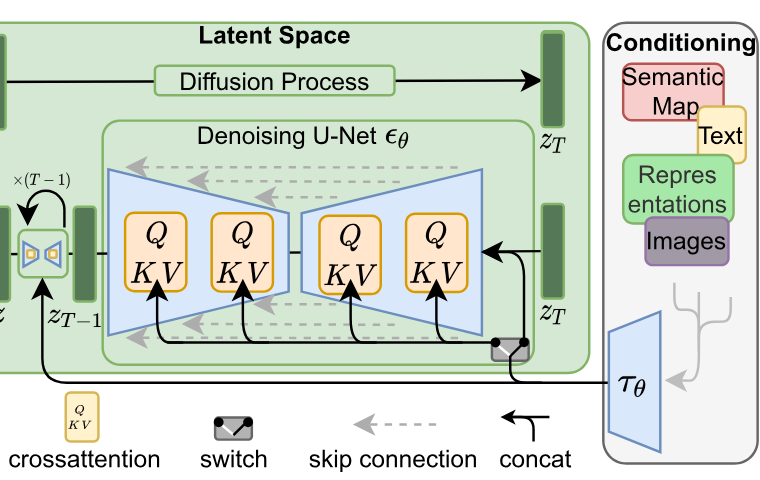

**図 3.** LDM の条件付けには、連結またはより一般的な cross-attention 機構を用いる。[第 3.3 節](#section-3-3)を参照。

$$
L_{LDM}:=\mathbb{E}_{\mathcal{E}(x),\epsilon\sim\mathcal{N}(0,1),t}\Big[\|\epsilon-\epsilon_{\theta}(z_{t},t)\|_{2}^{2}\Big]\,.
$$

モデルのニューラルバックボーン $\epsilon_{\theta}(\circ,t)$ は時刻条件付き UNet [Ron15] として実現する。順方向過程は固定されているため、学習中に $z_{t}$ を $\mathcal{E}$ から効率的に得られ、$p(z)$ のサンプルは $\mathcal{D}$ を一度通すだけで画像空間へデコードできる。

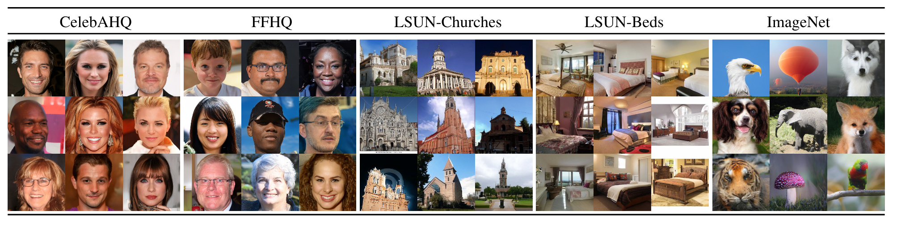

**図 4.** CelebAHQ [Kar17]、FFHQ [Kar19a]、LSUN-Churches [Yu15a]、LSUN-Bedrooms [Yu15a]、クラス条件付き ImageNet [Den09a] で学習した *LDM* のサンプル。それぞれ解像度は $256\times 256$。拡大して見ることを推奨する。追加サンプルについては補足資料を参照。

### 3.3 条件付け機構

他の種類の生成モデル [Mir14, Soh15a] と同様に、拡散モデルは原理上 $p(z|y)$ の形の条件付き分布をモデル化できる。これは条件付きノイズ除去オートエンコーダ $\epsilon_{\theta}(z_{t},t,y)$ によって実装でき、テキスト [Ree16]、意味マップ [Par19c, Iso17]、その他の画像から画像への変換タスク [Iso17a] などの入力 $y$ を通じて合成過程を制御する道を開く。

しかし画像合成の文脈では、DM の生成力と、クラスラベル [Dha21] や入力画像のぼけた変種 [Sah21] を超える条件付けを組み合わせることは、これまで十分に研究されていない。

私たちは、cross-attention 機構 [Vas17d] によって基礎となる UNet バックボーンを拡張し、DM をより柔軟な条件付き画像生成器へ変換する。この機構は、さまざまな入力モダリティの attention ベースモデルを学習するのに有効である [Jae21, Jae21a]。さまざまなモダリティ（言語プロンプトなど）から $y$ を前処理するため、ドメイン固有エンコーダ $\tau_{\theta}$ を導入し、$y$ を中間表現 $\tau_{\theta}(y)\in\mathbb{R}^{M\times d_{\tau}}$ へ射影する。この表現を、$\text{Attention}(Q,K,V)=\text{softmax}\left(\frac{QK^{T}}{\sqrt{d}}\right)\cdot V$ を実装する cross-attention 層によって UNet の中間層へ写像する。ここで、

$$
Q=W^{(i)}_{Q}\cdot\varphi_{i}(z_{t}),\;K=W^{(i)}_{K}\cdot\tau_{\theta}(y),\;V=W^{(i)}_{V}\cdot\tau_{\theta}(y).
$$

ここで、$\varphi_{i}(z_{t})\in\mathbb{R}^{N\times d^{i}_{\epsilon}}$ は $\epsilon_{\theta}$ を実装する UNet の（平坦化された）中間表現を表し、$W^{(i)}_{V}\in\mathbb{R}^{d\times d^{i}_{\epsilon}}$、$W^{(i)}_{Q}\in\mathbb{R}^{d\times d_{\tau}}$、$W^{(i)}_{K}\in\mathbb{R}^{d\times d_{\tau}}$ は学習可能な射影行列である [Vas17d, Jae21]。[図 3](#figure-03)に視覚的な説明を示す。

画像と条件のペアに基づき、条件付き LDM を次式で学習する。

$$
L_{LDM}:=\mathbb{E}_{\mathcal{E}(x),y,\epsilon\sim\mathcal{N}(0,1),t}\Big[\|\epsilon-\epsilon_{\theta}(z_{t},t,\tau_{\theta}(y))\|_{2}^{2}\Big]\,,
$$

$\tau_{\theta}$ と $\epsilon_{\theta}$ はともに [式 3](#equation-03) によって同時最適化される。この条件付け機構は柔軟である。$\tau_{\theta}$ は、$y$ がテキストプロンプトの場合には（マスクされていない）Transformer [Vas17d] など、ドメイン固有の専門モデルを用いてパラメータ化できる（[第 4.3.1 節](#section-4-3-1)を参照）。

## 4 実験

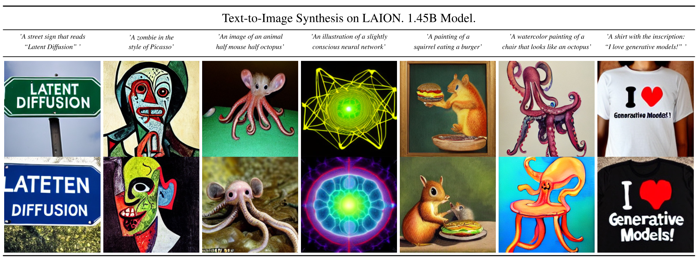

**図 5.** テキストから画像への合成モデル *LDM-8 (KL)* に、ユーザーが定義したテキストプロンプトを入力して得たサンプル。このモデルは LAION [Sch21a] データベース上で学習した。200 DDIM ステップ、$\eta=1.0$ で生成した。無条件誘導 [Ho21] を $s=10.0$ として用いる。

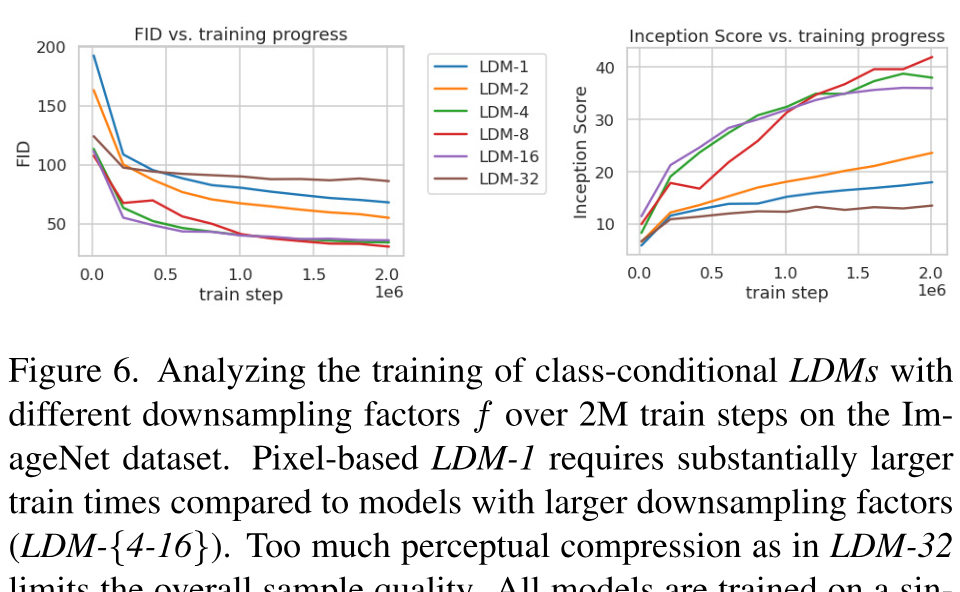

**図 6.** ImageNet データセット上で 2M 学習ステップにわたり、異なるダウンサンプリング係数 $f$ をもつクラス条件付き *LDM* の学習を分析する。ピクセルベースの *LDM-1* は、より大きなダウンサンプリング係数をもつモデル（*LDM-$\{$4-16$\}$*）と比べて大幅に長い学習時間を必要とする。*LDM-32* のように知覚的圧縮が強すぎると、全体的なサンプル品質が制限される。すべてのモデルは単一の NVIDIA A100 上で、同じ計算予算を用いて学習した。結果は 100 DDIM ステップ [Son21a]、$\kappa=0$ で得た。

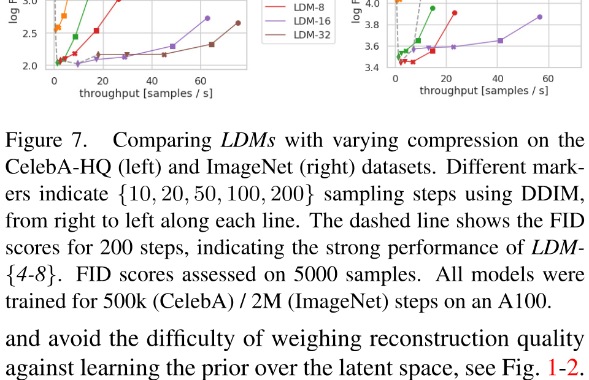

**図 7.** CelebA-HQ（左）と ImageNet（右）データセット上で、圧縮率の異なる *LDM* を比較する。異なるマーカーは、DDIM によるサンプリングステップ数 $\{10,20,50,100,200\}$ を示し、各線に沿って右から左へ並ぶ。破線は 200 ステップの FID スコアを示し、*LDM-$\{$4-8$\}$* の強い性能を示す。FID スコアは 5000 サンプルで評価した。すべてのモデルは A100 上で 500k（CelebA）／2M（ImageNet）ステップ学習した。

*LDM* は、さまざまな画像モダリティに対する柔軟で計算可能な拡散ベース画像合成の手段を提供する。以下で実験的に示す。まず、学習と推論の双方で、私たちのモデルによる改善をピクセルベースの拡散モデルと比較して分析する。興味深いことに、*VQ* 正則化潜在空間で学習した *LDM* は、*VQ* 正則化第一段階モデルの再構成能力が連続なモデルにやや劣るにもかかわらず、より良いサンプル品質を達成する場合がある（[表 8](#table-08)を参照）。第一段階の正則化方式が *LDM* の学習と $>256^{2}$ 解像度への一般化能力に与える影響の視覚的比較は、付録の[第 10.1 節](#section-10-1)に示す。[第 11.2 節](#section-11-2)では、この節で示すすべての結果について、アーキテクチャ、実装、学習、評価の詳細を列挙する。

### 4.1 知覚的圧縮のトレードオフについて

この節では、異なるダウンサンプリング係数 $f\in\{1,2,4,8,16,32\}$（*LDM-*$f$ と略記し、*LDM-1* はピクセルベース DM に対応する）をもつ LDM の挙動を分析する。この節のすべての実験で比較可能な試験場を得るため、計算資源を単一の NVIDIA A100 に固定し、すべてのモデルを同じステップ数、同じパラメータ数で学習する。

[表 8](#table-08)は、この節で比較する *LDM* に用いた第一段階モデルのハイパーパラメータと再構成性能を示す。[図 6](#figure-06)は、ImageNet [Den09a] データセット上でクラス条件付きモデルを 2M ステップ学習したときの、学習進行に対するサンプル品質を示す。i) 小さなダウンサンプリング係数 *LDM-*$\{$*1,2*$\}$* では学習の進行が遅く、ii) $f$ が大きすぎると、比較的少ない学習ステップの後に忠実度が停滞することがわかる。上の分析（[図 1](#figure-01)と[図 2](#figure-02)）を振り返ると、これは i) 知覚的圧縮の大部分を拡散モデルに任せていること、ii) 第一段階の圧縮が強すぎて情報損失が生じ、達成可能な品質を制限していることによると考えられる。*LDM-$\{$4-16$\}$* は効率と知覚的に忠実な結果のバランスがよく、2M 学習ステップ後の FID [Heu17] には、ピクセルベース拡散（*LDM-1*）と *LDM-8* の間で 38 という大きな差が現れる。

[図 7](#figure-07)では、CelebA-HQ [Kar17] と ImageNet 上で学習したモデルについて、DDIM サンプラー [Son21a] を用いた異なるノイズ除去ステップ数でのサンプリング速度を比較し、FID スコア [Heu17] に対してプロットする。*LDM-$\{$4-8$\}$* は、知覚的圧縮と概念的圧縮の比率が不適切なモデルを上回る。特にピクセルベースの *LDM-1* と比べると、サンプルスループットを大幅に高めながら、はるかに低い FID スコアを達成する。ImageNet のような複雑なデータセットでは、品質低下を避けるために圧縮率を下げる必要がある。まとめると、*LDM-4* と *-8* が高品質な合成結果を得るための最良の条件を提供する。

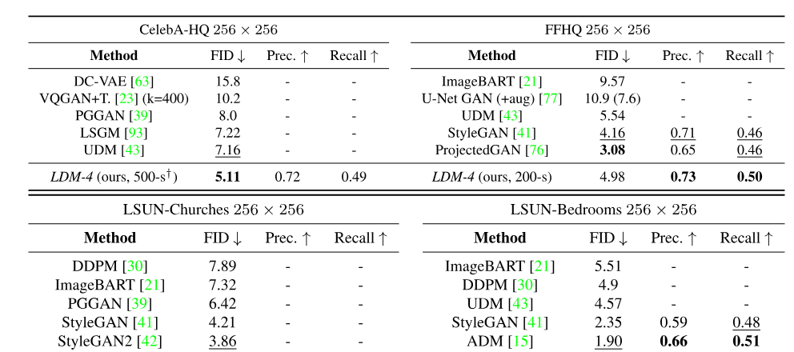

**表 1.** 無条件画像合成の評価指標。CelebA-HQ の結果は [Par21, Xia21a, Kim21a] から再現し、FFHQ は [Kar20b, Kim21a] から再現した。^†: $N$-s は DDIM [Son21a] サンプラーによる $N$ サンプリングステップを表す。^∗: *KL* 正則化潜在空間で学習した。追加結果は補足資料に示す。

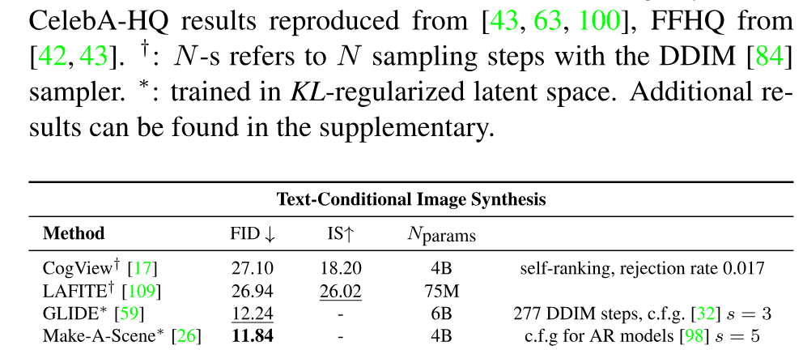

**表 2.** $256\times 256$ サイズの MS-COCO [Lin14a] データセットにおけるテキスト条件付き画像合成の評価。250 回の DDIM [Son21a] ステップを用いると、私たちのモデルは、パラメータ数が大幅に少ないにもかかわらず、最新の拡散 [Nic22] および自己回帰 [Gaf22] 手法と同等である。^†/^∗: 数値は [Zho21a]／[Gaf22] から引用。

### 4.2 潜在拡散による画像生成

$256^{2}$ 画像の無条件モデルを CelebA-HQ [Kar17]、FFHQ [Kar19a]、LSUN-Churches と -Bedrooms [Yu15a] 上で学習し、i) サンプル品質と ii) データ多様体の被覆を、ii) FID [Heu17] と ii) Precision-and-Recall [Kyn19] によって評価する。[表 1](#table-01)に結果をまとめる。CelebA-HQ では、$5.11$ の新たな最高水準 FID を報告し、先行する尤度ベースモデルと GAN の双方を上回る。第一段階と同時に潜在拡散モデルを学習する LSGM [Vah21] も上回る。これに対して私たちは固定空間で拡散モデルを学習し、再構成品質と潜在空間上の事前分布学習の重み付けの難しさを避ける。[図 1](#figure-01)～[図 2](#figure-02)を参照。

LSUN-Bedrooms データセットを除くすべてで先行する拡散ベース手法を上回る。LSUN-Bedrooms では、パラメータ数を半分にし、学習資源を 4 分の 1 にしながら、ADM [Dha21] に近いスコアを得る（付録の[第 11.3.5 節](#section-11-3-5)を参照）。さらに、*LDM* は Precision と Recall で GAN ベース手法を一貫して上回り、敵対的手法に対する、モードを広く覆う尤度ベース学習目的の利点を裏付ける。[図 4](#figure-04)には各データセットの定性的結果も示す。

### 4.3 条件付き潜在拡散

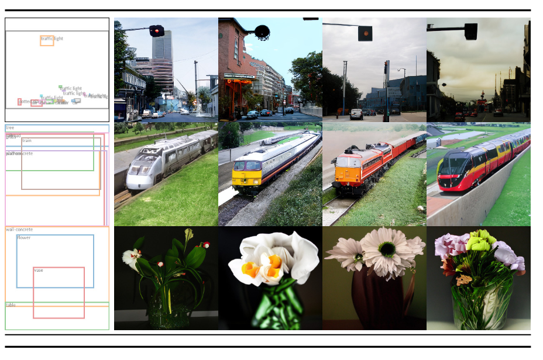

**図 8.** COCO [Cae18] 上での *LDM* によるレイアウトから画像への合成。[第 4.3.1 節](#section-4-3-1)を参照。定量評価は補足資料の[第 10.3 節](#section-10-3)に示す。

#### 4.3.1 LDM の Transformer エンコーダ

LDM に cross-attention ベースの条件付けを導入することで、拡散モデルではこれまで十分に探索されていなかったさまざまな条件モダリティを扱えるようになる。テキストから画像へのモデリングでは、LAION-400M [Sch21a] 上で、言語プロンプトを条件とする 14.5 億パラメータの *KL* 正則化 *LDM* を学習する。BERT tokenizer [Dev18] を用い、$\tau_{\theta}$ を Transformer [Vas17d] として実装し、（マルチヘッド）cross-attention（[第 3.3 節](#section-3-3)）を通じて UNet に写像する潜在コードを推論する。言語表現の学習と視覚的合成のためのドメイン固有専門モデルを組み合わせることで、ユーザーが定義した複雑なテキストプロンプトへよく一般化する強力なモデルとなる。[図 8](#figure-08)と[図 5](#figure-05)を参照。定量分析では先行研究に従い、MS-COCO [Lin14a] の検証セット上でテキストから画像への生成を評価する。私たちのモデルは、強力な AR [Ram21, Din21] および GAN ベース [Zho21a] の手法を上回る。[表 2](#table-02)を参照。classifier-free diffusion guidance [Ho21] を適用するとサンプル品質が大きく向上し、誘導付き *LDM-KL-8-G* は、パラメータ数を大幅に削減しながら、テキストから画像への合成で最近の最高水準の AR [Gaf22] および拡散モデル [Nic22] と同等になる。cross-attention ベース条件付け機構の柔軟性をさらに分析するため、OpenImages [Kuz18] 上で意味的レイアウトに基づく画像合成モデルも学習し、COCO [Cae18] 上でファインチューニングする。[図 8](#figure-08)を参照。定量評価と実装の詳細は[第 10.3 節](#section-10-3)に示す。

最後に、先行研究 [Dha21, Bro19, Ess20a, Ess21] に従い、[第 4.1 節](#section-4-1)の $f\in\{4,8\}$ を用いた最良性能のクラス条件付き ImageNet モデルを、[表 3](#table-03)、[図 4](#figure-04)、[第 10.4 節](#section-10-4)で評価する。ここでは、計算要件とパラメータ数を大幅に削減しながら、最高水準の拡散モデル ADM [Dha21] を上回る。[表 18](#table-18)を参照。

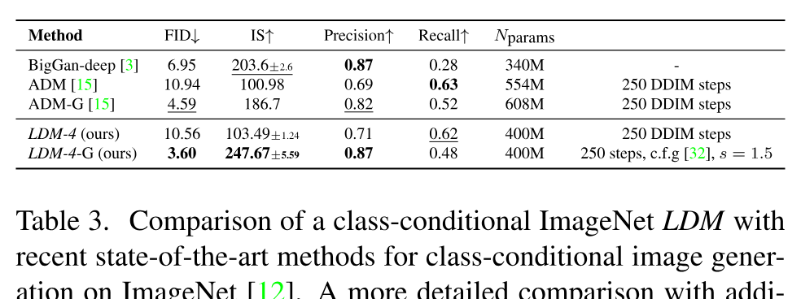

**表 3.** ImageNet [Den09a] におけるクラス条件付き画像生成について、最近の最高水準手法とクラス条件付き ImageNet *LDM* を比較する。追加のベースラインを含む詳細な比較は、[第 10.4 節](#section-10-4)、[表 10](#table-10)、[第 12 節](#section-12)に示す。*c.f.g.* は [Ho21] が提案したスケール $s$ の classifier-free guidance を表す。

#### 4.3.2 $256^{2}$ を超える畳み込みサンプリング

$\epsilon_{\theta}$ の入力へ空間的に整列した条件情報を連結することで、*LDM* は効率的な汎用画像から画像への変換モデルとして機能する。これを用いて、意味的合成、超解像（[第 4.4 節](#section-4-4)）、画像修復（[第 4.5 節](#section-4-5)）のモデルを学習する。意味的合成では、意味マップ [Par19c, Ess20a] と組み合わせた風景画像を用い、意味マップのダウンサンプリング版を $f=4$ モデル（VQ-reg.、[表 8](#table-08)を参照）の潜在画像表現に連結する。入力解像度 $256^{2}$（$384^{2}$ からのクロップ）で学習するが、モデルはより大きな解像度へ一般化し、畳み込み方式で評価するとメガピクセル領域まで画像を生成できることがわかる（[図 9](#figure-09)を参照）。この挙動を利用し、[第 4.4 節](#section-4-4)の超解像モデルと[第 4.5 節](#section-4-5)の画像修復モデルを、$512^{2}$ から $1024^{2}$ の大きな画像の生成にも適用する。この用途では、潜在空間のスケールによって生じる信号対雑音比が結果に大きく影響する。[第 10.1 節](#section-10-1)では、(i) $f=4$ モデルが提供する潜在空間（KL-reg.、[表 8](#table-08)を参照）と、(ii) 成分ごとの標準偏差でスケーリングした再スケール版で LDM を学習した場合について、この点を示す。

後者は classifier-free guidance [Ho21] と組み合わせることで、[図 13](#figure-13)のように、テキスト条件付き *LDM-KL-8-G* による $>256^{2}$ 画像の直接合成も可能にする。

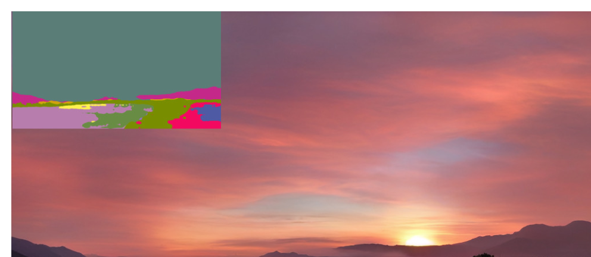

**図 9.** $256^{2}$ 解像度で学習した *LDM* は、風景画像の意味的合成のような空間条件付きタスクで、より大きな解像度（ここでは $512\times 1024$）へ一般化できる。[第 4.3.2 節](#section-4-3-2)を参照。

### 4.4 潜在拡散による超解像

LDM は、連結によって低解像度画像を直接条件とすることで、超解像用に効率的に学習できる（[第 3.3 節](#section-3-3)を参照）。最初の実験では SR3 [Sah21] に従い、画像劣化を $4\times$ ダウンサンプリングのバイキュービック補間に固定し、SR3 のデータ処理パイプラインに従って ImageNet 上で学習する。OpenImages 上で事前学習した $f=4$ オートエンコーディングモデル（VQ-reg.、[表 8](#table-08)を参照）を用い、低解像度の条件 $y$ と入力を UNet に連結する。つまり $\tau_{\theta}$ は恒等写像である。定性的・定量的結果（[図 10](#figure-10)と[表 5](#table-05)を参照）は競争力のある性能を示し、LDM-SR は FID で SR3 を上回る一方、SR3 は IS で優れる。単純な画像回帰モデルは PSNR と SSIM で最高スコアを達成するが、これらの指標は人間の知覚とよく一致せず [Zha18d]、不完全に整列した高周波詳細よりもぼけを好む [Sah21]。さらに、ピクセルベースラインと LDM-SR を比較するユーザースタディを行う。SR3 [Sah21] に従い、人間の被験者に二つの高解像度画像の間に低解像度画像を提示し、どちらを好むか尋ねる。[表 4](#table-04)の結果は LDM-SR の良好な性能を裏付ける。PSNR と SSIM は事後誘導機構 [Dha21] によってさらに向上させられる。私たちはこの*画像ベース誘導器*を知覚損失によって実装する。[第 10.6 節](#section-10-6)を参照。

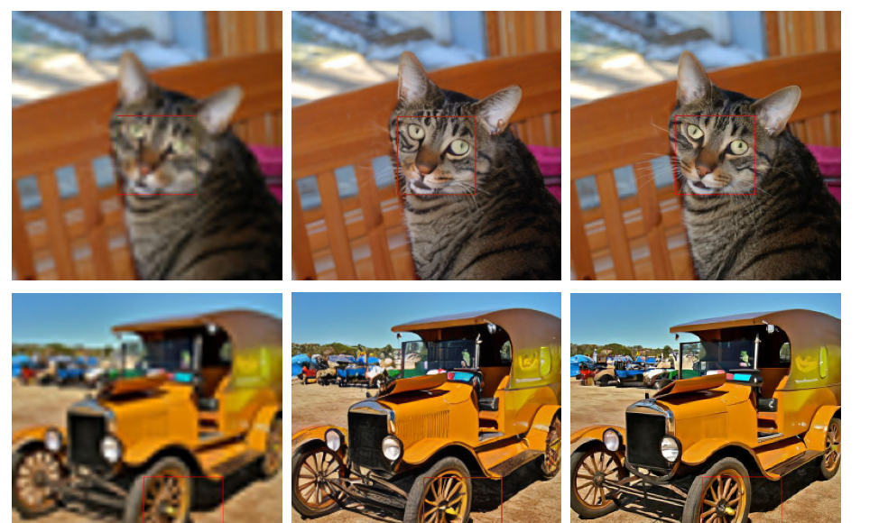

**図 10.** ImageNet-Val における ImageNet 64$\rightarrow$256 超解像。*LDM-SR* は現実的なテクスチャの描画に利点があるが、SR3 はより一貫した微細構造を合成できる。追加サンプルと切り出し画像は付録を参照。SR3 の結果は [Sah21] から引用。

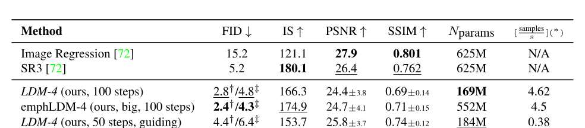

**表 4.** タスク 1：被験者に正解画像と生成画像を提示し、どちらを好むか尋ねた。タスク 2：被験者は二つの生成画像から一つを選んだ。詳細は[第 11.3.6 節](#section-11-3-6)を参照。

バイキュービック劣化過程は、この前処理に従わない画像へうまく一般化しないため、より多様な劣化を用いて汎用モデル *LDM-BSR* も学習する。結果は[第 10.6.1 節](#section-10-6-1)に示す。

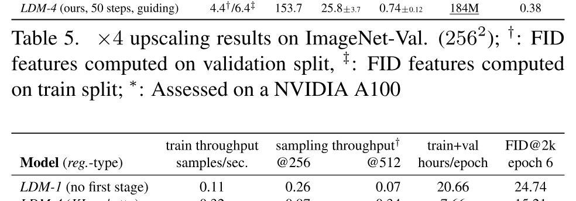

**表 5.** ImageNet-Val における $\times 4$ アップスケーリング結果（$256^{2}$）。^†: 検証分割で計算した FID 特徴、^‡: 学習分割で計算した FID 特徴、^∗: NVIDIA A100 上で評価。

### 4.5 潜在拡散による画像修復

画像修復は、画像の一部が破損している、または画像内の既存だが望ましくない内容を置き換えるために、マスクされた領域を新しい内容で埋めるタスクである。私たちは、条件付き画像生成に対する汎用的な手法を、このタスクに特化した最高水準の手法と比較する。評価は LaMa [Suv21] のプロトコルに従う。LaMa は Fast Fourier Convolution [Chi20a] に基づく特化アーキテクチャを導入した最近の画像修復モデルである。Places [Zho18a] 上での正確な学習・評価プロトコルは[第 11.2.2 節](#section-11-2-2)に示す。

まず、第一段階における異なる設計選択の効果を分析する。

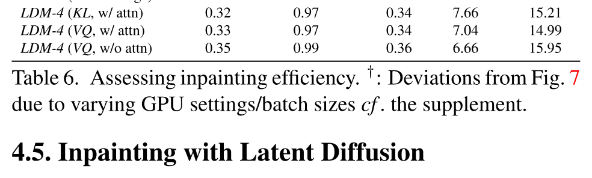

**表 6.** 画像修復効率の評価。^†: GPU 設定／バッチサイズの違いによる[図 7](#figure-07)からの差異（補足資料を参照）。

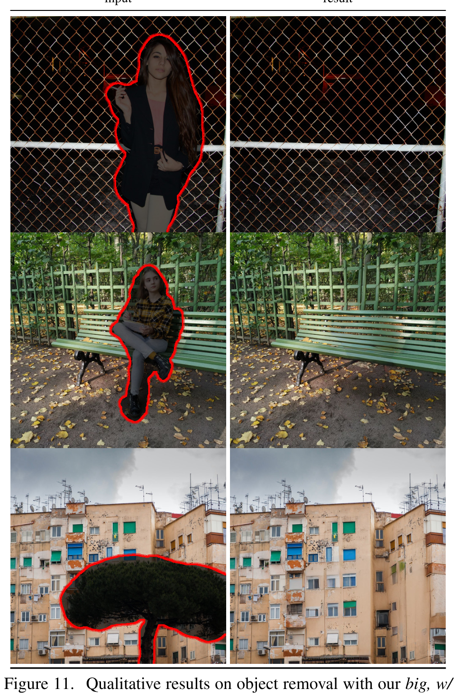

**図 11.** *big, w/ ft* 画像修復モデルによる物体除去の定性的結果。追加結果は[図 22](#figure-22)を参照。

特に、*KL* と *VQ* の両方の正則化について、*LDM-1*（*i.e*. ピクセルベースの条件付き DM）と *LDM-4* の画像修復効率を比較し、さらに第一段階に attention をもたない *VQ-LDM-4* も比較する（[表 8](#table-08)を参照）。後者は高解像度でのデコードに必要な GPU メモリを削減する。比較のため、すべてのモデルのパラメータ数を固定する。[表 6](#table-06)には、$256^{2}$ と $512^{2}$ の解像度における学習・サンプリングスループット、エポック当たりの総学習時間（時間）、6 エポック後の検証分割における FID スコアを示す。全体として、ピクセルベースと潜在ベースの拡散モデルの間で少なくとも $2.7\times$ の高速化を観測し、FID スコアを少なくとも $1.6\times$ 改善する。

[表 7](#table-07)で他の画像修復手法と比較すると、attention をもつ私たちのモデルは、[Suv21] よりも FID で測った全体的な画像品質を改善する。マスクされていない画像と私たちのサンプルの間の LPIPS は [Suv21] よりわずかに高い。これは、[Suv21] が単一の結果しか生成せず、私たちの LDM が生成する多様な結果と比べて、より平均的な画像を復元しやすいためだと考える（[図 21](#figure-21)を参照）。さらに、ユーザースタディ（[表 4](#table-04)）では、被験者は [Suv21] より私たちの結果を好む。

これらの初期結果に基づき、attention をもたない *VQ* 正則化第一段階の潜在空間で、より大きな拡散モデル（[表 7](#table-07)の *big*）も学習した。[Dha21] に従い、この拡散モデルの UNet は特徴階層の 3 つのレベルで attention 層を用い、アップサンプリングとダウンサンプリングに BigGAN [Bro19] の残差ブロックを用いる。パラメータ数は 215M ではなく 387M である。学習後、$256^{2}$ と $512^{2}$ の解像度で生成されるサンプル品質に差があることに気づき、追加の attention モジュールが原因だと仮定した。しかし、$512^{2}$ 解像度で半エポック分モデルをファインチューニングすると、新しい特徴統計へ適応でき、画像修復で新たな最高水準の FID を達成する（[表 7](#table-07)、[図 11](#figure-11)の *big, w/o attn, w/ ft*）。

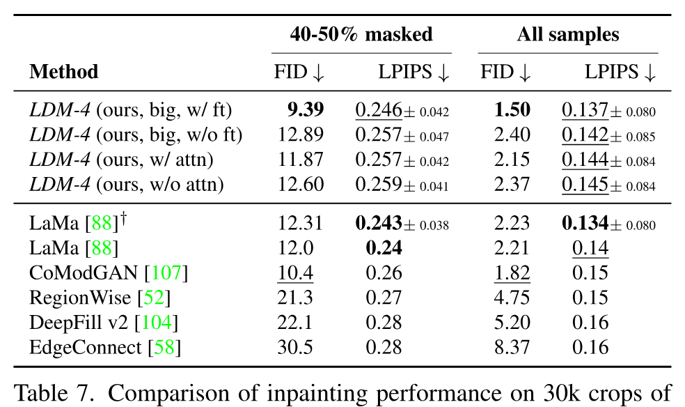

**表 7.** Places [Zho18a] のテスト画像から切り出した $512\times 512$ の 30k クロップにおける画像修復性能の比較。*40-50%* 列は、画像領域の 40～50% を修復する必要がある難しい例について計算した指標を示す。^†: [Suv21] で使用された元のテストセットが利用できなかったため、私たちのテストセットで再計算した。

## 5 限界と社会的影響

**限界。** LDM はピクセルベース手法と比べて計算要件を大幅に削減するが、逐次サンプリング過程は依然として GAN より遅い。さらに、高い精度が必要な場合、LDM の利用には注意が必要である。$f=4$ オートエンコーディングモデルでは画像品質の損失は非常に小さいものの（[図 1](#figure-01)を参照）、ピクセル空間で細粒度の精度を要するタスクでは、再構成能力がボトルネックになり得る。私たちの超解像モデル（[第 4.4 節](#section-4-4)）は、この点ですでにある程度制限されていると考える。

**社会的影響。** 画像のようなメディア向けの生成モデルは両刃の剣である。一方では、さまざまな創作的応用を可能にし、特に私たちのように学習と推論のコストを下げる手法は、この技術へのアクセスと探索を広げる可能性がある。他方では、改変データの作成・拡散や、誤情報・スパムの拡散も容易になる。特に、画像の意図的な改変（「ディープフェイク」）はこの文脈で一般的な問題であり、女性がとりわけ不均衡な影響を受けている [Den21, Fra18a]。

生成モデルは学習データを明らかにすることもある [Car21, Tin21]。データに機密情報や個人情報が含まれ、明示的な同意なしに収集された場合、これは大きな懸念となる。ただし、画像 DM にも同じことが当てはまる程度はまだ十分に理解されていない。

最後に、深層学習モジュールは、データにすでに存在するバイアスを再現または悪化させる傾向がある [Efr11, Jai20b, Ess20]。拡散モデルは *e.g*. GAN ベース手法よりデータ分布をよく覆うが、敵対的学習と尤度ベース目的を組み合わせる私たちの二段階手法がデータをどの程度誤って表現するかは、依然として重要な研究課題である。

深層生成モデルの倫理的考慮について、より一般的で詳しい議論は *e.g*. [Den21]を参照。

## 6 結論

私たちは、品質を低下させずにノイズ除去拡散モデルの学習効率とサンプリング効率の双方を大幅に改善する、単純で効率的な方法として潜在拡散モデルを提示した。これと cross-attention 条件付け機構に基づき、タスク固有のアーキテクチャを使わず、幅広い条件付き画像合成タスクで最高水準手法に対して良好な結果を示した。 [+ack] この研究は、ドイツ連邦経済・エネルギー省のプロジェクト「KI-Absicherung - Safe AI for automated driving」およびドイツ研究振興協会（DFG）プロジェクト 421703927 の支援を受けた。

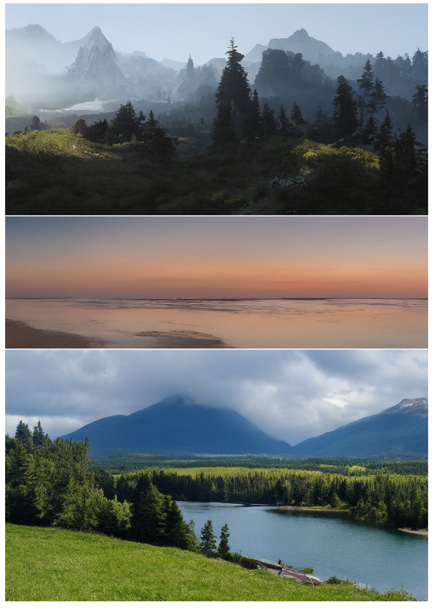

**図 12.** [第 4.3.2 節](#section-4-3-2)の意味的風景モデルから得た畳み込みサンプル。$512^{2}$ 画像でファインチューニングした。

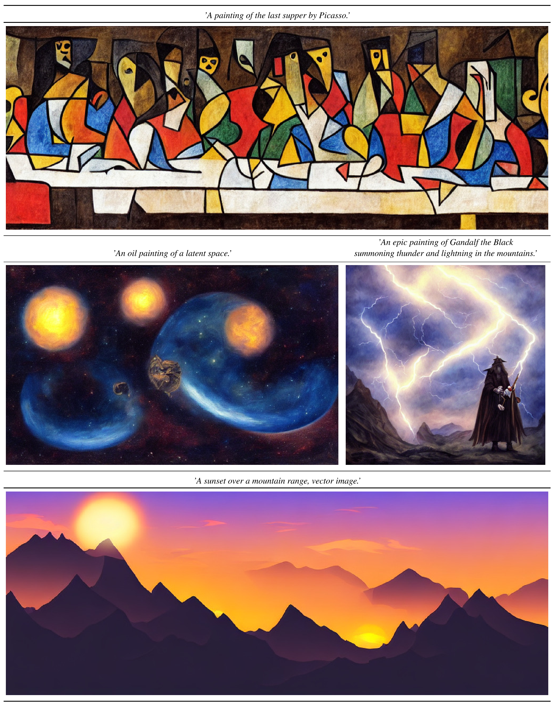

**図 13.** classifier-free diffusion guidance と[第 4.3.2 節](#section-4-3-2)の畳み込みサンプリング戦略を組み合わせることで、1.45B パラメータのテキストから画像へのモデルを、学習時のネイティブな $256^{2}$ 解像度より大きな画像の描画に利用できる。

## 7 変更履歴

この論文の現行版（https://arxiv.org/abs/2112.10752v2）と前版、すなわち https://arxiv.org/abs/2112.10752v1 の間の変更をここに列挙する。

- • [第 4.3 節](#section-4-3)のテキストから画像への合成結果を更新した。これは新しい、より大きなモデル（1.45B パラメータ）を学習して得たものである。この更新には、このタスクについて、私たちの研究の発表と同時期に arXiv で公開された非常に新しい競合手法（[Nic22, Zho21a]）および発表後に公開された手法（[Gaf22]）との新たな比較も含まれる。
- • [第 4.1 節](#section-4-1)と[表 3](#table-03)の ImageNet におけるクラス条件付き合成結果を更新した（[第 10.4 節](#section-10-4)も参照）。これは、より大きなバッチサイズでモデルを再学習して得たものである。対応する定性的結果である[図 26](#figure-26)と[図 27](#figure-27)も更新した。更新後のテキストから画像へのモデルとクラス条件付きモデルは、視覚的忠実度を高める尺度として classifier-free guidance [Ho21] を用いる。
- • Saharia らが提案した方式 [Sah21] に従ってユーザースタディを実施し、画像修復（[第 4.5 節](#section-4-5)）と超解像モデル（[第 4.4 節](#section-4-4)）について追加評価を行った。
- • [図 5](#figure-05)を本文に追加し、[図 18](#figure-18)を付録へ移し、[図 13](#figure-13)を付録へ追加した。

## 8 ノイズ除去拡散モデルの詳細

拡散モデルは、信号対雑音比 $\text{SNR}(t)=\frac{\alpha_{t}^{2}}{\sigma_{t}^{2}}$ によって指定できる。これは、列 $(\alpha_{t})_{t=1}^{T}$ と $(\sigma_{t})_{t=1}^{T}$ から構成され、データサンプル $x_{0}$ から始めて順方向拡散過程 $q$ を定義する。

$$
q(x_{t}|x_{0})=\mathcal{N}(x_{t}|\alpha_{t}x_{0},\sigma_{t}^{2}\mathbb{I})
$$

$s<t$ に対するマルコフ構造は次のとおりである。

$$
\displaystyle q(x_{t}|x_{s})
$$

ノイズ除去拡散モデルは、時間を逆向きに進めながら同様のマルコフ構造でこの過程を反転させる生成モデル $p(x_{0})$ であり、*i.e*. 次のように定義される。

$$
p(x_{0})=\int_{z}p(x_{T})\prod_{t=1}^{T}p(x_{t-1}|x_{t})
$$

このモデルに対応するエビデンス下限（ELBO）は、離散時間ステップ上で次のように分解される。

$$
-\log p(x_{0})\leq\mathbb{KL}(q(x_{T}|x_{0})|p(x_{T}))+\sum_{t=1}^{T}\mathbb{E}_{q(x_{t}|x_{0})}\mathbb{KL}(q(x_{t-1}|x_{t},x_{0})|p(x_{t-1}|x_{t}))
$$

事前分布 $p(x_{T})$ は通常標準正規分布として選ばれるため、ELBO の第一項は最終信号対雑音比 $\text{SNR}(T)$ のみに依存する。残りの項を最小化するため、$p(x_{t-1}|x_{t})$ をパラメータ化する一般的な方法は、真の事後分布 $q(x_{t-1}|x_{t},x_{0})$ に基づいて指定しつつ、未知の $x_{0}$ を推定値 $x_{\theta}(x_{t},t)$ で置き換えることである。ここで現在のステップは $x_{t}$ である。これは [Kin21] を与える。

$$
\displaystyle p(x_{t-1}|x_{t})
$$

このとき、平均は次のように表せる。

$$
\mu_{\theta}(x_{t},t)=\frac{\alpha_{t|t-1}\sigma_{t-1}^{2}}{\sigma_{t}^{2}}x_{t}+\frac{\alpha_{t-1}\sigma_{t|t-1}^{2}}{\sigma_{t}^{2}}x_{\theta}(x_{t},t).
$$

この場合、ELBO の和は次のように簡略化される。

$$
\sum_{t=1}^{T}\mathbb{E}_{q(x_{t}|x_{0})}\mathbb{KL}(q(x_{t-1}|x_{t},x_{0})|p(x_{t-1})=\sum_{t=1}^{T}\mathbb{E}_{\mathcal{N}(\epsilon|0,\mathbb{I})}\frac{1}{2}(\text{SNR}(t-1)-\text{SNR}(t))\|x_{0}-x_{\theta}(\alpha_{t}x_{0}+\sigma_{t}\epsilon,t)\|^{2}
$$

[Ho20a] に従い、次の再パラメータ化を用いる。

$$
\epsilon_{\theta}(x_{t},t)=(x_{t}-\alpha_{t}x_{\theta}(x_{t},t))/\sigma_{t}
$$

これにより再構成項をノイズ除去目的として表現できる。

$$
\|x_{0}-x_{\theta}(\alpha_{t}x_{0}+\sigma_{t}\epsilon,t)\|^{2}=\frac{\sigma_{t}^{2}}{\alpha_{t}^{2}}\|\epsilon-\epsilon_{\theta}(\alpha_{t}x_{0}+\sigma_{t}\epsilon,t)\|^{2}
$$

各項に同じ重みを割り当てる再重み付けを行うと、[式 1](#equation-01) が得られる。

## 9 画像誘導機構

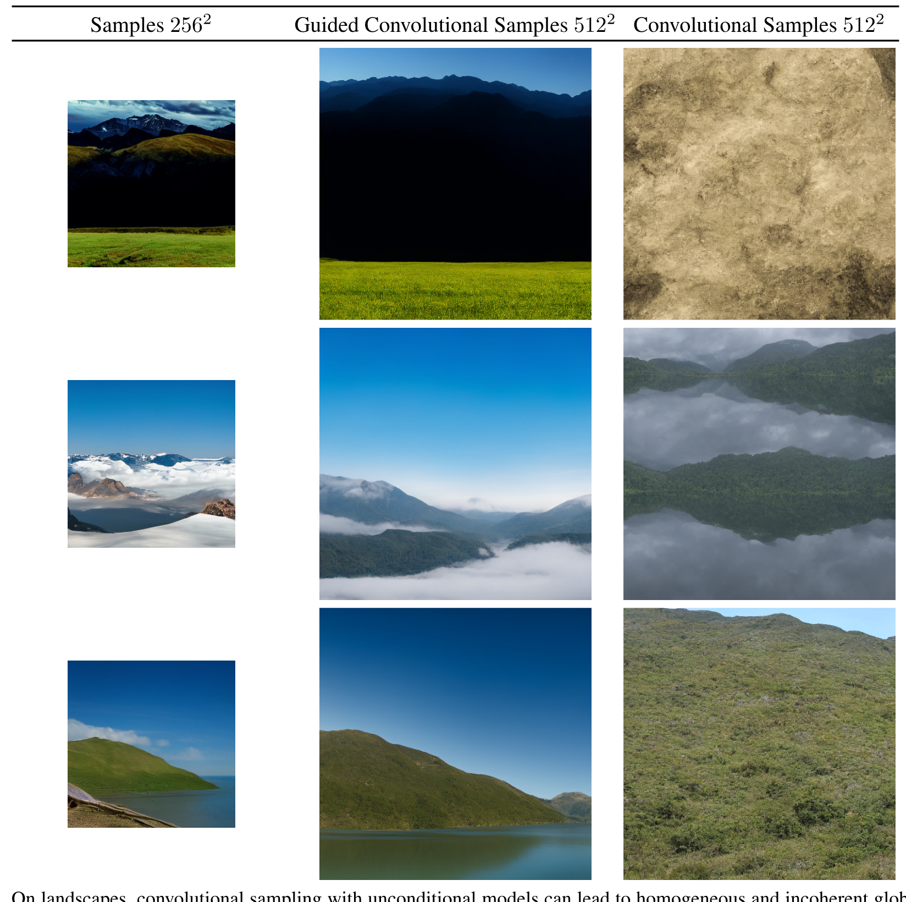

**図 14.** 風景画像では、無条件モデルによる畳み込みサンプリングが均質で一貫性のない大域構造を生じることがある（2 列目を参照）。低解像度画像を用いた $L_{2}$ 誘導は、一貫した大域構造の再構築に役立つ。

拡散モデルの興味深い特徴は、無条件モデルをテスト時に条件付けできることである [Son20, Soh15, Dha21]。特に [Dha21] は、分類器 $\log p_{\Phi}(y|x_{t})$ を拡散過程の各 $x_{t}$ 上で学習し、それによって ImageNet データセット上で学習した無条件モデルと条件付きモデルの双方を誘導するアルゴリズムを提示した。私たちはこの定式化を直接発展させ、事後的な*画像誘導*を導入する。

分散を固定した epsilon パラメータ化モデルでは、[Dha21] が導入した誘導アルゴリズムは次のようになる。

$$
\hat{\epsilon}\leftarrow\epsilon_{\theta}(z_{t},t)+\sqrt{1-\alpha_{t}^{2}}\;\nabla_{z_{t}}\log p_{\Phi}(y|z_{t})\;.
$$

これは、「スコア」$\epsilon_{\theta}$ を条件付き分布 $\log p_{\Phi}(y|z_{t})$ によって補正する更新と解釈できる。

これまで、この状況は単一クラス分類モデルにのみ適用されていた。私たちは誘導分布 $p_{\Phi}(y|T(\mathcal{D}(z_{0}(z_{t}))))$ を、目標画像 $y$ が与えられた汎用画像から画像への変換タスクとして再解釈する。ここで $T$ は、恒等写像、ダウンサンプリング操作、または対象の画像から画像への変換タスクに適した同様の微分可能変換など、任意の微分可能な画像変換である。 例として、分散 $\sigma^{2}=1$ を固定したガウス誘導器を考えると、

$$
\log p_{\Phi}(y|z_{t})=-\frac{1}{2}\|y-T(\mathcal{D}(z_{0}(z_{t})))\|^{2}_{2}
$$

これは $L_{2}$ 回帰目的になる。

[図 14](#figure-14)は、この定式化が $256^{2}$ 画像上で学習した無条件モデルのアップサンプリング機構として機能することを示す。$256^{2}$ サイズの無条件サンプルを用いて $512^{2}$ 画像の畳み込み合成を誘導し、$T$ は $2\times$ のバイキュービックダウンサンプリングである。この動機に従い、知覚的類似度による誘導も実験し、$L_{2}$ 目的を LPIPS [Zha18d] 指標に置き換える。[第 4.4 節](#section-4-4)を参照。

## 10 追加結果

### 10.1 高解像度合成における信号対雑音比の選択

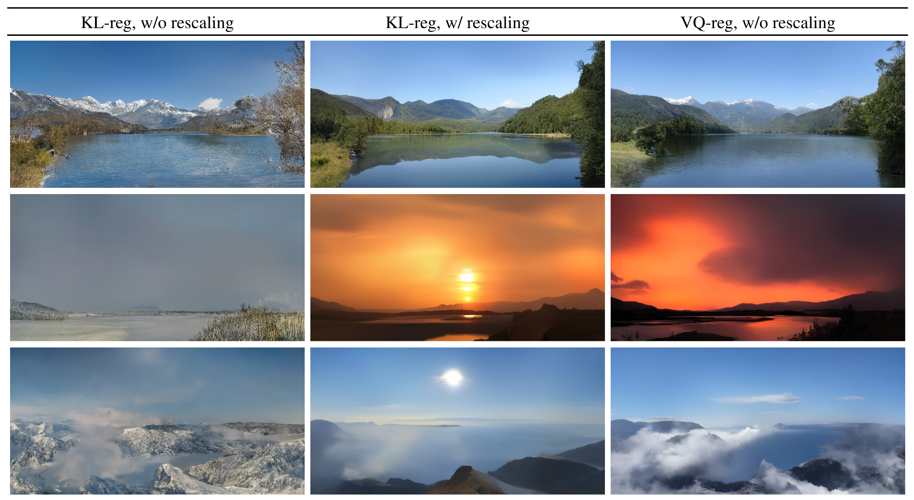

**図 15.** 潜在空間の再スケーリングが畳み込みサンプリングに与える影響。ここでは風景画像の意味的合成について示す。[第 4.3.2 節](#section-4-3-2)と[第 10.1 節](#section-10-1)を参照。

[第 4.3.2 節](#section-4-3-2)で述べたように、潜在空間の分散によって生じる信号対雑音比（*i.e*. $\text{Var(z)}/\sigma^{2}_{t}$）は、畳み込みサンプリングの結果に大きく影響する。たとえば、KL 正則化モデルの潜在空間（[表 8](#table-08)を参照）で LDM を直接学習すると、この比は非常に大きくなり、逆方向のノイズ除去過程の早い段階でモデルが多くの意味的詳細を割り当てる。これに対して、[第 13 節](#section-13)で説明するように、潜在空間を潜在表現の成分ごとの標準偏差で再スケーリングすると、SNR は低下する。意味的画像合成の畳み込みサンプリングに対する効果を[図 15](#figure-15)に示す。VQ 正則化空間の分散は $1$ に近いため、再スケーリングする必要がない。

### 10.2 第一段階モデルの全リスト

OpenImages データセット上で学習したさまざまなオートエンコーディングモデルの完全なリストを[表 8](#table-08)に示す。

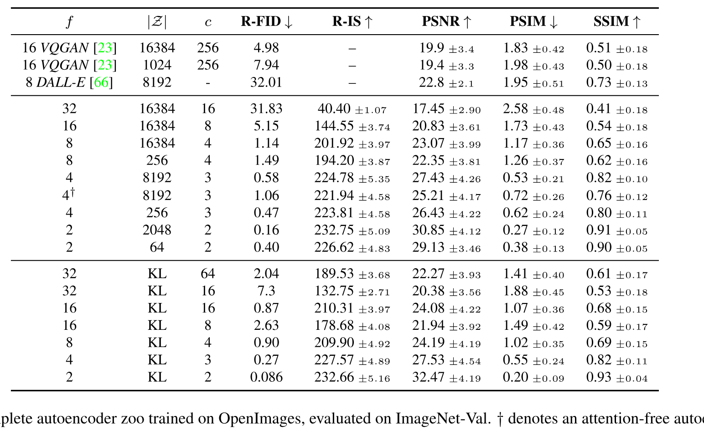

**表 8.** OpenImages 上で学習し、ImageNet-Val で評価した完全なオートエンコーダ・モデル群。$\dagger$ は attention をもたないオートエンコーダを表す。

### 10.3 レイアウトから画像への合成

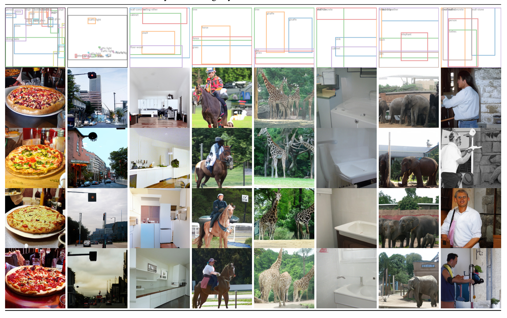

**図 16.** レイアウトから画像への合成における最良モデル *LDM-4* の追加サンプル。このモデルは OpenImages データセット上で学習し、COCO データセット上でファインチューニングした。100 DDIM ステップ、$\eta=0$ で生成した。レイアウトは COCO 検証セットから取得した。

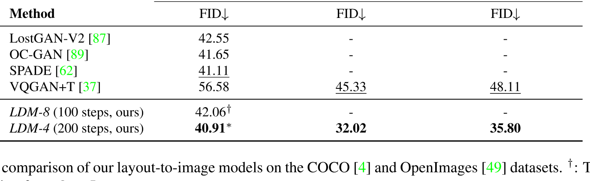

**表 9.** COCO [Cae18] および OpenImages [Kuz18] データセット上での、レイアウトから画像への合成モデルの定量比較。^†: COCO 上でゼロから学習。^∗: OpenImages からファインチューニング。

ここでは、[第 4.3.1 節](#section-4-3-1)のレイアウトから画像へのモデルについて、定量評価と追加サンプルを示す。COCO [Cae18] 上で一つのモデルを、OpenImages [Kuz18] 上でもう一つのモデルを学習し、後者をさらに COCO 上でファインチューニングする。[表 9](#table-09)に結果を示す。COCO モデルは、先行研究の学習・評価プロトコル [Syl21] に従うと、レイアウトから画像への合成における最近の最高水準モデルと同等の性能に達する。OpenImages モデルからファインチューニングすると、これらの手法を上回る。私たちの OpenImages モデルは、FID でほぼ 11 の差をつけて Jahn ら [Jah21] の結果を上回る。[図 16](#figure-16)に COCO 上でファインチューニングしたモデルの追加サンプルを示す。

### 10.4 ImageNet におけるクラス条件付き画像合成

[表 10](#table-10)には、FID と Inception スコア（IS）で測定したクラス条件付き LDM の結果を示す。LDM-8 は、非常に競争力のある性能を達成するために必要なパラメータ数と計算要件が大幅に少ない（[表 18](#table-18)を参照）。先行研究と同様に、各ノイズスケールで分類器を学習し、それによって誘導することで性能をさらに高められる。[第 9 節](#section-9)を参照。ピクセルベース手法とは異なり、この分類器は潜在空間で非常に安価に学習できる。追加の定性的結果は[図 26](#figure-26)と[図 27](#figure-27)を参照。

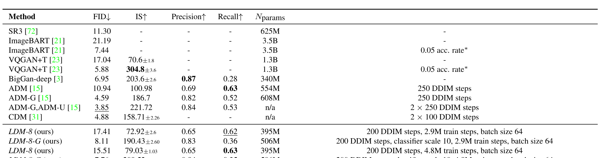

**表 10.** ImageNet [Den09a] データセット上で、クラス条件付き画像生成における最近の最高水準手法とクラス条件付き ImageNet *LDM* を比較する。^∗: [Raz19] が提案した、指定された棄却率による分類器棄却サンプリング。

### 10.5 サンプル品質と V100 日数（第 4.1 節の続き）

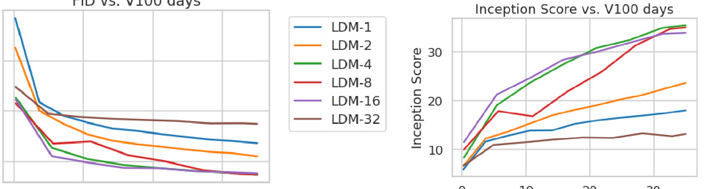

**図 17.** 完全性のため、固定した 35 V100 日に対する ImageNet データセット上のクラス条件付き *LDM* の学習進行も報告する。結果は 100 DDIM ステップ [Son21a] と $\kappa=0$ で得た。効率上の理由から、FID は 5000 サンプルで計算した。

[第 4.1 節](#section-4-1)で、学習ステップに対するサンプル品質の評価として FID と IS スコアを報告した。別の方法として、これらの指標を使用した資源量（V100 日数）に対して報告できる。この分析を[図 17](#figure-17)に追加で示すと、定性的には同様の結果が得られる。

### 10.6 超解像

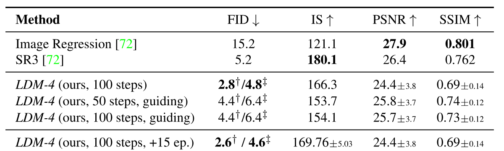

**表 11.** ImageNet-Val における $\times 4$ アップスケーリング結果（$256^{2}$）。^†: 検証分割で計算した FID 特徴、^‡: 学習分割で計算した FID 特徴。さらに、*LDM-4* と同じ計算量を受け取るピクセル空間ベースラインも含める。最後の 2 行には、前の結果より 15 エポック多く学習させた。

LDM とピクセル空間で学習した拡散モデルをよりよく比較するため、[表 5](#table-05)の分析を拡張し、同じステップ数、かつ比較可能なパラメータ数で学習した拡散モデルと LDM [+1] を比較する。この比較の結果を[表 11](#table-11)の最後の 2 行に示す。LDM は、サンプリングを大幅に高速化しながら、より良い性能を達成する。[図 20](#figure-20)に定性的比較を示し、LDM とピクセル空間の拡散モデルから得たランダムサンプルを比較する。

#### 10.6.1 LDM-BSR：多様な画像劣化による汎用 SR モデル

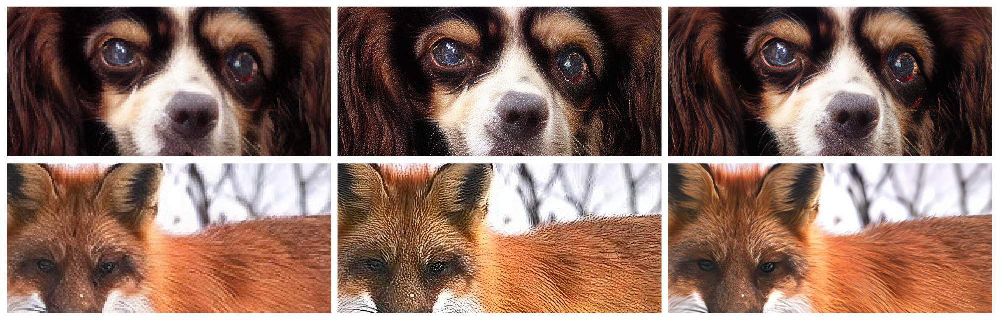

**図 18.** *LDM-BSR* は任意の入力へ一般化でき、汎用アップサンプラーとして、クラス条件付き *LDM* のサンプル（画像は[図 4](#figure-04)を参照）を $1024^{2}$ 解像度へアップスケールできる。固定された劣化過程を用いると（[第 4.4 節](#section-4-4)を参照）一般化が妨げられる。

LDM-SR の一般化を評価するため、クラス条件付き ImageNet モデル（[第 4.1 節](#section-4-1)）からの合成 LDM サンプルと、インターネットから収集した画像の双方に適用する。興味深いことに、[Sah21] のようにバイキュービックダウンサンプリングした条件だけで学習した LDM-SR は、この前処理に従わない画像へうまく一般化しないことがわかる。そこで、カメラノイズ、圧縮アーティファクト、ぼけ、補間が複雑に重なり得る幅広い現実世界画像向けの超解像モデルを得るため、LDM-SR のバイキュービックダウンサンプリング操作を [Zha21p] の劣化パイプラインに置き換える。BSR 劣化過程は、JPEG 圧縮ノイズ、カメラセンサーノイズ、ダウンサンプリングのための異なる画像補間、ガウシアンぼかしカーネル、ガウシアンノイズを画像へランダムな順序で適用する劣化パイプラインである。元の [Zha21p] のパラメータで bsr 劣化過程を用いると、非常に強い劣化過程になることがわかった。用途にはより穏やかな劣化過程が適切と考えたため、bsr 劣化のパラメータを調整した（調整後の劣化過程はコードベース https://github.com/CompVis/latent-diffusion にある）。[図 18](#figure-18)は、*LDM-SR* と *LDM-BSR* を直接比較して、この手法の有効性を示す。後者は固定された前処理に制限されたモデルよりはるかに鮮明な画像を生成し、現実世界の応用に適している。*LDM-BSR* の追加結果を LSUN-cows について[図 19](#figure-19)に示す。

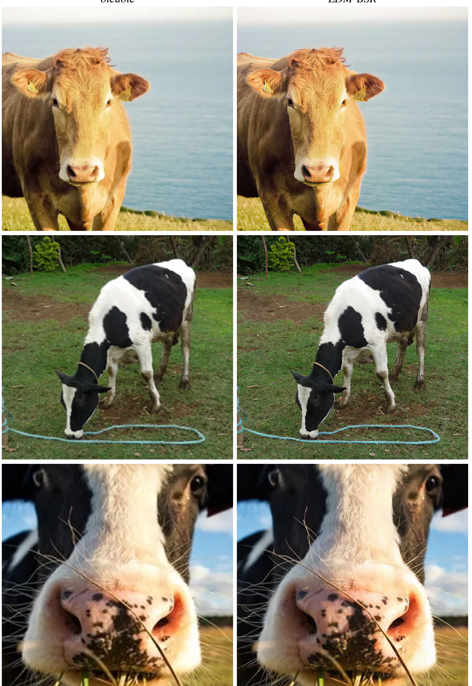

**図 19.** *LDM-BSR* は任意の入力へ一般化でき、汎用アップサンプラーとして LSUN-Cows データセットのサンプルを $1024^{2}$ 解像度へアップスケールできる。

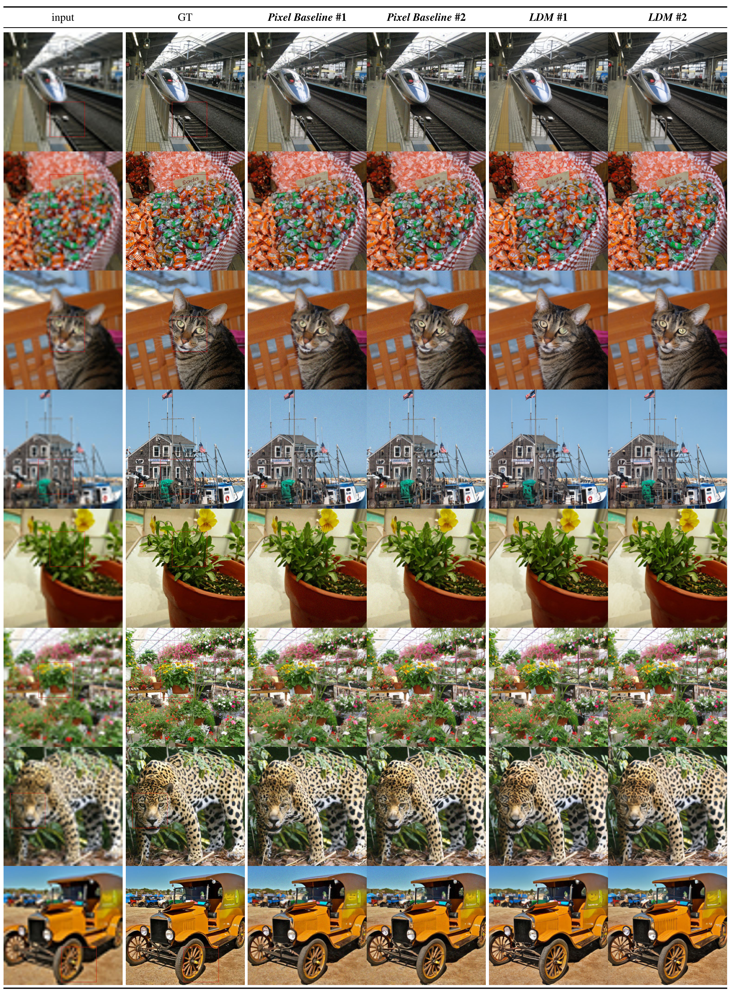

**図 20.** Pixelspace における LDM-SR と baseline-diffusionmodel の二つのランダムサンプルの定性的超解像比較。同じ学習ステップ数の後、ImageNet 検証セット上で評価した。

## 11 実装の詳細とハイパーパラメータ

### 11.1 ハイパーパラメータ

学習したすべての *LDM* モデルのハイパーパラメータの概要を、[表 12](#table-12)、[表 13](#table-13)、[表 14](#table-14)、[表 15](#table-15)に示す。

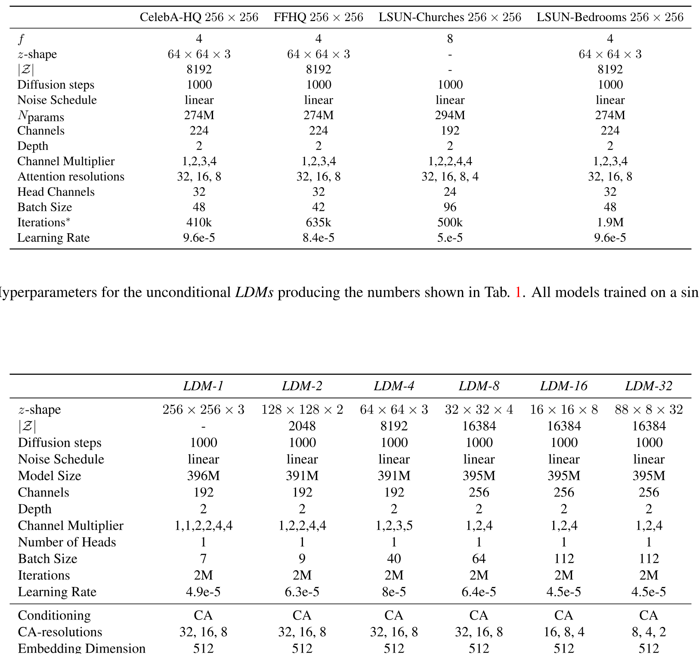

**表 12.** [表 1](#table-01)に示した数値を生成する無条件 *LDM* のハイパーパラメータ。すべてのモデルは単一の NVIDIA A100 上で学習した。

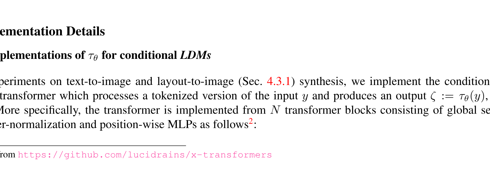

**表 13.** [第 4.1 節](#section-4-1)の分析のために ImageNet データセット上で学習した条件付き *LDM* のハイパーパラメータ。すべてのモデルは単一の NVIDIA A100 上で学習した。

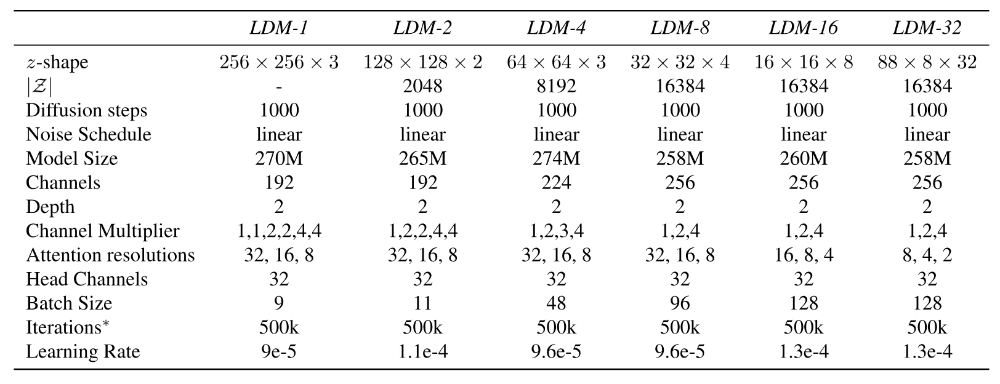

**表 14.** [図 7](#figure-07)の分析のために CelebA データセット上で学習した無条件 *LDM* のハイパーパラメータ。すべてのモデルは単一の NVIDIA A100 上で学習した。^∗: すべてのモデルを 500k イテレーション学習した。より早く収束した場合は、提示した FID スコアの評価に最良のチェックポイントを用いた。

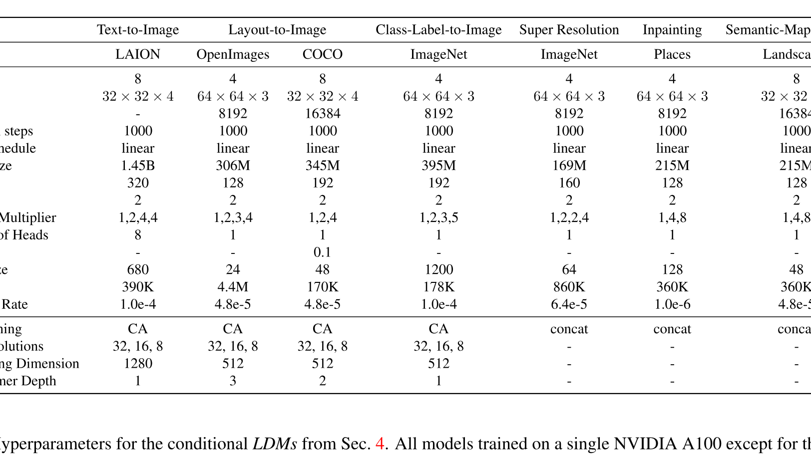

**表 15.** [第 4 節](#section-4)の条件付き *LDM* のハイパーパラメータ。画像修復モデルだけは 8 台の V100 で学習し、それ以外のすべてのモデルは単一の NVIDIA A100 上で学習した。

### 11.2 実装の詳細

#### 11.2.1 条件付き LDM における τθ\tau_{\theta} の実装

テキストから画像への合成とレイアウトから画像への合成（[第 4.3.1 節](#section-4-3-1)）の実験では、条件付け器 $\tau_{\theta}$ を、入力 $y$ のトークン化された版を処理して出力 $\zeta:=\tau_{\theta}(y)$ を生成する、マスクされていない Transformer として実装する。ここで $\zeta\in\mathbb{R}^{M\times d_{\tau}}$ である。より具体的には、Transformer は、グローバル自己 attention 層、layer-normalization、位置ごとの MLP からなる $N$ 個の Transformer ブロックとして次のように実装する [+2]：

$$
\displaystyle\zeta\leftarrow\text{TokEmb}(y)+\text{PosEmb(y)}
$$

$\zeta$ が得られると、[図 3](#figure-03)に示すように、cross-attention 機構を通じて条件付けを UNet へ写像する。「ablated UNet」[Dha21] アーキテクチャを変更し、自己 attention 層を、(i) 自己 attention、(ii) 位置ごとの MLP、(iii) cross-attention 層を交互に配置した $T$ ブロックからなる浅い（マスクされていない）Transformer に置き換える。[表 16](#table-16)を参照。(ii) と (iii) がなければ、このアーキテクチャは「ablated UNet」と等価である。

$\tau_{\theta}$ を時刻ステップ $t$ にも条件付けすることで表現力を高めることは可能だが、推論速度が低下するため、この選択は追求しない。この変更のより詳細な分析は今後の課題とする。

テキストから画像へのモデルでは、公開されている [+3] tokenizer [Wol19] に依存する。レイアウトから画像へのモデルでは、バウンディングボックスの空間的位置を離散化し、各ボックスを $(l,b,c)$ タプルとして符号化する。ここで $l$ は（離散化された）左上位置、$b$ は右下位置を表す。クラス情報は $c$ に含まれる。 上記二つのタスクにおける $\tau_{\theta}$ のハイパーパラメータは[表 17](#table-17)を、UNet のハイパーパラメータは[表 13](#table-13)を参照。 

[第 4.1 節](#section-4-1)で説明したクラス条件付きモデルも cross-attention によって実装する。ここで $\tau_{\theta}$ は次元 512 の単一の学習可能な埋め込み層であり、クラス $y$ を $\zeta\in\mathbb{R}^{1\times 512}$ へ写像する。

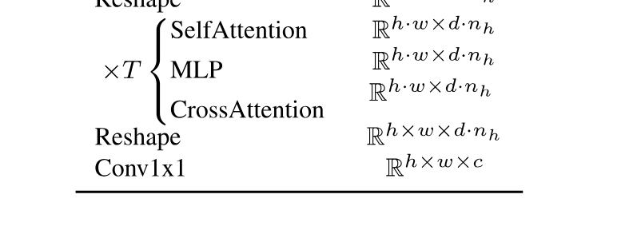

**表 16.** 標準の「ablated UNet」アーキテクチャ [Dha21] の自己 attention 層を置き換える、[第 11.2.1 節](#section-11-2-1)で説明した Transformer ブロックのアーキテクチャ。ここで $n_{h}$ は attention ヘッド数、$d$ はヘッドあたりの次元数を表す。

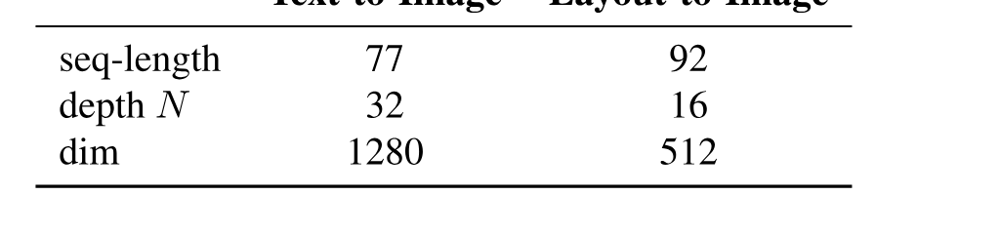

**表 17.** Transformer エンコーダを用いた実験のハイパーパラメータ。[第 4.3 節](#section-4-3)を参照。

#### 11.2.2 画像修復

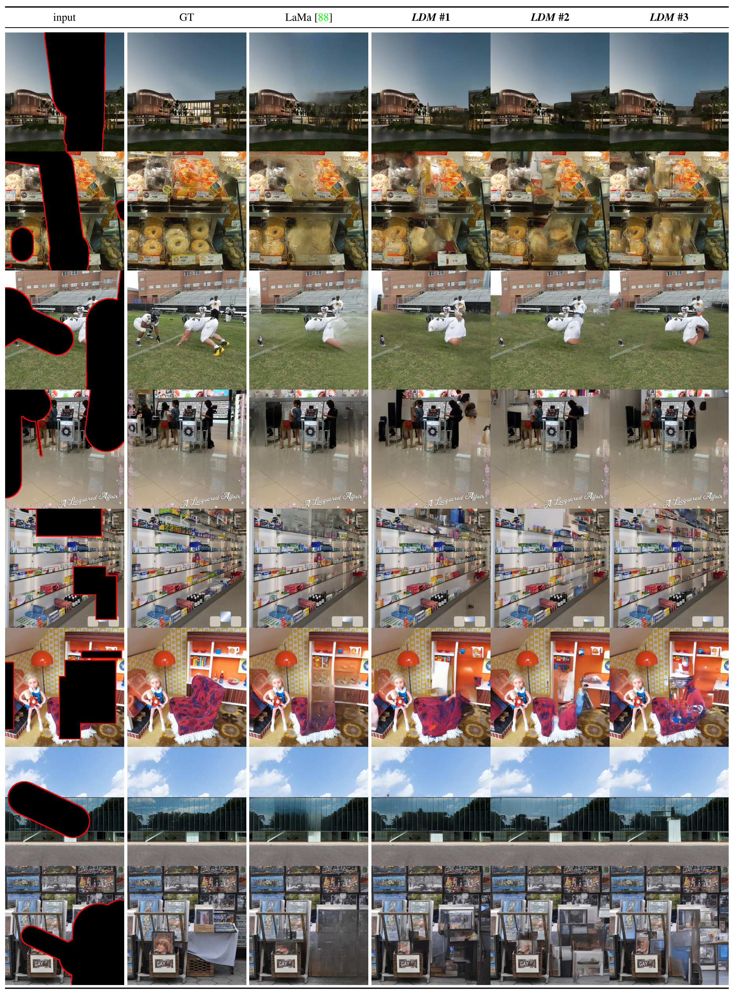

**図 21.** 画像修復の定性的結果。[Suv21] とは異なり、私たちの生成手法では、与えられた入力に対して多様な複数のサンプルを生成できる。

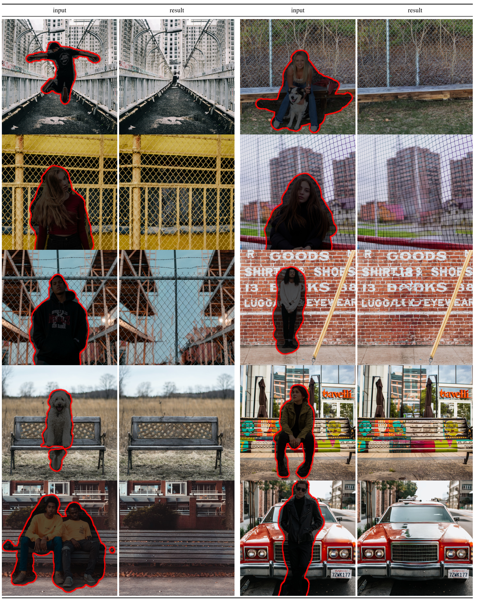

**図 22.** [図 11](#figure-11)と同様の物体除去に関する追加の定性的結果。

[第 4.5 節](#section-4-5)の画像修復実験では、[Suv21] のコードを用いて合成マスクを生成した。Places [Zho18a] から、検証用 2k サンプルとテスト用 30k サンプルの固定セットを用いる。学習中はサイズ $256\times 256$ のランダムクロップを用い、サイズ $512\times 512$ のクロップで評価する。これは [Suv21] の学習・テストプロトコルに従い、報告された指標を再現する（[表 7](#table-07)の ^† を参照）。*LDM-4, w/ attn* の追加定性的結果を[図 21](#figure-21)に、*LDM-4, w/o attn, big, w/ ft* の追加定性的結果を[図 22](#figure-22)に示す。

### 11.3 評価の詳細

この節では、[第 4 節](#section-4)に示した実験の評価について、追加の詳細を示す。

#### 11.3.1 無条件画像合成とクラス条件付き画像合成の定量結果

[表 1](#table-01)と[表 10](#table-10)に示す FID、Precision、Recall スコアを計算するため、一般的な慣行に従い、私たちのモデルからの 50k サンプルと、示した各データセットの学習セット全体に基づいて統計量を推定する [Heu17, Kyn19]。FID スコアの計算には torch-fidelity パッケージ [Obu20] を用いる。しかし、異なるデータ処理パイプラインは異なる結果につながり得るため [Par21a]、Dhariwal と Nichol [Dha21] が提供したスクリプトでもモデルを評価する。結果は概ね一致するが、ImageNet と LSUN-Bedrooms データセットでは、7.76（torch-fidelity）対 7.77（Nichol and Dhariwal）、および 2.95 対 3.0 というわずかに異なるスコアを確認した。今後は、サンプル品質評価の手順を統一することが重要である。Precision と Recall も Nichol と Dhariwal が提供したスクリプトで計算する。

#### 11.3.2 テキストから画像への合成

[Ram21] の評価プロトコルに従い、[表 2](#table-02)のテキストから画像へのモデルについて、生成サンプルと MS-COCO データセット [Lin14a] の検証セットからの 30000 サンプルを比較し、FID と Inception Score を計算する。FID と Inception Score は torch-fidelity で計算する。

#### 11.3.3 レイアウトから画像への合成

COCO データセット上の[表 9](#table-09)のレイアウトから画像へのモデルについてサンプル品質を評価するため、一般的な慣行 [Syl21, Jah21, Wu20] に従い、COCO Segmentation Challenge 分割の 2048 個の未拡張例について FID スコアを計算する。比較可能性を高めるため、[Jah21] とまったく同じサンプルを用いる。OpenImages データセットについても同様に先行研究のプロトコルに従い、検証セットから中央クロップした 2048 枚のテスト画像を用いる。

#### 11.3.4 超解像

[Sah21] が提案したパイプラインに従って ImageNet 上で超解像モデルを評価する。*i.e*. 短辺が $256$ px 未満の画像を（学習と評価の両方から）除外する。ImageNet では、低解像度画像をアンチエイリアス付きバイキュービック補間で生成する。FID は torch-fidelity [Obu20] で評価し、検証分割上でサンプルを生成する。FID スコアについては、学習分割から計算した参照特徴とも追加で比較する。[表 5](#table-05)と[表 11](#table-11)を参照。

#### 11.3.5 効率分析

効率上の理由から、[図 6](#figure-06)、[図 17](#figure-17)、[図 7](#figure-07)にプロットしたサンプル品質指標は 5k サンプルに基づいて計算する。そのため、結果は[表 1](#table-01)と[表 10](#table-10)に示すものと異なる可能性がある。すべてのモデルは、[表 13](#table-13)と[表 14](#table-14)に示すように、同程度のパラメータ数をもつ。各モデルの学習率は、安定して学習できる範囲で最大化する。そのため、学習率は実行ごとにわずかに異なる。[表 13](#table-13)と[表 14](#table-14)を参照。

#### 11.3.6 ユーザースタディ

[表 4](#table-04)に示すユーザースタディの結果では、[Sah21] のプロトコルに従い、二つの異なるタスクについて人間の選好スコアを評価するため 2-alternative force-choice パラダイムを用いる。タスク 1 では、対応する正解の高解像度／マスクなし画像と、中央の画像を条件として生成した合成画像の間に、低解像度／マスク付き画像を提示した。SuperResolution については、「中央の低解像度画像に対する高品質版として、二つの画像のどちらがよりよいか」と尋ねた。Inpainting については、「中央の画像の修復領域がより現実的なのは、二つの画像のどちらか」と尋ねた。タスク 2 では、同様に低解像度／マスク付き版を提示し、競合する二つの手法で生成した対応画像のどちらを好むか尋ねた。[Sah21] と同様に、被験者は回答前に画像を 3 秒間見た。

## 12 計算要件

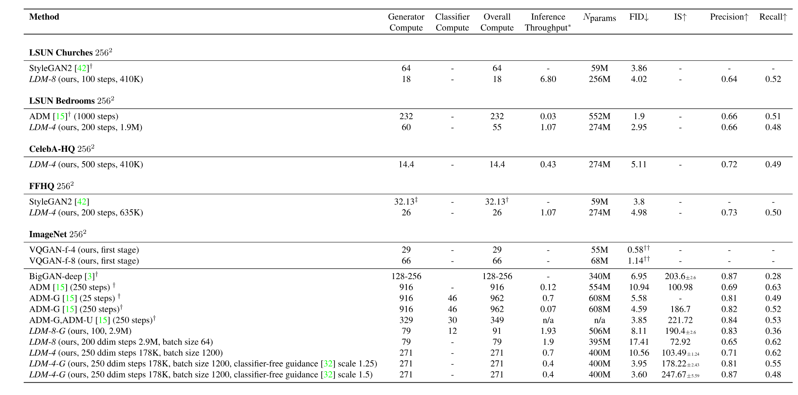

**表 18.** 最高水準の生成モデルについて、学習中の計算量と推論スループットを比較する。学習中の計算量は V100 日数で示し、競合手法の数値は特に記載がない限り [Dha21] から引用。^∗: 単一の NVIDIA A100 上で samples/sec として測定したスループット。^†: 数値は [Dha21] から引用。^‡: 25M の学習例で学習したと仮定。^††: ImageNet 検証セットに対する R-FID。

[表 18](#table-18)では、使用した計算資源をより詳細に分析し、CelebA-HQ、FFHQ、LSUN、ImageNet データセット上の最良性能モデルを、提供された数値を用いて最近の最高水準モデルと比較する。*cf*. [Dha21]。先行研究は使用した計算量を V100 日数で報告し、私たちはすべてのモデルを単一の NVIDIA A100 GPU で学習するため、A100 と V100 の速度差を $\times 2.2$ と仮定して A100 日数を V100 日数へ変換する [Sal20] [+4]。サンプル品質を評価するため、報告されたデータセット上の FID スコアも追加で示す。必要な計算資源を大幅に削減しながら、StyleGAN2 [Kar20b] や ADM [Dha21] などの最高水準手法に近い性能を達成する。

## 13 オートエンコーダモデルの詳細

すべてのオートエンコーダモデルを [Ess20a] に従って敵対的方式で学習し、パッチベースの識別器 $D_{\psi}$ を最適化して、元画像と再構成 $\mathcal{D}(\mathcal{E}(x))$ を区別する。潜在表現 $z$ が任意にスケーリングされることを避けるため、正則化損失項 $L_{reg}$ を導入し、潜在表現をゼロ中心にして分散を小さくする。 二つの異なる正則化手法を調べる。(i) 標準変分オートエンコーダ [Kin14, Rez14] と同様に、$q_{\mathcal{E}}(z|x)=\mathcal{N}(z;\mathcal{E}_{\mu},\mathcal{E}_{\sigma^{2}})$ と標準正規分布 $\mathcal{N}(z;0,1)$ の間に弱い重みを付けた Kullback-Leibler 項を置く方法、(ii) $|\mathcal{Z}|$ 個の異なる例からなるコードブックを学習することで、ベクトル量子化層によって潜在空間を正則化する方法 [Oor17]。 高忠実度の再構成を得るため、どちらの場合も非常に小さな正則化だけを用いる。*i.e*. $\mathbb{KL}$ 項に係数 $\sim 10^{-6}$ を掛けるか、高いコードブック次元 $|\mathcal{Z}|$ を選ぶ。

オートエンコーディングモデル $(\mathcal{E},\mathcal{D})$ を学習する完全な目的は次のとおりである。

$$
L_{\text{Autoencoder}}=\min_{\mathcal{E},\mathcal{D}}\max_{\psi}\Big(L_{rec}(x,\mathcal{D}(\mathcal{E}(x)))-L_{adv}(\mathcal{D}(\mathcal{E}(x)))+\log D_{\psi}(x)+L_{reg}(x;\mathcal{E},\mathcal{D})\Big)
$$

**潜在空間での DM 学習。** 学習した潜在空間上で拡散モデルを学習する際、$p(z)$ または $p(z|y)$ を学習する二つの場合を再び区別する（[第 4.3 節](#section-4-3)）。(i) KL 正則化潜在空間では、$z=\mathcal{E}_{\mu}(x)+\mathcal{E}_{\sigma}(x)\cdot\varepsilon=:\mathcal{E}(x)$ をサンプリングする。ここで $\varepsilon\sim\mathcal{N}(0,1)$ である。潜在表現を再スケーリングするとき、成分ごとの分散を推定する。

$$
\hat{\sigma}^{2}=\frac{1}{bchw}\sum_{b,c,h,w}(z^{b,c,h,w}-\hat{\mu})^{2}
$$

データの最初のバッチから推定し、ここで $\hat{\mu}=\frac{1}{bchw}\sum_{b,c,h,w}z^{b,c,h,w}$ である。$\mathcal{E}$ の出力は、再スケールされた潜在表現が単位標準偏差をもつようにスケーリングする。*i.e*. $z\leftarrow\frac{z}{\hat{\sigma}}=\frac{\mathcal{E}(x)}{\hat{\sigma}}$。(ii) VQ 正則化潜在空間では、量子化層の*前*から $z$ を取り出し、量子化操作をデコーダに吸収する。*i.e*. これは $\mathcal{D}$ の第一層と解釈できる。

## 14 追加の定性的結果

最後に、風景モデル（[図 12](#figure-12)、[図 23](#figure-23)、[図 24](#figure-24)、[図 25](#figure-25)）、クラス条件付き ImageNet モデル（[図 26](#figure-26)～[図 27](#figure-27)）、CelebA-HQ、FFHQ、LSUN データセットに対する無条件モデル（[図 28](#figure-28)～[図 31](#figure-31)）の追加の定性的結果を示す。[第 4.5 節](#section-4-5)の画像修復モデルと同様に、[第 4.3.2 節](#section-4-3-2)の意味的風景モデルを $512^{2}$ 画像上で直接ファインチューニングし、[図 12](#figure-12)と[図 23](#figure-23)に定性的結果を示す。比較的小さなデータセット上で学習したこれらのモデルについては、[図 32](#figure-32)～[図 34](#figure-34)で、私たちのモデルからのサンプルに対する VGG [Sim15] 特徴空間上の最近傍も示す。

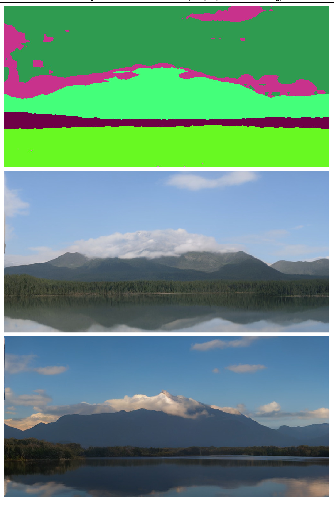

**図 23.** [第 4.3.2 節](#section-4-3-2)の意味的風景モデルから得た畳み込みサンプル。$512^{2}$ 画像上でファインチューニングした。

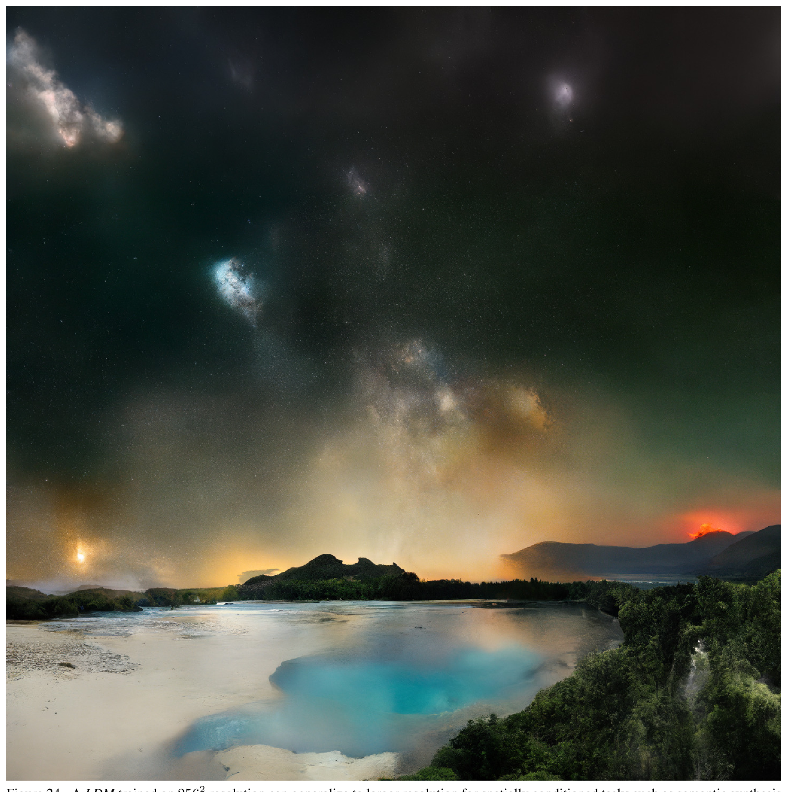

**図 24.** $256^{2}$ 解像度で学習した *LDM* は、風景画像の意味的合成のような空間条件付きタスクで、より大きな解像度へ一般化できる。[第 4.3.2 節](#section-4-3-2)を参照。

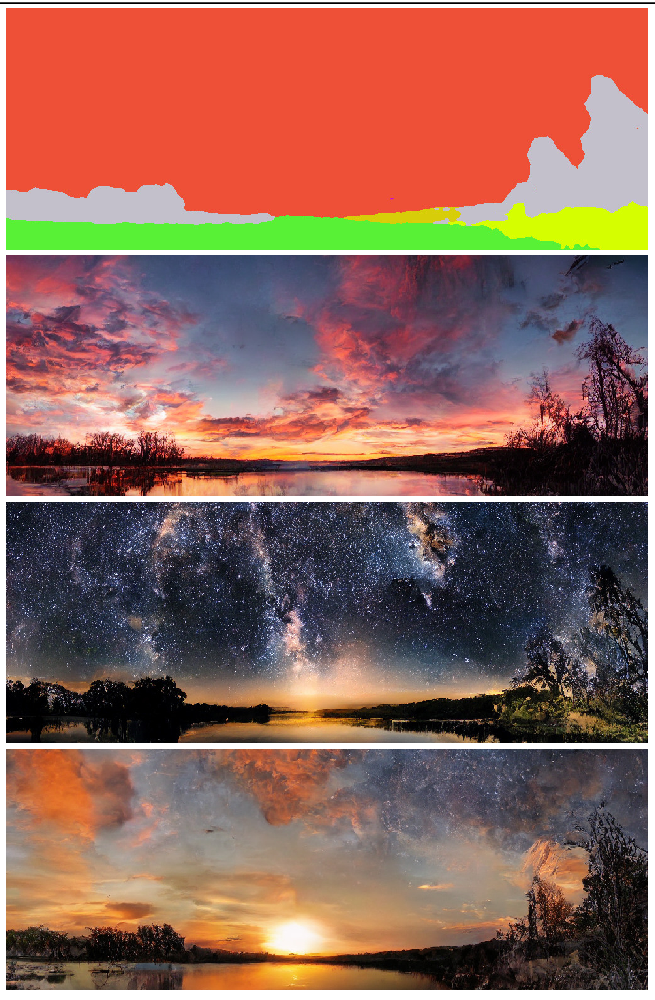

**図 25.** 意味マップを条件として与えると、私たちの *LDM* は学習時に見たものより大幅に大きな解像度へ一般化する。このモデルは $256^{2}$ サイズの入力で学習したが、ここに示す $1024\times 384$ 解像度のような高解像度サンプルを作成できる。

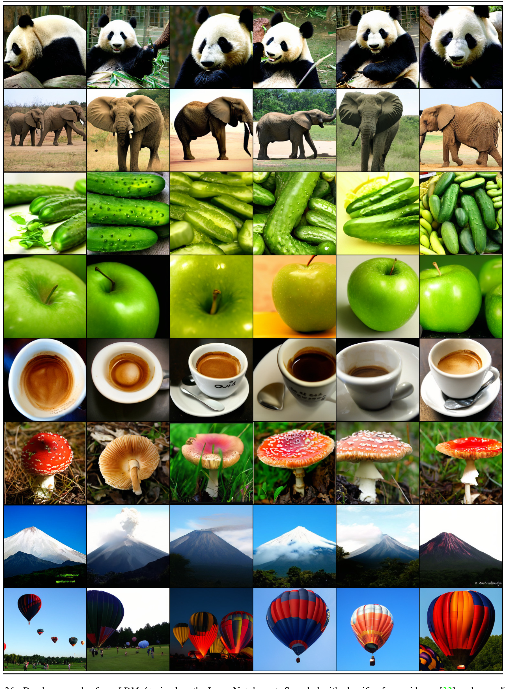

**図 26.** ImageNet データセット上で学習した *LDM-4* からのランダムサンプル。classifier-free guidance [Ho21] のスケール $s=5.0$、200 DDIM ステップ、$\eta=1.0$ でサンプリングした。

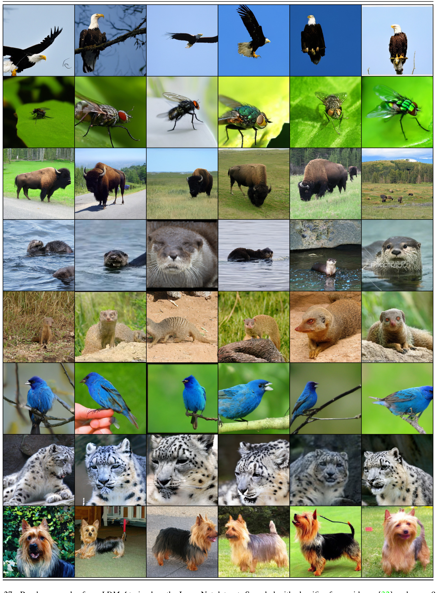

**図 27.** ImageNet データセット上で学習した *LDM-4* からのランダムサンプル。classifier-free guidance [Ho21] のスケール $s=3.0$、200 DDIM ステップ、$\eta=1.0$ でサンプリングした。

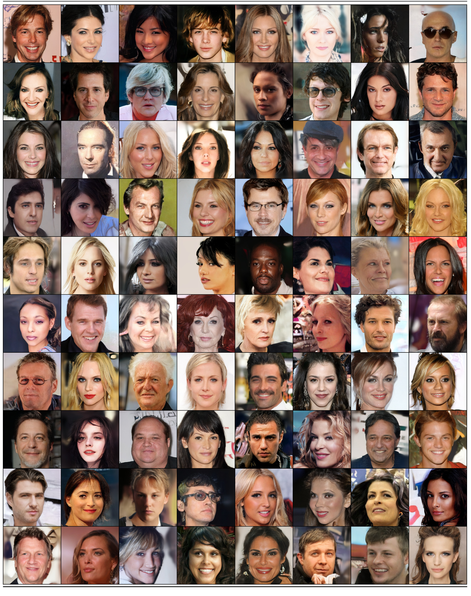

**図 28.** CelebA-HQ データセット上の最良性能モデル *LDM-4* からのランダムサンプル。500 DDIM ステップ、$\eta=0$ でサンプリングした（FID = 5.15）。

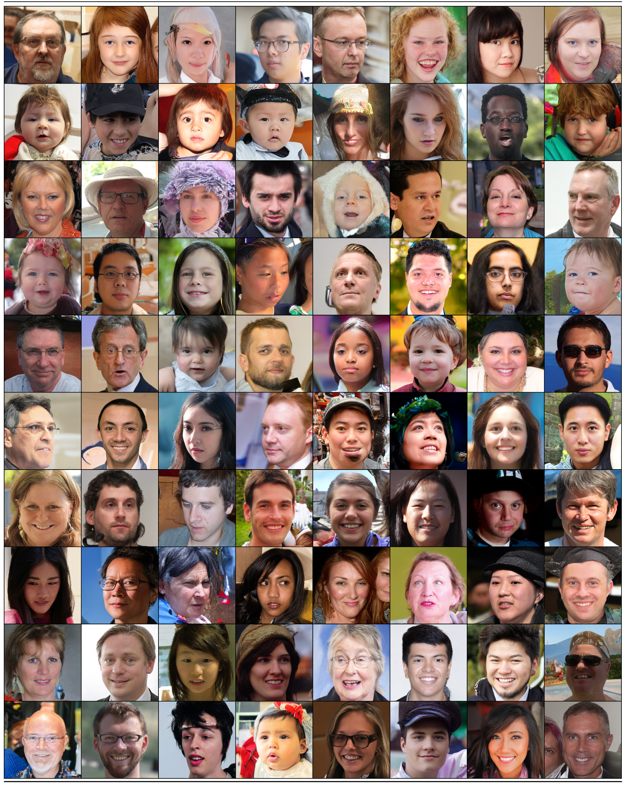

**図 29.** FFHQ データセット上の最良性能モデル *LDM-4* からのランダムサンプル。200 DDIM ステップ、$\eta=1$ でサンプリングした（FID = 4.98）。

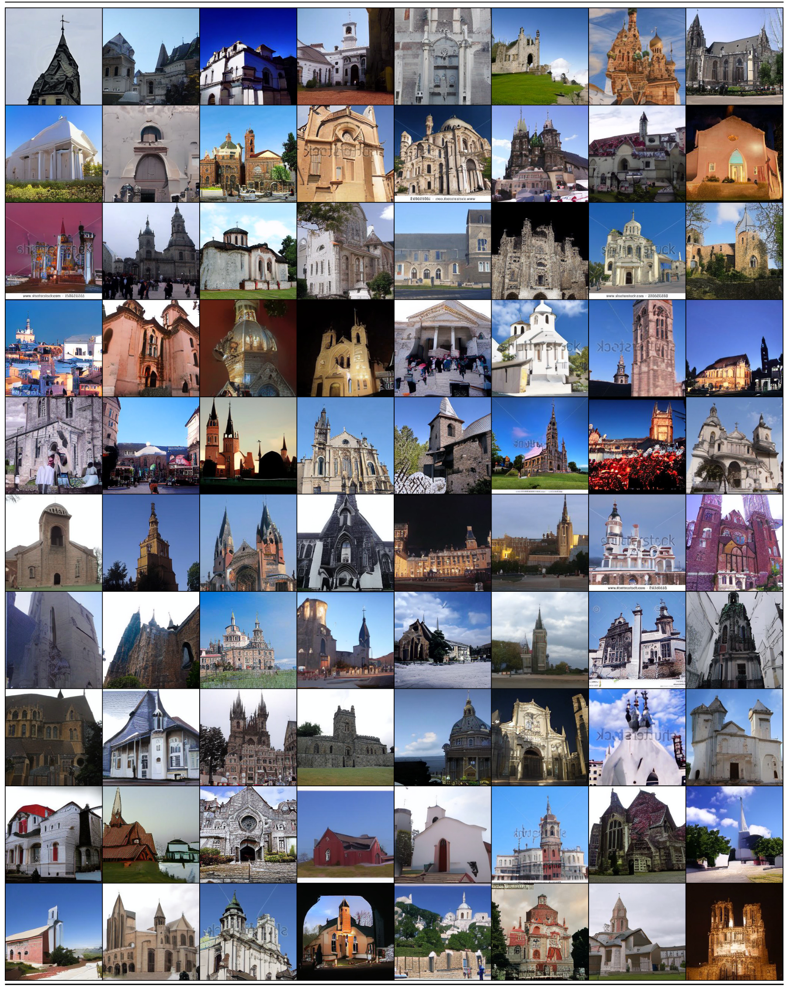

**図 30.** LSUN-Churches データセット上の最良性能モデル *LDM-8* からのランダムサンプル。200 DDIM ステップ、$\eta=0$ でサンプリングした（FID = 4.48）。

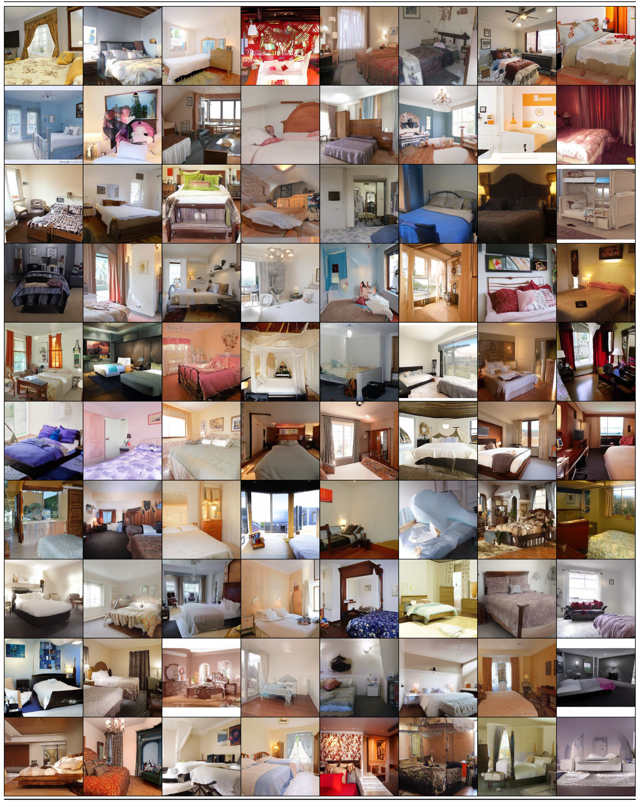

**図 31.** LSUN-Bedrooms データセット上の最良性能モデル *LDM-4* からのランダムサンプル。200 DDIM ステップ、$\eta=1$ でサンプリングした（FID = 2.95）。

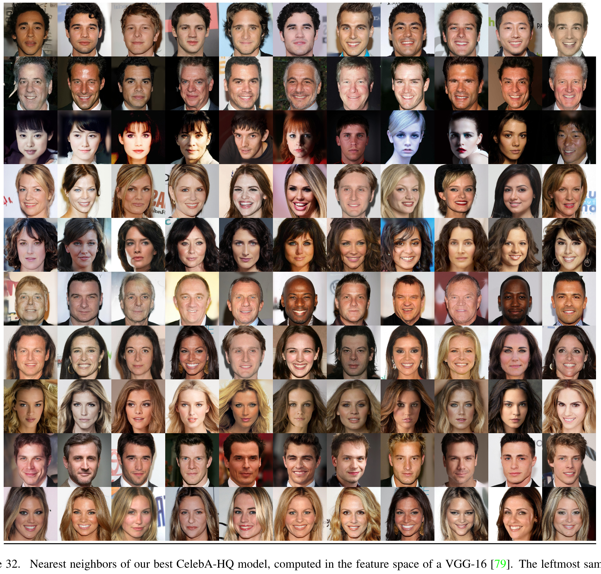

**図 32.** VGG-16 [Sim15] の特徴空間で計算した、CelebA-HQ の最良モデルの最近傍。左端のサンプルは私たちのモデルからのもの。各行の残りのサンプルはその 10 個の最近傍である。

**図 33.** VGG-16 [Sim15] の特徴空間で計算した、FFHQ の最良モデルの最近傍。左端のサンプルは私たちのモデルからのもの。各行の残りのサンプルはその 10 個の最近傍である。

**図 34.** VGG-16 [Sim15] の特徴空間で計算した、LSUN-Churches の最良モデルの最近傍。左端のサンプルは私たちのモデルからのもの。各行の残りのサンプルはその 10 個の最近傍である。

[+equal-contribution]: 最初の 2 名の著者はこの研究に同等に貢献した。
[+ack]: この研究は、ドイツ連邦経済・エネルギー省の「KI-Absicherung - Safe AI for automated driving」プロジェクトおよびドイツ研究振興協会（DFG）プロジェクト 421703927 の支援を受けた。
[+1]: 拡散モデルがピクセル空間で動作するため、両方のアーキテクチャを完全に一致させることはできない。
[+2]: <https://github.com/lucidrains/x-transformers> からの改変。
[+3]: <https://huggingface.co/transformers/model_doc/bert.html#berttokenizerfast>。
[+4]: この係数は、U-Net について、A100 が V100 より高速である割合に対応する。[Pat21a] の [図 1](#figure-01)で定義されている。
