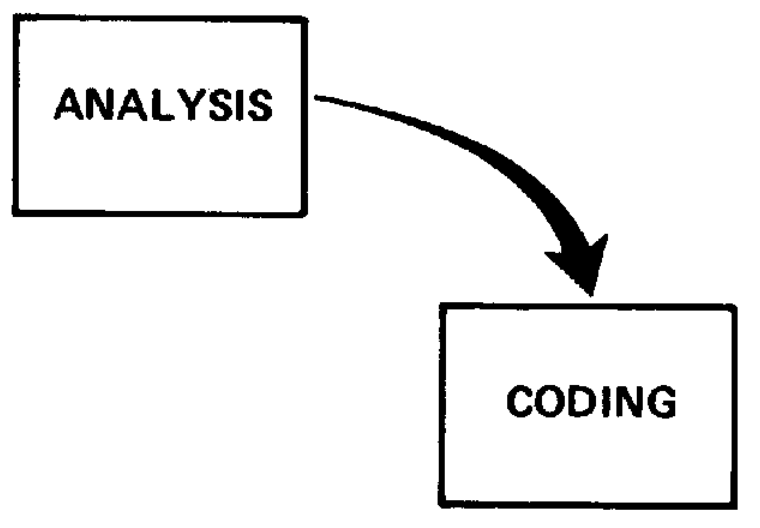
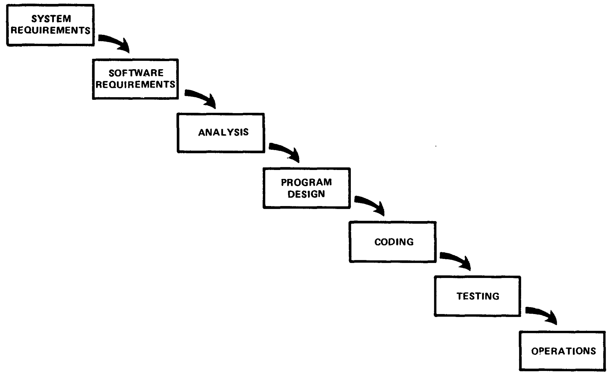
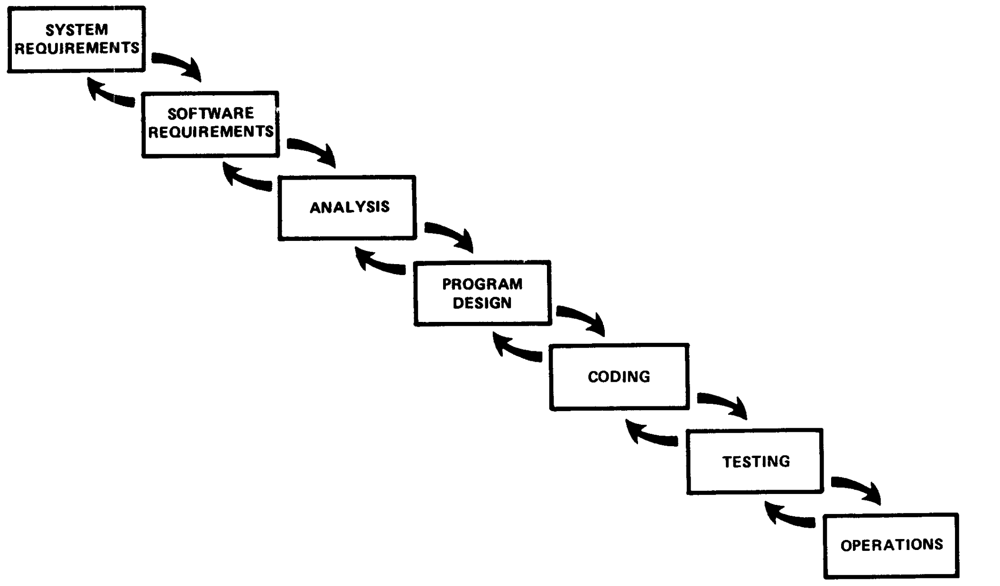
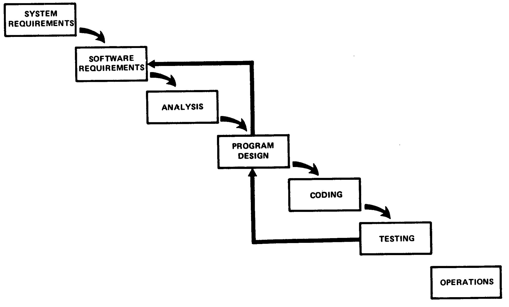
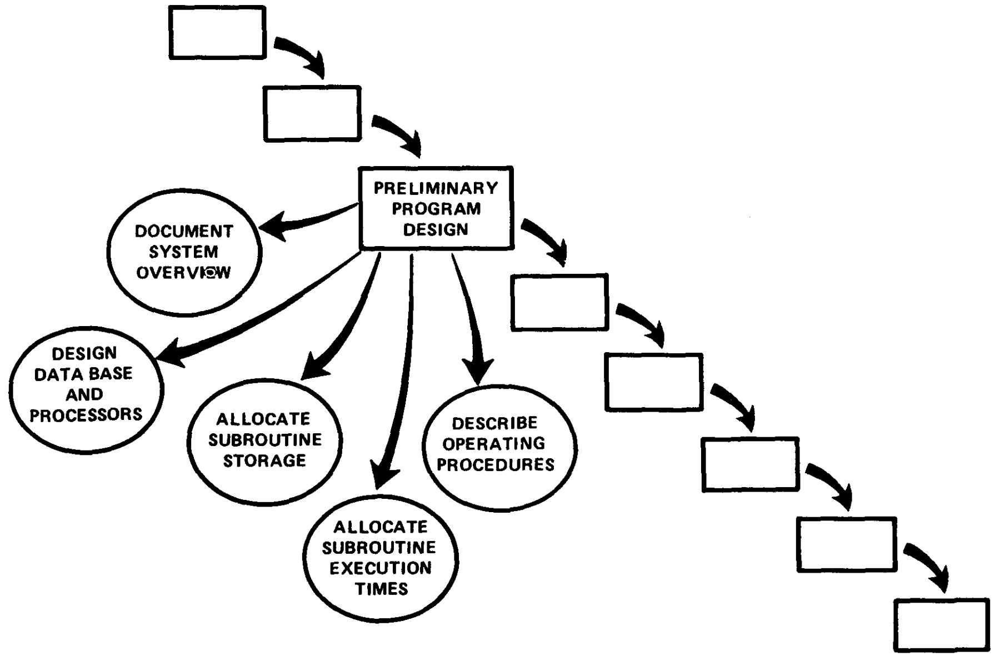
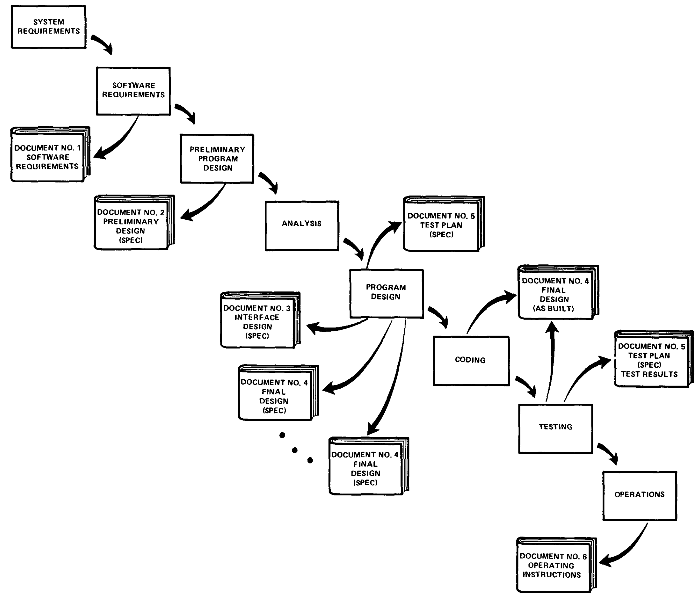
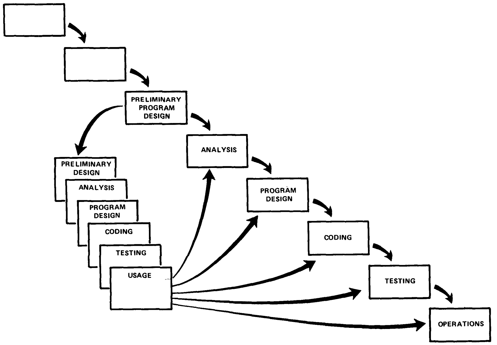
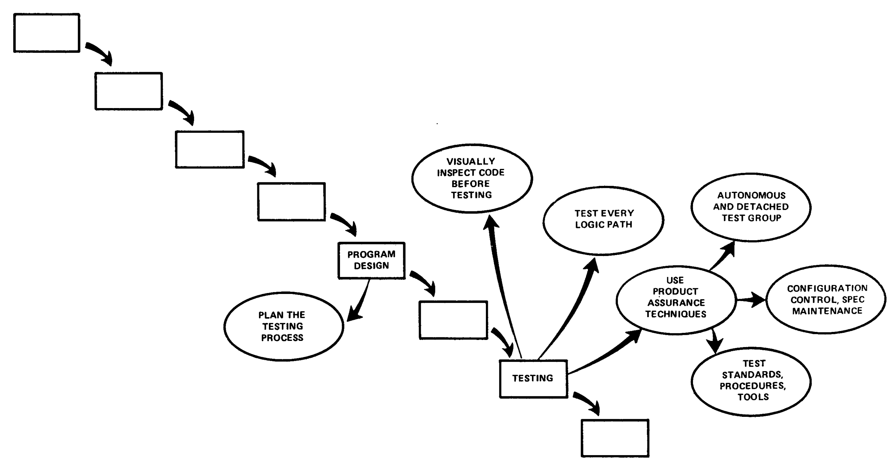
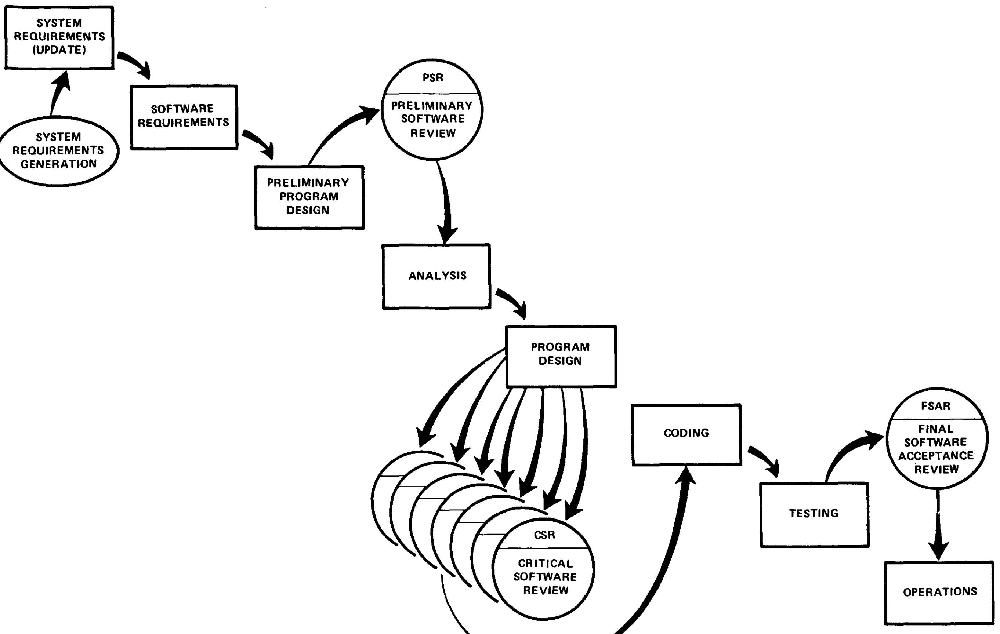
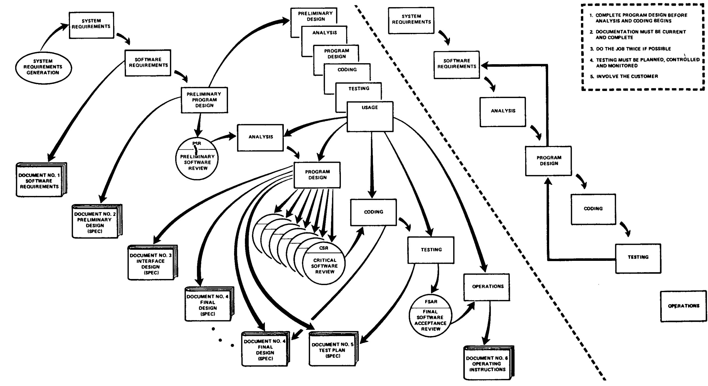

> [Winston W. Royce](https://dblp.org/pid/38/3947.html)。*[Managing the Development of Large Software Systems](https://dl.acm.org/doi/10.5555/41765.41801)*。初出は *Proceedings, IEEE WESCON*、1970 年 8 月、1–9 頁。のちに *Proceedings of the 9th International Conference on Software Engineering（ICSE '87）*、328–338 頁に再録された。TRW が最初に刊行した。<a href="/paper/managing-large-software-systems.pdf" target="_blank" rel="noopener noreferrer">原 PDF</a>。arXiv レコードおよび TeX ソースは存在しないため、正確な文言、印刷レイアウト、参考文献については公開 PDF を正本とする。

## 1 はじめに

ここでは、大規模ソフトウェア開発の管理についての私見を述べる。私は過去 9 年間にさまざまな任務を担当し、その大半は宇宙機のミッション計画、指令、飛行後解析のためのソフトウェアパッケージ開発に関わるものだった。これらの任務では、システムを稼働状態に到達させ、期限内かつ予算内に収めることについて、程度の異なる成功を経験してきた。私はこうした経験によって偏見を持つようになったので、本稿ではそのいくつかを紹介する。

## 2 コンピュータプログラム開発の機能

規模や複雑さにかかわらず、あらゆるコンピュータプログラム開発に共通する基本的な手順は 2 つある。最初に解析を行い、次にコーディングを行う。[図 1](#figure-01) に示すとおりである。作業が十分に小さく、最終製品を構築した当人が運用するのであれば、この種のきわめて単純な実装概念だけで実際には十分である。社内利用のコンピュータプログラムは通常このように作られる。また、この 2 つの手順はいずれも最終製品の有用性に直接寄与する真に創造的な仕事を含むため、ほとんどの顧客が喜んで対価を支払う開発作業でもある。しかし、大規模なソフトウェアシステムを作る実装計画をこの 2 つの手順だけに基づかせれば、失敗を免れない。ほかにも多くの開発手順が必要であり、どれも解析やコーディングほど最終製品に直接寄与しない一方、すべてが開発費を押し上げる。顧客側の担当者は通常その費用を払いたがらず、開発側の担当者も実施したがらない。管理の第一の役割は、双方にこれらの概念を受け入れさせ、そのうえで開発担当者に遵守を徹底させることである。

**図 1。** 内部運用向けの小規模コンピュータプログラムを納入するための実装手順。

より大がかりなソフトウェア開発手法を [図 2](#figure-02) に示す。解析とコーディングは引き続き図中にあるが、その前に 2 段階の要求解析が置かれ、両者の間にはプログラム設計が入り、後にはテストが続く。追加した手順は実行方法が明らかに異なるため、解析およびコーディングとは別に扱う。プログラム資源を最大限に活用するには、それぞれを別個に計画し、人員を配置しなければならない。

**図 2。** 顧客に納入する大規模コンピュータプログラムを開発するための実装手順。

[図 3](#figure-03) は、この方式における連続した開発段階間の反復関係を示している。手順の順序は、各手順が進んで設計が詳細になるにつれ、前後の手順とは反復するが、順序上さらに離れた手順とはほとんど反復しない、という考えに基づく。この方法の利点は、設計が進むにつれて変更プロセスの範囲が管理可能な限度まで狭まることにある。要求解析が完了した後は、設計プロセスのどの時点にも、予期しない設計上の問題が生じたときに戻ることのできる、確固として身近でありながら移動するベースラインが存在する。これは有効な退避地点となり、初期作業のうち救済し保存できる範囲を最大化する傾向がある。

**図 3。** さまざまな段階間の反復的なやり取りが、うまく隣接する手順だけに収まる場合。

私はこの考えを支持するが、上記の実装は危険であり、失敗を招く。[図 4](#figure-04) がその問題を示している。開発サイクルの末尾に来るテスト段階は、タイミング、記憶容量、入出力転送などを、解析対象としてではなく実際の現象として初めて経験する機会である。これらの現象は正確には解析できない。たとえば数理物理学の標準的な偏微分方程式を解けば得られるものではない。それでも、これらの現象がさまざまな外部制約を満たさなければ、必ず大規模な再設計が必要になる。単純な 8 進数パッチや、孤立したコードの一部を作り直すだけでは、この種の問題を解決できない。必要な設計変更は非常に破壊的になりやすく、設計の基礎であり、あらゆる判断の根拠でもあるソフトウェア要求に違反することになる。要求を修正するか、設計を大幅に変更しなければならない。事実上、開発プロセスは出発点に戻り、日程および／または費用が最大 100% 超過すると予想される。

**図 4。** 残念ながら、図示したプロセスでは、設計の反復が隣接する手順だけに収まることはない。

解析とコードの段階が飛ばされている、と指摘する人もいるだろう。もちろん、これらの手順なしにソフトウェアを作ることはできないが、通常これらの段階は比較的容易に管理でき、要求、設計、テストへの影響も小さい。私の経験では、軌道力学の解析、宇宙機の姿勢決定、ペイロード活動の数理最適化などに部門全体が取り組むことがあるが、それらの部門が困難で複雑な仕事を終えると、得られるプログラム手順は数行の逐次算術コードにすぎない。その困難で複雑な仕事を進める中で解析担当者が誤りを犯しても、修正は決まってコードへの小さな変更で済み、ほかの開発ベースへ破壊的なフィードバックを生じさせない。

それでも、図示した手法は基本的に妥当だと私は考える。以下では、開発リスクの大半を取り除くため、この基本手法に追加しなければならない 5 つの機能を提示する。

## 3 ステップ 1：プログラム設計を先に行う

修正に向けた最初の手順を [図 5](#figure-05) に示す。ソフトウェア要求生成段階と解析段階の間に、予備プログラム設計段階を挿入した。この手順に対しては、既存の解析がないまま、初期ソフトウェア要求しかない相対的な真空状態でプログラム設計者に設計を強いる、という批判があり得る。そのため、解析の完了を待って設計した場合と比べ、予備設計には重大な誤りが含まれるかもしれない。この批判は正しいが、要点を外している。この方法により、プログラム設計者は、記憶容量、タイミング、データフローを理由にソフトウェアが失敗しないことを保証する。次の段階で解析が進むにつれ、プログラム設計者は、解析担当者が結果を実感できるように、記憶容量、タイミング、運用上の制約を課さなければならない。解析担当者が方程式を実装するためにこの種の資源をさらに必要とする正当な理由があるなら、同時にそれを同僚の解析担当者から奪わなければならない。このようにして、すべての解析担当者とプログラム設計者が有意義な設計プロセスに寄与し、最終的には実行時間と記憶資源が適切に配分される。投入できる総資源が不十分であるか、萌芽段階の運用設計が誤っていれば、この早い段階で認識され、最終設計、コーディング、テストを始める前に、要求と予備設計を再度反復できる。

この手順はどのように実施するのか。次の手順が必要である。

1. **解析担当者やプログラマーではなく、プログラム設計者から設計プロセスを始める。**
2. **誤る危険があっても、データ処理モードを設計、定義、配分する。** 処理と機能を配分し、データベースを設計し、データベース処理を定義し、実行時間を配分し、オペレーティングシステムとのインターフェースおよび処理モードを定義し、入出力処理を記述し、予備運用手順を定義する。
3. **理解しやすく、情報を備え、最新の状態にある概要文書を作成する。** 作業者全員がシステムを基本的に理解していなければならない。少なくとも 1 人はシステムを深く理解する必要があり、その理解の一部は、自ら概要文書を書かなければならなかった経験から生まれる。

**図 5。** ステップ 1：解析を始める前に予備プログラム設計を完了しておく。

## 4 ステップ 2：設計を文書化する

ここで「どれだけの文書が必要か」という問題を取り上げるのが適切である。私の考えは「かなり多く」であり、プログラマー、解析担当者、プログラム設計者が自分の裁量に任されたときに進んで作る量より確実に多い。ソフトウェア開発を管理する第一の規則は、文書化要求を容赦なく徹底させることである。

私はときどき、ほかのソフトウェア設計作業の進捗を審査するよう求められる。最初の手順は文書の状態を調べることである。文書が深刻に不足していれば、私の最初の勧告は単純である。プロジェクト管理者を交代させる。文書化に関係しない活動をすべて止める。文書を許容できる基準まで引き上げる。きわめて高度な文書化なしにソフトウェアを管理することは、まったく不可能である。比較のため、次の見積もりを例に挙げる。500 万ドルのハードウェア機器を調達する場合、30 頁の仕様書があれば、調達を管理するのに十分な詳細を示せると考える。500 万ドル分のソフトウェアを調達する場合、同等の管理を実現するには 1500 頁ほどの仕様書が適当だと私は見積もる。

なぜそれほど多くの文書が必要なのか。

1. 各設計者は、インターフェースを担当する設計者、自分の管理者、場合によっては顧客と意思疎通しなければならない。口頭の記録は実体に乏しく、インターフェースや管理上の判断に十分な根拠を与えられない。許容できる記述文書は、設計者に曖昧でない立場を取らせ、完了を示す具体的な証拠を提出させる。設計者が毎月のように「90% 完了している」という症候群の陰に隠れることを防ぐ。
2. ソフトウェア開発の初期段階では、文書が仕様書であり、文書が設計である。コーディングが始まるまで、この 3 つの名詞（文書、仕様、設計）は 1 つのものを指す。文書が悪ければ設計も悪い。文書がまだ存在しないなら設計もまだ存在せず、そこにあるのは人々が設計について考え、話している状態だけである。それにも多少の価値はあるが、大きくはない。
3. 良い文書が持つ真の金銭的価値は、開発プロセスの下流にあるテスト段階から現れ、運用と再設計まで続く。文書の価値は、すべてのプログラム管理者が直面する 3 つの具体的な状況によって説明できる。
   1. **テスト段階では、** 良い文書があれば、管理者はプログラム中の誤りに人員を集中できる。良い文書がなければ、大小を問わずすべての誤りを 1 人が解析することになる。その人物は当該プログラム領域を理解する唯一の人間なので、おそらく最初に誤りを犯した本人でもある。
   2. **運用段階では、** 良い文書があれば、管理者は運用を専門とする人員にプログラムを扱わせ、より良い仕事を安く行わせることができる。良い文書がなければ、ソフトウェアは構築した本人が運用しなければならない。一般に、こうした人々は運用にあまり関心がなく、運用を専門とする人員ほど効果的な仕事をしない。この点に関連して、運用中に何らかの障害が起きれば、必ずソフトウェアが最初に責められることも指摘しておくべきである。ソフトウェアの責任を否定するにせよ、責任の所在を確定するにせよ、ソフトウェア文書は明確にものを言わなければならない。
   3. **初期運用の後、** システムを改善するときには、良い文書があれば、現場で効果的に再設計、更新、改修できる。文書が存在しなければ、比較的小さな変更であっても、通常は既存の運用ソフトウェアの枠組み全体を捨てなければならない。

[図 6](#figure-06) は、これまで示した手順に対応する文書化計画を示している。6 つの文書が作られ、最終製品を納入する時点では、文書 1、3、4、5、6 が更新済みで最新の状態にあることに注意されたい。

**図 6。** ステップ 2：文書を最新かつ完全な状態に保つ。少なくとも 6 つの異なる文書が必要である。

## 5 ステップ 3：2 度行う

文書化に次いで重要な成功基準は、製品が完全に新規のものかどうかを中心に決まる。対象のコンピュータプログラムを初めて開発するのであれば、少なくとも重要な設計・運用領域に関しては、運用配備のため顧客へ最終納入する版が実際には第 2 版になるよう手配する。[図 7](#figure-07) は、シミュレーションによってこれを実施する方法を示している。全体のプロセスを小規模に、全体作業に比べてかなり短い時間尺度で実行するだけである。この作業の性質は、主に全体の時間尺度と、モデル化すべき重大な問題領域の性質に応じて大きく変わり得る。作業全体が 30 か月なら、パイロットモデルの初期開発には 10 か月を割り当てられる。この日程であれば、かなり正式な統制、文書化手順などを利用できる。一方、作業全体が 12 か月に短縮されるなら、本線開発に十分な効果を与えるため、パイロット作業をおそらく 3 か月に圧縮できる。この場合、関係する人員には、きわめて特殊で幅広い能力が求められる。解析、コーディング、プログラム設計に対する直感的な感覚を持たなければならない。設計上の難所を素早く察知し、それと代替案をモデル化し、この早い時点で研究する価値のない単純な設計部分は捨て置き、最後に誤りのないプログラムへ到達しなければならない。どちらの場合も、シミュレーションと同じく、その要点は、通常なら判断に頼るしかないタイミングや記憶容量などの問題を精密に調べられるようにすることである。このシミュレーションがなければ、プロジェクト管理者は人間の判断に翻弄される。シミュレーションがあれば、少なくとも主要な仮説の一部を実験的に検証し、人間の判断に残す範囲を狭められる。離陸総重量、完成までの費用、デイリーダブルの予想と同じく、コンピュータプログラム設計における人間の判断は、常に深刻なほど楽観的である。

**図 7。** ステップ 3：作業を 2 度行う。最初の結果が最終製品の初期シミュレーションになる。

## 6 ステップ 4：テストを計画、統制、監視する

人員、コンピュータ時間、管理上の判断のいずれを資源と見ても、プロジェクト資源を最も多く使うのは間違いなくテスト段階である。金額と日程の点で最もリスクが大きい段階でもある。日程の最も遅い時点に位置し、そのころには代替案がほとんど、あるいはまったく残っていない。

解析とコーディングを始める前にプログラムを設計すること、完全に文書化すること、パイロットモデルを構築すること、という先の 3 つの勧告はすべて、テスト段階に入る前に問題を発見して解決することを目指している。しかし、これらを行ってもテスト段階は残り、実施すべき重要な作業も残る。[図 8](#figure-08) は、テストに関する追加の側面をいくつか示している。テストを計画する際には、次の点を検討するよう勧めたい。

1. テストプロセスの多くの部分は、元の設計に必ずしも貢献していないテスト専門家が担当するのが最善である。構築した領域を理解しているのは設計者だけだから、徹底したテストを行えるのも設計者だけだと主張するなら、それは文書化が適切に行われなかったことの確かな兆候である。良い文書があればソフトウェア製品保証の専門家を利用でき、私の判断では、彼らは設計者より良いテストを行う。
2. ほとんどの誤りは明白な性質のものであり、目視検査で簡単に見つけられる。解析とコードのすべての部分を、元の解析やコーディングを行っていない別の人が簡単に目視確認し、落ちたマイナス記号、2 の係数の欠落、誤ったアドレスへのジャンプなどを発見すべきである。これは解析とコードの校正に相当する。この種の問題を見つけるためにコンピュータを使ってはならない。費用が高すぎる。
3. コンピュータプログラムのすべての論理パスを、何らかの数値チェックを伴って少なくとも 1 度テストする。私が顧客なら、この手順が完了し、認証されるまで納入を受け入れない。この手順によってコーディングエラーの大半を発見できる。

このテスト手順は単純に聞こえるが、大規模で複雑なコンピュータプログラムについて、制御された入力値であらゆる論理パスをたどるのは比較的難しい。実際、それはほぼ不可能だと主張する人もいる。それでも私は、すべての論理パスを少なくとも 1 回は実際に確認すべきだという勧告を変えない。

4. 単純な誤りが取り除かれたら、それらは大多数を占め、大きな誤りを覆い隠すものでもあるので、次は検査のためソフトウェアをテスト部門へ引き渡す。開発過程の適切な時点で適切な人に委ねれば、コンピュータそのものが検査に最適な装置となる。管理上の重要な判断は、いつ最終検査を行うか、誰が行うかである。

**図 8。** ステップ 4：コンピュータプログラムのテストを計画、統制、監視する。

## 7 ステップ 5：顧客を参加させる

何らかの理由で、ソフトウェア設計が何をするのかは、事前に合意した後でさえ幅広い解釈の対象になる。最終納入より前の時点で顧客自身が約束をするよう、正式な形で顧客を参加させることが重要である。要求定義から運用までの間、請負業者に完全な自由を与えるのは問題を招く行為である。[図 9](#figure-09) は、要求定義後の 3 つの時点を示している。これらの時点で、顧客の見識、判断、約束が開発作業を支えられる。

**図 9。** ステップ 5：顧客を参加させる。その関与は正式で、綿密かつ継続的なものでなければならない。

## 8 まとめ

[図 10](#figure-10) は、リスクの高い開発プロセスを、望ましい製品を提供できるプロセスへ変えるために必要だと私が考える 5 つの手順をまとめている。各項目にはいくらか追加費用がかかることを強調したい。ここで述べた 5 つの複雑な措置を含まない、比較的単純なプロセスで成功するなら、追加費用を払う意味はない。しかし私の経験では、その単純な方法が大規模ソフトウェア開発で成功したことはなく、失敗から立て直す費用は、挙げた 5 段階プロセスに必要な費用をはるかに上回った。

**図 10。** まとめ。

正確な印刷レイアウトと参考文献については、原 PDF を正本とする。
