> [Zixu Hao](https://scholar.google.com/citations?user=5C9woXAAAAAJ)、[Jianyu Wei](https://kaleid-liner.github.io/about/more/)、[Tuowei Wang](https://pairshoe.github.io/)、[Minxing Huang](https://dblp.org/pid/61/3034)、[Huiqiang Jiang](https://hqjiang.com/)、[Shiqi Jiang](https://chrisplus.me/)、[Ting Cao](https://tingcao952.github.io/) [+corresponding]、[Ju Ren](https://juren1987.github.io/) [+corresponding]。所属：清華大学、中国科学技術大学、Microsoft Research、清華大学 AI Industry Research（AIR）。2025 年 9 月 27 日に arXiv へ初回投稿。現行版は v1。EuroSys 2026（第 21 回 European Conference on Computer Systems、エディンバラ、2026 年 4 月 27-30 日、2157-2172 ページ）で発表。[Scaling LLM Test-Time Compute with Mobile NPU on Smartphones](https://arxiv.org/abs/2509.23324v1)。<a href="/paper/mobile-npu-test-time-scaling.pdf" target="_blank" rel="noopener noreferrer">原 PDF</a>。[DOI](https://doi.org/10.1145/3767295.3769382)。[TeX ソース](https://arxiv.org/src/2509.23324v1)。[コード](https://github.com/haozixu/llama.cpp-npu)。正確な印刷レイアウトと参考文献については、原論文 PDF を正本とする。

[+corresponding]: 責任著者。

## 概要

大規模言語モデル（LLM）をモバイルデバイスへデプロイする際には、小規模モデルの性能不足と大規模モデルの過大なリソース消費という課題がある。本稿では、一般的な LLM 推論中、モバイル Neural Processing Unit（NPU）の計算資源、とりわけ行列乗算ユニットが十分に活用されていないことを明らかにする。この余剰計算能力を活用するため、モバイル NPU 上で並列 test-time scaling 技術を適用し、小規模 LLM の性能を高めることを提案する。しかし、この手法は、細粒度量子化に対するハードウェアサポートの不足や汎用計算の低効率といった、NPU 固有の課題に直面する。これらを克服するため、グループ量子化を NPU のメモリアクセスパターンに整合させるハードウェア指向のタイル量子化方式と、Softmax や逆量子化などの複雑な演算を効率的な LUT ベース処理へ置き換える手法という、2 つの主要技術を導入する。Qualcomm Snapdragon プラットフォーム上で、NPU の計算能力を利用して test-time scaling を支援するエンドツーエンド推論システムを設計、実装した。実験では、本手法により混合精度 GEMM で最大 19.0 倍、Softmax で 2.2 倍という大幅な高速化が得られた。さらに重要なことに、test-time scaling を用いた小規模モデルが大規模モデルと同等以上の精度を達成し、性能とコストの新たなパレートフロンティアを実現できることを示す。

## 1 はじめに

コモディティハードウェアとアルゴリズムの進歩により、大規模言語モデル（LLM）をモバイルデバイスへデプロイすることがますます現実的になっている。Llama 3.2 [Met24a]、MiniCPM [Hu24, Yao24b]、Gemma [Gem24b, Gem25a] など、モバイルデバイス向けの言語モデルが数多く登場している。しかし、これらのモデルは一般に、より大規模なモデルより性能が低い。モデル性能を改善する直接的な方法はモデルサイズを拡大することだが、メモリ消費量と帯域幅要件が大幅に増加するため、リソースに制約のあるモバイルプラットフォームには深刻な課題となる。

近年、**test-time scaling** と呼ばれる新たなパラダイムが、推論時の計算量を増やすことで LLM の能力を高める新しい可能性をもたらした。並列 test-time scaling 手法では、複数の経路を生成し、多数の生成候補から最良のサンプルを選択する [Wan22g, Wu24c, Sne24, Hug25, Bro24, Liu25ae, Xu25j, Che25af]。これまで、こうした手法は計算資源が豊富なクラウドまたはオフライン環境に限られてきた。

直感的には、モバイルデバイス上で LLM の生成品質を高めるために test-time scaling 技術を採用することは、非現実的に思えるかもしれない。スマートフォンなどのモバイルデバイスは通常、リソースに制約があるとみなされる一方、LLM 推論はリソース消費量が多いことで知られている。そのうえ、実行時に計算資源をスケールさせるには、さらに多くの計算が必要になる。

しかし、近年モバイル SoC へ Neural Processing Unit（NPU）が統合されたことで、この状況は変わり始めている。Qualcomm、Intel、AMD などのベンダーは、AI ワークロードを高速化する NPU を設計、統合してきた [Mah23a, Int24b, Ric24]。これらの NPU は高いピーク計算性能を達成するだけでなく、急速に進化している。Qualcomm は Snapdragon X Elite の Hexagon NPU が INT8 で 45 TOPS の性能を発揮するとしており [Qua24a]、近年の AMD NPU は $3.1\times$ [+1] の性能向上を達成している [Amd25a]。こうした進展が、モバイルデバイスの計算能力を変えつつある。

モバイル NPU は、大きな行列タイルを処理する専用行列乗算ユニットにより、高いピーク性能を達成していることが分かった。しかし、一般的な LLM 推論では、デコード段階で GEMM 演算が GEMV へ退化することが多く、ハードウェア利用率が低下し、大規模タイル向けに最適化された行列ユニットの計算能力が浪費される。この未活用部分は好機となる。サンプリングの並列度を高める test-time scaling 手法なら、推論オーバーヘッドを大幅に増やすことなく、この利用可能な計算能力を活用できる。

こうした可能性がある一方、モバイル NPU で効率的な test-time scaling を実現するには、重大なハードウェア上の課題があり、本稿ではこれを 2 つに分類する。

**精度：** モバイル NPU はもともと粗粒度量子化モデル向けに設計されており、低ビットでデプロイされる現代の LLM に不可欠な細粒度グループ量子化をネイティブにはサポートしない。従来のチャネル単位手法で量子化したモデルは、test-time scaling に不可欠な推論タスクで性能が著しく低下することを確認した。

**効率：** NPU は行列乗算に優れる一方、その汎用ベクトルユニットの計算スループットとメモリ帯域幅は限られている。test-time scaling 向け LLM 推論における主要な非行列計算の多くはベクトルユニット上で実行する必要があり、顕著なボトルネックとなる。さらに、幅広の SIMD ベクトル部品とデータ粒度の不一致に加え、ハードウェアのメモリアクセス制約があるため、ソフトウェアがベクトルユニットの計算能力を十分に活用することは難しく、この問題をいっそう悪化させる。

これらの課題に対処するため、モバイル NPU の豊富な計算能力を活用して test-time scaling ワークロードを支援する、エンドツーエンドの LLM 推論システムを提示する。デバイス上のリソース制約と精度要件を満たすため、主として重みのみを対象とする 4 ビット細粒度グループ量子化を採用する。そこから生じる効率上の課題に対し、本手法は次の主要技術を組み込む。

**ハードウェア指向のタイル量子化方式：** 行列ユニットとベクトルユニットを考慮した新たな量子化レイアウトを提示する。量子化の前後に重みレイアウトを変換することで、ハードウェアに適したタイル上で細粒度グループ量子化を適用し、NPU のメモリアクセスパターンと整合させる。これにより、実行時のメモリアクセスオーバーヘッドを最小限に抑え、ベクトル計算の利用率を最大化する。

**効率的な LUT ベース計算：** Softmax の指数計算や混合精度 GEMM の逆量子化処理など、複雑な主要演算を効率的なルックアップテーブル（LUT）命令に置き換え、ベクトルユニット上の計算ボトルネックを緩和する。

Qualcomm Snapdragon プラットフォーム 3 世代にわたって本システムを評価した。提案技術はベースラインと比べ、混合精度 GEMM で最大 $19.0\times$、Softmax で $2.2\times$ の高速化をそれぞれもたらした。この結果は、モバイル NPU を LLM の test-time scaling ワークロードに利用することの有効性を示している。特筆すべき点として、test-time scaling が性能とコストの最先端のトレードオフを達成することを示す。小規模モデルで test-time scaling を用いると、スケーリングなしで動作する大規模モデルの性能と同等か、それを上回ることができる。著者らの知る限り、本研究はモバイルデバイス上の NPU を用いた LLM の test-time scaling 手法について、その実現可能性を検討し、トレードオフを評価した初めての研究である。本稿の貢献を以下にまとめる。

- 現代のモバイル NPU のアーキテクチャを分析し、LLM のデコード段階で専用行列ユニットが十分に活用されていないことを明らかにする。
- ハードウェア指向のタイル量子化方式と LUT ベース計算という 2 つの技術を提示し、モバイル NPU 上の LLM test-time scaling を高速化する。
- モバイル NPU を活用して、独自ソフトウェアスタックへの依存を最小限に抑えつつ test-time scaling ワークロードを支援する、エンドツーエンドの LLM 推論システム [+2] を設計、実装する。
- test-time scaling が、本来は浪費される NPU の計算能力を効果的に活用してデバイス上の小規模言語モデルの生成品質を高め、従来のモデルスケーリングと比べて精度とコストのパレートフロンティア上の性能を達成できることを示す。これは、モバイルデバイスへの LLM デプロイに新たな可能性をもたらす。

## 2 背景

### 2.1 テスト時における LLM 計算のスケーリング

並列 test-time scaling は、モデルのパラメータを変更する代わりにテスト時の計算量を増やしてモデル精度を改善する、効果的で新しいパラダイムとして広く用いられつつある。最も単純な test-time scaling 手法は多数決と self-consistency [Wan22g, Bro24] であり、複数組の生成サンプルから最も一貫性の高い回答を選択する。結果を検証できる数学やプログラミングの問題、および報酬モデル（すなわち Outcome Reward Model）を利用できる領域では、完成したサンプル集合から最高スコアの選択肢を選べる。この戦略を Best-of-N [Sne24] と呼ぶ。先読みロールアウトを通じ、Monte Carlo Tree Search（MCTS）に類似した手法は、部分的に生成された系列から最適経路を選択できる。これにより、中間結果を直接採点する Process Reward Model（PRM）[Wan23a, Zhe24c, Sky24, Dwi23] が導かれた。PRM の支援を受け、先読みを行わないステップ単位の Beam Search [Sne24, Wu24c] は、低品質な生成経路を動的に破棄して探索と活用のバランスを取る。[図 1](#figure-01) に、広く用いられる 2 つの test-time scaling 手法のアルゴリズムを示す。

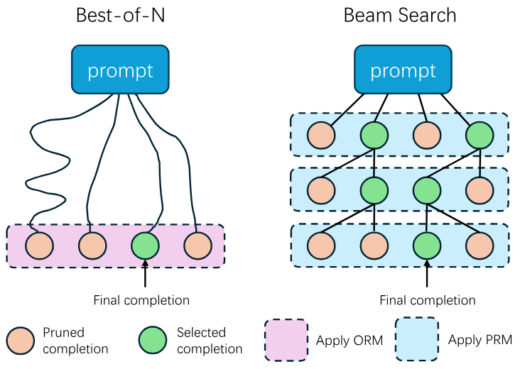

**図 1.** 代表的な 2 つの test-time scaling 手法：Best-of-N と Beam Search。

### 2.2 Neural Processing Unit

AI ワークロードの拡大に伴い、現代の SoC にはニューラルネットワーク推論を高速化する NPU がますます統合されている [Mah23a, Ric24, Int24b]。NPU は、低精度で計算負荷の高いニューラルネットワークの中核演算（GEMM など）に特化した高速化機構を備え、優れた電力効率を保ちながら極めて高い計算スループットを実現する。

広く採用されている NPU アーキテクチャは「ベクトル＋行列」の組み合わせを用いる。行列ユニットが行列乗算や畳み込みなどの演算を高速化し、ベクトルユニットが正規化や複雑な活性化関数などの汎用計算を担う。Qualcomm の Hexagon NPU [Mah23a]、Huawei の Ascend NPU [Lia21b]、AMD の XDNA NPU [Ric24]、Intel NPU [Int24b]、Intel の Gaudi HPU [Int25b] など、よく知られた例はいずれもこの種のアーキテクチャを採用している。こうした NPU は、ハードウェア実行モデルの点で一般的な GPU と大きく異なる。[図 2](#figure-02) に示すように、GPU の SIMT モデルでは異なるスレッドがそれぞれ独立して分岐、メモリアクセス、計算を実行できる一方、NPU の SIMD ベース実行モデルでは、単一スレッドが大きなベクトルまたは行列データブロックを処理する。ハードウェアレベルでは、NPU は通常、ハードウェアスレッド数を抑え、VLIW アーキテクチャを用いて制御ロジックのオーバーヘッドを削減する。GPU と比べると、NPU はプログラミングの柔軟性と使いやすさを犠牲にして、より高い実行効率とエネルギー効率を得ている。

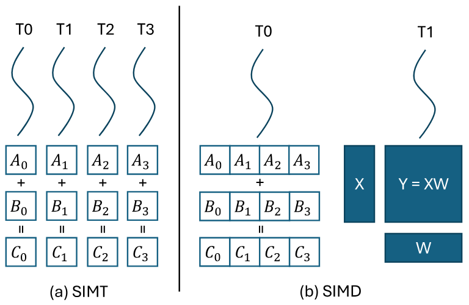

**図 2.** （a）GPU の SIMT 実行モデルと（b）NPU の SIMD 実行モデルの比較。

## 3 動機と課題

本節では、まずモバイル NPU の主要な特徴をいくつか紹介し、その後、NPU の余剰計算能力を活用する機会と、test-time scaling ワークロード向けの効率的なシステムを実装する際の課題を分析する。

### 3.1 Qualcomm Hexagon NPU

Qualcomm Snapdragon SoC 上の Hexagon NPU は、典型的なアーキテクチャ、広範な普及、比較的アクセスしやすい SDK を備えることから、モバイル NPU の代表例である。そのため、モバイル NPU の中核的な特徴を示すためにこれを用いる。

#### 3.1.1 プログラミングインターフェース

Qualcomm Hexagon NPU をプログラムする主な方法は、独自のクローズドソース DNN 推論フレームワーク Qualcomm AI Engine Direct [Qua25a]（一般に QNN と呼ばれる）を用いることである。Hexagon SDK では Hexagon NPU 向けの完全な LLVM ツールチェーンが提供されているにもかかわらず、主に行列ユニットの命令が公開されていないため、ほとんどの場合、開発者は高性能な低レベルカーネルをカスタマイズできない。著者らは、バイナリライブラリ内の文書化されていない命令をリバースエンジニアリングすることで、FP16 行列ユニットを利用できるようにした。

#### 3.1.2 アーキテクチャ

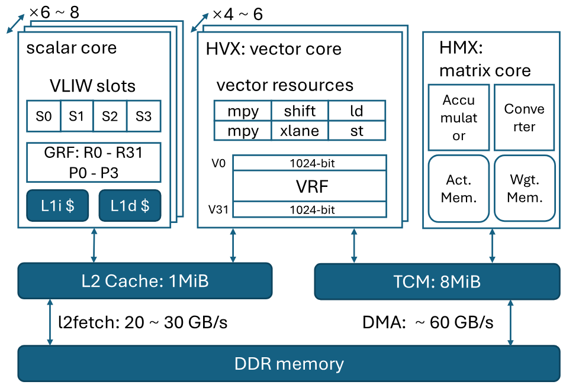

**図 3.** Hexagon NPU のアーキテクチャ。

**計算ユニット。** Hexagon NPU は、典型的な「ベクトル＋行列」ハイブリッドアーキテクチャを備える。そのベクトルユニットと行列ユニットは、それぞれ HVX（Hexagon Vector eXtension）と HMX（Hexagon Matrix eXtension）と呼ばれる。Hexagon NPU は論理制御用に 6-8 個のスカラ VLIW ハードウェアスレッドを組み込んでいる。すべてのベクトル命令または行列命令は、スカラコアにある 4 つの VLIW スロットのいずれかから発行される。HVX ユニットのコンテキストは、幅 1024 ビットのベクトルレジスタ 32 本で構成され、このようなユニットが 4-6 個ある。HMX ユニットの数は 1 個または 2 個と推定される。

**メモリサブシステム。** Hexagon NPU は、共有 1 MiB L2 キャッシュと 8 MiB の TCM（Tightly Coupled Memory）を備える。後者はソフトウェア管理のオンチップメモリ領域である。HVX は L2 キャッシュまたは TCM のいずれからもデータを読み出せる。ベクトルの scatter/gather 演算とすべての HMX 命令は、TCM にのみアクセスできる。データは、それぞれ `l2fetch` 命令と DMA 機構を介して、DDR メモリから L2 キャッシュと TCM へロードできる。どちらも 1D または 2D テンソルデータの非同期転送をサポートする。

**HMX ユニット。** Hexagon NPU の強力な行列乗算能力は HMX コンポーネントに由来する。Qualcomm によると、HMX ユニットは INT4、INT8、INT16、FP16 など、さまざまな精度をサポートする [Mah23a]。以下では主として FP16 HMX を説明し、関連情報はリバースエンジニアリング、Hexagon SDK、QNN SDK、および Qualcomm が公開している情報から得た。

HMX 演算の基本データ単位はタイルであり、各タイルには特定サイズの行列が含まれる。FP16 HMX では、タイルは 32\*32 で 2 KiB の領域を占める。HMX ユニットは、TCM から重みメモリと活性化メモリのタイルを複数ロードできる。行列タイルの各ペアに対して行列乗算を実行した後、結果を内部アキュムレータへ累積する。最後に、アキュムレータに対応するタイルを出力する。同時に、HMX ユニットは出力タイルのチャネル（列）ごとに、独立してスケーリングとバイアス加算を実行できる。

FP16 HMX タイルは、[図 4](#figure-04)（a）に示す特殊なメモリレイアウトを持つ。入力タイルと出力タイルはいずれもこのレイアウトに従う。このレイアウトを構築する典型的な方法は、HVX 命令を用いて元の行列の隣接する 2 行ごとにレーン間シャッフルを行うことである。

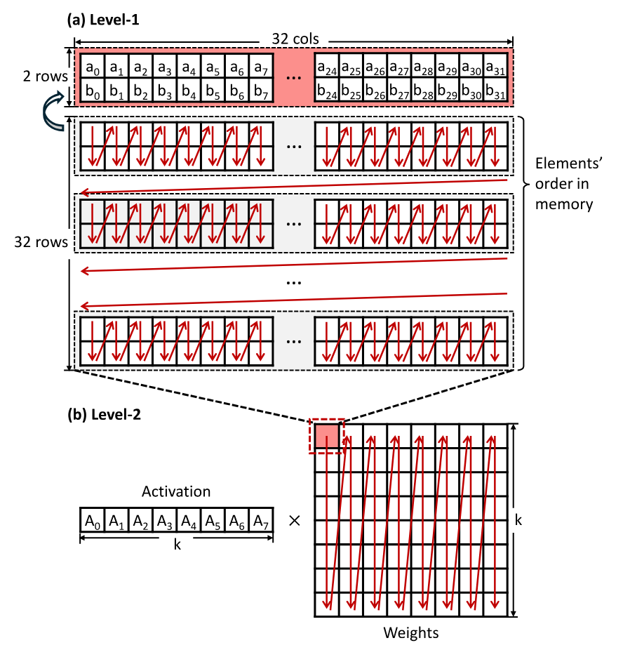

**図 4.** （a）FP16 HMX タイルのメモリレイアウト。各タイルは 32 * 32 行列に対応し、2048 バイトを占める。2 行ごとに並べ替えられ、転置した 2 * 32 部分行列と同じレイアウトになる。（b）HMX ベース GEMM の全体的なメモリレイアウト。ハードウェアはタイル単位で内積を実行するため、重みタイルは列優先レイアウトで配置される。

### 3.2 機会：LLM デコード中の余剰行列計算能力

自己回帰生成処理では、LLM の入力は通常 1 トークンのみに対応するため、GEMM 演算は GEMV へ退化する。たとえば、形状が $[1, \texttt{hidden\_dim}]$ の活性化行列に、形状が $[\texttt{hidden\_dim}, \texttt{proj\_dim}]$ の重み行列を乗算する。FP16 HMX を用いる場合、各計算タイルの実効サイズは $[1,32]\times[32,32]$ となる。ハードウェア計算の基本単位が $32\times32$ タイルであるため、入力活性化タイルの 31 行には実際に有用な内容が対応せず、行列ユニットの利用率が低下して計算能力が浪費される。

一方、Self-Consistency、Best-of-N、Beam Search などの並列サンプリング手法を含む一部の test-time scaling アルゴリズムは、生成中の計算量を増やすことで、より高い生成品質を実現できる。その特徴は、1 より大きいバッチサイズで複数の生成経路を探索し、何らかの方法（外部検証器など）でより優れた生成経路を選択することにある。[図 5](#figure-05) に、Best-of-N を用いた test-time scaling の例を示す。生成予算（すなわち、デコード段階における最大バッチサイズ）が増えるにつれて、MATH500 データセット上のモデル精度は大幅に向上する。

以上に基づき、LLM の test-time scaling ワークロードをモバイル NPU 上で実行することを提案する。この方法により、従来の LLM 生成処理で浪費されていた NPU の計算能力を効果的に活用できる。理論上、デコードのオーバーヘッドは大幅には増えず、モデルの重みを変更することなく、実行時にモデルの生成品質を改善できる。

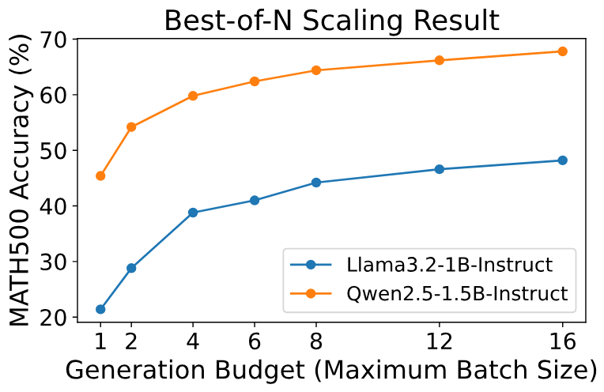

**図 5.** 2 つのモデルを用いた test-time scaling の例。生成予算が増えるにつれて、MATH500 上の精度が向上する。

### 3.3 課題

モバイル NPU を test-time scaling に利用することは理論上可能だが、効率的に実装するには数多くのハードウェア上の課題がある。これらの課題を以下にまとめる。

**不十分な精度。** HMX ユニットは FP16 GEMM をサポートするものの、リソースに制約のあるデバイスへ FP16 モデルをデプロイすることは依然として現実的ではなく、通常は量子化モデルが代替手段となる。HMX を含む大半のモバイル NPU の行列ユニットは、もともとテンソル単位やチャネル単位の量子化など、粗粒度量子化方式を用いる整数量子化 DNN モデルを高速化するために設計された。具体例として、Hexagon NPU には現代の LLM に不可欠な細粒度量子化手法をネイティブでサポートするハードウェアがない。この制約はソフトウェアスタックにも現れており、QNN はテンソル単位またはチャネル単位の重み量子化しかサポートしない。粗粒度の低ビット量子化を LLM の重みに直接適用すると、精度が著しく低下する可能性がある。

[表 1](#table-01) に示す QNN のチャネル単位量子化 [+3] と AWQ のグループ単位 4 ビット量子化（いずれも W4A16 設定）における Llama 3.2 1B-Instruct モデルの精度結果から、チャネル単位で量子化したモデルは、難度の高い数学的推論タスクで深刻な性能低下を被ることが分かる。残念ながら、test-time scaling 手法はこのようなタスクに適用されるため、QNN が達成するベースライン精度は、性能をスケールさせるための最低限の要件すら満たさない。

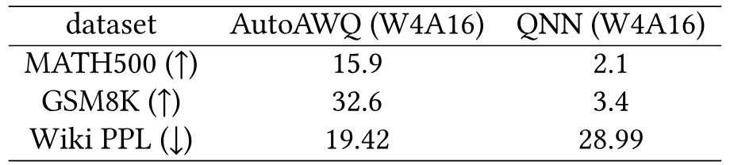

**表 1.** 異なる実装における Llama3.2-1B-Instruct の性能比較。QNN の量子化はモデルの推論能力を大幅に損なう。

**弱い汎用計算性能とメモリ帯域幅。** 細粒度グループ量子化をネイティブにサポートするハードウェアがない場合、一般には汎用計算ユニットへこの処理を任せる。しかし、NPU 内の汎用ベクトルユニットと専用行列ユニットの間には、計算能力とメモリアクセス能力に大きな隔たりがあることが分かった。Hexagon V75 NPU 上で、1024$\times$1024$\times$1024 の GEMM 演算を用いて HVX と HMX の FP16 GEMM 性能を測定した。ハードウェアのピーク性能を反映するため、すべての入力と出力はオンチップ TCM に置いた。[表 2](#table-02) に示すように、行列ユニットの FP16 GEMM スループットは最大 12 TFLOPS に達し、単一ベクトルスレッドの 300 倍を超える。メモリ帯域幅については、専用 DMA エンジンが DDR から 60 GB/s を超える読み出し帯域幅を実現する一方、コアのデータパスを介するベクトルユニットのメモリ読み出し帯域幅は 30 GB/s 未満にとどまる。ただし、DMA が提供する高帯域幅は、大きく規則的な 1D または 2D データブロックに限られ、小さなメモリアクセスや不規則なメモリアクセスは効率的に処理できない。これらの観察は、ベクトルユニットの汎用計算性能とメモリ帯域幅が、専用行列ユニットの計算スループットに追随するには不十分であることを示しており、細粒度量子化下で高性能な混合精度 GEMM カーネルを実装する際の大きな課題となる。

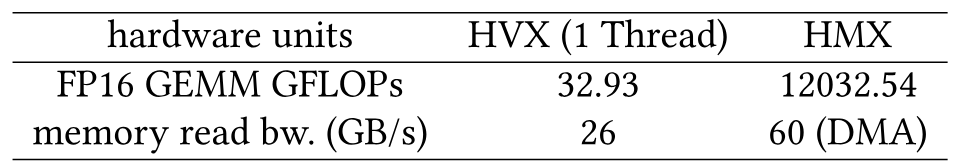

**表 2.** FP16 GEMM の計算能力（GFLOPs）とメモリ読み出し帯域幅（GB/s）で見た、HVX ユニットと HMX ユニットの性能指標。

## 4 設計概要

モバイル NPU 向けに設計し、test-time scaling ワークロードに最適化した LLM 推論システムを提示する。

精度の課題に対処するため、主要な重みには 4 ビット細粒度グループ量子化を採用し、活性化は浮動小数点のまま保持する。実行時には、その場で重みを動的に浮動小数点値へ逆量子化し、NPU の強力な FP16 行列計算能力を利用して test-time scaling タスクを効率的に支援する。

避けられない汎用計算では、ベクトル処理ユニットのメモリ帯域幅と計算スループットが限られるため、中核戦略として次を採用する。

- ハードウェア指向のオフライン設計を採用し、実行時の計算オーバーヘッドを最小限に抑える。
- SIMD ベクトルユニット固有の能力を最大限に活用し、専用ハードウェアと柔軟なソフトウェア要件との隔たりを埋める。

具体的には、次の技術を導入する。

**ハードウェア指向の細粒度タイル量子化方式。** 累積軸に沿ってグループ化する従来手法とは異なり、細粒度の矩形タイル単位でグループ量子化を行う新たな量子化レイアウトを提案する。行列ユニットとベクトルユニット双方のメモリアクセスパターンに整合させるため、量子化前の重み変換、量子化、量子化後の変換からなるオフラインパイプラインを導入する。これにより、実行時のメモリアクセスの連続性を高め、不要な計算オーバーヘッドをなくす。

**効率的な LUT ベース計算。** より複雑な実行時演算には、ベクトルユニットのルックアップテーブル（LUT）命令と一般化 LUT 機構を利用して、複雑な変換ロジックを置き換える。この手法は、混合精度 GEMM 内の逆量子化や Attention の Softmax 演算など、test-time scaling ワークロードの主要なボトルネック演算を高速化する。

## 5 システム設計

### 5.1 ハードウェア指向の細粒度タイル量子化方式

既存研究 [Liu25af, Li25ag] では、量子化誤差によって数学的推論のような難度の高いタスクにおけるモデル性能が著しく低下することが示されている。しかし、厳しいデバイス上のリソース制約により、完全精度モデルは依然として実現困難であるため、精度を維持するには細粒度量子化が不可欠となる。

残念ながら、モバイル NPU 上で細粒度量子化に対応した効率的な逆量子化ベースの GEMM カーネルを実装すると、重大なシステム上の課題が生じる。主な問題として、次の 2 つを特定した。

- 行列ユニットが想定する重みレイアウトと従来のグループ量子化レイアウトの不一致。
- グループサイズが小さいことに起因する幅広ベクトルレジスタの利用率低下。

これらの制約を克服するため、次の 2 つの要素を組み込んだ新たなタイル量子化方式を提案する。

- 行列ユニット固有のデータレイアウトに合わせて設計した、タイルベースの量子化戦略。
- ベクトルユニットの処理能力を最大限に活用する、量子化後の重み並べ替え手法。

#### 5.1.1 タイルグループ量子化

従来の量子化 GEMM では、重み行列は一般に列優先レイアウトで保存される。これは llama.cpp の CPU バックエンドなど、CPU ベースの行列乗算で用いられるベクトル内積演算に適している。重みは列方向に沿って、通常はサイズ 32 の連続した量子化グループへ分割される。各グループ内で値を量子化し、得られた整数重みを対応するスケールおよびゼロ点パラメータと交互にメモリへ格納することで、元の行列の列方向の順序を維持する。

しかし、特殊な行列ユニットを備える NPU では、従来のグループレイアウトがハードウェア要件と一致しないことが多い。[図 6](#figure-06) に示すように、従来のレイアウトでは連続している要素が、オンチップ TCM 上では分散する。SIMD ベクトルユニットにとって、このような非連続アクセスパターンは問題となる。現代のベクトルエンジンは分散アクセスを緩和する gather/scatter 演算を備えるものの、これらの演算には依然として大きなコストがかかる。重み行列を単純に転置しても、行列ユニットが想定する複雑な多階層データレイアウトによってメモリアクセスが非連続になるため、この不一致は解消しない。

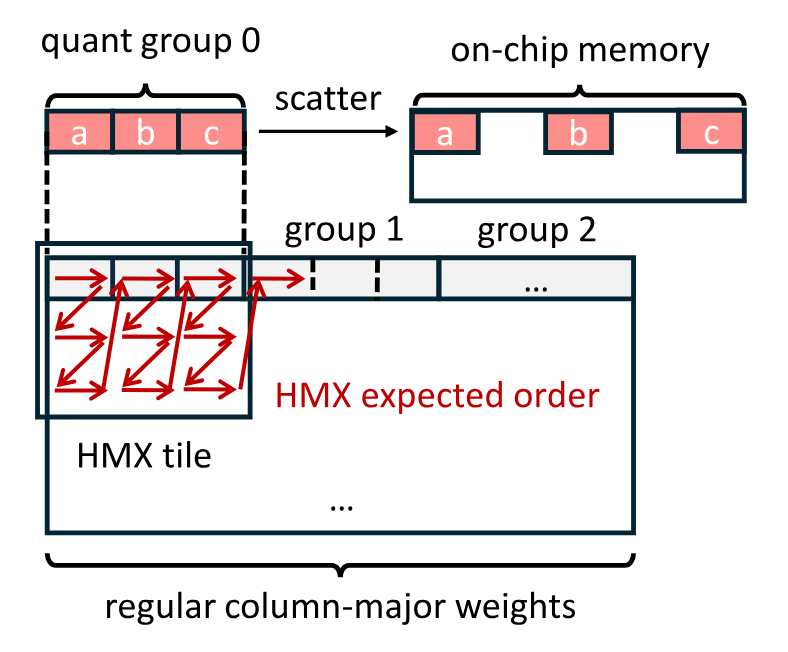

**図 6.** 量子化グループレイアウトと HMX タイルレイアウトの不一致を単純化して示した図。

これに対処するため、まず重みを行列ユニットが想定するレイアウトへ並べ替え、その後、グループごとに最近傍丸め量子化を適用する。グループサイズが 32 の場合、この手法は実質的に $2\times16$ タイル単位でグループ量子化を行う。一般的なモデルの事前学習済み重みは、おおむね平均 0 のガウス分布に従うため、このように形状を変更したタイルグループ内で量子化しても、従来のグループ化と比べて各グループ内の統計的性質は大きく変わらない。したがって、得られる量子化誤差も同程度にとどまる。

具体的には、量子化前の重みを [図 4](#figure-04) に示すレイアウトに従って配置する。このレイアウトは 2 階層で構成される。外側では、行列ユニットのタイル単位の内積演算に合わせてタイルを列優先順に並べ、内側では各タイル内の 2 行ごとにシャッフルする。その後、新しいメモリ順序で重みをグループ単位に量子化する。

#### 5.1.2 幅広ベクトルアクセスに向けた量子化グループの結合

量子化された重みは、デフォルトでは Array of Structures（AoS）レイアウトで保存される。Q4_0 対称量子化を例にすると、32 要素からなる各グループは 16 バイトの INT4 量子化値と 2 バイトの FP16 スケール値で構成され、量子化値とスケールはメモリ内に交互に格納される。NPU アーキテクチャ上のメモリアクセスは、ソフトウェア管理によるローカルな 1D または 2D プリフェッチに大きく依存するため、量子化値とスケールを別々の大きな連続配列に置く Structure of Arrays（SoA）レイアウトは避け、ハードウェアが好むアクセスパターンへ適合させる。

しかし、細粒度量子化グループでは、ネイティブのベクトル処理粒度との不一致が生じる。単一の量子化グループは小さすぎて、幅 128 バイトのベクトルレジスタを満たせない。このような小さなグループへアクセスするには、複数回のメモリ演算、または複数のレジスタからデータを統合する追加命令が必要となり、メモリ帯域幅の利用効率が低下し、計算オーバーヘッドが生じる。

この問題を解決するため、8 個の量子化グループを 1 個のより大きなスーパーグループへ結合し、連続する 256 要素の INT4 値がちょうど 1 本の HVX レジスタ全体を占めるよう、その内容を再編成する。この処理を [図 7](#figure-07) に示す。

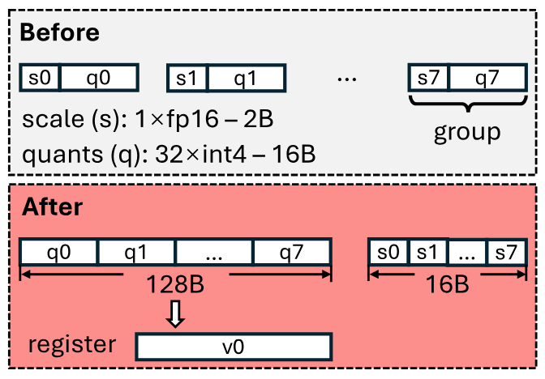

**図 7.** 8 個の細粒度量子化グループをスーパーブロックへ再パッキングする。INT4 量子化値は 1 本のベクトルレジスタに収まる。

### 5.2 LUT ベース計算

ベクトルユニットの汎用計算性能が限られていることを踏まえ、複雑な計算を一般化ルックアップテーブル（LUT）命令で置き換え、命令数と計算オーバーヘッドを削減することを提案する。LUT ベース計算は、Softmax の指数関数や逆量子化処理など、test-time scaling ワークロードの主要演算を高速化するうえで特に効果的である。

#### 5.2.1 ベクトル Gather による高速 Softmax

test-time scaling 手法では通常、サンプリングの並列度を高めるため、バッチサイズが大きくなり、コンテキスト長も長くなる。生成中の Transformer ベース LLM において、これらのスケーリング要因が主要演算子に与える影響を分析する。

- GEMM。前述した NPU のハードウェア特性に基づくと、test-time scaling ワークロードでバッチサイズを適度に増やしても、GEMM のレイテンシは大幅には増えない。また、GEMM のレイテンシはコンテキスト長に依存しない。
- その他の演算。活性化関数、LayerNorm、残差 Add、RoPE などの演算子では、計算オーバーヘッドがおおむね入力サイズに比例するものの、計算量とメモリアクセス量が小さいため、その影響は無視する。
- Attention。Attention の理論的な計算複雑性はバッチサイズとコンテキスト長の双方に応じて増大するため、test-time scaling の状況では性能上のボトルネックになり得る。

FP16 HMX を用いて Hexagon NPU 上に FlashAttention [Dao23a] を実装し、[図 8](#figure-08) に示すように、プロンプト長 4096 で入力バッチサイズ（クエリ長）を変えながら、そのレイテンシ構成を測定した。その結果、行列乗算がレイテンシ全体に占める割合は小さい一方、クエリ長が増えるにつれて Softmax が Attention の実行時間の大部分を占めることが分かった。

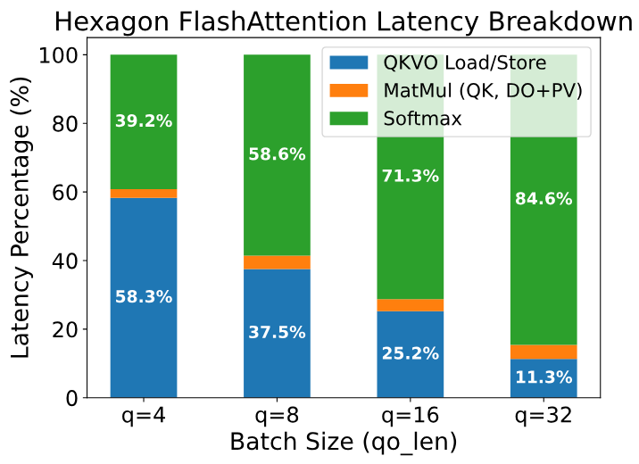

**図 8.** Hexagon NPU 上の FlashAttention のレイテンシ内訳。Qwen2.5-1.5B を使用し、プロンプト長を 4096 に設定した。

分析の結果、オンチップ Softmax の主なボトルネックは、$\Theta(N_q\times N_{kv})$ 個の要素へ適用しなければならない指数計算にあることが分かった。さらに問題なのは、これらの高コストな指数演算を、特殊数学関数向けの専用ハードウェアを持たない HVX 上で実行しなければならない点である。一般的な手法に従い、`exp` を `exp2` へ置き換え、係数 $\log_2{e}$ を $Q K^\top$ のスケーリング係数 $\frac{1}{\sqrt{d}}$ へ組み込む。入力要素 $x$ を整数部 $k$ と小数部 $f$ に分解し、$2^f$ はテイラー級数の多項式展開で近似する一方、$k$ は $2^f$ の IEEE-754 表現の指数フィールドへ直接加算する。しかし、多項式評価には逐次依存関係があるため、VLIW アーキテクチャ上の命令レベル並列性が制限される。

指数計算のボトルネックを緩和するため、明示的な指数計算を事前計算済みのルックアップテーブル（LUT）で置き換えることを検討する。HVX は `vgather` 命令を備えており、TCM 内の分散した位置から連続する 128 バイトの TCM 領域へ値を gather できる。`vgather` を使えば大規模な LUT を実装できるものの、$\operatorname{exp}$ に LUT を用いることには依然として課題がある。32 ビット浮動小数点数に $2^{32}$ 要素を保存するのは現実的ではない。さらに、`vgather` 自体にも、Hexagon V75 では 24-48 命令パケットという大きなレイテンシがあるため、使用回数を最小限に抑える必要がある。

実用的な LUT ベースの $\operatorname{exp}$ を実現するため、次の手法を設計した。まず、FlashAttention 全体で FP16 を幅広く使用し、オンチップ計算処理を [アルゴリズム 1](#algorithm-01) に示す。行列 $S, P, O$ とベクトル $\vec m, \vec l$ は 16 ビット浮動小数点で保存し、$\operatorname{exp}$ 計算の入力と出力も 16 ビット浮動小数点とする。特に、FP16 HMX は内部の累積により高精度な浮動小数点数を使用し、行列 $P$ の行単位の総和など、重要な演算では要素を 32 ビット精度へアップキャストする。

入力と出力を 16 ビットにすると、LUT は 65536 エントリに制限され、128 KiB のストレージが必要になるが、これは TCM 内に収まる。`vgather` のある変種は、1 命令で 2 バイト要素を 64 個 gather でき、最大アドレスオフセットは 65536 バイトである。しかし、65536 個の FP16 エントリは 128 KiB を占めるため、直接アドレス指定ではエントリの半分にアクセスできない。これを解決するため、行単位の最大値 $m_i$ を減算することで $\operatorname{exp}$ の入力がすべて非正になることを保証する safe softmax [Mil18] の性質を利用する。したがって、$x\le0$ の値だけを保存し、32768 エントリ（64 KiB）の LUT とする。LUT ベースの $\operatorname{exp}$ 計算では、FP16 入力の MSB（符号ビット）を無視し、入力を 1 ビット左シフトして `vgather` に必要なバイトオフセットを生成する。

LUT はシステム初期化中に事前計算するため、モデル推論中に追加のオーバーヘッドは生じない。TCM 内の固定 64 KiB 領域を占めるが、TCM 総容量の $64\,\mathrm{KiB}/8\,\mathrm{MiB}\approx0.8\%$ にすぎないため、他の演算に利用できる TCM 容量への影響は最小限である。

**アルゴリズム 1：本手法による FP16 FlashAttention のオンチップ計算（異なる head は省略）**

- **入力：** Head 次元 $d$、Query タイル数 $T_q$、KV タイル数 $T_{kv}$、Query タイルサイズ $B_q$、KV タイルサイズ $B_{kv}$。
- **入力：** 行列 $Q_i$（FP16）$\in \mathbb{R}^{B_q\times d}$、$K_j,V_j$（FP16）$\in \mathbb{R}^{B_{kv}\times d}$。
- $O_i^{(0)}=(\mathbf{0})\in\mathbb{R}^{B_q\times B_{kv}}$（FP16）、$m=(\mathbf{-\infty})\in\mathbb{R}^{B_q}$（FP16）、$l=(\mathbf{0})\in\mathbb{R}^{B_q}$（FP16）を初期化する。
- $S_i^{(j)}=\mathrm{MatMul}(Q_i,K_j^\top,\mathrm{AccumType}=\mathrm{FP}32)\in\mathbb{R}^{B_q\times B_{lv}}$（FP16）。
- $m_i^{(j)}=\max(m_i^{(j-1)},\mathrm{rowmax}(S_i^{(j)}))\in\mathbb{R}^{B_q}$（FP16）。
- $P_i^{(j)}=\mathrm{LUT\_Exp}(S_i^{(j)}-m_i^{(j)})\in\mathbb{R}^{B_q\times B_{kv}}$（FP16）。
- $l_i^{(j)}=e^{m_i^{(j-1)}-m_i^{(j)}}l_i^{(j-1)}+\mathrm{rowsum}(P_i^{(j)},\mathrm{AccumType}=\mathrm{FP}32)\in\mathbb{R}^{B_q}$（FP16）。
- $O_i^{(j)}=\mathrm{diag}(e^{m_i^{(j-1)}-m_i^{(j)}})O_i^{(j-1)}+P_i^{(j)}V_j\in\mathbb{R}^{B_q\times d}$（FP16、$\mathrm{AccumType}=\mathrm{FP}32$）。
- **出力：** $O_i=\mathrm{diag}(l_i^{(T_{kv})})^{-1}O_i^{(T_{kv})}$。

#### 5.2.2 LUT を中心とする効率的な逆量子化

実行時の HVX 逆量子化では、追加のオーバーヘッドを避けるために慎重な設計が必要となる。HVX のルックアップテーブル命令を用いた効率的な逆量子化処理を提示する。`vlut16` 命令は、ソースベクトルレジスタ内の各 8 ビットインデックスについて、16 要素のテーブルでルックアップを実行できる。各入力バイトは 16 ビット値へ変換されるため、`vlut16` の結果はレジスタ 2 本の組となる。

**テーブルルックアップによる高速な INT4 から FP16 への変換。** `vlut16` 命令を用い、4 ビット量子化値を Q4_0 量子化方式の $[-8, 7]$ FP16 値へ直接変換することで、従来の mask-unpack-convert 命令列を避ける。[図 9](#figure-09) に 2 つの手法の比較を示す。V79 より前の Hexagon NPU では、すべての HVX 浮動小数点演算が qfloat と呼ばれる内部形式で結果を生成するため、標準の IEEE-754 形式へ戻すには追加命令が必要となる。テーブルルックアップを用いると、このオーバーヘッドをなくせる。この LUT 中心の設計は、テーブル内容を調整するだけで、異なる 4 ビット符号化方式（FP4、NF4 [Det23a]、llama.cpp で使用される IQ4_NL など）を容易にサポートできる。

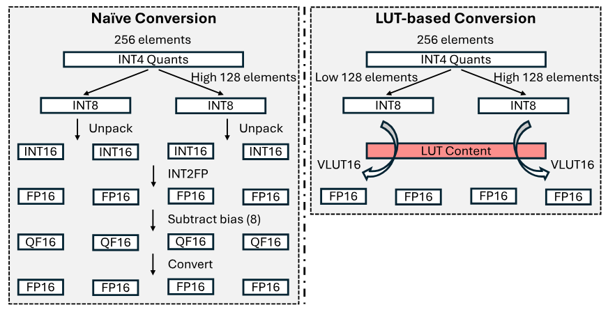

**図 9.** テーブルルックアップによる INT4 量子化値から FP16 数値への変換。

**テーブルルックアップによるスケールのブロードキャスト。** 128 バイトの HVX レジスタには、サイズ 32 の FP16 量子化グループを 2 個格納できる。したがって、従来手法ではスカラスケールをベクトルレジスタ全体へブロードキャストし、その後、量子化値との乗算に備えてレジスタ 2 本を連結する。しかし、4 グループのスケールを LUT の内容として使用し、事前定義した定数インデックスを適用すれば、`vlut16` 命令 1 回だけで 4 グループのスケールをブロードキャストできる。

## 6 実装

本推論システムは llama.cpp [Ger25] を基盤とし、C/C++ とインラインアセンブリで約 7K 行のコードとして実装した。Hexagon SDK（バージョン 6.0.0.2）の LLVM ツールチェーンを用いて Hexagon NPU 向けコードを生成する。特に、本システムは Qualcomm の QNN に依存せず、柔軟性に欠ける静的な固定形状計算グラフを回避している。

本実装は主として 2 つのモジュールで構成される。1 つは Hexagon NPU 向け演算子ライブラリで、独立した Hexagon DSP 共有オブジェクトとしてコンパイルされる。もう 1 つは CPU 側の llama.cpp へ統合されるモジュールである。NPU 演算子ライブラリは、計算カーネル、電力管理、ハードウェアリソース管理、計算スレッドプールを実装する。llama.cpp には、`rpcmem` 共有メモリを基盤となるバッファ型として用いる Hexagon NPU バックエンドを追加する。`rpcmem` はカーネルの dmabuf メモリのラッパーであり、CPU と NPU の間で物理メモリを共有できる。関連する割り当て、解放、マッピングの各インターフェースは、Android システムのベンダーライブラリに含まれる `libcdsprpc.so` により提供される。共有メモリバッファを利用すると、不要なプロセッサ間データコピーをなくせるだけでなく、既存のメモリ管理システムを可能な限り再利用できる。さらに、NPU 上に実装していない演算子を CPU 上で実行するようスケジュールできるため、上位層アプリケーションとシームレスに統合できる。

バックエンドの初期化段階では、Hexagon SDK の FastRPC [Fas25] 機能を呼び出してリモート NPU セッションを開始し、通信用の共有メモリ領域を初期化する。NPU 側では、1 本のスレッドがこの共有メモリ領域を継続的にポーリングし、CPU から計算要求を受信する。デフォルトの RPC 実装と比べ、共有メモリ経由の通信はレイテンシを低減できる。Snapdragon SoC では CPU と NPU の間に一方向のコヒーレンシしかないため、CPU が共有メモリへデータを書き込んだ後も、NPU は対応領域のキャッシュを自動的には無効化しない。したがって、NPU がポーリングする前に手動でキャッシュをクリアする。モデルの活性化を含む共有バッファにも、同様のキャッシュ保守操作が必要となる。

## 7 評価

### 7.1 実験設定

**デバイス。** NPU 性能の実験は、OnePlus Ace3、OnePlus 12、OnePlus Ace5 Pro の 3 台の Android デバイスで実施した。一部の精度結果は、NVIDIA RTX3090 GPU を搭載したサーバーテストベッドで得た。

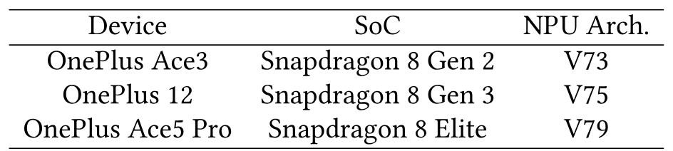

**表 3.** 評価に用いたモバイルデバイス。

**モデル。** Qwen 2.5 [Yang24] および Llama 3.2 [Met24a] のモデルファミリからモデルを選択する。携帯電話の実際のリソース制約を考慮し、主として Qwen 2.5 の 1.5B、3B と Llama 3.2 の 1B、3B を評価する。これらは実際にデプロイ可能なモデルサイズに相当する。test-time scaling 手法の性能とコストのトレードオフを評価する際には、Qwen 2.5 の 7B も考慮する。数学的推論タスクの評価では、Qwen 2.5 と Llama 3.2 の Instruct モデル変種を使用する。Best-of-N search とステップ単位の beam search では、Skywork-1.5B-PRM [Sky24] を outcome-reward および process-reward の採点器として使用する。

**データセットと指標。** test-time scaling タスクでは、MATH500 [Hen21] と GSM8K [Cob21] という 2 つの数学的推論タスクにおけるモデルの pass@1 精度を評価し、0-shot CoT プロンプトを一律に使用する。その他の精度測定では、`llama-perplexity` ユーティリティを用いて WinoGrande [Sak19] の精度、MMLU [Hen20] の精度、Wikitext-2 の perplexity を評価する。

**ベースライン。** test-time scaling タスクに焦点を当てるため、主として異なるデコードワークロードにおける本実装の性能を示す。NPU で test-time scaling ワークロードを実行する利点を示すため、GPU ベースの比較対象として llama.cpp の最近の OpenCL バックエンド [+4] を選択する。この OpenCL バックエンドには、Snapdragon の Adreno GPU 向けに最適化した Q4_0 行列乗算カーネルが組み込まれている。既存の NPU ベースシステムはいずれも test-time scaling ワークロードの処理に何らかの制約があるため、主要なベースラインには用いない。`llm.npu` [Xu24f] はデコード段階の計算に NPU を利用しない。その他の QNN ベースシステムは精度が低い（PowerServe [Pow25] など）。Powerinfer-2 [Xue24] や HeteroLLM [Che25ah] などのシステムはオープンソースではない。それでも、[第 7.2.4 節](#section-7-2-4) では参考として QNN ベースのデータを報告する。

**設定。** 演算子レベルの GEMM 評価では、Qwen2.5-1.5B、Qwen2.5-3B、Llama3.2-1B、Llama3.2-3B の線形層に対応する重み行列のサイズを選択する。具体的には、Attention の射影行列 $W_q,W_o$ と、Feed Forward Network（FFN）の $W_{\mathrm{gate}}, W_{\mathrm{up}}, W_{\mathrm{down}}$ が含まれる。（Grouped Query Attention（GQA）を用いる現代のモデルでは、Attention の射影行列 $W_k,W_v$ は $W_q,W_o$ と比べて規模が小さいため選択しない。）大半の行列には Q4_0 量子化方式を採用し、これは 4.5 Bits Per Weight（BPW）に相当する。FFN の down 行列については、モデル精度の維持に重要であることが既存研究で示されているため [Kov24, Lin24b, Lin23e]、量子化誤差を抑える目的で Q8_0 量子化方式（8.5 BPW）を適用する。

### 7.2 全体性能

#### 7.2.1 Test-time scaling の精度とレイテンシのトレードオフ

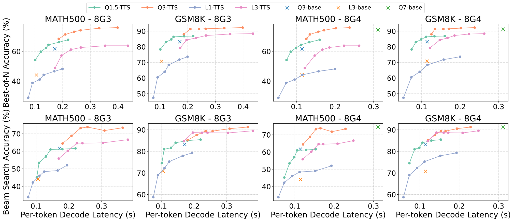

**図 10.** データセットとハードウェアのさまざまな組み合わせにおける、異なる test-time scaling 手法の精度とレイテンシのトレードオフ。

[図 10](#figure-10) に、test-time scaling 手法の性能とコストのトレードオフを示す。生成品質の指標には MATH500 と GSM8K の精度を用い、コスト指標にはデバイス上モデルの平均デコードレイテンシを用いる（ここでのデータは TTS によって増加したコンテキスト長を考慮している）。図の上段と下段はそれぞれ Best-of-N と Beam Search の結果に対応し、「QN」／「LN」はパラメータ数が $N$ billion の Qwen2.5／Llama3.2 モデルを表す。SoC の結果では、Snapdragon 8 Gen 2 に既知の NPU 仮想アドレス空間制限 [Hao25c] があり、3B 以上のパラメータを持つモデルを実行できないため、「8G2」の項目を除外した。「base」と記した孤立点は、各モデルで従来のサンプリングにより得られた平均性能を表す。

データは、test-time scaling がトレードオフ空間を提供し、特定の構成でより優れたパレートフロンティアを達成することで、性能とコストの均衡を改善できることを示している。Best-of-N 手法では、Qwen2.5 1.5B と 3B のスケーリング結果が、それぞれ 3B モデルと 7B モデルのベースライン精度を上回る。Beam Search では、Qwen2.5-1.5B と Llama3.2-1B が、それぞれの 3B 変種と同等か、わずかに優れた効率を達成できる。この結果は、NPU の計算能力と test-time scaling アルゴリズムを活用することで、デバイス上の小規模モデルが生成品質と推論コストの両面で大規模モデルを上回る可能性があることを示している。

#### 7.2.2 デバイス上のデコード性能

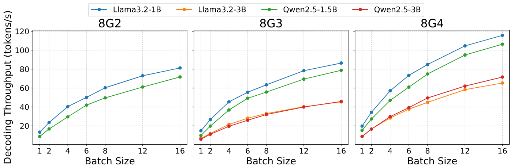

**図 11.** さまざまなバッチサイズとハードウェア設定における、異なるモデルのエンドツーエンドデコードスループット。

[図 11](#figure-11) に、異なるバッチサイズにおける各モデルのデバイス上デコードスループットを示す。古い NPU では仮想アドレス空間が 2 GiB に制限されるため、OnePlus Ace3 では Qwen2.5-1.5B と Llama-3.2-1B のみを評価する。

データから、3 台のデバイスすべてで、バッチサイズが増えるにつれてシステムのエンドツーエンドデコードスループットが大幅に向上することが分かる。デコードスループットが向上する根本的な理由は、HMX ユニットの未使用だった計算能力が利用され、中核となる HMX で消費される計算時間が本質的にはまったく増えないことにある。しかし、推論処理には入力長の増加に伴って大幅に遅くなる部分が含まれるため、デコードスループットは完全な線形にはスケールしない。具体的には、本実装では `lm_head` の重み（隠れ状態から語彙への射影行列）と関連する活性化を、NPU ではなく CPU へ保守的に配置する。現代の LLM は語彙が大きいため、`lm_head` と logits は大きな領域を占める。残念ながら、Hexagon NPU の仮想アドレス空間は 32 ビットしかないため、完全な logits テンソルを NPU へ置くと、モデル全体を実行できなくなる可能性がある。現時点では、バッチサイズが 16 のとき、CPU 上の logits 計算時間の割合が 50% に近づくか、それを超えることを確認している。NPU アドレス空間の制約を解消して logits 計算を NPU 上へ配置すれば、システムはより優れたスループットのスケーリング特性を達成すると期待する。

#### 7.2.3 電力およびエネルギー消費

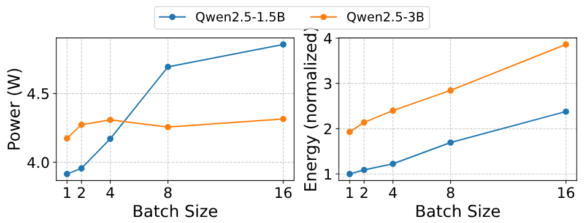

**図 12.** LLM デコード段階における電力およびエネルギー消費。

パフォーマンスモードを有効にした OnePlus 12 上で、sysfs インターフェースを介して LLM デコード中の消費電力を測定する。デコード段階でバッチサイズが増えると、1.5B Qwen モデル実行時の消費電力は増えるが、デバイス全体の消費電力は依然として 5 W 以内に収まる。これに対し、3B Qwen モデル実行時の消費電力は約 4.3 W で安定する。[図 12](#figure-12) に正規化したエネルギー消費量を示す。これは、対応する消費電力に相対デコードレイテンシを乗じて算出した。バッチサイズに対するエネルギー消費量のスケーリング特性はデコードレイテンシと類似しているため、[図 10](#figure-10) のコスト指標をエネルギーへ置き換えても、精度とコストのトレードオフは同様の特性を示す。特に、バッチサイズ 8 での 1.5B モデルのデコードエネルギー消費量は、バッチサイズ 1 での 3B モデルより小さい一方、数学タスクにおいてバッチサイズ 8 でデコードする 1.5B モデルの test-time scaling 精度は、3B モデルのベース精度に匹敵する。

#### 7.2.4 他システムとの比較

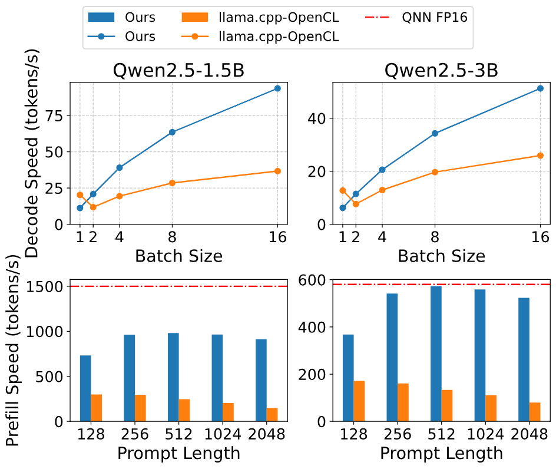

**図 13.** 推論スループットの比較。

本システムのデコード性能と prefill 性能を [図 13](#figure-13) に示す。本システムを GPU ベースの実装と比較し、参考として FP16 QNN の性能も加えた。デコード段階では、バッチサイズ 1 の場合は GPU の方が高速にデコードするものの、バッチサイズが大きくなると、本 NPU ベースシステムはより高いデコードスループットと優れたスケーリング特性を示す。これは、test-time scaling ワークロードに NPU を用いる利点を際立たせる。本システムは prefill スループットでも GPU ベースシステムを一貫して上回り、一部のワークロードでは独自の QNN と同等の性能を達成する。

### 7.3 精度評価

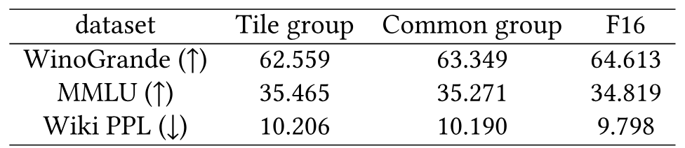

**表 4.** HMX レイアウト向けのタイル量子化グループを用いたモデルと、従来の量子化グループを用いたモデルの精度比較。

**量子化方式。** HMX レイアウトに基づくタイル量子化グループと、従来の量子化グループにそれぞれ対応する Qwen2.5-1.5B モデルの精度を評価する。[表 4](#table-04) に示すように、本量子化レイアウトを用いたモデルは、従来レイアウトのモデルと比べ、MMLU の精度がわずかに高く、Winogrande と Wikitext PPL の低下もわずかにとどまる。さらに、これらの精度差は、量子化自体が引き起こす性能低下（「F16」列の Wikitext perplexity が示す）よりはるかに小さい。総じて、提案するタイル量子化グループを使用しても、量子化モデルの精度は大幅には低下しない。

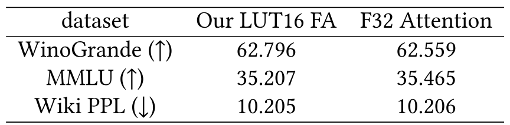

**表 5.** LUT ベース Softmax を用いた本手法の F16 FlashAttention と、従来の F32 Attention を用いたモデルの精度比較。

**Attention の実装。** [表 5](#table-05) に、上記と同じモデルおよびデータセットを用いた、本手法の LUT ベース FP16 Attention と従来の FP32 Attention に対応するモデル精度を示す。Attention 内の重要ではない部分（累積を除く）を、より低い FP16 精度へ置き換えても、モデルのエンドツーエンド精度には目立った影響がないことが分かる。

### 7.4 アブレーション評価

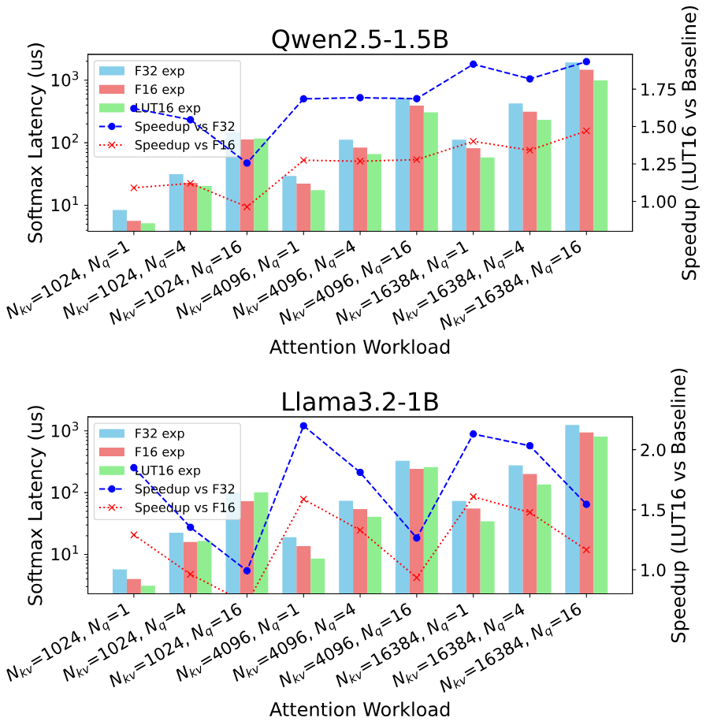

**図 14.** LUT ベース指数計算を用いる提案 F16 Attention のオンチップ Softmax に関するアブレーション評価。性能は OnePlus 12 上で測定した。

**Attention 内の Softmax。** [図 14](#figure-14) に、異なる Attention ワークロードで、さまざまな手法により指数関数 $\operatorname{exp}$ を計算した場合のオンチップ Softmax のレイテンシを示す。Attention の入力 Query 長は 1、4、16 に設定し、KV 長は 1024、4096、16384 のいずれかに設定した。図から、本手法の LUT ベース指数計算は、従来の 32 ビット浮動小数点 $\operatorname{exp}$ と比べて 1.26-2.19 倍、16 ビット浮動小数点 $\operatorname{exp}$ と比べて最大 $1.60\times$ の高速化を達成することが分かる。$\operatorname{exp}$ ルックアップテーブルを事前計算する際には、32 ビット以上の幅を持つ浮動小数点数で中間結果を計算できる点は注目に値する。したがって、LUT ベースの $\operatorname{exp}$ は、$\operatorname{exp}$ の 16 ビット多項式近似より高い精度を持つ。コンテキスト長が短い場合、入力 Query が大きくなると高速化率がわずかに低下するが、KV 長が長くなるとこの現象は緩和される。

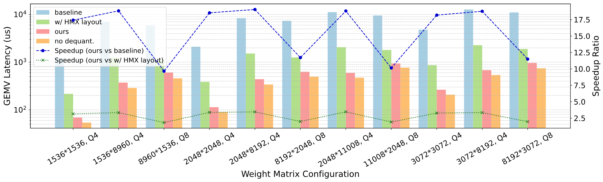

**図 15.** GEMM 逆量子化に対する提案最適化のアブレーション評価。OnePlus 12 上で GEMV の性能を測定した。

**逆量子化ベースの GEMM。** [図 15](#figure-15) に、GEMM の逆量子化レイアウト最適化に関するアブレーション実験を示す。ベースライン手法は従来のメモリレイアウトに対応し、列優先の重み行列をメモリ内の連続グループに従って量子化する。GEMM カーネルは実行時にサイズ 32 のグループを 1 つずつ逆量子化し、その後、要素を TCM 内の正しい位置へ scatter する。「HMX layout」の項目では、HMX レイアウト向けにオフラインでの重み並べ替えとタイル量子化グループを適用し、FP16 重みを TCM へ連続して書き込めるようにする。「Ours」は、量子化グループの結合を含むすべての最適化を採用した版である。さらに、「no dequantization」と記したデータ群も追加した。この実装では、実際に重みを逆量子化する代わりに、量子化された重みをメモリから直接読み出し、計算を一切行わずオンチップメモリへコピーする。このデータ群は、逆量子化ベース手法の性能上限とみなせる。

ベースラインと比べ、本手法は異なる行列サイズにおいて 9.65-19.04 倍の高速化を達成する。これは主として、ベースラインの scatter 演算に極めて大きなコストがかかるためである。HMX レイアウトの適用後は、量子化グループの結合と並べ替えによって計算の無駄も効果的に削減され、$1.82\times$-$3.45\times$ の高速化が得られる。特に「no dequantization」群と比べ、本手法は平均で 27% 遅いだけであり、この実装がすでに逆量子化の性能上限に近いことを示している。

### 7.5 オーバーヘッドと感度分析

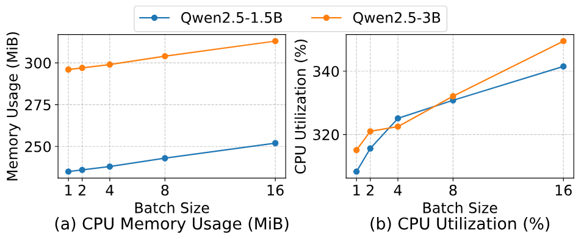

**図 16.** デコード段階における CPU およびメモリ使用量。

**CPU およびメモリ使用量。** OnePlus 12 上で、デコード段階における Qwen2.5 の 1.5B モデルと 3B モデルの CPU 使用率およびメモリ消費量を評価する。[図 16](#figure-16) に示す CPU メモリ使用量は、`top` コマンドが報告する常駐メモリサイズから取得した。さらに、`pmap` を用いて `dmabuf`（すなわち NPU が使用するメモリ）の総サイズを測定した。その結果、4096 トークンのコンテキスト予算では、1.5B モデルと 3B モデルについてそれぞれ一定値の 1056 MiB と 2090 MiB が得られた。総メモリ消費量は、1.5B モデルで約 1.3 GiB、3B モデルで約 2.4 GiB となる。CPU 上の語彙射影計算が増えるため、CPU 使用率はバッチサイズとともに増加するが、使用するコア数は一貫して 4 個に制限される。

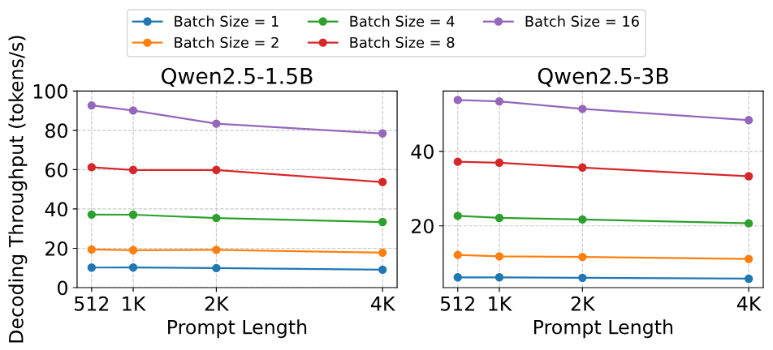

**図 17.** プロンプト長がデコードスループットへ与える影響。

**プロンプト長の影響。** [図 17](#figure-17) に、プロンプト長がデコードスループットへ与える影響を示す。すべてのバッチサイズと両モデルで、プロンプト長が 512 トークンから 4096 トークンへ増えるにつれて、デコードスループットは緩やかな低下傾向を示す。しかし、プロンプト長が 4096 トークン以下の範囲では、この低下は比較的小さく、この範囲においてプロンプト長がデコードスループットへ与える影響は限定的であることが分かる。

## 8 考察

**他のハードウェアへの一般化可能性。** NPU の「ベクトル＋行列」アーキテクチャには一定の普遍性があり、CPU と NPU の境界が徐々に曖昧になっていると考える。NPU に限らず、現代の CPU も Intel AMX や ARM SME などの専用行列乗算ユニットを組み込み始め、同様の「ベクトル＋行列」アーキテクチャを備えるようになっている。さらに、現代の AI アクセラレータでは一般に、汎用計算性能と低精度行列乗算に特化した能力の間に大きな隔たりがある（NVIDIA GPU など）。具体的なハードウェアアーキテクチャは異なる場合があるものの、本技術の中核的な考え方は広く適用できる。

**システム性能と制約。** （a）デコード性能：本システムの現時点のデコード速度は、主として逆量子化のオーバーヘッドにより、比較的制約されている。しかし、これは test-time scaling の有効性を損なうものではない。QNN ベースの量子化 GEMM は通常、HVX の計算オーバーヘッドを生じさせず、DMA と HMX の構成要素のみを利用する。T-MAC [Wei25j] に類似した手法により、NPU 上で細粒度グループ量子化に対応する効率的な GEMV を実現し、LLM のデコード処理を高速化できる可能性がある。（b）Prefill 性能：本システムの現時点の prefill 性能には改善の余地がある。より多くの演算子を NPU へオフロードし、演算子融合によってメモリアクセスと通信のオーバーヘッドを減らし、行列乗算のタイリングとパイプライン化戦略を最適化することで、prefill 性能を向上できる。これらの最適化は今後の研究課題とする。（c）モデルサイズの制約：現行実装は、古いデバイス上の単一 NPU セッションが持つ 32 ビットアドレス空間によって制限される。複数の NPU セッションを用いれば、この問題を緩和できる可能性がある。

**並列 test-time scaling の適用範囲。** 現在、並列 test-time scaling 手法は数学的推論タスクで主流となっているが、近年の研究 [Yan25p, Yao23a, Par23d, Hon23, Haf24, Che25ai] の知見は、より広範な推論および計画領域へ拡張できることを示しており、大きな一般化可能性を浮き彫りにしている。

## 9 関連研究

**NPU を用いたデバイス上 LLM 推論。** `llm.npu` [Xu24f] は、NPU 上でテンソル単位に量子化した INT8 GEMM を用いて LLM の prefill 段階を高速化し、精度維持のため外れ値関連の計算を CPU で補助する手法を先駆的に実現した。HeteroLLM [Che25ah] はテンソル分割により GPU と NPU の協調推論を実現する。オープンソース推論フレームワーク PowerServe [Pow25] は、中間表現 ONNX を利用して、量子化計算と浮動小数点計算のカスタム分割を実装する。ShadowAttn [Yin25b] は、NPU と CPU／GPU の協調を利用してスパース Attention を高速化する。ExecuTorch [Exe25, Or25] は広く知られたオープンソースのエッジ側 DNN 推論フレームワークであり、SpinQuant [Liu24b] と QNN バックエンドをサポートする。以上の研究はいずれも Qualcomm の Hexagon NPU を基盤とし、クローズドソースの QNN [Qua25a] をバックエンドとして用いる。vivo の研究 [Lu24b, Che25ag] では MediaTek の NPU が利用されているが、NeuroPilot SDK が公開されていないため、この種の研究は依然として少ない。

**LLM 量子化。** 最もよく知られた学習後量子化アルゴリズムには GPTQ [Fra22] と AWQ [Lin24] がある。これらは重みのみの量子化を行い、少量のキャリブレーションデータしか必要としないため、広く利用されている。SmoothQuant [Xia23] や DuQuant [Lin24b] などの後続手法は対象を重み・活性化量子化まで広げ、問題となる活性化の外れ値分布を緩和する技術を開発することで、より難しい活性化量子化に取り組んだ。ごく最近では、QuaRot [Ash24] や SpinQuant [Liu24b] のような包括的手法が登場し、重み、活性化、そして重要な KV cache という主要構成要素すべてを、多くの場合 4 ビットまで量子化することを目指している。これらの手法は回転変換を利用し、モデル全体で量子化に適した特徴分布を作り出す。

**投機的デコード。** 投機的デコード [Lev23, Mia24a, Lu24c] は LLM 推論の高速化手法の一種で、その中核は 1 回のモデル forward pass で複数の投機トークンを検証し、LLM デコードのメモリ律速問題を緩和することにある。投機的デコードにはさまざまな拡張変種があり、一部 [Hao24a, Lia25h] は対象モデルの分布へ厳密には従わない。理論上、一般化した投機的デコードと test-time scaling 手法は、ともに一般化した Generate-then-Verify フレームワークに属し、本システムは理論上、これらの応用をシームレスに支援できる。

## 10 結論

本研究は、モバイル NPU、とりわけ Qualcomm Hexagon NPU で十分に活用されていない計算能力を、LLM の test-time scaling に利用することの実現可能性と有効性を示した。ハードウェア指向のタイル量子化、重みレイアウト最適化、主要演算子の LUT ベース高速化を組み込んだエンドツーエンド推論システムを設計することで、test-time scaling を加えた小規模モデルが、従来どおりにデプロイした大規模モデルを精度とレイテンシの両面で上回り得ることを示した。本手法は、リソースに制約のあるモバイルデバイスへ高性能な言語モデルをデプロイする新たな道筋を提示し、デバイス上 AI における効率と能力のパレートフロンティアを前進させる。

## 謝辞

有益なフィードバックと提案を寄せてくださったすべての匿名査読者と shepherd の Yubin Xia 氏に感謝する。本研究は、清華大学（AIR）-AsiaInfo Technologies（China）, Inc. Joint Research Center for 6G Network and Intelligent Computing の助成（Grant 20233910006）を受けた。

[+1]: この値は、AMD Ryzen AI 9 HX 370 NPU の 50 TOPS を AMD Ryzen 7 8845HS NPU の 16 TOPS で除して得た。

[+2]: コードは https://github.com/haozixu/llama.cpp-npu （メインリポジトリ）および https://github.com/haozixu/htp-ops-lib （演算子ライブラリ）で公開している。

[+3]: PowerServe がリリースした公式モデル https://huggingface.co/PowerServe/Llama-3.2-1B-PowerServe-QNN29-8G3 を使用する。

[+4]: commit：1caae7f
