> [Susheel Suresh](https://susheels.github.io/) [+equal] [+susheel-email], [Hazel Mak](https://www.linkedin.com/in/s-n-hazel-mak) [+equal] [+hazel-email], [Shangpo Chou](https://www.linkedin.com/in/shangpochou), [Fred Kroon](https://ca.linkedin.com/in/fredkroon), [Sahil Bhatnagar](https://dblp.org/pid/273/7895.html). Microsoft Corporation. 2026 年 5 月 7 日首次提交至 arXiv; 当前版本: v1. [AgenticRAG: Agentic Retrieval for Enterprise Knowledge Bases](https://arxiv.org/abs/2605.05538), [TeX 源码](https://arxiv.org/e-print/2605.05538), <a href="/paper/agenticrag.pdf" target="_blank" rel="noopener noreferrer">原始 PDF</a>. 精确的印刷版式与参考文献以原始 PDF 为准.

## 摘要

我们提出 **AgenticRAG**, 一个面向企业知识库检索与分析的实用智能体框架. 标准 RAG 流水线把很大一部分事实落地负担交给搜索栈, 使语言模型只能处理检索流程深处选出的固定候选集. 我们在现有企业搜索基础设施之上叠加一层轻量框架, 为推理 LLM 配备 search, find, open 和 summarize 工具, 让模型能够反复检索信息、在文档内导航并自主分析证据, 从而减少对搜索栈的过度依赖. 在三个开放基准上, 我们观察到明显提升: BRIGHT 的 recall@1 达到 49.6% (比最佳嵌入基线高 21.8 个百分点), WixQA 的事实性得分为 0.96 (相对提升 13%), FinanceBench 的答案正确率为 92% (与直接获得真实证据的预言机仅差 2 个百分点). 消融研究表明, 最重要的因素是从单次检索转向智能体工具调用 (提升 $5.9\times$), 多查询搜索和文档内导航则同时改善质量与效率. 我们还介绍了智能体框架中的多项设计选择, 这些选择来自预生产部署经验. 结果表明, 该框架适合真实的企业生产环境.

## 1 引言

标准检索增强生成 (RAG) 流水线采用静态的先检索后生成范式 [Lew20]. 在这种设计中, 搜索栈实际上决定了大语言模型 (LLM) 最终看到的候选集, 模型的推理也受限于该集合. 现代企业级搜索栈围绕可扩展性、延迟以及由倒排索引、概率检索和学习排序模型组成的多阶段排序流水线进行了高度优化 [Liu09, Nog19, Tha21]. 这些系统擅长关键词查询和较短的语义查询, 也善于生成高召回率的候选集. 但它们并非为情境化、多文档或分析难度较高的信息需求而设计; 知识工作者面对技术手册、合规文档和财务报告等密集语料库时, 提出的恰恰是这类查询.

真实的 RAG 系统 [Azu26] 尝试使用 HyDE [Gao23a]、多查询改写 [Wan23o] 以及自适应或迭代检索策略 [Tri22a, Jeo24b] 等检索增强技术弥补这些不足. 这些方法能降低查询措辞带来的影响并扩大检索覆盖范围, 但大体上仍保留同一个架构假设: 实质性推理开始之前, 检索决策已经完成. LLM 仍在搜索栈深处选出的固定候选集上工作, 无法反复浏览文档、跨来源综合证据, 也无法从更高层视角重新评估结果.

近期具备推理能力的语言模型在规划和反复调用外部工具方面表现突出 [Yao23b, Sch23]. 与其硬编码检索步骤, 不如让模型自己驱动流程, 决定搜索什么、哪些文档值得深入查看, 以及何时已经收集到足够证据. 这样可以减轻搜索栈的压力: 搜索栈只需保证较好的召回率, 模型则利用更宽广的上下文完成最终的精确筛选. 我们提出 *AgenticRAG*, 一个实用框架, 它在现有企业搜索基础设施之上为推理 LLM 配备四种工具: **search**、**find**、**open** 和 **summarize**. search 工具调用底层搜索栈完成广泛的候选发现, find 和 open 则是精细操作工具, 让模型通过文档内搜索和全文检索 (采用滚动窗口访问) 深入候选文档. 为控制长推理链中不断增长的上下文, 框架会监测 token 用量, 并在达到阈值时触发 summarize 工具, 使模型能够在保留关键引用的同时整理已获信息. 本文的贡献属于系统层面: 这个轻量的推理时工具框架不需要模型微调、自定义嵌入模型、图构建, 也不需要语料库特定的预处理, 只需将文档索引到已有的企业搜索后端.

我们在涵盖检索、企业问答和财务文档推理的三个基准上进行评估. 本方法在 BRIGHT 上取得 49.6% 的 recall@1 (比最佳嵌入基线高 21.8 个百分点), 在 WixQA 上取得 0.96 的事实性得分 (相对提升 13%), 在 FinanceBench 上取得 92.00% 的答案正确率 (与预言机访问仅差 2 个百分点). 本方法已用于预生产评估, 部署中得到的经验直接影响了设计选择. 我们还通过详细消融实验分析每种工具的贡献、多查询搜索的作用以及模型层面的检索策略差异.

## 2 相关工作

检索增强生成 (RAG) 把 LLM 的生成建立在外部语料库之上, 以缓解参数化记忆的局限 [Lew20, Guu20]. 早期方法主要通过稀疏或稠密向量检索识别相关文档 [Kha20b, Iza21], 从而提高知识密集型 NLP 任务的性能. 随着上下文窗口扩大, 研究开始转向万亿 token 规模的检索 [Bor22] 以及上下文学习优化 [Ram23a, Shi23f]. 尽管取得了这些进展, 标准 RAG 流水线仍经常难以处理“长尾”知识, 检索失败时也可能出现幻觉 [Mal22, Gao24e]. 此外, 静态的“先检索后生成”范式不够灵活, 难以处理需要反复收集信息的复杂多跳查询 [Jia23c, Lew23].

为缓解静态流水线的脆弱性, 该领域开始采用 *Agentic* 模式, 由自主智能体 (LLM) 动态编排检索流程 [Sin25b, Och25]. ReAct [Yao23b] 和 Toolformer [Sch23] 等智能体行为的奠基工作表明, LLM 可以有效使用外部工具解决推理问题. Self-RAG [Asa23] 和 Corrective RAG [Yan24o] 等系统进一步把这一范式形式化, 使用自省机制评议检索内容, 并在必要时触发后备方案 (例如 Web 搜索). 近期方法尝试把检索纳入规划: PlanRAG [Lee24e] 和 Search-o1 [Li25k] 将高层规划与底层执行分离, 使智能体能够把复杂查询拆成子任务. Search-R1 [Jin25b] 则使用强化学习训练 LLM 自主做出搜索决策. 这些系统虽然有效, 但许多系统面向开放域搜索, 或者需要微调、强化学习和专门的检索策略; 对于无法导出用于训练的专有企业语料库, 它们很难直接应用. 递归推理循环还可能带来较高延迟和 token 成本 [Tri22a].

标准 RAG 的另一项主要局限是把文档“展平”为彼此分离的块, 丢弃标题和文档边界等有价值的结构先验. RAPTOR [Sar24] 通过递归聚类并汇总文本块构造树形结构, 支持在不同抽象层次上检索. HiQA [Che24x] 同样构造多文档层级上下文. Graph RAG [Edg24, Sca25a] 方法尝试从文档构建知识图谱, 以支持面向查询的摘要. 这些方法虽然能统一知识 [Pan24h, Wan24ah], 但图构建对于动态企业环境往往需要过高的计算成本.

相比之下, 我们的 Agentic RAG 框架是一个推理时系统. 它让推理模型使用“search”工具 (后端是快速的企业级搜索栈), 并配合“find”和“open”工具进一步收集信息和推理. 因此, 本文贡献是一种可部署到企业文件系统的系统集成方案: 它沿用已有搜索基础设施, 保留文档访问控制, 同时避免大规模预计算或重新训练.

## 3 方法

### 3.1 系统概览

我们提出一个面向大型文件系统中企业文档搜索与问答的智能体 RAG 系统. 与传统单次 RAG 流水线不同, 本系统使用迭代推理循环, 由大语言模型 (LLM) 在生成最终答案之前自主决定何时搜索文档、深入具体段落以及检索完整内容.

系统要解决企业 RAG 中的若干问题: (1) 多步推理: 复杂查询需要来自多份文档的信息; (2) 上下文窗口约束: 累积的检索结果必须装入 LLM 的限制范围; (3) 有依据的回答: 答案必须含有可追溯到源文档的引用; (4) 多轮效率: 后续查询应复用先前检索的内容, 而不是重复执行冗余搜索. 我们的架构支持多个模型系列, 并复用现有搜索基础设施作为检索工具的后端实现. 所谓轻量, 是指该框架只有四种工具, 不需要模型微调和图构建, 除了已经部署用于文档发现的企业搜索栈外, 也不需要自定义嵌入索引. 整个系统包括三个主要组件:

1. **智能体循环**: 编排 LLM 与工具的交互, 并用最大迭代次数限制循环.
2. **检索工具**: 三种工具 (*search*、*find*、*open*) 提供对企业文档的层级访问. *summarize* 工具负责长推理链中的上下文管理.
3. **对话状态**: 维护消息历史、token 计数和引用 ID 映射, 在多轮迭代中跟踪文档.

### 3.2 智能体循环

智能体通过有界迭代循环处理每条查询 ([图 1](#figure-01)). 在每次迭代中, 智能体收到当前对话后, 要么选择工具调用并把结果追加到对话, 要么返回带引用的最终答案.

循环在两种条件下终止: (1) 模型生成文本响应; (2) 迭代次数达到上限 (默认为 15). 如果达到最大迭代次数仍未生成最终答案, 智能体会发出强制完成请求, 要求模型使用现有信息作答. 如果执行期间超出 token 预算, 智能体会触发上下文管理 ([第 3.4 节](#section-3-4)) 以腾出空间, 然后继续循环. 算法细节见[第 7.1 节](#section-7-1).

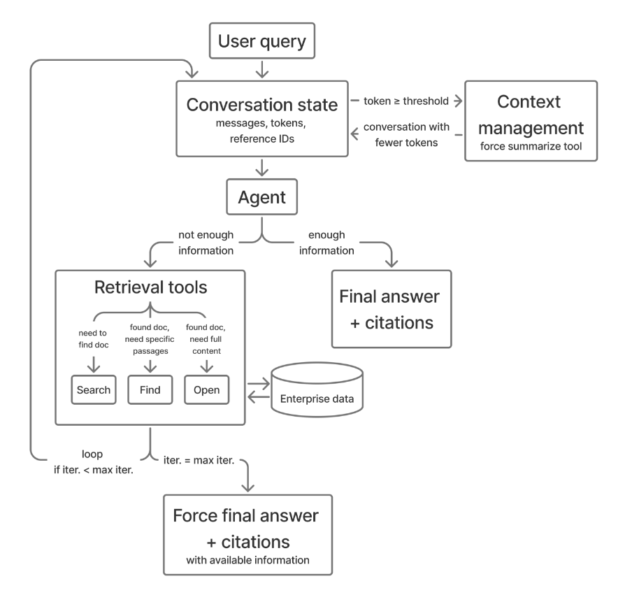

**图 1.** 智能体循环.

### 3.3 检索工具

系统提供三种检索工具, 支持分层浏览文档 ([表 1](#table-01)). 智能体根据当前的信息需求决定调用哪一种工具.

**Search** 把请求交给已有的企业搜索栈, 在整个企业范围内发现文档. 默认配置允许模型在一次工具调用中发出最多五条查询改写. 每条查询最多返回 10 个结果, 每个结果包含片段、标题、文件名、文件类型和其他可用元数据. 多条查询的结果会合并并去重. 每个结果都会获得唯一的引用 ID (格式为 $\mathrm{turn}m\mathrm{search}n$), 该 ID 由全局递增计数器产生, 供后续 find 和 open 操作使用.

**Find** 在引用 ID 标识的单份文档内进行定向搜索. 给定一组关键词模式后, 词法匹配采用不区分大小写的子串匹配; 也可以启用可选的语义 find 模式. 每个模式最多返回 2 个匹配段落. 结果按内容去重, 并截断到有界 token 上限 ($\sim 11\mathrm{k}$ token). 当模型知道要找*什么*时, 例如长篇申报文件中的收入指标或具名概念, Find 最为有用.

**Open** 在固定行窗口中检索完整文档内容. 每次调用返回一个行窗口 (默认为 1,800 行), 起点可以是开头 (第 0 行), 也可以是智能体选择的具体行号; 响应头还会标明当前查看范围和文档总行数 (例如“Viewing lines [0-1799] of 3000 lines”). 要访问同一文件的多个位置, 模型会在后续调用中显式提供行号. 这样既能浏览超出窗口大小的文档, 又能控制每次响应的长度. 当模型知道要读*哪里*时, 例如表格、章节标题或带行号预览附近的上下文, Open 最为有用. 系统提示会指导工具的有效使用. 详情见[第 7.2 节](#section-7-2).

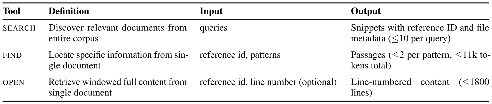

**表 1.** 检索工具规格.

### 3.4 上下文管理

检索工具每次都可能从文件加载 $\sim 11\mathrm{k}$ token, 因而上下文窗口很快就会用尽. 为此, 框架以 128K token 为阈值监测用量: 对话达到预算的 90% 时发出内部警告, 达到阈值时强制执行摘要. summarize 工具让模型记录当前推理, 并指定要保留的引用. 随后, 系统扫描工具消息, 删除与保留引用 ID 无关的内容, 在保留引用证据的同时释放 token. 这种方法扩展了有效上下文容量. [图 2](#figure-02) 给出了上下文管理前后的对话历史示例.

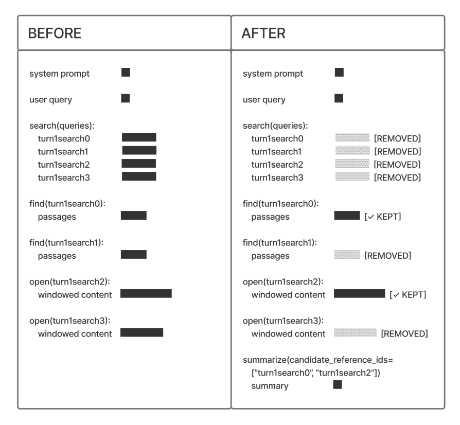

**图 2.** 通过强制调用 summarize 工具管理上下文的对话历史示例.

## 4 实验设置

我们的目标是在真实企业环境中评估 AgenticRAG. 在这类环境里, 知识工作者会针对由大量长篇领域文档构成的语料库提出复杂的情境化查询, 而解答这些查询需要多步推理. 为此, 我们采用 **BRIGHT 基准** [Su24a], 它包含来自八个领域的 StackExchange 问题. 我们评估 BRIGHT 的长上下文设置: 文档对应完整网页而非片段, 任务是为给定查询检索完整的相关文档. 在智能体设置中, 完整的 BRIGHT 网页会转换为文档文件, 并索引到 search 工具使用的同一个企业搜索后端. Search 返回带元数据和引用 ID 的片段预览, find 和 open 工具随后通过这些 ID 访问完整文档内容. 我们采用以 Recall@1 衡量检索文档相关性的标准协议 [Su24a]. 我们要求 AgenticRAG 中的模型为生成答案时使用的引用给出相关性分数, 从而产生用于评估的文档排序. 我们还在 **WixQA** [Coh25] 上测试本方法; 该基准面向真实的企业支持和故障排查场景, 程序性答案需要多文档、多步推理. 我们采用 WixQA 定义的同一种基于 LLM 的事实性指标. 最后, 我们在常用的 **FinanceBench** [Isl23] 数据集上进行评估, 其中的财务问题需要基于大型公司财务文档进行深入推理. 由于每条问题只涉及一份文档, 此处以答案正确率作为准确信息检索的代理指标. 基准的详细说明、查询集与语料库统计见[第 8 节](#section-8).

## 5 结果

### 5.1 BRIGHT 长上下文检索

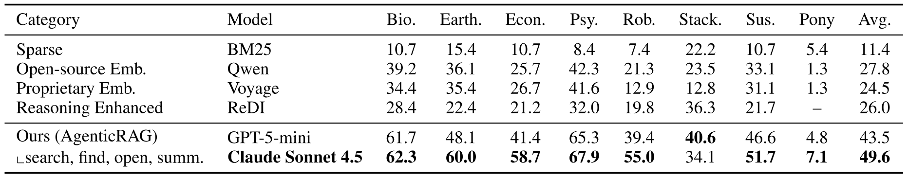

**表 2.** BRIGHT 基准未切分 StackExchange 网页上的长上下文检索性能. 分数采用 recall@1. 每个类别展示最佳基线; 完整结果见[表 9](#table-09).

[表 2](#table-02) 给出了 BRIGHT 基准上的检索性能, 每个类别展示最佳基线. 包含所有模型的完整结果见[表 9](#table-09), 其中包括在 BM25/SBERT 上使用 LLM 重排序器的推理增强基线和 ReDI. 我们为智能体框架配备 search、find、open 和 summarize 工具后, Claude Sonnet 4.5 与 GPT-5-mini 在八个基准划分上的 recall@1 均超过所有基线. 使用 AgenticRAG 检索框架时, Claude Sonnet 4.5 的平均 recall@1 达到 **49.6%** (比最佳嵌入模型 Qwen 的 27.8% 高 21.8 个百分点), GPT-5-mini 达到 43.5% (高 15.7 个百分点). 各领域的提升较为一致, 其中 Economics (+33.0 个百分点)、Earth Science (+24.6 个百分点)、Robotics (+33.7 个百分点) 和 Psychology (+25.6 个百分点) 的提升最大. 即使语料库包含 5.65K 份长文档, 每份平均 16K token, 本方法仍能扩展: search 工具利用传统检索, open / find 工具支持更深入的推理, summarize 工具则有效管理上下文窗口. 表现最佳的推理增强基线 ReDI 使用经过微调的 Qwen3-8B 分解与检索融合模型, 在 BRIGHT 长文档设置中取得 26.0% 的 recall@1. 本方法使用 Claude 时比它高 23.6 个百分点, 使用 GPT-5-mini 时高 17.5 个百分点. 单次查询改写或基于 LLM 重排序等静态方法无法达到本框架的迭代推理能力, 这一差距在所有划分上都很明显.

### 5.2 WixQA 企业问答

[图 3](#figure-03) 给出了 WixQA 基准上的事实性结果; 该基准要求通过多文档分析回答企业支持问题. 仅使用语义嵌入无法捕捉这些查询所需的跨文档推理, 而本框架支持的迭代搜索与推理表现更好. 在 *Expert Written* 划分上, 本方法配合 GPT-5-mini 得到 **0.96** 的事实性分数, E5 检索为 0.85, BM25 为 0.83; 相比最佳基线相对提升 **13%**. 我们在 *Simulated* 划分上观察到类似提升; 详情见[第 9.3 节](#section-9-3).

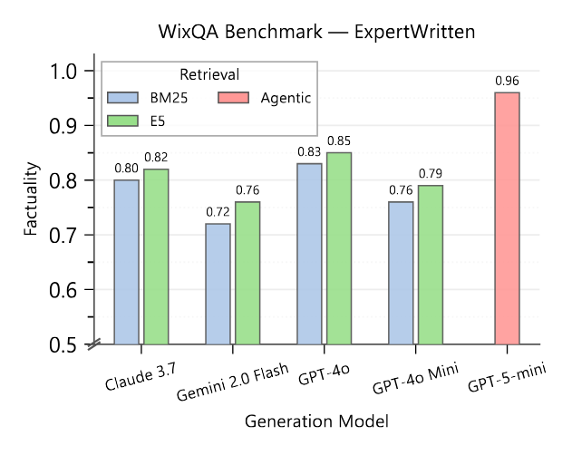

**图 3.** WixQA Expert Written 数据集上的事实性性能 (N=200). 在所有生成模型上, 智能体方法 (红色) 都明显优于 BM25 (蓝色) 与 E5 (绿色) 检索基线.

### 5.3 FinanceBench 财务文档问答

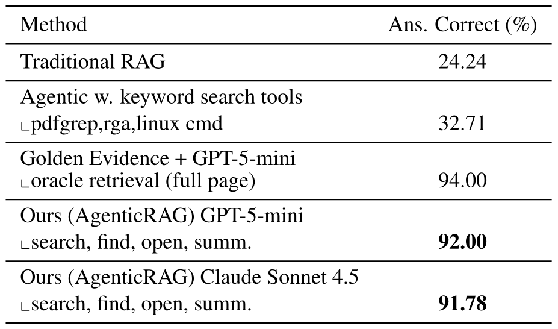

**表 3.** FinanceBench 评估结果 (N=150).

[表 3](#table-03) 给出了 FinanceBench 数据集上的答案正确率, 该数据集评估真实财务申报文件上的问答. 检索语料库包含 84 份长篇财务文档, 每份平均约 $\sim 116\mathrm{K}$ token ($\sim 140$ 页 PDF). 本智能体方法配合 GPT-5-mini 达到 **92.00%** 的正确率, 明显优于传统 RAG (**$3.8\times$**), 而且比依赖 pdfgrep、rga 和 Linux 命令等关键词搜索工具的智能体工具使用基线 [Sub26] 更通用 (达到其 **$2.8\times$**). 我们还设置了一个基线, 直接把真实完整页面证据提供给 GPT-5-mini, 完全绕过智能体检索. 该预言机设置达到 94.00%, 代表模型在证据完美时推理能力的上界. 本智能体系统只比这一上界低 2 个百分点, 说明它确实有效. 在 GPT-5-mini 与 Claude Sonnet 4.5 之间, 本框架同样有效.

### 5.4 Token 成本与检索效率

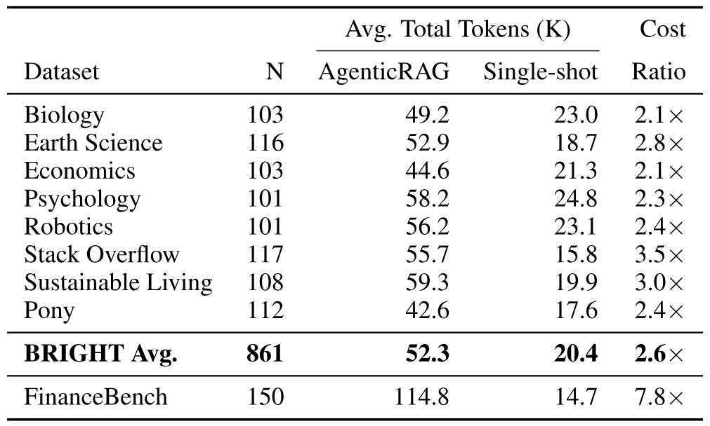

**表 4.** AgenticRAG 与 Single-shot Search 在 BRIGHT 各划分和 FinanceBench 上的总 token 用量比较. 所有数值均为每条查询的平均值 (单位: 千), 包括系统提示、工具调用、工具结果和所有思考 token. 成本比为 AgenticRAG 总 token 数除以 Single-shot Search 总 token 数.

[表 4](#table-04) 量化了智能体检索的端到端 token 成本. 我们统计完整交互中消耗的全部 token, 包括模型思考、工具调用参数、返回的工具结果和最终答案生成. 在 BRIGHT 上, AgenticRAG 每条查询平均使用 52.3K token, Single-shot Search 为 20.4K, token 开销为 $2.6\times$. 这项成本带来的质量增益更大: Claude Sonnet 4.5 配合 AgenticRAG 的 recall@1 为 49.6%, Single-shot Search 为 8.41%, 提升 $5.9\times$. FinanceBench 的成本更高, 每条查询平均使用 114.8K token, 是单次搜索的 $7.8\times$, 这是因为系统需要深入浏览长篇财务申报文件. 与此同时, 答案正确率达到 92.00%, 接近预言机证据的 94.00% 上界. [表 5](#table-05) 中的工具使用情况还表明, 系统远未用满 15 次迭代预算, 每条查询平均调用 4.48-4.79 次工具. 多查询消融给出了直接的效率比较: 完整系统平均调用 4.79 次工具就能取得相近召回率, 不使用多查询搜索时则需要 6.79 次, 工具调用减少 29%.

### 5.5 消融研究

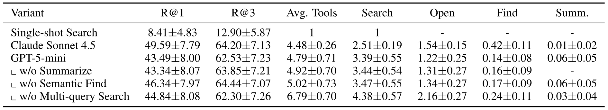

**表 5.** 在所有 BRIGHT 划分上取平均的智能体组件消融研究. 性能采用召回率 (R@k) 衡量, 同时报告平均工具用量和每种工具的统计数据. 各划分结果见[表 10](#table-10).

**单次检索与智能体检索.** [表 5](#table-05) 中最明显的结果是, 从单次搜索改为完整智能体工具调用后, 性能大幅提高. 单次搜索的平均 recall@1 只有 8.41%, 智能体工具调用配合 GPT-5-mini 时达到 **43.49%**, 配合 Claude Sonnet 4.5 时达到 **49.59%**, 分别提升 **$5.2\times$** 和 **$5.9\times$**. 值得注意的是, 与[表 2](#table-02) 中最先进的嵌入式检索器相比, search 工具背后的专有搜索栈牺牲了一部分原始检索质量, 换取速度、超大规模和可用性. 但将智能体框架与推理语言模型结合后, 这些质量差异便消失了. 所有划分都呈现一致提升 (参见[表 10](#table-10)).

**模型比较与工具使用模式.** Claude Sonnet 4.5 比 GPT-5-mini 高 **6.1 个百分点**, 并在八个划分中的七个上胜出 (各划分的详细结果见[表 10](#table-10)). 两个模型采用不同策略, 反映出探索与利用之间的权衡. Claude 偏向*利用*: 它调用 search 的次数更少 (2.51 对 3.39), 但打开更多文档 (1.54 对 1.22), 也更依赖语义 find (0.42 对 0.14, 增加 $3\times$), 因而会更深入地阅读候选文档. GPT-5-mini 偏向*探索*: 它会使用改写后的查询发起更多 search 调用, 而不是在文档内使用 find, 从而在语料库中撒下更宽的搜索网. 在 BRIGHT 长文档设置中, 每条查询平均只有 $\sim 1.9$ 份真实相关文档, 而语料库规模很大; 相关文档很稀疏, 广泛探索往往只会找到无关结果.

**失败模式.** 主要弱点是宽范围的多证据检索, 尤其是 Pony 划分; 该划分每条查询平均有 $\sim 6.9$ 份真实相关文档, BRIGHT 整体平均只有 $\sim 1.9$ 份. 这种设置奖励找回许多相关文档, 而我们的框架针对从粗到细的导航进行了优化, 目标是找到少量高价值证据来源. 这解释了为什么尽管本方法在相关文档稀疏的科学与技术划分上提升很大, 两个模型仍难以处理 Pony. 这种模式说明, 未来的轨迹策略应更好地识别广泛证据需求, 在最终排序前从深度优先的文档阅读转向更宽的覆盖范围.

**组件贡献.** 我们使用 GPT-5-mini 对各个组件进行消融, 以分析它们的贡献. 最明显的结果与多查询搜索有关. 默认配置允许模型在一次 search 工具调用中并行发出最多 5 条查询, 结果经过去重后一起呈现. 将系统限制为单查询搜索 (**w/o Multi-query Search**, 44.84%) 时, 模型每次 search 调用只发出一条查询, 但接收的结果数不变; 其 recall@1 与完整系统相近, 代价是工具调用增至平均 6.79 次, 完整系统为 4.79 次, 其中 search 操作 (4.38 对 3.39) 和文档 open 操作 (2.16 对 1.22) 都明显更多. 这说明多查询搜索能用更少的迭代找到相关文档, 因而提高效率. 这些消融实验的详细分析见[第 9.2 节](#section-9-2).

**预生产部署中的发现** 在预生产评估中, 我们发现多项设计选择可以引导模型沿着更合适的轨迹工作: (1) **在搜索结果中显示文档元数据**, 如标题、文件名和文件类型, 能帮助模型区分语义相近的片段并避免重复搜索; (2) **带行号的文档预览**让模型可以定位具体内容, 并在后续 open 调用中跳到相关部分; (3) **摘要后在上下文窗口中保留候选引用**使模型能够通过 open/find 深入有希望的候选文档, 而不必用改写后的查询重新启动检索.(4) **使用切换器**把复杂的多意图查询路由到 Agentic RAG 框架做深入分析. 简单查询则路由到传统 RAG, 以便更快作答. 这对平衡用户体验、成本和模型可用性十分重要. 我们已经看到良好的早期信号, 并会继续推进这种混合方案.

## 6 结论

我们提出了一个实用的 AgenticRAG 框架, 为推理语言模型配备 search、find、open 和 summarize 工具, 使其能够在大型企业语料库上自主检索和推理. 在三个基准上, 本方法在 BRIGHT 上取得 49.6% 的 recall@1 (比最佳嵌入基线高 21.8 个百分点), 在 WixQA 上取得 0.96 的事实性得分 (相对提升 13%), 在 FinanceBench 上取得 92.00% 的答案正确率 (与预言机访问仅差 2 个百分点). Token 分析表明, 与单次搜索相比, 这些增益在 BRIGHT 上需要中等程度的 $2.6\times$ token 开销, 同时使 recall@1 提高 $5.9\times$. 结果表明, 对于需要深入多步推理的企业信息检索任务, 该框架能够有效发挥推理模型的价值. 后续工作将关注大规模部署、传统 RAG 与 Agentic RAG 之间的预算感知路由、更深入的失败分析、迭代次数与窗口大小预算的消融实验, 以及通过微调优化检索轨迹以实现快速迭代推理.

## 致谢

感谢 Eli Coon、Kinfe Mengistu 以及 Copilot Studio 团队的更多成员在内部实验期间提供反馈并参与讨论. 特别感谢 James Cai 和 Alejandro Gutierrez Munoz 提供技术指导与项目赞助.

## 7 方法细节

### 7.1 智能体循环算法

[算法 1](#algorithm-01) 给出了智能体循环的详细算法.

**算法 1: 智能体循环.**

- **要求:** $\mathrm{user\_query}$、$\mathrm{max\_calls}$、$\mathrm{token\_threshold}$.
- **保证:** 带引用的格式化答案.
- $\mathrm{conversation}.\mathrm{add}(\mathrm{user\_query})$.
- **对于** $i=1$ **到** $\mathrm{max\_calls}$:
  - **如果** $\mathrm{tokens}(\mathrm{conversation})\geq\mathrm{token\_threshold}$:
    - $\mathrm{ManageContext}()$. *强制执行摘要.*
  - $\mathrm{response}\leftarrow\mathrm{LLM}(\mathrm{conversation},\mathrm{tool\_schemas})$.
  - **如果** $\mathrm{response}.\mathrm{has\_tool\_calls}$:
    - **对于每个** $\mathrm{response}.\mathrm{tool\_calls}$ **中的** $\mathrm{tool\_call}$:
      - $\mathrm{result}\leftarrow\mathrm{ExecuteTool}(\mathrm{tool\_call})$.
      - $\mathrm{conversation}.\mathrm{add}(\mathrm{tool\_call},\mathrm{result})$.
  - **否则:**
    - **返回** $\mathrm{FormatAnswer}(\mathrm{response}.\mathrm{text})$.
- **返回** $\mathrm{ForceFinalAnswer}()$.

### 7.2 工具使用的系统指令

总体指令包括:

- 不确定时先搜索, 再回答.
- 如果片段不够充分, 使用 find 或 open 逐步探索.
- 复用先前的结果, 不要再次执行搜索.
- 使用工具输出中的信息时, 每次都要给出引用.

何时使用 search:

- 企业语料库的主要搜索工具.
- 所有工作相关查询的首选.
- 用户提到当前/变化中的信息、企业特定术语或缩写时.
- 用于核实细节, 而不是作出假设.

何时使用 find:

- 在搜索结果指定的相关文件中进行文档内模式搜索.
- 搜索结果没有提供足够细节时.
- 围绕特定术语获取某条结果的聚焦视图.

何时使用 open:

- 对搜索结果中的相关文件进行窗口式全文检索.
- 搜索结果片段不够充分时.
- 从最有希望的结果中提取更多内容.
- 可以打开多条搜索结果.
- 可以选择靠近相关内容的行号.

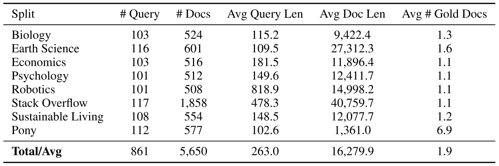

**表 6.** 评估中使用的 BRIGHT 基准 [Su24a] 长上下文划分数据统计.

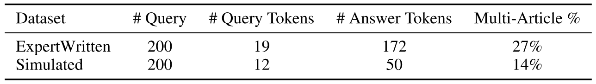

**表 7.** WixQA [Coh25] 基准的数据统计 (中位数).

## 8 数据集细节

### 8.1 BRIGHT 基准

我们采用 BRIGHT 基准 [Su24a], 它用于捕捉真实企业场景中的信息检索需求. BRIGHT 的查询来自 StackExchange 帖子, 反映了人类撰写、高度情境化且具有领域特征的信息需求. 对于每条查询, 语料库包含获得最高票答案所引用并经人工标注者核验的正样本文档, 以及通过搜索引擎检索收集的负样本文档. 语料库是标准化后的 Web 内容 (例如 Wikipedia 页面、博客和报告). 这种构建方法已经能够产生真实的检索池, 相关文档与无关文档之间存在大量语义重叠. 我们选择 BRIGHT 的长上下文设置进行评估, 其中的文档对应完整网页而非片段, 任务是为给定查询检索完整的相关文档. 实验涵盖八个领域: Biology、Earth Science、Economics、Psychology、Robotics、Stack Overflow、Sustainable Living 和 Pony. 这些领域覆盖企业信息检索中常见的多种科学、技术和专业方向. 各领域语料库包含数百至数千份文档, 文档平均长度从数千 token 到 40K token 以上不等. 查询本身也不短, 多数领域的平均查询长度超过 100 token, Robotics 和 Stack Overflow 等技术领域甚至达到数百 token. 基准统计见[表 6](#table-06). 我们遵循 BRIGHT 的标准评估协议, 报告长上下文文档检索的 Recall@1.

### 8.2 WixQA 基准

WixQA 面向需要多步推理和企业专用词汇的程序性长问题, 与真实的支持和故障排查场景高度吻合. 实验同时使用 WiXQA 的两个子集: *Expert Written* 包含真实客户查询及由人类领域专家撰写并核验的分步答案; *Simulated* 来自多轮用户与聊天机器人交互, 经整理后形成单轮查询, 程序正确性由专家核验. WixQA 的一个显著特点是多文章依赖, 即回答一条查询可能需要从多份文档中检索并综合信息. 所有查询都基于同一个企业规模知识库, 其中包含 6,221 篇领域帮助文章; 因此, WixQA 很适合评估需要在复杂多文档企业语料库上协同检索与推理的 Agentic RAG. 数据集统计见[表 7](#table-07)

### 8.3 FinanceBench

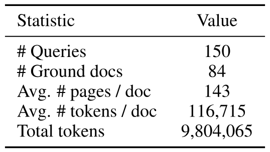

**表 8.** FinanceBench [Isl23] 数据统计.

FinanceBench [Isl23] 是一个经过人工评估的基准, 包含针对上市公司申报文件 (PDF 格式的 10-K、10-Q、8-K 和收益报告) 的财务问题. 问题分为指标生成类与领域相关类: 指标生成类问题要求模型找到文档中的相关数据, 通常还要进行计算, 目标是特定财务条目或比率; 每条问题都有唯一明确答案, 因而容易核验. 领域相关问题需要更深入的财务推理, 例如识别利润率变化的驱动因素或评估资本密集度. 每条查询只涉及一份文档. 我们选择这一基准, 是因为其文档规模很大 (每份 PDF 平均约 $\sim 143$ 页、$\sim 117\mathrm{K}$ token), 可以代表知识工作者经常面对的密集、信息量大的手册、报告和监管申报文件. 语料库统计见[表 8](#table-08). 我们使用答案正确率作为评估指标. 这一过程使用 LLM 作为评审, 同时也会人工复核结果.

## 9 补充结果

### 9.1 完整 BRIGHT 检索结果

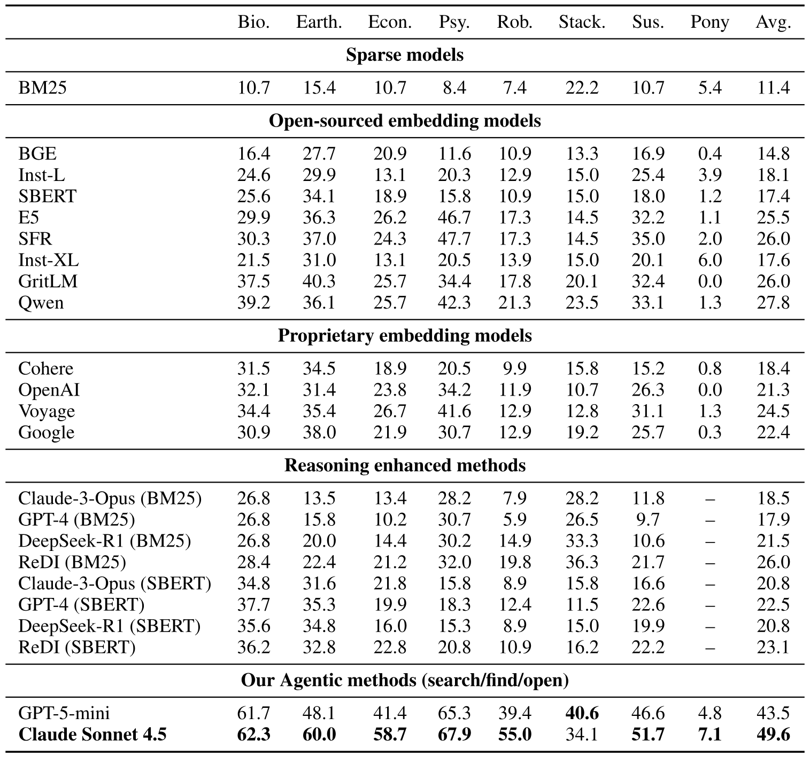

**表 9.** BRIGHT 基准未切分 StackExchange 网页上的完整长上下文检索性能. 分数采用 recall@1.

[表 9](#table-09) 给出了 BRIGHT 基准上所有基线模型的完整检索结果.

### 9.2 详细消融分析

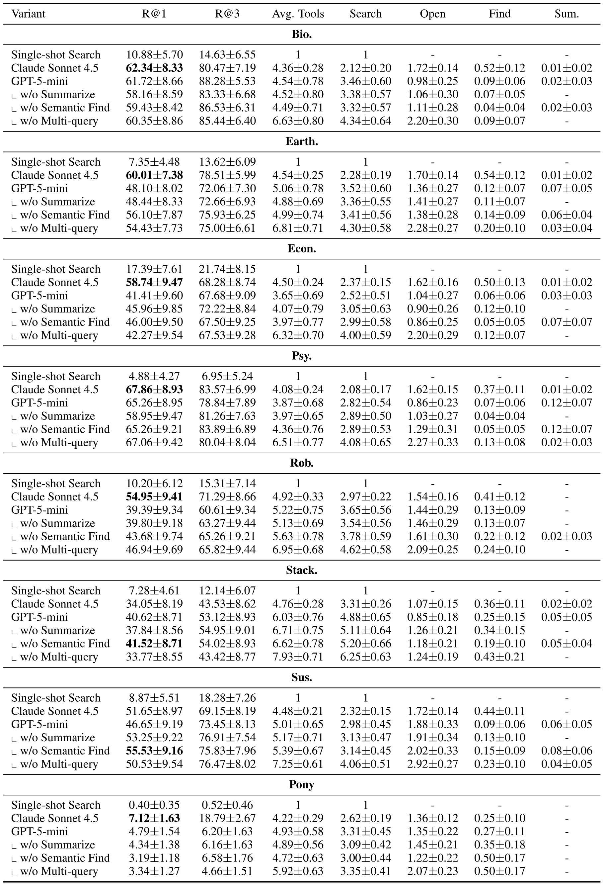

**表 10.** BRIGHT 上智能体组件的逐划分消融研究. 性能采用召回率 (R@k) 衡量, 同时报告平均工具用量和每种工具的统计数据.

[表 10](#table-10) 给出了 BRIGHT 所有领域上各划分的消融结果. 移除摘要工具 (**w/o Summarize**, 平均 recall@1 为 43.34%) 几乎没有影响, 说明检索任务很少需要该组件. 移除语义 find (**w/o Semantic Find**, 46.34%) 反而略微*提高*平均 recall@1, 可能是因为词法 find 后备方案已足以应对大多数文档内搜索, 而去掉语义选项能够降低延迟, 从而在相同计算预算下进行更多搜索迭代.

### 9.3 WixQA Simulated 结果

如[图 4](#figure-04) 所示, 对于带有经专家核验的真实答案的模拟问题, 即 WixQA 的 *Simulated* 划分, 本方法取得 **0.94** 的事实性得分, E5+GPT-4o 和 E5+Claude 3.7 均为 0.77. 这一数据集上的提升更大, 相对增益达到 **22%**. 这说明当问题需要更复杂的推理或多跳信息收集时, 智能体检索尤其有效.

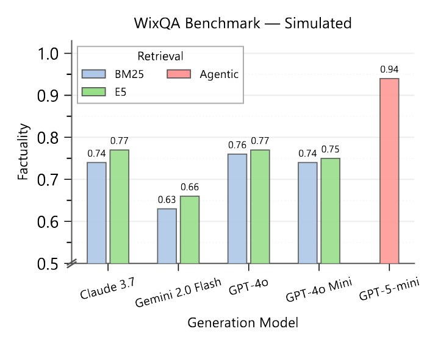

**图 4.** WixQA Simulated 数据集上的事实性性能. 对于需要更复杂推理的合成问题, 智能体检索与传统方法之间的性能差距更大.

### 9.4 对话示例

[图 5](#figure-05) 给出了 FinanceBench 中的一段对话示例.

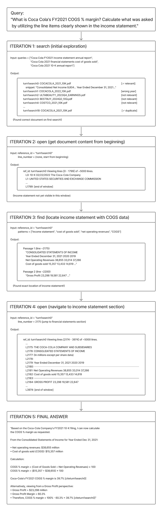

**图 5.** FinanceBench 对话示例.

[+equal]: 贡献相同.

[+susheel-email]: `sussuresh@microsoft.com`

[+hazel-email]: `hazelmak@microsoft.com`
