> [Minguk Kang](https://mingukkang.github.io/), [Jun-Yan Zhu](https://www.cs.cmu.edu/~junyanz/), [Richard Zhang](https://richzhang.github.io/), [Jaesik Park](https://jaesik.info/), [Eli Shechtman](https://research.adobe.com/person/eli-shechtman/), [Sylvain Paris](https://www.sylvainparis.com/), and [Taesung Park](https://taesung.me/). 首次提交 arXiv 的日期为 2023 年 3 月 9 日, 当前版本为 v2. 论文发表于 [2023 IEEE/CVF Conference on Computer Vision and Pattern Recognition](https://openaccess.thecvf.com/content/CVPR2023/html/Kang_GigaGAN_A_Unified_Approach_to_Generative_Adversarial_Networks_for_Text-to-Image_CVPR_2023_paper.html). [Scaling up GANs for Text-to-Image Synthesis](https://arxiv.org/abs/2303.05511). <a href="/paper/gigagan.pdf" target="_blank" rel="noopener noreferrer">原始 PDF</a>. [TeX 源码](https://export.arxiv.org/e-print/2303.05511v2). 原始 PDF 对精确印刷版式和参考文献具有最终权威性.

## 摘要

文本到图像合成近来的成功席卷了整个领域, 也引起了公众的广泛关注. 从技术角度看, 它还彻底改变了生成图像模型设计中更受青睐的架构. 过去, GAN 配合 StyleGAN 一类的技术几乎是默认选择. 随着 DALL$\cdot$E 2 出现, 自回归模型和扩散模型一夜之间成为大规模生成模型的新标准. 这种快速转变带来一个根本问题: 我们能否扩展 GAN, 让它也能利用 LAION 这样的大型数据集? 我们发现, 朴素地增加 StyleGAN 架构的容量会很快导致训练不稳定. 我们提出新的 GAN 架构 GigaGAN, 大幅突破这一限制, 说明 GAN 仍然可以用于文本到图像合成. GigaGAN 有三项主要优势. 首先, 它在推理时快了几个数量级, 生成一张 512px 图像只需 0.13 秒. 其次, 它可以生成高分辨率图像, 例如在 3.66 秒内生成 16 megapixel 图像. 最后, GigaGAN 支持多种隐空间编辑应用, 包括隐空间插值, 风格混合和向量算术运算.

## 1 引言

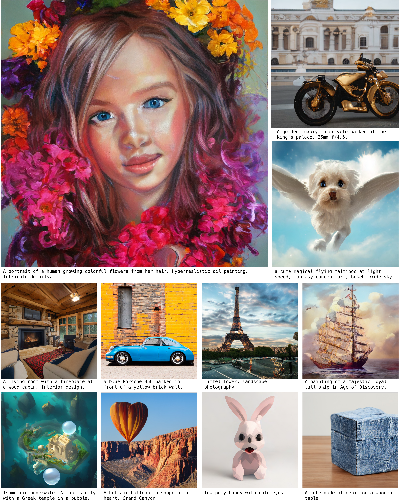

**图 1.** 我们的模型 GigaGAN 表明, GAN 框架也可以扩展到通用的文本到图像合成任务, 以 0.13 秒的交互速度生成 512px 输出, 并在 3.7 秒内生成 4096px 输出. 图中展示了 2K 或 4K 分辨率的部分示例. 放大图像可以查看更多细节. 更多未经筛选的比较见附录 8 和我们的网站.

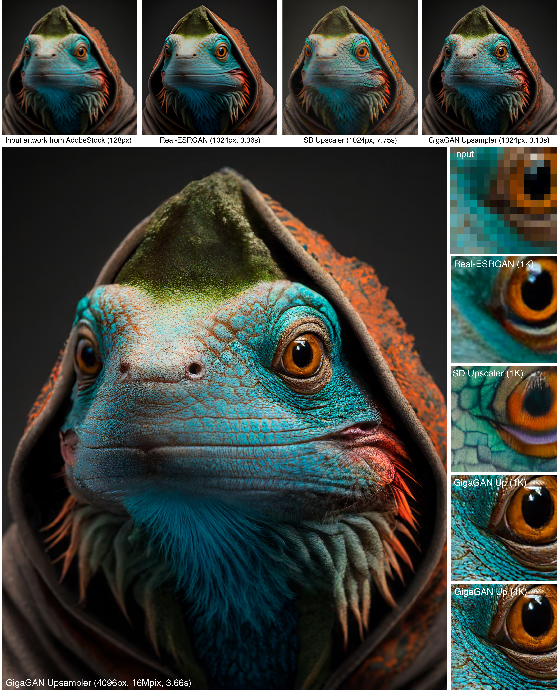

**图 2.** 我们基于 GAN 的上采样器可以用于许多文本到图像模型的上采样流水线, 这些模型通常先以 64px 或 128px 等低分辨率生成初始输出. 我们在一张低分辨率 128px 艺术图像上应用文本条件的 8$\times$ 超分辨率模型, 使用提示词 "Portrait of a colored iguana dressed in a hoodie", 得到 1K 输出, 以此模拟这种用法. 随后可以再次应用该模型, 生成超过 4K 的图像. 我们将本模型与 Stable Diffusion 的文本条件上采样器 [Sta22] 以及无条件的 Real-ESRGAN [Wan21i] 进行比较. 建议放大图像, 以比较 1K 和 4K 的结果.

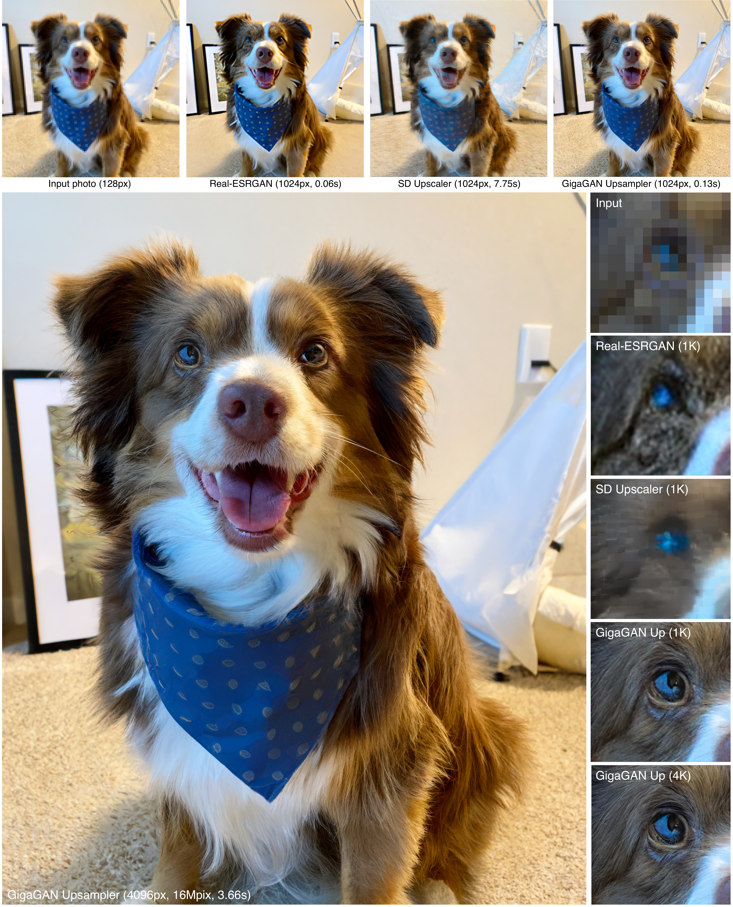

**图 3.** 与 [图 2](#figure-02) 类似, 我们基于 GAN 的上采样器也可以通过提供合适的图像描述, 作为真实图像的现成超分辨率模型, 并支持较大的放大倍数. 我们在一张低分辨率 128px 照片上应用文本条件的 8$\times$ 超分辨率模型, 使用提示词 "A dog sitting in front of a mini tipi tent", 得到 1K 输出. 随后可以再次应用该模型, 生成超过 4K 的图像. 我们将本模型与 Stable Diffusion 的文本条件上采样器 [Sta22] 以及无条件的 Real-ESRGAN [Wan21i] 进行比较. 建议放大图像, 以比较 1K 和 4K 的结果.

最近发布的模型, 如 DALL$\cdot$E 2 [Ram22], Imagen [Sah22a], Parti [Yu22] 和 Stable Diffusion [Rom22], 开启了图像生成的新阶段, 同时取得了前所未有的图像质量和模型灵活性. 当前占主导地位的两种范式, 扩散模型和自回归模型, 都依赖迭代推理. 这是一把双刃剑: 迭代方法能用简单的目标实现稳定训练, 但推理时的计算成本很高.
与此相对, 生成对抗网络 (GAN) [Goo14a, Rad15, Kar19, Bro19] 通过一次前向传播生成图像, 因而具有固有的高效率. 这类模型曾经主导生成建模的上一个阶段, 但由于训练过程不稳定, 扩展它们需要仔细调节网络架构和训练设置. 因此, GAN 在单个或多个物体类别的建模上表现出色, 但要扩展到复杂数据集, 更不用说开放世界, 仍然很困难. 结果是, 超大规模模型, 数据和计算资源如今都投入到了扩散模型和自回归模型上. 本文提出以下问题: GAN 能否继续扩展并利用这些资源, 还是已经达到上限? 是什么阻碍了它进一步扩展, 我们又能否克服这些障碍?
我们首先在 StyleGAN2 [Kar20b] 上进行实验, 发现仅仅扩大骨干网络就会导致训练不稳定. 我们找出几个关键问题, 并提出在增加模型容量的同时稳定训练的技术. 首先, 我们保留一个滤波器库, 对其进行针对样本的线性组合, 从而有效扩大生成器的容量. 我们还采用扩散模型中常见的几种技术, 并确认它们对 GAN 也有类似的好处. 例如, 在卷积层之间交错加入自注意力 (仅处理图像) 和交叉注意力 (处理图像和文本) 可以提升性能.
此外, 我们重新引入多尺度训练, 找到一种能改善生成结果中文本与图像对齐以及低频细节的新方案. 多尺度训练使基于 GAN 的生成器能够更有效地使用低分辨率块中的参数, 从而提升文本与图像的对齐度和图像质量. 经过仔细调节, 我们在 LAION2B-en [Sch22b] 等大规模数据集上稳定地训练出一个拥有十亿参数的 GAN (GigaGAN). 结果见 [图 1](#figure-01).
此外, 我们的方法采用多阶段方案 [Den15, Zha17c]. 我们先在 $64\times 64$ 分辨率生成图像, 再将其上采样到 $512\times 512$. 这两个网络具有模块化结构, 足够稳健, 可以以即插即用的方式使用. 我们表明, 即使训练时从未见过扩散图像, 文本条件的基于 GAN 的上采样网络仍可以作为 DALL$\cdot$E 2 等基础扩散模型的高效高质量上采样器 ([图 2](#figure-02)).
这些改进使 GigaGAN 大幅超越此前的 GAN: 其规模是 StyleGAN2 [Kar20b] 的 36$\times$, 是 StyleGAN-XL [Sau22] 和 XMC-GAN [Zha21n] 的 6$\times$. 虽然我们的 1B 参数量仍低于 Imagen (3.0B), DALL$\cdot$E 2 (5.5B) 和 Parti (20B) 等近期最大的合成模型, 但我们还没有观察到模型规模带来的质量饱和. GigaGAN 在 COCO2014 数据集上取得 9.09 的零样本 FID, 低于 DALL$\cdot$E 2, Parti-750M 和 Stable Diffusion 的 FID.
此外, 与扩散模型和自回归模型相比, GigaGAN 有三项主要的实际优势. 第一, 它快了几个数量级, 生成一张 512px 图像只需 0.13 秒 ([图 1](#figure-01)). 第二, 它可以在 3.66 秒内生成 4K 分辨率的超高分辨率图像. 第三, 它拥有可控的隐向量空间, 可以用于风格混合 ([图 6](#figure-06)), 提示词插值 ([图 7](#figure-07)) 和提示词混合 ([图 8](#figure-08)) 等成熟的可控图像合成应用.
总的来说, 我们的模型是第一个成功在数十亿张真实世界复杂互联网图像上训练十亿规模模型的基于 GAN 的方法. 这说明 GAN 仍然是文本到图像合成的可行选择, 也应当在未来大幅扩展模型时得到考虑. 更多结果请访问我们的[网站](https://mingukkang.github.io/GigaGAN/).

## 2 相关工作
**文本到图像合成.**
根据文本描述生成逼真图像是一个困难任务, 早期工作 [Zhu07, Man16] 已经对此进行了探索. 一种常见方案是在特定领域 [Wel10] 和具有封闭世界假设的数据集 [Lin14a] 上使用文本条件 GAN [Ree16a, Ree16, Zha17c, Xu18a, Zhu19b, Tao22]. 随着扩散模型 [Den20, Dha21], 自回归 (AR) Transformer [Che20b] 和大规模语言编码器 [Raf20a, Rad21] 的发展, 文本到图像合成在任意文本描述的开放世界上取得了显著进展. GLIDE [Nic22], DALL$\cdot$E 2 [Ram22] 和 Imagen [Sah22a] 是代表性的扩散模型, 它们借助预训练语言编码器 [Rad21, Raf20a] 生成照片级输出. DALL$\cdot$E [Ram21], Make-A-Scene [Gaf22], CogView [Din21, Din22a] 和 Parti [Yu22] 等 AR 模型也取得了很好的结果. 虽然这些模型展现出前所未有的图像合成能力, 但要获得高质量采样, 仍需要耗时的迭代过程.
为加快采样, 一些方法提出减少采样步数 [Men22a, Sal22, Son21a, Lu22c], 或复用预计算特征 [Li22g]. Latent Diffusion Model (LDM) [Rom22] 在低维隐空间而不是像素空间执行逆过程. 但是, 连续的逆过程仍然计算开销很大, 限制了大规模文本到图像模型在交互式应用中的使用.
**基于 GAN 的图像合成.**
GAN [Goo14a] 一直是自然图像合成的主要生成模型家族之一. 随着 GAN 的采样质量和多样性不断提高 [Rad15, Kar18a, Kar19, Kar20b, Kar21, Kum22a, Sau21], GAN 已被用于计算机视觉和图形学的多种应用, 如文本到图像合成 [Ree16], 图像到图像转换 [Iso17, Zhu17, Hua18b, Lee18d, Par19c, Par20c] 和图像编辑 [Zhu16, Bro17, Abd19a, Pat21]. 值得注意的是, StyleGAN 系列模型 [Kar20b, Kar21] 在单类别领域的图像合成任务中表现出很强的能力 [Abd19a, Zhu20a, Wul20, Har20c, Pat21]. 其他工作则在类别集合固定的数据集上探索了类别条件 GAN [Zha19m, Bro19, Kan21, Zha20c, Sau22].
本文将数据条件从单类别或多类别数据集改为数据极其丰富的场景. 我们首次尝试在海量网络爬取文本图像对上训练用于文本到图像生成的大规模 GAN, 例如 LAION2B-en [Sch22b] 和 COYO-700M [Bye22]. 现有的基于 GAN 的文本到图像合成模型 [Ree16, Zha17c, Xu18a, Zhu19b, Lia20, Zha21n, Tao22] 在相对较小的数据集上训练, 例如 CUB-200 (12k 训练对), MSCOCO (82k) 和 LN-OpenImages (507k). 此外, 这些模型在对应的验证数据集上评估, 而这些数据集尚未验证是否能像扩散模型或 AR 模型一样执行大规模文本图像合成.
与我们的工作同时, StyleGAN-T [Sau23] 和 GALIP [Tao23a] 也有相近目标, 并提供了互补的见解.
**大规模文本到图像模型的超分辨率.**
大规模模型在训练和推理时都需要高昂的计算成本. 为减少内存和运行时间, 先进的文本到图像模型 [Nic22, Ram22, Sah22a, Yu22] 采用级联生成过程: 先以 $64\times64$ 分辨率生成图像, 再依次上采样到 $256\times256$ 和 $1024\times1024$. 然而, 超分辨率网络主要基于扩散模型, 需要多次迭代. 与之相对, 我们的低分辨率图像生成器和上采样器基于 GAN, 从而降低两个阶段的计算成本. 传统超分辨率技术 [Don15, Led17, Wan18h, Anw20] 的目标是忠实重建低分辨率输入, 或处理压缩伪影等图像退化; 而面向大规模模型的上采样器用途不同. 它们需要执行更大的放大倍数, 同时可能利用输入文本提示.

## 3 方法

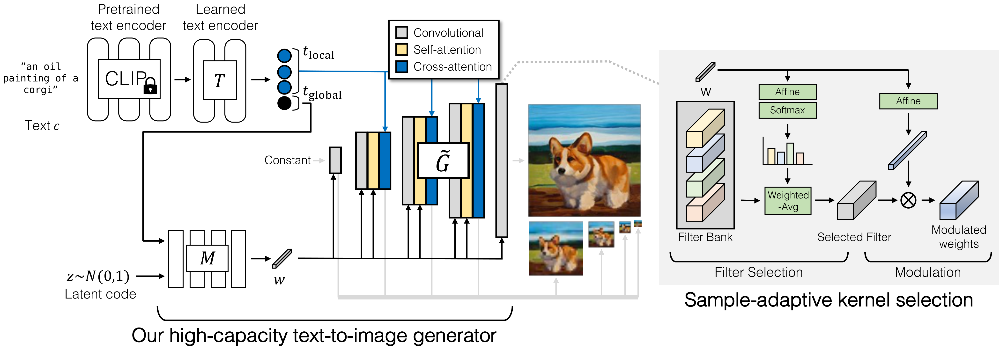

**图 4.** 我们的高容量 GigaGAN 文本到图像生成器. 首先, 我们使用预训练 CLIP 模型和学习得到的编码器 $T$ 提取文本嵌入. 局部文本描述符通过交叉注意力送入生成器. 全局文本描述符与隐码 $\mathbf{z}$ 一起送入风格映射网络 $M$, 生成风格码 $\mathbf{w}$. 风格码通过图右侧所示的风格自适应核选择来调制主生成器. 生成器将中间特征转换为 RGB 图像, 输出图像金字塔. 为获得更大容量, 我们在每个尺度使用多个注意力层和卷积层 ([表 A2](#table-07)). 此外, 我们还使用了图中未展示的独立上采样器模型.
我们训练生成器 $G(\mathbf{z}, \mathbf{c})$, 在给定隐码 $\mathbf{z} \sim \mathcal{N}(0, 1) \in \mathbb{R}^{128}$ 和文本条件信号 $\mathbf{c}$ 时预测图像 $\mathbf{x}\in \mathbb{R}^{H\times W\times 3}$. 我们使用判别器 $D(\mathbf{x}, \mathbf{c})$ 判断生成图像的真实性, 并将其与训练数据库 $\mathcal{D}$ 中的样本进行比较, 该数据库包含图像文本对.
尽管 GAN [Kar18a, Kar19, Bro19] 能够在单类别和多类别数据集 [Kar19, Yu15a, Den09a] 上成功生成逼真图像, 但在互联网图像上进行开放式文本条件合成仍然很困难. 我们假设, 当前限制源于对卷积层的依赖. 也就是说, 同一组卷积滤波器需要在图像的所有位置, 针对所有文本条件建模通用的图像合成函数, 这给它们带来很大压力. 因此, 我们希望根据输入条件动态选择卷积滤波器, 并通过注意力机制捕获长距离依赖, 让参数化具有更强的表达能力.
下面我们讨论让 ConvNet 更具表达能力的主要贡献 ([第 3.1 节](#section-3-1)), 接着介绍生成器 ([第 3.2 节](#section-3-2)) 和判别器 ([第 3.3 节](#section-3-3)) 的设计. 最后, 我们介绍一种新的高速 GAN 上采样器模型, 它可以提升本方法和 Imagen [Sah22a], DALL$\cdot$E 2 [Ram22] 等扩散模型的推理质量和速度.

### 3.1 复杂上下文交互建模
**StyleGAN 生成器基线.**
我们的架构基于条件版 StyleGAN2 [Kar20b], 由两个网络 $G = \widetilde{G}\circ M$ 组成. 映射网络 $\mathbf{w}=M(\mathbf{z}, \mathbf{c})$ 将输入映射为"风格"向量 $\mathbf{w}$, 该向量调制合成网络 $\widetilde{G}(\mathbf{w})$ 中的一系列上采样卷积层, 将学习到的常量张量映射为输出图像 $\mathbf{x}$. 卷积是生成所有输出像素的主要部件, 而 $\mathbf{w}$ 向量是建模条件信息的唯一来源.
**样本自适应核选择.**
为了处理互联网图像高度多样的分布, 我们希望增加卷积核的容量. 但卷积层宽度增大后, 同一运算会在所有位置重复执行, 计算成本过高.
我们提出一种高效方法, 根据文本条件动态生成卷积核, 如 [图 4](#figure-04) 右侧所示. 在该方案中, 我们实例化 $N$ 个滤波器组成的库 $\{\mathbf{K}_i \in \mathbb{R}^{C_{\text{in}} \times C_{\text{out}} \times K \times K} \}_{i=1}^N$, 而不是只使用一个滤波器. 每一层都接收特征 $\mathbf{f} \in \mathbb{R}^{C_\text{in}}$. 然后, 风格向量 $\mathbf{w} \in \mathbb{R}^{d}$ 经过仿射层 $[W_\text{filter}, b_\text{filter}] \in \mathbb{R}^{(d + 1) \times N}$, 预测一组在这些滤波器之间进行加权平均的权重, 生成聚合滤波器 $\mathbf{K} \in \mathbb{R}^{C_{\text{in}} \times C_{\text{out}} \times K \times K}$.

$$
\mathbf{K} = \sum_{i=1}^N \mathbf{K}_i \cdot \text{softmax}\big( W_\text{filter}^{\top}\mathbf{w} + b_\text{filter}\big)_i
$$
滤波器随后用于 StyleGAN2 的常规卷积流水线, 并使用第二个仿射层 $[W_\text{mod}, b_\text{mod}] \in \mathbb{R}^{(d + 1) \times C_\text{in}}$ 进行权重 (去) 调制 [Kar20b].
$$
g_\text{adaconv}(\mathbf{f}, \mathbf{w}) = \big((W_{\text{mod}}^{\top}\mathbf{w} + b_\text{mod} \big) \otimes \mathbf{K}) *\mathbf{f},
$$
其中, $\otimes$ 和 $*$ 分别表示 (去) 调制和卷积.
从高层看, 基于 softmax 的加权可以看作根据输入条件进行可微滤波器选择. 此外, 滤波器选择过程在每层只执行一次, 比实际卷积快得多, 因此计算复杂度与分辨率解耦. 我们的方法与动态卷积 [Jia16, Wu18d, Ha17, Tan20b] 有相似之处, 都会使卷积滤波器随样本动态变化; 但我们的不同之处在于, 我们显式实例化更大的滤波器库, 并根据 StyleGAN 的 $\mathbf{w}$ 空间, 通过独立的条件路径选择权重.
**交错注意力与卷积.**
卷积滤波器只在自己的感受野内运行, 无法建立与图像远处部分的上下文关系. 引入长距离关系的一种方式是使用注意力层 $g_\text{attention}$. 近来的扩散模型 [Dha21, Ho22b, Rom22] 普遍采用注意力机制, 而 StyleGAN 架构主要由卷积组成, 少数例外包括 BigGAN [Bro19], GANformer [Hud21] 和 ViTGAN [Lee22a].
我们希望通过将注意力层整合进卷积骨干网络来提升 StyleGAN 的性能. 但是, 直接向 StyleGAN 添加注意力层经常导致训练崩溃, 可能是因为点积自注意力不满足 Lipschitz 条件, 正如 Kim 等人 [Kim21b] 所指出的. 判别器的 Lipschitz 连续性对稳定训练一直很重要 [Arj17, Gul17, Mes18], 因此我们使用 L2 距离而不是点积作为注意力 logits, 以促进 Lipschitz 连续性 [Kim21b], 这与 ViTGAN [Lee22a] 类似.
为了进一步提升性能, 我们发现必须匹配 StyleGAN 的架构细节, 例如均衡学习率 [Kar18a] 和从单位正态分布初始化权重. 我们缩小 L2 距离 logits, 使其在初始化时大致匹配单位正态分布, 并减小注意力层的残差增益. 我们还通过绑定键矩阵和查询矩阵 [Lee22a], 以及使用权重衰减来进一步提升稳定性.
在合成网络 $\widetilde{G}$ 中, 注意力层与每个卷积块交错排列, 并将风格向量 $\mathbf{w}$ 作为额外 token. 在每个注意力块中, 我们加入独立的交叉注意力机制 $g_\text{cross-attention}$, 以关注单个词嵌入 [Bah15]. 我们将每个输入特征张量作为 query, 将文本嵌入作为注意力机制的 key 和 value.

### 3.2 生成器设计
**文本和隐码条件.**
首先, 我们从提示词中提取文本嵌入. 先前工作 [Ram21, Sah22a] 表明, 使用强大的语言模型对于获得良好结果至关重要. 为此, 我们将输入提示词分词 (先将其填充到 $C=77$ 个词, 遵循 [Ram21, Sah22a] 的最佳实践), 生成条件向量 $\mathbf{c}\in \mathbb{R}^{C\times 768}$, 并从冻结 CLIP 特征提取器 [Rad21] 的倒数第二层 [Sah22a] 获取特征. 为增加灵活性, 我们在其上加入额外的注意力层 $T$ 来处理词嵌入, 再将它们送入基于 MLP 的映射网络. 这样得到文本嵌入 $\mathbf{t}=T(\mathcal{E}_{\text{txt}}(\mathbf{c})) \in \mathbb{R}^{C\times 768}$. $\mathbf{t}$ 的每个分量 $\mathbf{t}_i$ 表示句子中第 $i$ 个词的嵌入. 我们将它们记为 $\mathbf{t}_\text{local} = \mathbf{t}_{\{1:C\} \setminus \text{EOT}} \in \mathbb{R}^{(C - 1)\times 768}$. $\mathbf{t}$ 的 EOT ("end of text") 分量聚合全局信息, 称为 $\mathbf{t}_\text{global} \in \mathbb{R}^{768}$. 我们将这个全局文本描述符与隐码 $\mathbf{z} \sim \mathcal{N}(0, 1)$ 一起输入 MLP 映射网络, 提取风格 $\mathbf{w} = M(\mathbf{z}, \mathbf{t}_\text{global})$.
$$
\begin{split}
    (\mathbf{t}_\text{local}&, \mathbf{t}_\text{global}) = T(\mathcal{E}_{\text{txt}}(\mathbf{c})), \\
    &\mathbf{w} = M(\mathbf{z}, \mathbf{t}_\text{global}).
\end{split}
$$
与原始 StyleGAN 不同, 我们同时使用基于文本的风格码 $\mathbf{w}$ 调制合成网络 $\widetilde{G}$, 并将词嵌入 $\mathbf{t}_\text{local}$ 作为交叉注意力的特征.
$$
\mathbf{x} = \widetilde{G}(\mathbf{w}, \mathbf{t}_\text{local}).
$$
与早期工作 [Man16, Sah22a, Ram22] 类似, 交叉注意力在视觉上改善了文本图像对齐.
**合成网络.**
我们的合成网络由一系列上采样卷积层组成, 每层都通过自适应核选择 ([公式 1](#equation-01)) 增强, 随后连接注意力层.
$$
\hspace{-1ex}\mathbf{f}_{\ell+1}=g^\ell_\text{xa}(g^\ell_\text{attn}(g^\ell_\text{adaconv}(\mathbf{f}_\ell, \mathbf{w}), \mathbf{w}), \mathbf{t}_\text{local}),
$$
其中, $g^\ell_\text{xa}$, $g^\ell_\text{attn}$ 和 $g^\ell_\text{adaconv}$ 分别表示第 $l$ 层的交叉注意力, 自注意力和权重 (去) 调制层. 我们发现, 在每层加入更多块来增加网络深度是有益的. 此外, 我们的生成器输出一个包含 $L=5$ 个层级的多尺度图像金字塔, 而不是只输出最高分辨率的单张图像, 这与 MSG-GAN [Kar20c] 和 AnycostGAN [Lin21b] 类似. 我们将这个金字塔记为 $\{\mathbf{x}_i\}_{i=0}^{L-1} = \{\mathbf{x}_0, \mathbf{x}_1, ..., \mathbf{x}_4\}$, 其空间分辨率依次为 $\{S_i\}_{i=0}^{L-1} = \{64, 32, 16, 8, 4\}$. 基础层级 $\mathbf{x}_0$ 是输出图像 $\mathbf{x}$. 如 [第 3.3 节](#section-3-3) 所述, 金字塔中的每张图像都独立用于计算 GAN 损失. 我们遵循 StyleGAN-XL [Sau22] 的发现, 关闭风格混合和路径长度正则化 [Kar20b]. 更多训练细节见 [第 6.1 节](#section-6-1).

### 3.3 判别器设计
如 [图 5](#figure-05) 所示, 我们的判别器包含两个独立分支, 分别使用函数 $\mathbf{t}_D$ 处理文本, 使用函数 $\phi$ 处理图像. 通过函数 $\psi$ 比较两个分支的特征, 得到真伪预测. 我们提出一种在多个尺度上进行预测的新方法. 最后, 我们使用额外的 CLIP 和 Vision-Aided GAN 损失 [Kum22a] 来提高稳定性.
**文本条件.**
首先, 为向判别器加入条件信息, 我们从文本 $\mathbf{c}$ 中提取文本描述符 $\mathbf{t}_\text{D}$. 与生成器类似, 我们使用预训练文本编码器 (如 CLIP [Rad21]), 再接入若干可学习的注意力层. 在这里, 我们只使用全局描述符.

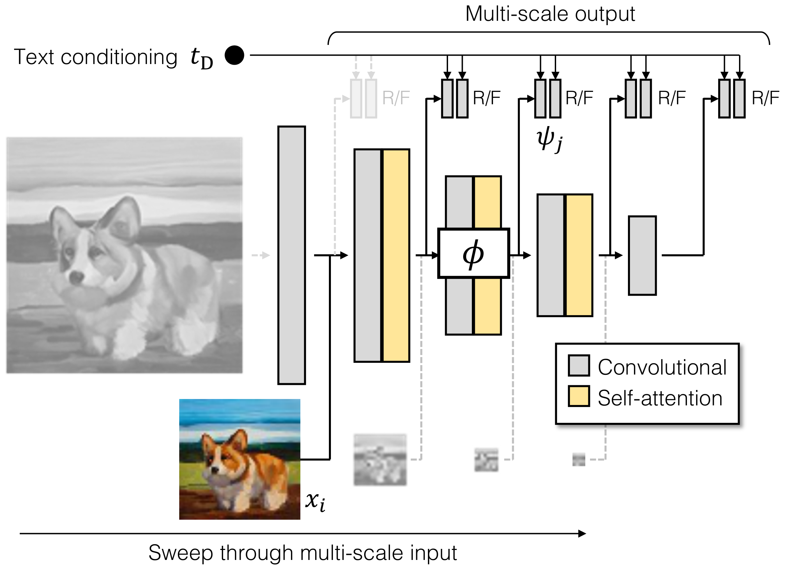

**图 5.** 我们的判别器包含两个分支, 分别处理图像和文本条件 $t_D$. 文本分支以与生成器相似的方式处理文本 ([图 4](#figure-04)). 图像分支接收图像金字塔, 并对每个图像尺度独立进行预测. 此外, 它还会在下采样层的所有后续尺度上进行预测, 因而构成多尺度输入, 多尺度输出 (MS-I/O) 判别器.
**多尺度图像处理.**
我们观察到, 无论提示词如何, 生成器早期的低分辨率层都会变得不活跃, 只使用很小的动态范围. StyleGAN2 [Kar20b] 也观察到这一现象, 并得出结论: 随着模型规模增大, 网络会依赖高分辨率层. 由于恢复包含复杂结构信息的低频部分的性能非常重要, 我们重新设计模型架构, 让训练信号跨越多个尺度.
回顾一下, 生成器会产生一个金字塔 $\{\mathbf{x}_i\}_{i=0}^{L-1}$, 其完整图像 $\mathbf{x}_0$ 位于金字塔底部. MSG-GAN [Kar20c] 通过一次性对整个金字塔进行预测来提升性能, 强制各尺度保持一致. 但是, 在我们的规模化设置中, 这会损害稳定性, 因为它限制了生成器调整初始低分辨率输出.
因此, 我们*独立地*处理金字塔的每一层. 如 [图 5](#figure-05) 所示, 每个层级 $\mathbf{x}_i$ 都会在多个尺度 $i < j \leq L$ 上进行真伪预测. 例如, 完整图像 $\mathbf{x}_0$ 会在 $L=5$ 个尺度上预测, 下一层 $\mathbf{x}_1$ 会在 4 个尺度上预测, 依此类推. 总体而言, 判别器产生 $\frac{L(L+1)}{2}$ 个预测, 在多个尺度上监督多尺度生成.

为了提取不同尺度的特征, 我们定义特征提取器 $\phi_{i\rightarrow j}: \mathbb{R}^{X_i\times X_i\times 3} \rightarrow \mathbb{R}^{X_j^D\times X_j^D\times C_j}$. 实际上, 每个子网络 $\phi_{i\rightarrow j}$ 都是完整 $\phi\triangleq \phi_{0\rightarrow L}$ 的子集, 其中 $i>0$ 表示较晚进入, $j<L$ 表示较早退出. $\phi$ 中的每一层由自注意力和步幅为 2 的卷积组成. 最后一层将空间范围展平为 $1\times 1$ 张量. 输出分辨率为 $\{X_j^D\} = \{32, 16, 8, 4, 1\}$. 这使我们可以将金字塔中的低分辨率图像注入中间层 [Kar18a]. 由于不同层级共享特征提取器, 且新增预测大多在低分辨率上进行, 增加的计算开销是可控的.
**多尺度输入, 多尺度输出的对抗损失.** 总体而言, 我们的训练目标包含判别器损失和我们提出的匹配损失, 用来促使判别器考虑条件信息:

$$
\mathcal{V}_\text{MS-I/O}(G, D) = \sum_{i=0}^{L-1} \sum_{j=i+1}^{L} \mathcal{V}_\text{GAN}(G_i, D_{ij}) + \mathcal{V}_\text{match}(G_i, D_{ij}),
$$
其中, $\mathcal{V}_\text{GAN}$ 是标准的非饱和 GAN 损失 [Goo14a].

为计算判别器输出, 我们训练预测器 $\psi$, 使用文本特征 $\mathbf{t}_\text{D}$ 调制图像特征 $\phi(\mathbf{x})$:

$$
D_{ij}(\mathbf{x}, \mathbf{c}) = \psi_j(\phi_{i\rightarrow j}(\mathbf{x}_i), \mathbf{t}_D) + \text{Conv}_{1\times 1}(\phi_{i\rightarrow j}(\mathbf{x}_i)),
$$
其中, $\psi_j$ 由 4 层 $1\times 1$ 调制卷积实现, $\text{Conv}_{1\times 1}$ 作为跳跃连接加入, 以显式保留无条件预测分支 [Miy18].

**匹配感知损失.** 前面的 GAN 项衡量图像 $\mathbf{x}$ 与条件 $\mathbf{c}$ 的匹配程度, 也衡量图像 $\mathbf{x}$ 的逼真程度, 而不考虑条件. 但是在训练早期, 伪影很明显, 判别器会严重依赖与条件无关的判断, 不愿意考虑条件信息.

为了强制判别器纳入条件信息, 我们将 $\mathbf{x}$ 与随机独立采样的条件 $\hat{\mathbf{c}}$ 匹配, 并将它们作为一个伪造对:

$$
\mathcal{V}_{\text{match}} = \mathbb{E}_{\mathbf{x}, \mathbf{c}, \hat{\mathbf{c}}} \Big[ \log(1 + \exp(D(\mathbf{x}, \hat{\mathbf{c}}))) + \log(1 + \exp(D(G(\mathbf{c}), \hat{\mathbf{c}}))) \Big],
$$
其中, $(\mathbf{x}, \mathbf{c})$ 和 $\hat{\mathbf{c}}$ 分别从 $p_{\text{data}}$ 中采样. 这一损失此前已在文本到图像 GAN 工作 [Ree16, Zha17c] 中探索, 但我们发现, 对来自 $G$ 的生成图像以及真实图像 $\mathbf{x}$ 都施加匹配感知损失, 能明显提升性能 ([表 1](#table-01)).

**CLIP 对比损失.** 我们进一步利用现成的预训练模型作为损失函数 [Sau21, Kum22a, Sun18]. 具体而言, 我们要求生成器产生可被预训练 CLIP 图像编码器和文本编码器 [Rad21] 识别的输出, 即 $\mathcal{E}_\text{img}$ 和 $\mathcal{E}_\text{txt}$, 并使用原本训练它们时采用的对比交叉熵损失.

$$
\mathcal{L}_\text{CLIP} = \mathbb{E}_{\{\mathbf{c}_n\}} \Bigg[ -\log \frac{\exp(\mathcal{E}_\text{img}(G(\mathbf{c}_0))^\top \mathcal{E}_\text{txt}(\mathbf{c}_0))}{\sum_n \exp(\mathcal{E}_\text{img}(G(\mathbf{c}_0))^\top \mathcal{E}_\text{txt}(\mathbf{c}_n))} \Bigg].
$$

其中, $\{\mathbf{c}_n\} = \{\mathbf{c}_0, \dots\}$ 是从训练数据中采样的标题集合.

**视觉辅助对抗损失.** 最后, 我们构建一个以 CLIP 模型为骨干的额外判别器, 称为 Vision-Aided GAN [Kum22a]. 我们冻结 CLIP 图像编码器, 从中间层提取特征, 再用一个包含 $3\times 3$ 卷积层的简单网络处理这些特征, 以进行真伪预测. 我们还像 [公式 3](#equation-03) 中那样通过调制加入条件信息. 为稳定训练, 我们还加入 Projected GAN [Sau21] 提出的固定随机投影层. 为简化表示, 记该损失为 $\mathcal{L}_\text{Vision}(G)$, 省略可学习的判别器参数.

最终目标为 $\mathcal{V}(G, D) = \mathcal{V}_\text{MS-I/O}(G, D) + \mathcal{L}_\text{CLIP}(G) + \mathcal{L}_\text{Vision}(G)$, 各项之间的权重见 [表 A2](#table-07).

### 3.4 基于 GAN 的上采样器
此外, GigaGAN 框架可扩展为基于文本条件的超分辨率模型, 将基础 GigaGAN 生成器输出上采样至 512px 或 2k 分辨率. 我们将流水线分为两个阶段训练, 在相同的计算资源内, 就能容纳容量更高的 64px 基础模型.
在上采样器中, 合成网络被重新布置为不对称 U-Net 架构, 将 64px 输入经 3 个下采样残差块处理, 随后是带注意力层的 6 个上采样残差块, 产生 512px 图像. 相同分辨率处存在跳跃连接, 与 CoModGAN [Zha21o] 类似. 该模型与基础模型使用相同的损失, 此外还针对地面真高分辨率图像使用 LPIPS 感知损失 [Zha18d]. 上采样器不使用 Vision-aided GAN. 训练和推理期间, 我们应用适度高斯噪声增大, 以缩小真实图像与 GAN 生成图像之间的差距. 更多详情请参见 [第 6.3 节](#section-6-3).
与扩散模型相比, 我们的 GigaGAN 框架在超分辨率任务上尤其有效, 因为扩散模型在高分辨率下无法负担与基础模型同样多的采样步骤.LPIPS 回归损失也提供了稳定的学习信号. 我们认为, 我们的 GAN 上采样器可以作为其他生成模型的超分辨率阶段的即插即用替代方案.

## 4 实验

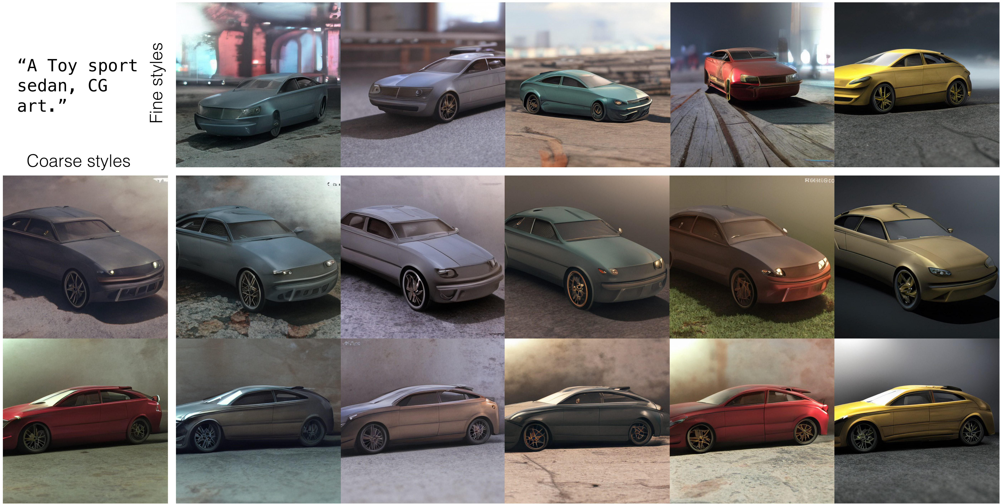

**图 6.** 风格混合. 我们的基于 GAN 的架构保留了解耦的隐空间, 使我们能够将一个样本的粗粒度风格与另一个样本的细粒度风格混合. 所有输出均使用提示词 "A Toy sport sedan, CG art." 生成. 相应的隐码被拼接在一起, 生成风格交换网格.

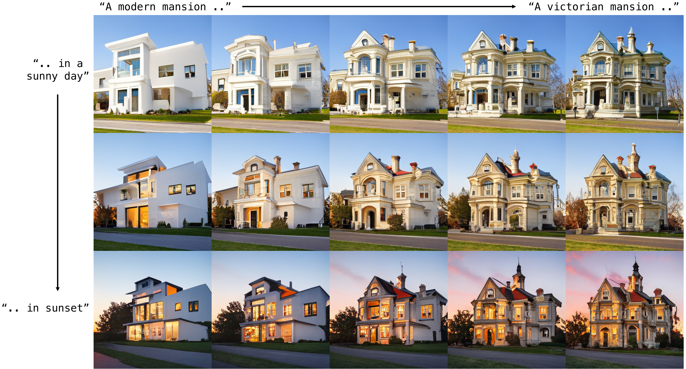

**图 7.** 提示词插值. GigaGAN 支持提示词之间的平滑插值, 如插值网格所示. 四个角使用相同的隐码 $\mathbf{z}$ 但不同的文本提示词生成. 相应的文本嵌入 $\mathbf{t}$ 和风格向量 $\mathbf{w}$ 被插值以创建平滑过渡. 相同的 $\mathbf{z}$ 产生相似的布局. 更精确的控制请参见 [图 8](#figure-08).

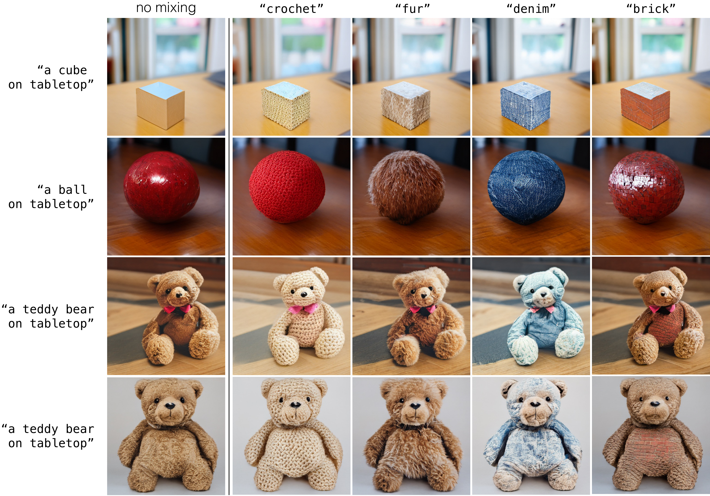

**图 8.** 提示词混合.GigaGAN 保留了解耦的隐空间, 使我们能够将一个样本的粗粒度风格与另一个样本的细粒度风格结合. 此外, GigaGAN 可以直接使用文本提示词控制风格. 这里, 我们使用提示词 "a X on tabletop" 生成四个输出, 如"无混合"列所示. 然后, 我们使用新提示词 "a X with the texture of Y on tabletop"(例如 "a cube with the texture of crochet on tabletop") 重新计算文本嵌入 $\mathbf{t}$ 和风格码 $\mathbf{w}$, 并将其应用于生成器的后半部分层, 实现保留布局的细粒度风格控制. 交叉注意力机制会自动将风格定位到感兴趣的对象.
大规模文本到图像合成任务的系统, 可控评估很困难, 因为大多数现有模型不公开发布. 从头训练一个新模型成本过高, 即使训练代码可用也是如此. 不过, 我们基于现有信息, 将模型与最近的文本到图像模型(如 Imagen [Sah22a], Latent Diffusion Models (LDM) [Rom22], Stable Diffusion [Sta22] 和 Parti [Yu22]) 进行比较, 同时承认训练数据集, 迭代次数, 批次大小和模型规模等方面存在相当大的差异. 除文本到图像结果外, 我们还在 [第 7 节](#section-7) 对 ImageNet 类条件生成进行评估, 以便与其他方法在更受控的环境下进行一对一比较.
定量评估方面, 我们主要使用 Fréchet Inception Distance(FID) [Heu17] 来衡量输出分布的真实性, 并使用 CLIP 分数来评估图像-文本对齐度.
我们进行了五项不同的实验. 首先, 我们通过逐个加入每个技术组件来展示我们的方法的有效性([第 4.2 节](#section-4-2)). 其次, 我们的文本到图像合成结果表明, GigaGAN 的 FID 与 Stable Diffusion (SD-v1.5) [Rom22] 相当, 而生成结果的速度比扩散或自回归模型快几百倍([第 4.3 节](#section-4-3)). 第三, 我们将 GigaGAN 与基于蒸馏的扩散模型 [Men22a] 进行比较, 并表明 GigaGAN 可以比基于蒸馏的扩散模型更快地合成更高质量的图像. 第四, 我们验证了 GigaGAN 上采样器在有条件和无条件超分辨率任务中相比其他上采样器的优势. 最后, 我们展示了我们的大规模 GAN 仍然享有 GAN 的连续且解耦的隐空间操作, 从而实现新的图像编辑模式([第 4.6 节](#section-4-6)).

### 4.1 训练与评估细节
我们基于 StudioGAN PyTorch 库 [Kan22] 实现 GigaGAN, 除非另有说明, 否则遵循带反混叠双三次缩放函数 [Par22c] 的标准 FID 评估协议. 对于文本到图像合成, 我们在 LAION2B-en [Sch22b] 和 COYO-700M [Bye22] 数据集的并集上训练模型, 唯一例外是训练于 Adobe 内部 Stock 图像的 128-to-1024 上采样器模型. 图像-文本对基于 CLIP 分数 [Hes21], 图像分辨率和美学分数 [Sch00] 进行预处理, 与先前的工作 [Sta22] 类似. 我们使用 CLIP ViT-L/14 [Rad21] 作为预训练文本编码器, 并使用 OpenCLIP ViT-G/14 [Ilh21] 计算 CLIP 分数 [Hes21], [表 1](#table-01) 除外. 所有模型均在 A100 GPU 上训练和评估. 更多训练与评估细节见 [第 6 节](#section-6).

### 4.2 提议组件的有效性

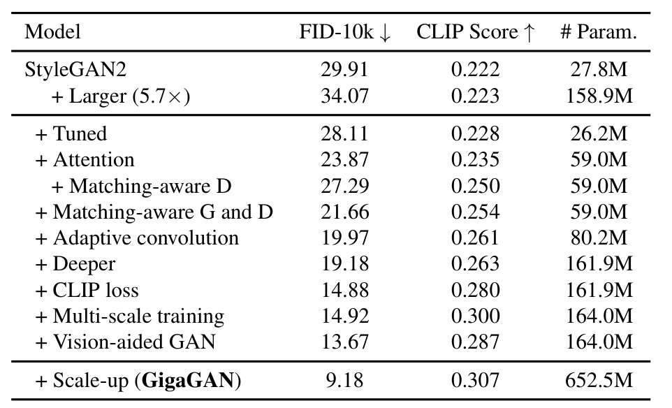

**表 1.** 64px 文本到图像合成的消融研究. 为评估我们组件的有效性, 我们从用于文本条件化的修改版 StyleGAN 开始. 虽然增加网络宽度没有显示出令人满意的改进, 但每次添加我们的贡献都会持续改进指标. 最后, 我们增加网络宽度并扩大训练规模, 以达到最终模型. 所有消融模型均以 256 的批次大小训练 100k 步, Scale-up 行除外(1350k 次迭代, 使用较大的批次大小).CLIP 分数使用 CLIP ViT-B/32 [Rad21] 计算.
首先, 我们通过 [表 1](#table-01) 的消融研究展示我们表述的有效性. 我们通过向 StyleGAN2 添加文本条件化并根据 StyleGAN-XL 的发现调整配置来建立基线. 我们首先直接增加此基线的模型大小, 但发现这并不能改善 FID 和 CLIP 分数. 然后, 我们逐个添加我们的组件, 并观察到它们始终改善性能. 特别是, 我们的模型更具可扩展性, 因为最终表述的更高容量版本能够实现更好的性能.

### 4.3 文本到图像合成
接着, 我们通过将基础生成器和上采样器的容量分别提高到 652.5M 和 359.1M 来训练更大的模型. 这使得 GAN 模型的总参数数量达到前所未有的 1.0B. [表 2](#table-02) 将我们端到端流水线的性能与各种文本到图像生成模型 [Ram21, Nic22, Rom22, Ram22, Sah22a, Bal22, Yu22, Zho22d, Sta22, Cha23e] 进行比较. 请注意, 训练数据集, 预训练文本编码器甚至图像分辨率等方面存在差异. 例如, GigaGAN 最初合成 512px 图像, 在评估前将其调整为 256px.

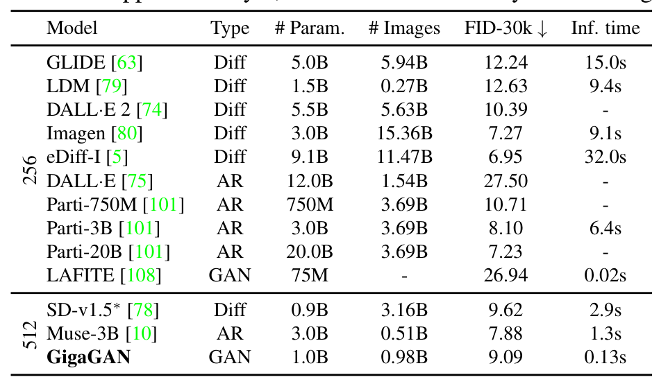

**表 2.** 使用 30k 样本对 256px 文本到图像生成进行 COCO 零射 FID 比较.LDM [Rom22], Stable Diffusion [Sta22] 和 Parti [Yu22] 提供与我们规模相当的模型.[Base] 和 [Upsampler] 表示每个组件的模型大小.[Steps] 表示模型在推理时的前向传播次数.[MAC] 测量乘累加运算次数.
[表 2](#table-02) 表明, GigaGAN 的 FID 低于 DALL$\cdot$E 2 [Ram22], Stable Diffusion [Sta22] 和 Parti-750M [Yu22]. 虽然我们的模型可以优化以比现有模型更好地匹配真实图像的特征分布, 但生成图像的质量不一定更好 (更多样品请参见 [第 8 节](#section-8)). 我们承认, 这可能代表 COCO2014 数据集上的零射 FID 的一个边缘情况, 并建议需要进一步研究更好的评估指标来改进文本到图像模型. 尽管如此, 我们强调, GigaGAN 是第一个能够从任意文本提示词合成有前景图像的 GAN 模型, 并且与其他文本到图像模型具有竞争性的零射 FID.

### 4.4 与蒸馏扩散模型的比较
虽然 GigaGAN 比上述扩散模型快至少 20 倍, 但已有改进扩散模型推理速度的努力. 我们将 GigaGAN 与逐步蒸馏的 Stable Diffusion (SD-distilled) [Men22a] 进行比较.

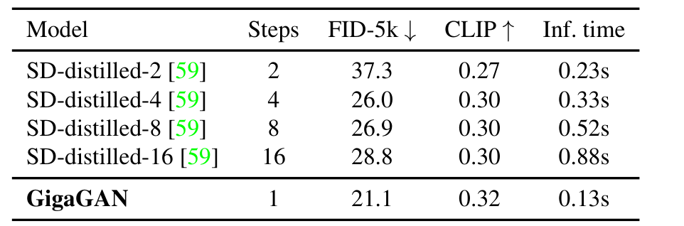

**表 3.** 与蒸馏扩散模型的比较表明, 对于快速推理, GigaGAN 达到的 FID 和 CLIP 分数优于逐步蒸馏的扩散模型 [Men22a]. 由于 GigaGAN 在一次前向传播中生成输出, 推理速度仍然更快. 评估设置与 [表 2](#table-02) 不同, 以匹配 SD-distilled 的协议 [Men22a].
[表 3](#table-03) 表明, GigaGAN 仍然比蒸馏的 Stable Diffusion 快, 同时 FID 和 CLIP 分数分别达到更好的 21.1 和 0.32. 我们遵循 SD-distilled [Men22a] 的评估协议, 在 COCO2017 数据集 [Lin14a] 上报告 FID 和 CLIP 分数, 其中图像调整为 512px.

### 4.5 大规模图像合成的超分辨率
我们单独评估 GigaGAN 上采样器的性能. 评估包含两部分. 首先, 我们将 GigaGAN 与几种常用的上采样器进行比较. 对于基于文本条件的上采样任务, 我们组合 Stable Diffusion [Sta22] 4x Upscaler 和 2x Latent Upscaler 来建立一个 8x 上采样模型 (SD Upscaler). 我们还使用无条件的 Real-ESRGAN [Wan21i] 作为另一个基线.

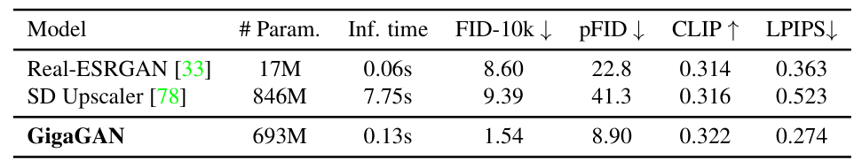

**表 4.** 基于文本条件的 128→1024 超分辨率, 在随机 10K LAION 样本上, 与无条件 Real-ESRGAN [Wan21i] 和 Stable Diffusion Upscaler [Sta22] 进行比较.GigaGAN 保持了基于 GAN 模型的快速速度, 同时实现了更好的 FID, patch-FID [Cha22c], CLIP 分数和 LPIPS [Zha18d].
[表 4](#table-04) 在 LAION 数据集的随机 10K 图像上测量了上采样器的性能, 并表明我们的 GigaGAN 上采样器在现实性分数 (FID 和 patch-FID [Cha22c]), 文本对齐(CLIP 分数) 和接近地面真 (LPIPS [Zha18d]) 方面显著优于其他上采样器. 此外, 为了进行更受控的比较, 我们在 ImageNet 无条件超分辨率任务上训练模型, 并将其性能与基于扩散的模型 (包括 SR3 [Sah22b] 和 LDM [Rom22]) 进行比较.

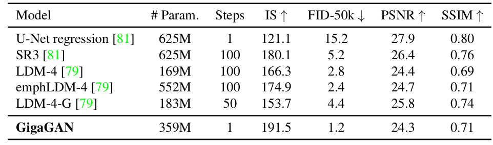

**表 5.** ImageNet 上的无条件 64→256 超分辨率. 我们将我们的方法与使用像素回归损失训练的简单 U-Net(U-Net 回归) 以及基于扩散的方法(SR3 [Sah22b] 和 LDM [Rom22]) 进行比较. 我们的方法在由 Inception Score (IS) 和 FID 表示的现实性分数上达到更高的分数.
如 [表 5](#table-05) 所示, GigaGAN 在一次前向传播中达到最佳 IS 和 FID 分数.

### 4.6 可控图像合成
StyleGAN 众所周知拥有一个用于图像操作的线性隐空间, 称为 $\mathcal{W}$-空间. 同样, 我们使用风格向量 $\mathbf{w}$ 进行粗粒度和细粒度风格交换. 与 StyleGAN 的 $\mathcal{W}$-空间类似, [图 6](#figure-06) 表明 GigaGAN 保持了解耦的 $\mathcal{W}$-空间, 暗示 StyleGAN 的现有隐操作技术可以迁移到 GigaGAN. 此外, 我们的模型在 $\mathcal{W}$ 之前拥有另一个文本嵌入 $\mathbf{t} = [\mathbf{t}_\text{local}, \mathbf{t}_\text{global}]$ 的隐空间, 我们探索了其在图像合成中的潜力. 如 [图 8](#figure-08) 所示, 解耦的风格操作可以通过文本输入进行控制. 具体来说, 我们可以使用不同的提示词计算文本嵌入 $\mathbf{t}$ 和风格码 $\mathbf{w}$, 并将其应用于生成器的不同层. 这样, 我们不仅获得了粗粒度和细粒度的风格解耦, 还在风格空间中获得了基于提示词的直观操纵.

## 5 讨论与局限性

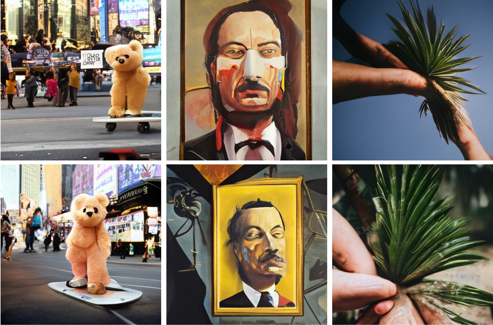

**图 9.** 失败案例. 我们的输出与 DALL$\cdot$E 2 使用相同的提示词. 每一列分别以 "a teddy bear on a skateboard in Times Square", "a Vibrant portrait painting of Salvador Dali with a robotic half face"和 "A close up of a handpalm with leaves growing from it"为条件. 与 DALL$\cdot$E 2 等生产级模型相比, 我们的模型在现实性和构图性方面存在局限性. 未经过筛选的比较请参见附录 8.
我们的实验对 GAN 的可扩展性给出了明确答案:我们的新架构可以扩展到能够实现文本到图像合成的模型规模. 然而, 我们结果的视觉质量尚未可与 DALL$\cdot$E 2 等生产级模型相比. [图 9](#figure-09) 显示了几个案例, 在其中, 我们的方法在与 DALL$\cdot$E 2 相比时无法生成高质量结果, 就论文中使用的相同输入提示词而言, 在照片级真实感和文本到图像对齐方面都不足.
尽管如此, 我们测试了远超朴素方法所能实现的能力, 并与在类似资源下训练的自回归和扩散模型取得了具有竞争力的结果, 同时快几个数量级并支持隐插值和风格化. 我们的 GigaGAN 架构为大规模生成模型打开了一个全新的设计空间, 并重新带来了在转向自回归和扩散模型后变得困难的关键编辑能力. 我们预期随着模型规模增大, 性能会有所提高, 如 [表 1](#table-01) 所示.
## 致谢

我们感谢 Simon Niklaus, Alexandru Chiculita 和 Markus Woodson 构建了分布式训练流水线. 我们感谢 Nupur Kumari, Gaurav Parmar, Bill Peebles, Phillip Isola, Alyosha Efros 和 Joonghyuk Shin 提供有益的意见. 我们还要感谢 Chenlin Meng, Chitwan Saharia 和 Jiahui Yu 就其出色的工作回答了许多问题. 我们感谢 Kevin Duarte 关于 4K 以上上采样的讨论. 这项工作部分是在 Minguk Kang 于 Adobe Research 实习期间完成的.Minguk Kang 和 Jaesik Park 由韩国政府(MSIT) 资助的 IITP 赠款支持(POSTECH GSAI: 2019-0-01906 和 Image restoration: 2021-0-00537).
我们首先在 [第 6 节](#section-6) 提供训练与评估细节. 然后, 我们分享 ImageNet 上的结果, 并在 [第 7 节](#section-7) 与现有方法进行可视化比较. 最后, 在 [第 8 节](#section-8) 中, 我们展示更多文本到图像合成结果, 并将其与 LDM [Rom22], Stable Diffusion [Sta22] 和 DALL$\cdot$E 2 [Ram22] 进行比较.

## 6 训练与评估细节

### 6.1 文本到图像合成

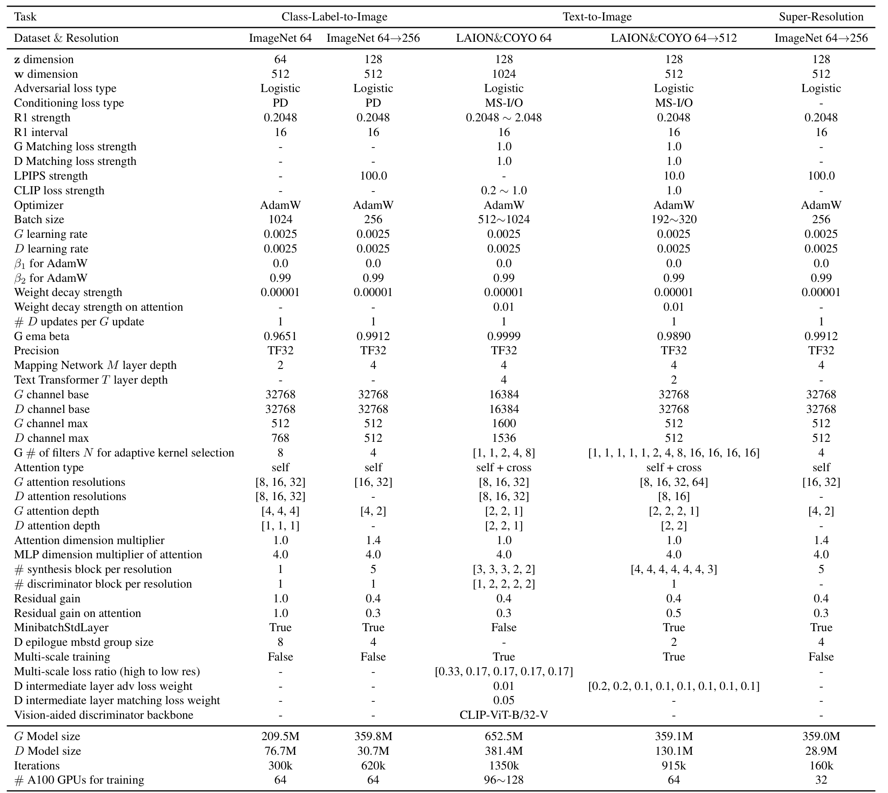

**表 A2.** GigaGAN 训练超参数. 我们将 Projection Discriminator [Miy18] 记为 PD, 将 R1 正则化 [Mes18] 记为 R1, 将 Learned Perceptual Image Patch Similarity [Zha18d] 记为 LPIPS, 将带解耦权重衰减的 Adam [Los19] 记为 AdamW, 将预训练的 VIT-B/32 视觉编码器 [Rad21] 记为 CLIP-ViT-B/32-V.
我们在 LAION2B-en [Sch22b] 和 COYO-700M [Bye22] 的合并数据集上使用 PyTorch 框架 [Pas19a] 训练 GigaGAN. 训练时, 我们进行中心裁剪, 得到一张边长等于原图较短边的正方形图像. 然后, 使用支持抗锯齿的 PIL.LANCZOS [Tur90] 缩放器将图像调整到 $64\times64$ 分辨率 [Par22c]. 我们根据图像分辨率 ($\geq512$), CLIP 分数 ($>0.3$) [Hes21] 和美学分数 ($>5.0$) [Sch00] 筛选训练图像文本对, 并移除带水印的图像. 我们根据 [表 A2](#table-07) 第四列和第五列所示的配置训练 GigaGAN.
评估时, 我们按照 Imagen [Sah22a] 的描述, 使用 COCO2014 [Lin14a] 验证集中的 40,504 张真实图像和 30,000 张生成图像. 我们进行中心裁剪, 再使用 clean-fid [Par22c] 推荐的 PIL.BICUBIC 将真实图像和生成图像调整到 $299\times299$ 分辨率. FID 使用 clean-fid 库 [Par22c] 计算.

### 6.2 ImageNet 上的类条件图像合成
为了与其他先进生成模型公平比较, 我们遵循 Kang *et al*. [Kan22] 提出的训练和评估协议. 我们使用与文本到图像实验相同的裁剪策略处理训练和评估图像. 然后, 使用支持抗锯齿的 PIL.LANCZOS [Tur90] 缩放器将图像调整到目标分辨率 ($64\times64$ 用于基础生成器, $256\times256$ 用于超分辨率堆栈) [Par22c]. 我们使用预处理后的训练图像, 根据 [表 A2](#table-07) 第二列和第三列所示的配置训练 GigaGAN.
评估时, 我们使用 PIL.BICUBIC 缩放器将真实图像和生成图像上采样到 $299\times299$ 分辨率. 为计算 FID, 我们在不使用截断技巧的情况下生成 50k 张图像 [Kar19, Bro19], 并将这些图像与完整训练数据集进行比较. 我们使用 StudioGAN [Kan22] 提供的真实图像预计算特征, 并使用 50k 张生成图像计算 Precision & Recall [Kyn19].

### 6.3 超分辨率结果
模型训练时, 我们按照 [第 6.2 节](#section-6-2) 的方式预处理 ImageNet, 并使用 [表 A2](#table-07) 最后一列的配置. 为了公平地将我们的模型与 SR3 [Sah22b] 和 LDM 进行比较, 我们遵循 SR3 和 LDM 论文中描述的评估流程.

## 7 ImageNet 实验

### 7.1 定性结果
我们在 ImageNet 数据集 [Den09a] 上训练类条件 GAN, 使用相同的数据集和评估流水线可以进行直接比较. 我们的 GAN 不使用预训练 ImageNet 分类器, 但仍达到与先进生成模型相当的生成质量, 而预训练分类器会对自动化指标产生有利影响 [Kyn22]. 我们在模型中使用 L2 自注意力, 风格自适应卷积核和匹配感知损失, 并使用更宽的合成网络训练批次大小为 1024 的基础 64px 模型. 此外, 我们还训练一个独立的 256px 类条件上采样器模型, 并通过端到端微调阶段将两者结合.

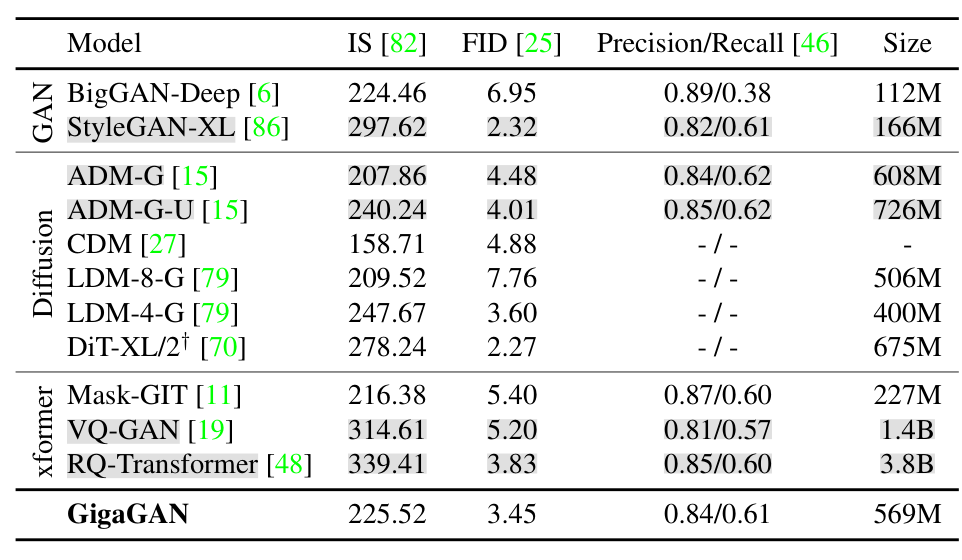

**表 A1.** ImageNet 256px 类条件合成. 我们的方法与大型扩散模型和 Transformer 模型相比具有竞争力. 阴影标出的方法在训练或推理时使用预训练 ImageNet 分类器, 这可能会对自动化指标产生有利影响 [Kyn22].
[表 A1](#table-06) 表明, 我们的方法能够生成高保真图像.

### 7.2 定量结果
我们在 [图 A1](#figure-10) 和 [图 A2](#figure-11) 中给出 ADM-G-U, LDM, StyleGAN-XL [Sau22] 和 GigaGAN 的可视化结果. 尽管 StyleGAN-XL 的 FID 最低, 但其视觉质量似乎不如 ADM 和 GigaGAN. StyleGAN-XL 难以合成整体图像结构, 因而生成的图像不够逼真. 相比之下, GigaGAN 似乎比 StyleGAN-XL 更擅长合成整体结构, 并能忠实捕捉细粒度细节, 例如帝王蝶的翅膀纹理和北极狐的白色毛发. 与 GigaGAN 相比, ADM-G-U 合成的图像结构更合理, 但缺少上述细粒度细节.

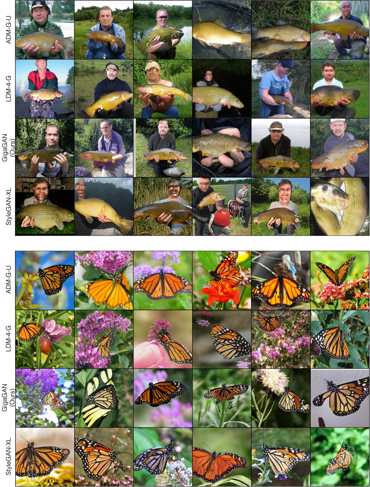

**图 A1.** 来自 ADM-G-U [Dha21], LDM-4-G [Rom22], GigaGAN (本文方法) 和 StyleGAN-XL [Sau22] 的未经筛选图像 (上方为 Tench, 下方为 Monarch). 各生成模型的 FID 分别为 4.01,3.60,3.45 和 2.32.

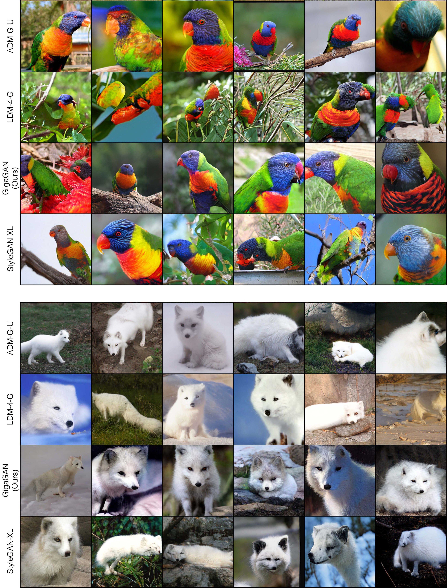

**图 A2.** 来自 ADM-G-U [Dha21], LDM-4-G [Rom22], GigaGAN (本文方法) 和 StyleGAN-XL [Sau22] 的未经筛选图像 (上方为 Lorikeet, 下方为 Arctic fox). 各生成模型的 FID 分别为 4.01,3.60,3.45 和 2.32.

## 8 文本到图像合成结果

### 8.1 推理时的截断技巧
与 LDM 等扩散模型使用的分类器引导 [Dha21] 和无分类器引导 [Ho22d] 类似, 我们的 GAN 模型在推理时也可以使用截断技巧 [Bro19, Kar19].
$$
\mathbf{w_{\text{trunc}}} = \text{lerp}(\mathbf{w_\text{mean}}, \mathbf{w}, \psi),
$$
其中, $\mathbf{w_\text{mean}}$ 是整个数据集上 $\mathbf{w}$ 的均值, 可以预先计算. 截断技巧本质上是将隐向量插值到分布均值, 以使输出更典型, 从而在多样性和保真度之间进行权衡. 当 $\psi = 1.0$ 时, 不使用 $\mathbf{w_\text{mean}}$, 因而没有截断. 当 $\psi = 0.0$ 时, $\mathbf{w}$ 会塌缩到均值, 多样性随之丢失.
无条件情况下应用截断技巧很直接, 但如何将它用于文本条件图像生成并不明确. 我们发现, 同时将隐向量向整个分布的均值以及文本提示条件下的 $\mathbf{w}$ 均值插值, 可以得到理想结果.
$$
\mathbf{w_{\text{trunc}}} = \text{lerp}(\mathbf{w_{\text{mean}, \mathbf{c}}}, \text{lerp}( \mathbf{w_\text{mean}}, \mathbf{w}, \psi ), \psi ),
$$
其中, $\mathbf{w}_{\text{mean}, \mathbf{c}}$ 可以在推理时使用同一个 $\mathbf{c}$ 对 $\mathbf{w} = M(\mathbf{z}, \mathbf{c})$ 采样 16 次, 再取平均得到. 由于映射网络 $M$ 相比合成网络的计算量很小, 这一操作的额外开销可以忽略. 当 $\psi = 1.0$ 时, $\mathbf{w_{\text{trunc}}}$ 变为 $\mathbf{w_{\text{trunc}}} = \mathbf{w}$, 即不进行截断. [图 A4](#figure-13) 展示了文本条件截断技巧的效果.
从定量角度看, 截断的效果类似于扩散模型的引导技术. 如 [图 A3](#figure-12) 所示, 截断越强, CLIP 分数越高, 同时由于多样性降低, FID 会升高.

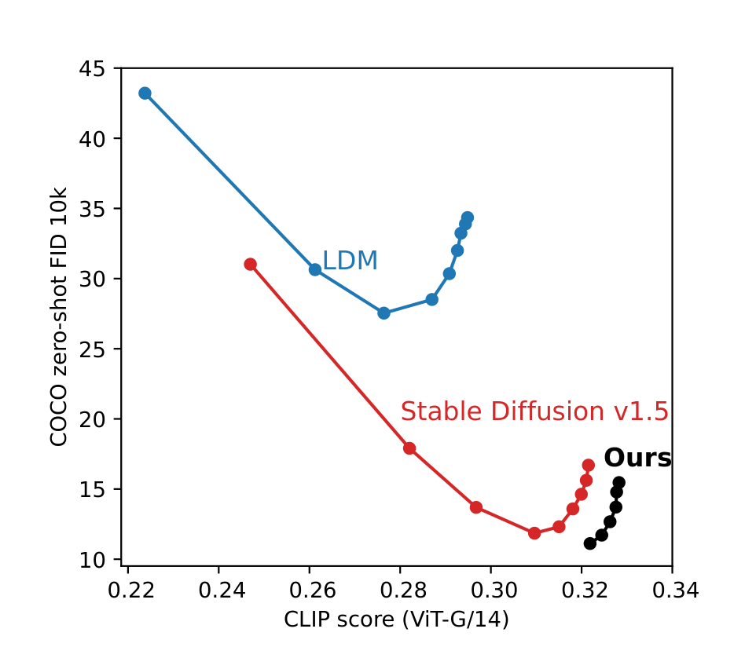

**图 A3.** 我们考察截断值 [1.0, 0.9, 0.8, 0.7, 0.6, 0.5] 对 FID 和 CLIP 分数的影响, 并将它们与两个公开的大规模扩散模型的 FID-CLIP 分数曲线一起可视化, 这两个模型为 LDM 和 Stable Diffusion. 可以看到, 截断越强, CLIP 分数越高, 但代价是多样性降低, 这由更高的 FID 表示. 扩散模型的引导值为 [1.0, 1.25, 1.5, 1.75, 2, 4, 6, 8, 10].

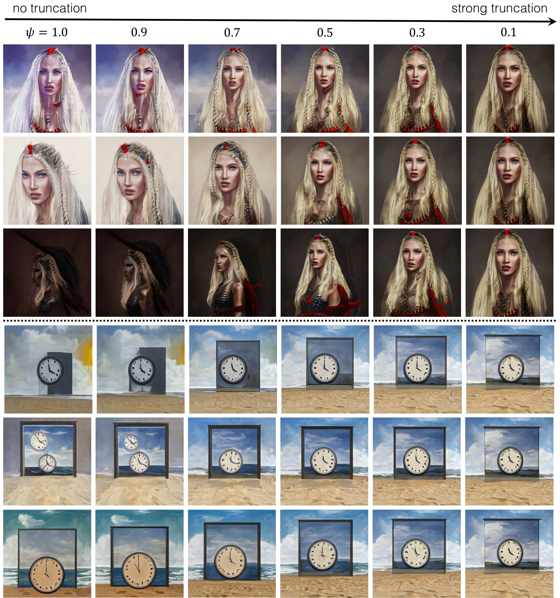

**图 A4.** 我们的截断技巧的视觉效果. 我们将截断值 $\psi$ 从 1.0 开始降低, 展示截断的影响. 我们展示六个示例输出, 使用文本提示 "digital painting of a confident and severe looking northern war goddess, extremely long blond braided hair, beautiful blue eyes and red lips." 和 "Magritte painting of a clock on a beach.". 在 1.0 (不截断) 时, 多样性很高, 但对齐度不理想. 随着截断增强, 文本图像对齐改善, 代价是多样性下降. 我们发现, 0.8 到 0.7 之间的截断值效果最好.

### 8.2 与扩散模型的比较
最后, 我们展示模型的随机采样结果, 并与公开的扩散模型 LDM [Rom22], Stable Diffusion [Sta22] 和 DALL$\cdot$E 2 [Ram22] 进行比较.

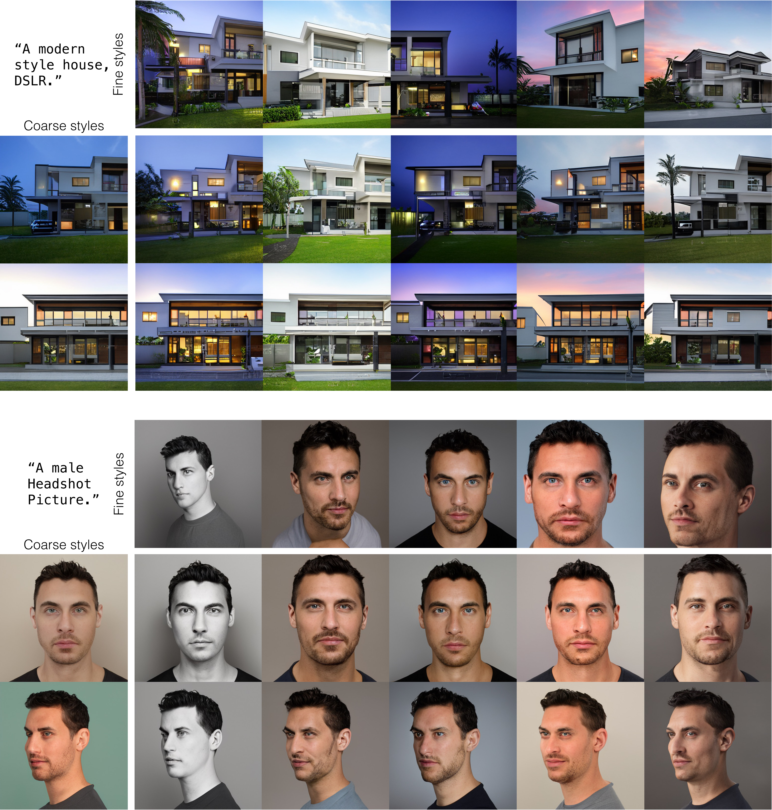

**图 A5.** 风格混合. GigaGAN 保持了解耦的隐空间, 可以将一个样本的粗粒度风格与另一个样本的细粒度风格混合. 将相应的隐码拼接在一起, 生成风格交换网格. 输出使用相同提示词和不同隐码生成.

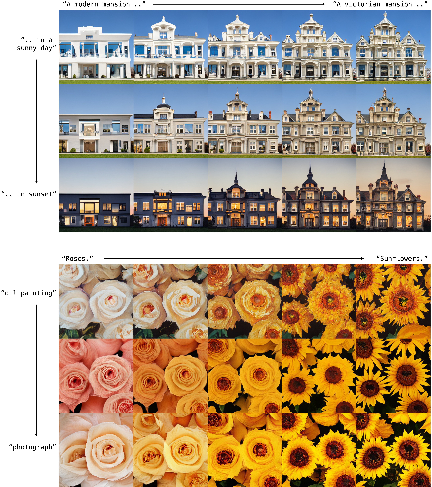

**图 A6.** 提示词插值. 如插值网格所示, GigaGAN 支持提示词之间的平滑插值. 四个角使用相同的隐码和不同的文本提示词生成. 对应的文本嵌入和风格向量被插值, 以创建平滑过渡. 相同的隐码会产生相似的布局.

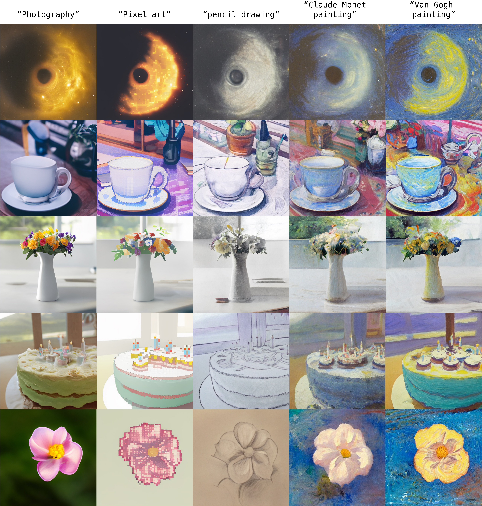

**图 A7.** 提示词混合. GigaGAN 可以直接使用文本提示词控制风格. 这里, 我们使用提示词 "Photography of X" 生成五个输出, 如"Photography"列所示. 然后, 我们使用新提示词 "Y of X" 重新计算文本嵌入 $\mathbf{t}$ 和风格码 $\mathbf{w}$, 例如 "Van Gogh painting of the black hole in the space", 并将其应用于生成器的后半部分层, 实现保持布局的风格控制. 交叉注意力机制会自动将风格定位到感兴趣的对象. 我们按从上到下的顺序使用以下提示词: (1) the black hole in the space. (2) a teacup on the desk. (3) a table top with a vase of flowers on it. (4) a birthday cake. (5) a beautiful flower. 我们发现, 基于提示词的风格迁移仅适用于单一且简单的对象图像.

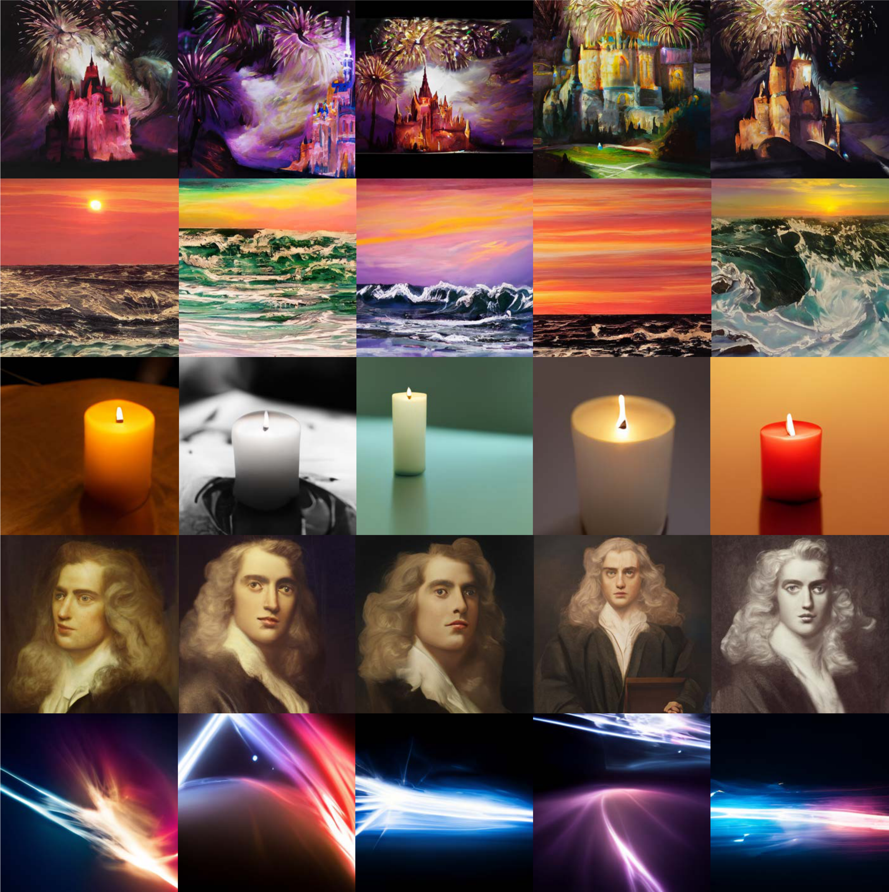

**图 A8.** 使用 GigaGAN 合成图像的多样性. 对给定提示词, GigaGAN 可以生成多样化图像. 我们按从上到下的顺序使用以下提示词: (1) Majestic castle and fireworks, art work, oil painting, 2k. (2) Oil-painting depicting a sunset over the sea with waves. (3) A burning candle with tho wicks, detailed photo, studio lighting. (4) Portrait of Isaac Newton, long hair. (5) An abstract representation of the speed of light.

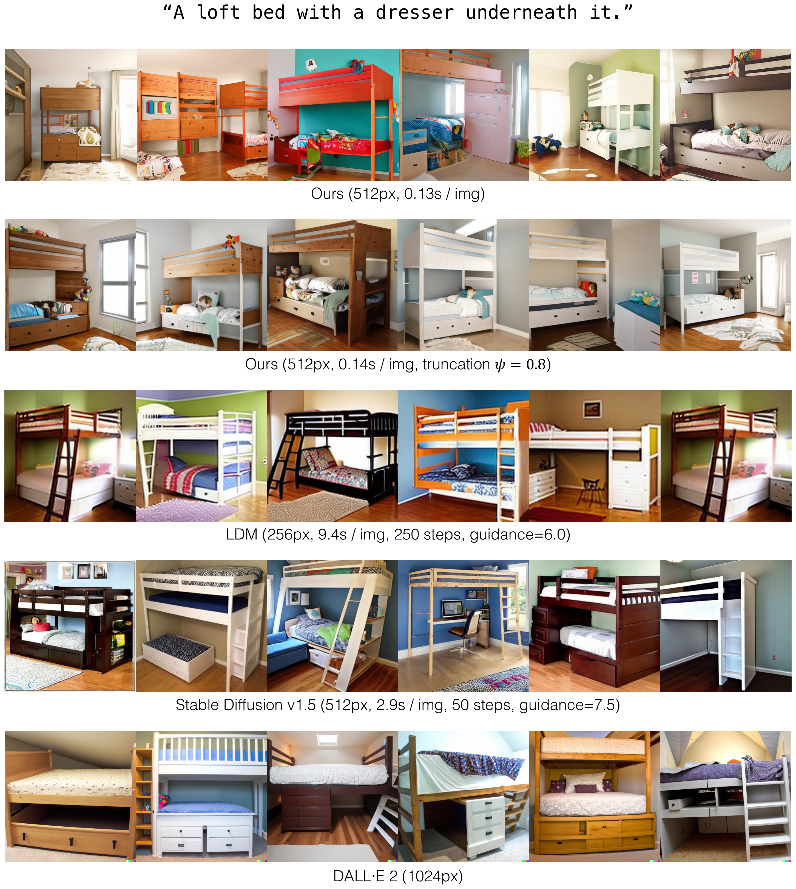

**图 A9.** 使用提示词 "A loft bed with a dresser underneath it" 生成的模型, Latent Diffusion Model [Rom22], Stable Diffusion [Sta22] 和 DALL$\cdot$E 2 [Ram22] 的随机输出. 我们展示模型的两个版本, 一个不使用截断, 另一个使用截断. 我们的模型速度比扩散模型快. 但我们观察到, 它在结构连贯性方面落后, 例如床架腿的数量. 对 LDM 和 Stable Diffusion, 我们分别使用 DDIM / PLMS [Liu22h] 的 250 和 50 个采样步. 对 DALL$\cdot$E 2, 我们使用官方 DALL$\cdot$E 服务 [Dal22] 生成图像.

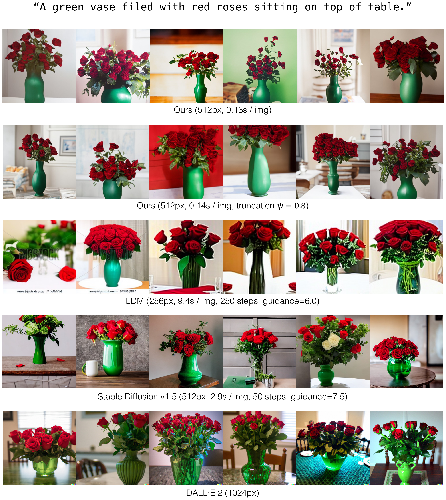

**图 A10.** 使用提示词 "A green vase filed with red roses sitting on top of table" 生成的模型, Latent Diffusion Model [Rom22], Stable Diffusion [Sta22] 和 DALL$\cdot$E 2 [Ram22] 的随机输出. 我们展示模型的两个版本, 一个不使用截断, 另一个使用截断. 两种情况下, 我们的模型都比扩散模型快. 但我们观察到, 它在结构连贯性方面落后, 例如花瓶的对称性. 对 LDM 和 Stable Diffusion, 我们分别使用 DDIM / PLMS [Liu22h] 的 250 和 50 个采样步. 对 DALL$\cdot$E 2, 我们使用官方 DALL$\cdot$E 服务 [Dal22] 生成图像.

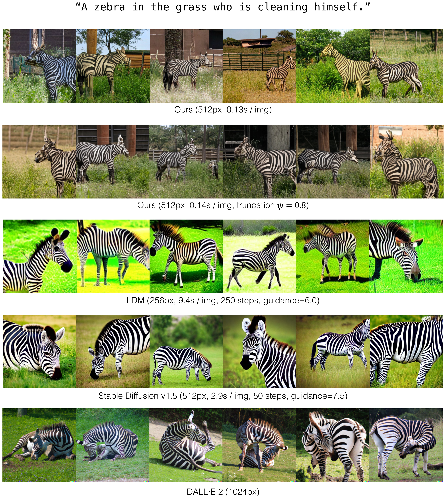

**图 A11.** 使用提示词 "A zebra in the grass who is cleaning himself" 生成的模型, Latent Diffusion Model [Rom22], Stable Diffusion [Sta22] 和 DALL$\cdot$E 2 [Ram22] 的随机输出. 我们展示模型的两个版本, 一个不使用截断, 另一个使用截断. 但我们观察到, 它在细节方面落后, 例如眼睛位置的精确条纹图案. 对 LDM 和 Stable Diffusion, 我们分别使用 DDIM / PLMS [Liu22h] 的 250 和 50 个采样步. 对 DALL$\cdot$E 2, 我们使用官方 DALL$\cdot$E 服务 [Dal22] 生成图像.

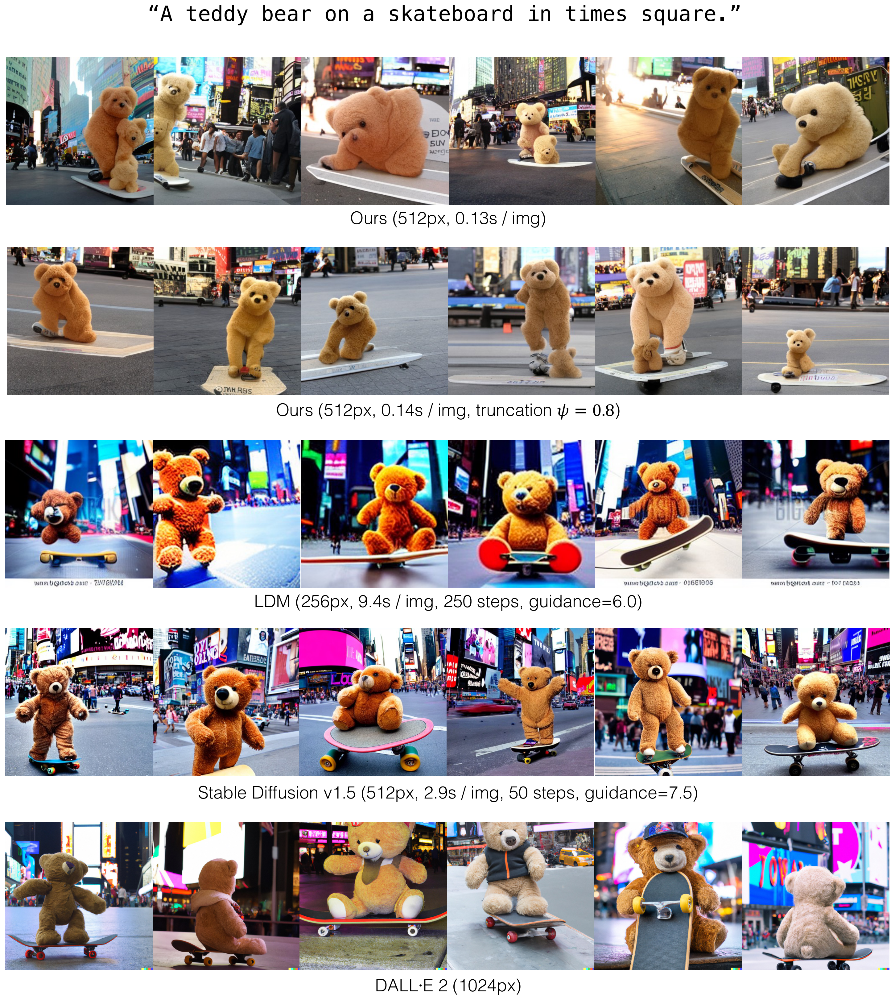

**图 A12.** 使用提示词 "A teddy bear on a skateboard in times square" 生成的模型, Latent Diffusion Model [Rom22], Stable Diffusion [Sta22] 和 DALL$\cdot$E 2 [Ram22] 的随机输出. 我们展示模型的两个版本, 一个不使用截断, 另一个使用截断. 但我们观察到, 它在细节方面落后, 例如滑板的确切形状. 对 LDM 和 Stable Diffusion, 我们分别使用 DDIM / PLMS [Liu22h] 的 250 和 50 个采样步. 对 DALL$\cdot$E 2, 我们使用官方 DALL$\cdot$E 服务 [Dal22] 生成图像.

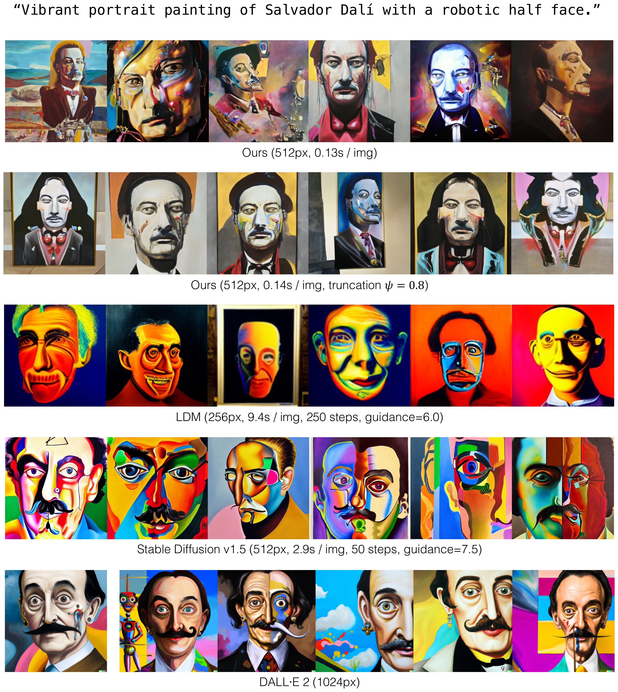

**图 A13.** 使用提示词 "Vibrant portrait painting of Salvador Dalí with a robotic half face" 生成的模型, Latent Diffusion Model [Rom22], Stable Diffusion [Sta22] 和 DALL$\cdot$E 2 [Ram22] 的随机输出. 我们展示模型的两个版本, 一个不使用截断, 另一个使用截断. 但我们观察到, 它在结构细节方面落后, 例如眼睛形状的细节. 对 LDM 和 Stable Diffusion, 我们分别使用 DDIM / PLMS [Liu22h] 的 250 和 50 个采样步. 对 DALL$\cdot$E 2, 我们使用官方 DALL$\cdot$E 服务 [Dal22] 生成图像.

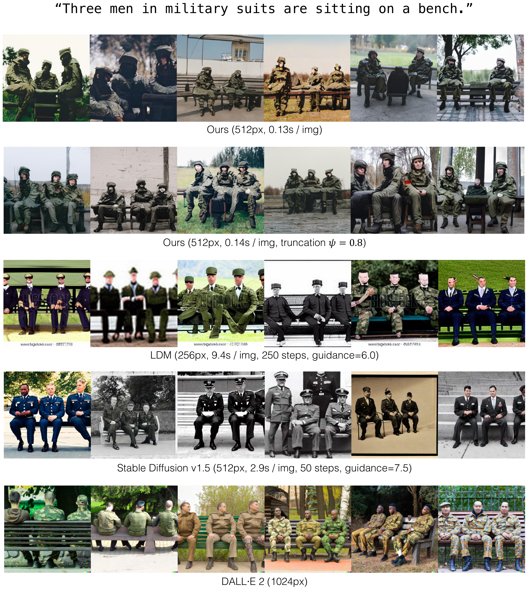

**图 A14.** 使用提示词 "Three men in military suits are sitting on a bench" 生成的模型, Latent Diffusion Model [Rom22], Stable Diffusion [Sta22] 和 DALL$\cdot$E 2 [Ram22] 的随机输出. 我们展示模型的两个版本, 一个不使用截断, 另一个使用截断. 但我们观察到, 它在面部表情和着装细节方面落后. 对 LDM 和 Stable Diffusion, 我们分别使用 DDIM / PLMS [Liu22h] 的 250 和 50 个采样步. 对 DALL$\cdot$E 2, 我们使用官方 DALL$\cdot$E 服务 [Dal22] 生成图像.

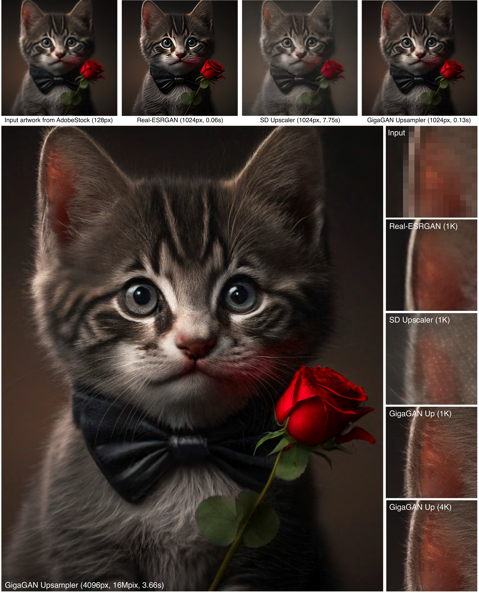

**图 A15.** 我们基于 GAN 的上采样器可以作为许多文本到图像模型的上采样器, 这些模型通常以 64px 或 128px 等低分辨率生成初始输出. 我们在一张低分辨率 128px 艺术图像上应用 8$\times$ 超分辨率模型, 使用提示词 "Portrait of a kitten dressed in a bow tie. Red Rose. Valentine’s day.", 得到 1K 输出. 随后可以再次应用该模型, 生成超过 4K 的图像. 我们将本模型与 Stable Diffusion 的文本条件上采样器 [Sta22] 以及无条件的 Real-ESRGAN [Wan21i] 进行比较. 建议放大图像, 以比较 1K 和 4K 的输出.

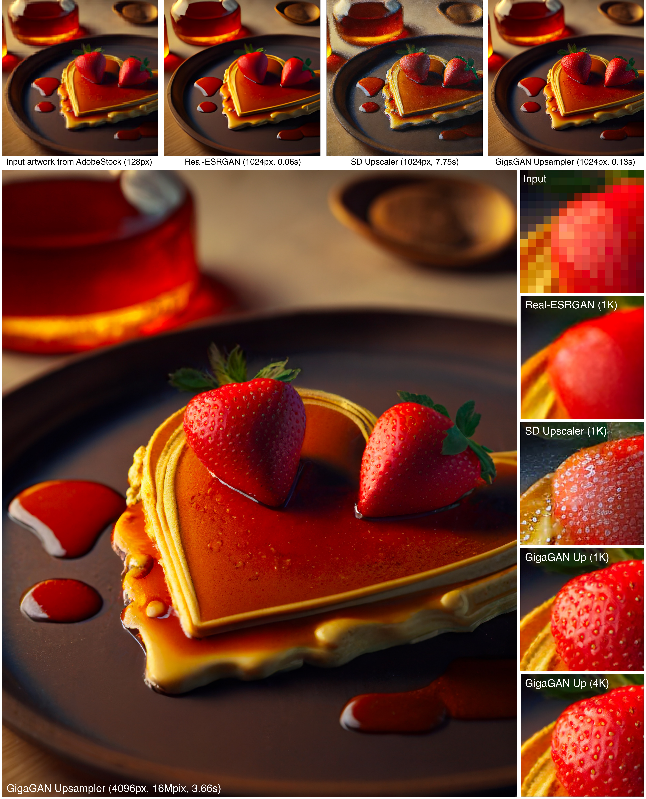

**图 A16.** 我们基于 GAN 的上采样器可以作为许多文本到图像模型的上采样器, 这些模型通常以 64px 或 128px 等低分辨率生成初始输出. 我们在一张低分辨率 128px 艺术图像上应用 8$\times$ 超分辨率模型, 使用提示词 "Heart shaped pancakes with honey and strawberry for Valentine’s Day", 得到 1K 输出. 随后可以再次应用该模型, 生成超过 4K 的图像. 我们将本模型与 Stable Diffusion 的文本条件上采样器 [Sta22] 以及无条件的 Real-ESRGAN [Wan21i] 进行比较. 建议放大图像, 以比较 1K 和 4K 的输出.

**图 A17.** 我们基于 GAN 的上采样器也可以通过提供合适的图像描述, 作为真实图像的现成超分辨率模型, 并支持较大的放大倍数. 我们在一张低分辨率 128px 照片上应用文本条件的 8$\times$ 超分辨率模型, 使用提示词 "An elephant spraying water with its trunk", 得到 1K 输出. 随后可以再次应用该模型, 生成超过 4K 的图像. 我们将本模型与 Stable Diffusion 的文本条件上采样器 [Sta22] 以及无条件的 Real-ESRGAN [Wan21i] 进行比较. 建议放大图像, 以比较 1K 和 4K 的输出.
