> [Robin Rombach](https://ommer-lab.com/) [+equal-contribution], [Andreas Blattmann](https://andreasbl.com/), [Dominik Lorenz](https://www.linkedin.com/in/dominik-lorenz/), [Patrick Esser](https://www.linkedin.com/in/patrick-esser/), 和 [Björn Ommer](https://ommer-lab.com/). [High-Resolution Image Synthesis with Latent Diffusion Models](https://arxiv.org/abs/2112.10752), 首次提交 arXiv 的日期为 2021 年 12 月 20 日, 当前 arXiv 版本为 v2, 修订日期为 2022 年 4 月 13 日. 论文发表于 CVPR 2022. [CVPR 论文页面](https://openaccess.thecvf.com/content/CVPR2022/html/Rombach_High-Resolution_Image_Synthesis_With_Latent_Diffusion_Models_CVPR_2022_paper.html), [DOI](https://doi.org/10.48550/arXiv.2112.10752) 和 [TeX 源码](https://export.arxiv.org/e-print/2112.10752v2). <a href="/paper/latent-diffusion-models.pdf" target="_blank" rel="noopener noreferrer">原始 PDF</a>. 原始 PDF 仍是精确打印版式和参考文献的权威来源.

## 摘要

通过将图像生成过程分解为一系列去噪自动编码器的顺序应用, 扩散模型 (DM) 在图像数据及其他数据上取得了当前最先进的合成结果. 此外, 这类模型的形式允许在无需重新训练的情况下, 通过引导机制控制图像生成过程. 但由于这类模型通常直接在像素空间中运行, 强大的 DM 的优化往往要消耗数百个 GPU 日, 而且由于需要顺序评估, 推理成本很高. 为了在保留质量和灵活性的同时, 让 DM 能够在有限的计算资源上训练, 我们在强大预训练自动编码器的潜在空间中使用 DM. 与之前的工作相比, 在这种表示上训练扩散模型首次在降低复杂度和保留细节之间达到了近乎最优的平衡, 大幅提高了视觉保真度. 通过在模型架构中引入交叉注意力层, 我们将扩散模型变成了能够接受文本或边界框等通用条件输入的强大而灵活的生成器, 并且可以以卷积方式进行高分辨率合成. 我们的潜在扩散模型 (LDM) 在图像修复和类别条件图像合成上取得了新的当前最先进结果, 在文本到图像合成, 无条件图像生成和超分辨率等多种任务上也有很强的表现, 同时相比基于像素的 DM 大幅降低了计算需求.

## 1 引言

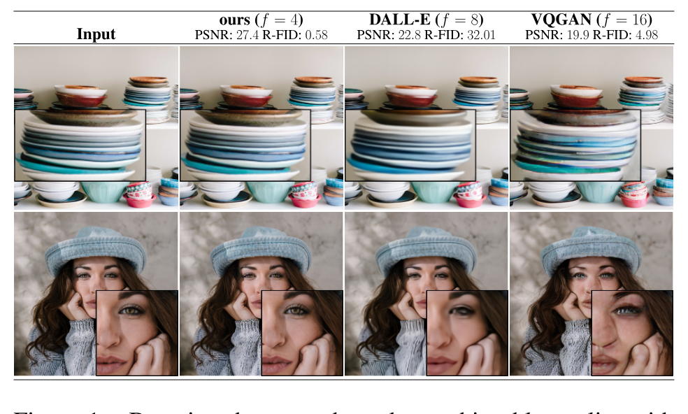

**图 1.** 通过采用更温和的下采样提高可达到的质量上限. 由于扩散模型为具有空间结构的数据提供了很好的归纳偏置, 我们不需要像相关生成模型那样在潜在空间中进行强烈的空间下采样, 但仍然可以通过合适的自动编码模型大幅降低数据的维度, 见[第 3 节](#section-3). 图像来自 DIV2K [Agu17a] 验证集, 在 $512^{2}$ px 下评估. 我们用 $f$ 表示空间下采样因子. 重建 FID [Heu17] 和 PSNR 在 ImageNet-val 上计算. [Den09a]; 另见[表 8](#table-08).

图像合成是计算机视觉领域中近年来发展最显著的方向之一, 但也是计算需求最高的方向之一. 尤其是复杂自然场景的高分辨率合成, 目前主要依赖扩大基于似然的模型, 这些模型在自回归 (AR) transformer [Ram21, Raz19] 中可能包含数十亿个参数. 相比之下, GAN [Goo14, Bro19, Kar19] 的结果虽然很有希望, 但由于其对抗学习过程难以扩展到复杂的多模态分布, 这些结果大多局限于变化性相对有限的数据. 最近, 由去噪自动编码器层级构成的扩散模型 [Soh15] 在图像合成 [Ho20a, Son20] 及其他任务 [Kin21, Che21n, Kon21, Mit21] 上取得了令人瞩目的结果, 并在类别条件图像合成 [Dha21, Ho21a] 和超分辨率 [Sah21] 上定义了当前最先进水平. 此外, 即使是无条件 DM, 也可以直接用于图像修复和彩色化 [Son20] 或基于笔触的合成 [Men21] 等任务, 这与其他类型的生成模型 [Kin14, Rez14, Din17] 不同. 作为基于似然的模型, 它们不会出现模式坍塌和训练不稳定问题, 并且通过大量复用参数, 可以在不使用像 AR 模型 [Raz19] 那样数十亿参数的情况下建模高度复杂的自然图像分布.

**让高分辨率图像合成更易获得.** DM 属于基于似然的模型, 这类模型具有覆盖模式的行为, 容易在建模数据中不可感知的细节时消耗过多容量, 从而消耗更多计算资源 [Die20, Sal17]. 尽管重新加权的变分目标 [Ho20a] 试图通过对最初的去噪步骤进行欠采样来处理这一问题, DM 的计算需求仍然很高, 因为训练和评估这类模型都需要在高维 RGB 图像空间中重复进行函数评估和梯度计算. 例如, 训练最强大的 DM 往往需要数百个 GPU 日 (*e.g*. [Dha21] 中的 150 - 1000 个 V100 日), 而且在输入空间的噪声版本上重复评估也使推理成本很高, 因此在单个 A100 GPU 上生成 50k 个样本大约需要 5 天 [Dha21]. 这对研究社区和一般用户有两个后果: 第一, 训练此类模型需要巨大的计算资源, 只有该领域中很小一部分人能够获得这些资源, 同时还会留下巨大的碳足迹 [Pat21a, Str20]. 第二, 评估已经训练好的模型在时间和内存上也很昂贵, 因为同一个模型架构必须在大量步骤中顺序运行 (*e.g*. [Dha21] 中的 25 - 1000 步).

为了提高这一强大模型类别的可及性, 同时减少其显著的资源消耗, 需要一种能够同时降低训练和采样计算复杂度的方法. 因此, 在不损害 DM 性能的情况下降低其计算需求, 是提高其可及性的关键.

**转向潜在空间.** 我们的方法从分析已经在像素空间中训练好的扩散模型开始: [图 2](#figure-02) 展示了一个训练后模型的率失真权衡. 与任何基于似然的模型一样, 学习过程大致可以分为两个阶段: 第一阶段是*感知压缩*, 它去除高频细节, 但只学习很少的语义变化. 第二阶段是真正的生成模型学习数据的语义和概念构成, 也就是*语义压缩*. 因此, 我们首先希望找到一个在感知上等价但计算上更合适的空间, 然后在其中训练扩散模型以进行高分辨率图像合成.

遵循常见做法 [Oor17, Raz19, Ess20a, Dai19a, Ram21], 我们将训练分为两个不同阶段: 首先, 训练一个自动编码器, 为数据空间提供一个更低维且更高效的表示空间, 同时保持感知等价性. 与之前的工作 [Ess20a, Ram21] 不同, 我们不需要依赖过度的空间压缩, 因为我们在学习到的潜在空间中训练 DM, 其空间维度扩展性更好. 降低后的复杂度还支持通过一次网络前向传播从潜在空间高效生成图像. 我们将得到的模型类别称为*潜在扩散模型* (LDM).

这种方法的一个明显优点是, 我们只需训练一次通用自动编码阶段, 因此可以在多次 DM 训练中复用它, 也可以用它探索可能完全不同的任务 [Sne21]. 这使得我们能够高效探索大量用于各种图像到图像和文本到图像任务的扩散模型. 对于后者, 我们设计了一种将 transformer 与 DM 的 UNet 主干 [Ron15] 连接起来的架构, 支持任意类型的基于 token 的条件机制, 见[第 3.3 节](#section-3-3).

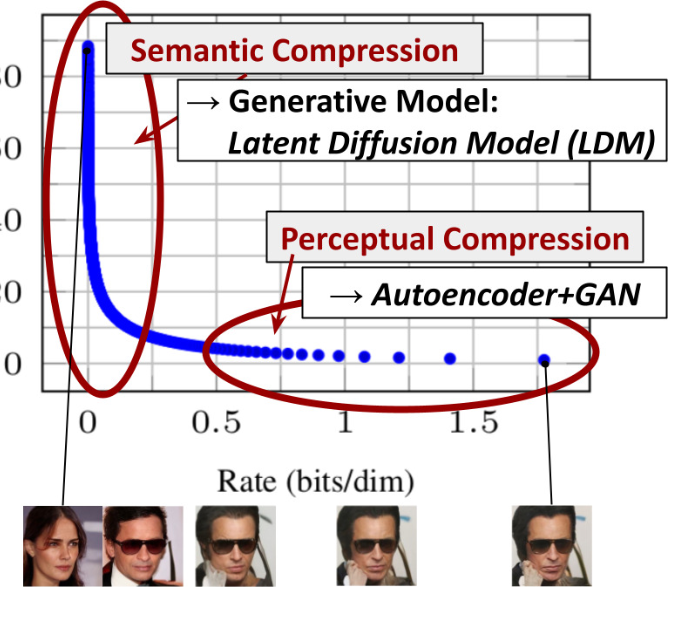

**图 2.** 感知压缩和语义压缩示意图: 数字图像中的大多数比特对应不可感知的细节. DM 可以通过最小化相应的损失项来抑制这些在语义上无意义的信息, 但梯度 (训练期间) 和神经网络主干 (训练和推理期间) 仍然需要在所有像素上计算, 从而产生多余计算, 使优化和推理成本不必要地增加.  我们提出*潜在扩散模型 (LDM)* 作为一种有效的生成模型, 并使用一个单独的温和压缩阶段, 只去除不可感知的细节. 数据和图像来自 [Ho20a].

总的来说, 我们的工作有以下贡献:

(i) 与纯 transformer 方法 [Ess20a, Ram21] 相比, 我们的方法能够更好地扩展到更高维的数据, 因此 (a) 可以使用比之前工作更忠实, 更详细的重建所对应的压缩级别, 见[图 1](#figure-01), 并且 (b) 可以高效应用于百万像素图像的高分辨率合成.

(ii) 我们在多个任务 (无条件图像合成, 图像修复, 随机超分辨率) 和数据集上取得了有竞争力的表现, 同时显著降低了计算成本. 与基于像素的扩散方法相比, 我们也显著降低了推理成本.

(iii) 我们表明, 与之前同时学习编码器/解码器架构和基于 score 的先验的工作 [Vah21] 不同, 我们的方法不需要在重建能力和生成能力之间进行精细的权衡. 这保证了高度忠实的重建, 同时只需对潜在空间进行很少的正则化.

(iv) 我们发现, 对于超分辨率, 图像修复和语义合成等密集条件任务, 我们的模型可以以卷积方式应用, 生成约 $\sim 1024^{2}$ px 大小且结构一致的图像.

(v) 此外, 我们设计了一种基于交叉注意力的通用条件机制, 支持多模态训练. 我们使用它训练了类别条件, 文本到图像和布局到图像模型.

(vi) 最后, 我们在 https://github.com/CompVis/latent-diffusion 发布了预训练的潜在扩散模型和自动编码模型, 除了训练 DM 外, 它们还可以复用于各种任务 [Sne21].

## 2 相关工作

**用于图像合成的生成模型.** 图像的高维特性给生成建模带来了独特挑战. 生成对抗网络 (GAN) [Goo14] 可以以良好的感知质量高效采样高分辨率图像 [Bro19, Kar20b], 但难以优化 [Mes18a, Arj17, Gul17], 也难以捕捉完整的数据分布 [Met17]. 相比之下, 基于似然的方法重视良好的密度估计, 因此优化过程更稳定. 变分自动编码器 (VAE) [Kin14] 和基于流的模型 [Din15, Din17] 支持高分辨率图像的高效合成 [Chi20b, Vah20, Kin18], 但样本质量不及 GAN. 自回归模型 (ARM) [Oor16b, Oor16a, Che20b, Chi19] 在密度估计上表现很强, 但计算开销大的架构 [Vas17d] 和顺序采样过程将其限制在低分辨率图像上. 由于基于像素的图像表示包含几乎不可感知的高频细节 [Die20, Sal17], 最大似然训练会在建模这些细节上消耗不成比例的容量, 从而导致训练时间很长. 为了扩展到更高分辨率, 一些两阶段方法 [Yan21a, Raz19, Ess20a, Yu21a] 使用 ARM 建模压缩后的潜在图像空间, 而不是原始像素.

最近, 扩散概率模型 (DM) [Soh15] 在密度估计 [Kin21] 和样本质量 [Dha21] 上都取得了当前最先进的结果. 这类模型的生成能力来自其底层神经主干使用 UNet [Ron15, Ho20a, Son20, Dha21] 时与类图像数据归纳偏置的天然契合. 通常, 使用重新加权目标 [Ho20a] 训练时可以得到最好的合成质量. 在这种情况下, DM 对应一种有损压缩器, 可以在图像质量和压缩能力之间进行权衡. 然而, 在像素空间中评估和优化这类模型会导致推理速度低, 训练成本极高. 前者可以通过高级采样策略 [Son21a, San21a, Kon21a] 和层级方法 [Ho21a, Vah21] 部分缓解, 但在高分辨率图像数据上训练始终需要计算昂贵的梯度. 我们提出的 *LDM* 在更低维的压缩潜在空间中运行, 同时解决了这两个缺点. 这样训练的计算成本更低, 推理速度更快, 而合成质量几乎没有下降, 见[图 1](#figure-01).

**两阶段图像合成.** 为了缓解单个生成方法的缺点, 大量研究 [Dai19a, Rom20, Ess20a, Yu21a, Yan21a, Raz19] 采用两阶段方法, 将不同方法的优点结合起来, 构建更高效, 性能更好的模型. VQ-VAE [Yan21a, Raz19] 使用自回归模型在离散潜在空间上学习具有表现力的先验. [Ram21] 将这种方法扩展到文本到图像生成, 通过在离散图像和文本表示上学习联合分布来实现. 更一般地, [Rom20] 使用条件可逆网络, 在不同领域的潜在空间之间提供通用转换. 与 VQ-VAE 不同, VQGAN [Ess20a, Yu21a] 使用带有对抗和感知目标的第一阶段, 将自回归 transformer 扩展到更大的图像. 但可行的 ARM 训练所需的高压缩率会引入数十亿个可训练参数 [Ram21, Ess20a], 限制这类方法的整体性能, 而降低压缩率又会带来高计算成本 [Ram21, Ess20a]. 我们的方法避免了这种权衡, 因为所提出的 *LDM* 依靠卷积主干, 能够更平缓地扩展到更高维的潜在空间. 因此, 我们可以自由选择压缩程度, 在学习强大的第一阶段与不过度将感知压缩交给生成扩散模型之间取得合适平衡, 同时保证高保真重建, 见[图 1](#figure-01).

虽然已有方法分别联合 [Vah21] 或单独 [Sin21] 学习编码/解码模型和基于 score 的先验, 但前者仍需要在重建能力和生成能力之间进行困难的权衡 [Dai19a], 表现也不如我们的方法, 见[第 4 节](#section-4), 后者则关注人脸等高度结构化的图像.

## 3 方法

为了降低扩散模型进行高分辨率图像合成训练时的计算需求, 我们注意到, 尽管扩散模型可以通过对相应损失项进行欠采样来忽略感知上无关的细节 [Ho20a], 但它们仍然需要在像素空间进行昂贵的函数评估, 因而带来巨大的计算时间和能源需求.

我们提出通过将压缩学习阶段与生成学习阶段明确分离来绕开这一缺点, 见[图 2](#figure-02). 为此, 我们使用一个自动编码模型, 学习一个在感知上等价于图像空间, 但计算复杂度显著更低的空间.

这种方法有几个优点: (i) 离开高维图像空间后, 我们得到的 DM 计算效率高得多, 因为采样是在低维空间中进行的. (ii) 我们利用继承自 UNet 架构 [Ron15] 的 DM 归纳偏置, 这使得模型特别适合具有空间结构的数据, 也就不再需要像之前的方法 [Ess20a, Ram21] 那样采用激进且会降低质量的压缩级别. (iii) 最后, 我们得到通用的压缩模型, 其潜在空间可以用于训练多个生成模型, 也可以用于单图像 CLIP 引导合成 [Fra21a] 等其他下游应用.

### 3.1 感知图像压缩

我们的感知压缩模型基于之前的工作 [Ess20a], 由感知损失 [Zha18d] 和基于 patch 的 [Iso17] 对抗目标 [Dos16, Ess20a, Yu21a] 共同训练一个自动编码器得到. 这种方法通过强制局部真实感, 使重建结果受限于图像流形, 同时避免只依赖像 $L_{2}$ 或 $L_{1}$ 这类像素空间损失目标时产生的模糊.

更具体地说, 给定 RGB 空间中的图像 $x\in\mathbb{R}^{H\times W\times 3}$, 编码器 $\mathcal{E}$ 将 $x$ 编码为潜在表示 $z=\mathcal{E}(x)$, 解码器 $\mathcal{D}$ 根据潜在表示重建图像, 得到 $\tilde{x}=\mathcal{D}(z)=\mathcal{D}(\mathcal{E}(x))$, 其中 $z\in\mathbb{R}^{h\times w\times c}$. 重要的是, 编码器会将图像下采样 $f=H/h=W/w$ 倍, 我们研究了不同的下采样因子 $f=2^{m}$, 其中 $m\in\mathbb{N}$.

为了避免方差任意增大的潜在空间, 我们试验了两种不同的正则化. 第一种变体 *KL-reg.* 对学习到的潜在表示施加轻微的 KL 惩罚, 使其趋向标准正态分布, 类似于 VAE [Kin14, Rez14], 而 *VQ-reg.* 在解码器中使用向量量化层 [Oor17]. 这个模型可以看作 VQGAN [Ess20a], 但量化层被吸收到解码器中. 由于后续的 DM 设计为使用学习到的潜在空间 $z=\mathcal{E}(x)$ 的二维结构, 我们可以使用相对温和的压缩率, 并得到很好的重建结果. 这与之前的工作 [Ess20a, Ram21] 不同, 后者依赖于对学习空间 $z$ 进行任意的一维排序, 以自回归方式建模其分布, 从而忽略了 $z$ 中大量固有结构. 因此, 我们的压缩模型能够更好地保留 $x$ 的细节, 见[表 8](#table-08). 完整目标和训练细节见补充材料.

### 3.2 潜在扩散模型

扩散模型 [Soh15] 是用于学习数据分布 $p(x)$ 的概率模型, 它通过逐步对一个服从正态分布的变量进行去噪来实现这一点, 这等价于学习一个长度为 $T$ 的固定马尔可夫链的逆过程. 对于图像合成, 最成功的模型 [Ho20a, Dha21, Sah21] 依赖于 $p(x)$ 变分下界的重新加权变体, 该变体与去噪 score matching [Son20] 相对应. 这些模型可以解释为一系列权重相同的去噪自动编码器 $\epsilon_{\theta}(x_{t},t);\,t=1\dots T$, 它们经过训练来预测输入 $x_{t}$ 的去噪版本, 其中 $x_{t}$ 是输入 $x$ 的带噪版本. 相应目标可以简化为[第 8 节](#section-8)

$$
L_{DM}=\mathbb{E}_{x,\epsilon\sim\mathcal{N}(0,1),t}\Big[\|\epsilon-\epsilon_{\theta}(x_{t},t)\|_{2}^{2}\Big]\,,
$$

其中 $t$ 从 $\{1,\dots,T\}$ 中均匀采样.

**潜在表示的生成建模.** 通过训练由 $\mathcal{E}$ 和 $\mathcal{D}$ 构成的感知压缩模型, 我们现在获得了一个高效, 低维的潜在空间, 其中高频且不可感知的细节已经被抽象掉. 与高维像素空间相比, 这个空间更适合基于似然的生成模型, 因为它们现在可以 (i) 关注数据中重要的语义信息, (ii) 在维度更低, 计算效率更高的空间中训练.

与之前依赖高度压缩的离散潜在空间中的自回归, 基于注意力的 transformer 模型的工作 [Ram21, Ess20a, Yu21a] 不同, 我们可以利用模型所提供的图像特有归纳偏置. 其中包括主要使用二维卷积层构建底层 UNet, 以及通过重新加权的界将目标进一步集中到感知上最重要的信息上, 该目标现在写作

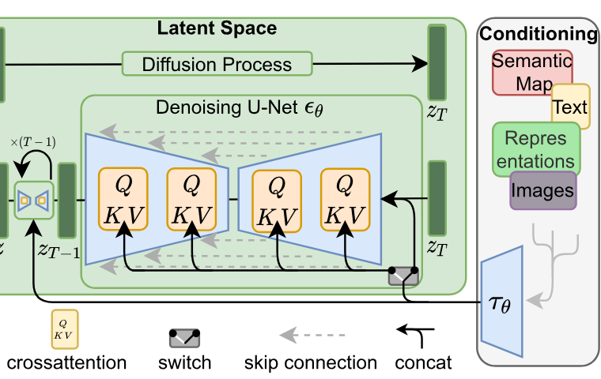

**图 3.** 我们可以通过拼接或更通用的交叉注意力机制为 LDM 添加条件. 见[第 3.3 节](#section-3-3)

$$
L_{LDM}:=\mathbb{E}_{\mathcal{E}(x),\epsilon\sim\mathcal{N}(0,1),t}\Big[\|\epsilon-\epsilon_{\theta}(z_{t},t)\|_{2}^{2}\Big]\,.
$$

我们模型的神经主干 $\epsilon_{\theta}(\circ,t)$ 实现为时间条件 UNet [Ron15]. 由于前向过程是固定的, $z_{t}$ 可以在训练期间通过 $\mathcal{E}$ 高效获得, 而 $p(z)$ 的样本可以通过 $\mathcal{D}$ 的一次前向传播解码到图像空间.

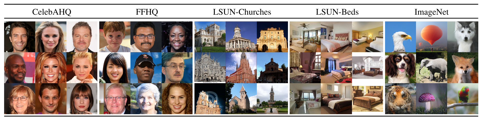

**图 4.** 在 CelebAHQ [Kar17], FFHQ [Kar19a], LSUN-Churches [Yu15a], LSUN-Bedrooms [Yu15a] 和类别条件 ImageNet [Den09a] 上训练的 *LDM* 样本, 每个数据集的分辨率均为 $256\times 256$. 放大查看效果更佳. 更多样本见补充材料.

### 3.3 条件机制

与其他类型的生成模型 [Mir14, Soh15a] 类似, 扩散模型原则上能够建模 $p(z|y)$ 形式的条件分布. 这可以通过条件去噪自动编码器 $\epsilon_{\theta}(z_{t},t,y)$ 实现, 也为使用文本 [Ree16], 语义图 [Par19c, Iso17] 或其他图像到图像转换任务 [Iso17a] 等输入 $y$ 控制合成过程提供了可能.

然而, 在图像合成背景下, 将 DM 的生成能力与类别标签 [Dha21] 或输入图像的模糊版本 [Sah21] 之外的其他条件结合起来, 至今仍是研究较少的方向.

我们通过使用交叉注意力机制 [Vas17d] 增强底层 UNet 主干, 将 DM 变成更灵活的条件图像生成器. 交叉注意力机制适合学习各种输入模态的基于注意力的模型 [Jae21, Jae21a]. 为了预处理来自不同模态的 $y$ (例如语言 prompt), 我们引入一个领域特定编码器 $\tau_{\theta}$, 将 $y$ 投影到中间表示 $\tau_{\theta}(y)\in\mathbb{R}^{M\times d_{\tau}}$, 然后通过实现 $\text{Attention}(Q,K,V)=\text{softmax}\left(\frac{QK^{T}}{\sqrt{d}}\right)\cdot V$ 的交叉注意力层, 将其映射到 UNet 的中间层, 其中

$$
Q=W^{(i)}_{Q}\cdot\varphi_{i}(z_{t}),\;K=W^{(i)}_{K}\cdot\tau_{\theta}(y),\;V=W^{(i)}_{V}\cdot\tau_{\theta}(y).
$$

这里, $\varphi_{i}(z_{t})\in\mathbb{R}^{N\times d^{i}_{\epsilon}}$ 表示实现 $\epsilon_{\theta}$ 的 UNet 的一个 (展平后的) 中间表示, $W^{(i)}_{V}\in\mathbb{R}^{d\times d^{i}_{\epsilon}}$, $W^{(i)}_{Q}\in\mathbb{R}^{d\times d_{\tau}}$ 和 $W^{(i)}_{K}\in\mathbb{R}^{d\times d_{\tau}}$ 是可学习的投影矩阵 [Vas17d, Jae21]. 具体示意见[图 3](#figure-03).

基于图像-条件对, 我们通过以下目标学习条件 LDM:

$$
L_{LDM}:=\mathbb{E}_{\mathcal{E}(x),y,\epsilon\sim\mathcal{N}(0,1),t}\Big[\|\epsilon-\epsilon_{\theta}(z_{t},t,\tau_{\theta}(y))\|_{2}^{2}\Big]\,,
$$

其中 $\tau_{\theta}$ 和 $\epsilon_{\theta}$ 都通过 [公式 3](#equation-03) 联合优化. 这种条件机制很灵活, 因为 $\tau_{\theta}$ 可以由领域特定专家参数化, 例如, 当 $y$ 是文本 prompt 时, 可以使用 (无掩码) transformer [Vas17d], 见[第 4.3.1 节](#section-4-3-1)

## 4 实验

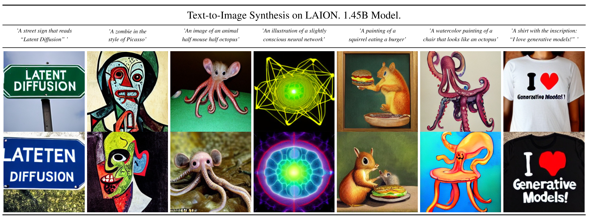

**图 5.** 我们的文本到图像合成模型 *LDM-8 (KL)* 根据用户定义的文本 prompt 生成的样本. 该模型在 LAION [Sch21a] 数据库上训练. 样本使用 200 个 DDIM 步骤和 $\eta=1.0$ 生成. 我们使用无条件引导 [Ho21], $s=10.0$.

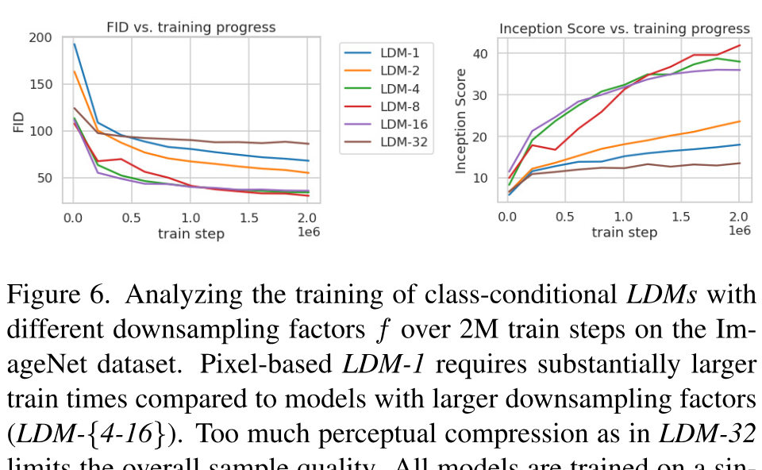

**图 6.** 在 ImageNet 数据集上, 分析使用不同下采样因子 $f$ 的类别条件 *LDM* 经过 2M 个训练步骤后的训练过程. 基于像素的 *LDM-1* 相比具有更大下采样因子的模型 (*LDM-$\{$4-16$\}$*) 需要明显更长的训练时间. 如 *LDM-32* 那样过度感知压缩会限制整体样本质量. 所有模型均在单个 NVIDIA A100 上使用相同的计算预算训练. 结果使用 100 个 DDIM 步骤 [Son21a] 和 $\kappa=0$ 获得.

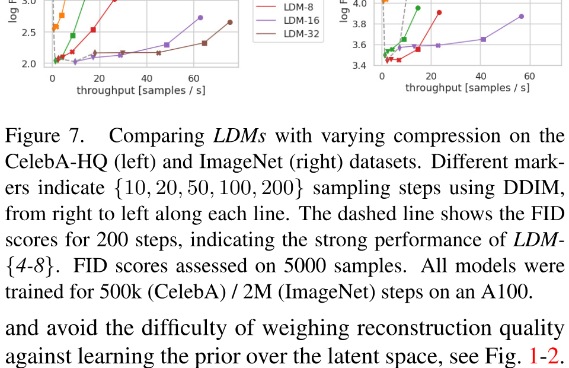

**图 7.** 比较 CelebA-HQ (左) 和 ImageNet (右) 数据集上具有不同压缩程度的 *LDM*. 不同标记表示使用 DDIM 的 $\{10,20,50,100,200\}$ 个采样步骤, 沿每条线从右向左排列. 虚线显示 200 步时的 FID 分数, 说明 *LDM-$\{$4-8$\}$* 的表现很强. FID 分数在 5000 个样本上评估. 所有模型在 A100 上训练了 500k (CelebA) / 2M (ImageNet) 步.

*LDM* 为各种图像模态提供了灵活且计算上可行的基于扩散的图像合成方式, 我们将在下面通过实验展示这一点. 但首先, 我们分析模型相比基于像素的扩散模型在训练和推理上的收益. 有趣的是, 我们发现, 在 *VQ* 正则化潜在空间中训练的 *LDM* 有时能达到更好的样本质量, 尽管 *VQ* 正则化第一阶段模型的重建能力略逊于连续潜在空间模型, 见[表 8](#table-08). 第一阶段正则化方案对 *LDM* 训练以及模型推广到 $>256^{2}$ 分辨率的影响, 可见附录[第 10.1 节](#section-10-1). 本节所有结果的架构, 实现, 训练和评估细节列于[第 11.2 节](#section-11-2).

### 4.1 感知压缩权衡

本节分析使用不同下采样因子 $f\in\{1,2,4,8,16,32\}$ 的 LDM 行为, 记作 *LDM-*$f$, 其中 *LDM-1* 对应基于像素的 DM. 为获得可比的测试环境, 本节所有实验都将计算资源固定为单个 NVIDIA A100, 并使用相同步数和相同参数量训练所有模型.

[表 8](#table-08) 展示了本节比较的 *LDM* 所使用的第一阶段模型的超参数和重建性能. [图 6](#figure-06) 展示了在 ImageNet [Den09a] 数据集上, 类别条件模型训练 2M 步期间样本质量随训练进展的变化. 我们看到, (i) 对 *LDM-$\{$*1,2*$\}$* 而言, 较小的下采样因子会导致训练进展缓慢, 而 (ii) 过大的 $f$ 值会导致模型在相对较少的训练步骤后保真度停滞. 回顾上面的分析 ([图 1](#figure-01) 和[图 2](#figure-02)), 我们将其归因于: (i) 将大部分感知压缩留给扩散模型, (ii) 第一阶段压缩过强, 导致信息损失并限制可达到的质量. *LDM-$\{$4-16$\}$* 在效率和感知保真结果之间取得了良好平衡, 具体表现为训练 2M 步后, 基于像素的扩散模型 (*LDM-1*) 和 *LDM-8* 之间存在 38 的显著 FID [Heu17] 差距.

在[图 7](#figure-07) 中, 我们比较在 CelebA-HQ [Kar17] 和 ImageNet 上训练的模型, 评估其在 DDIM 采样器 [Son21a] 下不同去噪步数的采样速度, 并将结果与 FID 分数 [Heu17] 对比. *LDM-$\{$4-8$\}$* 的表现优于感知压缩和概念压缩比例不合适的模型. 尤其是与基于像素的 *LDM-1* 相比, 它们在显著提高样本吞吐量的同时, 达到了更低的 FID 分数. ImageNet 这样的复杂数据集需要降低压缩率, 以避免质量下降. 总的来看, *LDM-4* 和 *-8* 最适合获得高质量的合成结果.

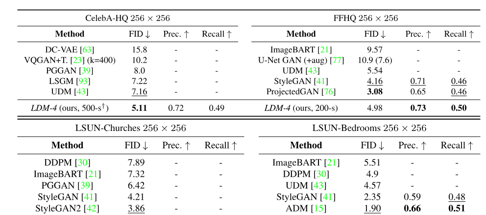

**表 1.** 无条件图像合成的评估指标. CelebA-HQ 结果复现自 [Par21, Xia21a, Kim21a], FFHQ 结果复现自 [Kar20b, Kim21a]. ^†: $N$-s 表示使用 DDIM [Son21a] 采样器进行 $N$ 个采样步骤. ^∗: 在 *KL* 正则化潜在空间中训练. 更多结果见补充材料.

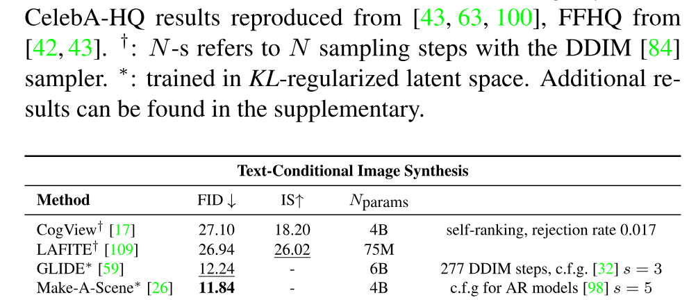

**表 2.** 在大小为 $256\times 256$ 的 MS-COCO [Lin14a] 数据集上评估文本条件图像合成: 使用 250 个 DDIM [Son21a] 步骤时, 尽管参数量显著更少, 我们的模型仍能达到与最新扩散 [Nic22] 和自回归 [Gaf22] 方法相当的结果. ^†/^∗: 数值来自 [Zho21a] / [Gaf22]

### 4.2 使用潜在扩散的图像生成

我们在 CelebA-HQ [Kar17], FFHQ [Kar19a], LSUN-Churches 和 -Bedrooms [Yu15a] 上训练 $256^{2}$ 图像的无条件模型, 并使用 i) 样本质量和 ii) 数据流形覆盖程度进行评估, 其中 ii) 使用 FID [Heu17] 和 ii) Precision-and-Recall [Kyn19]. [表 1](#table-01) 总结了我们的结果. 在 CelebA-HQ 上, 我们报告了新的当前最先进 FID $5.11$, 超过之前的基于似然模型和 GAN. 我们也超过了 LSGM [Vah21], 后者将潜在扩散模型与第一阶段联合训练. 相比之下, 我们在固定空间中训练扩散模型, 避免了在重建质量和学习潜在空间先验之间进行权衡的困难, 见[图 1](#figure-01)-[图 2](#figure-02).

在除 LSUN-Bedrooms 外的所有数据集上, 我们都超过了之前的扩散方法. 在 LSUN-Bedrooms 上, 尽管只使用其一半的参数和少 4 倍的训练资源, 我们的分数仍接近 ADM [Dha21], 见附录[第 11.3.5 节](#section-11-3-5). 此外, *LDM* 在 Precision 和 Recall 上稳定优于基于 GAN 的方法, 进一步说明其覆盖模式的基于似然训练目标相对于对抗方法的优势. [图 4](#figure-04) 还展示了每个数据集上的定性结果.

### 4.3 条件潜在扩散

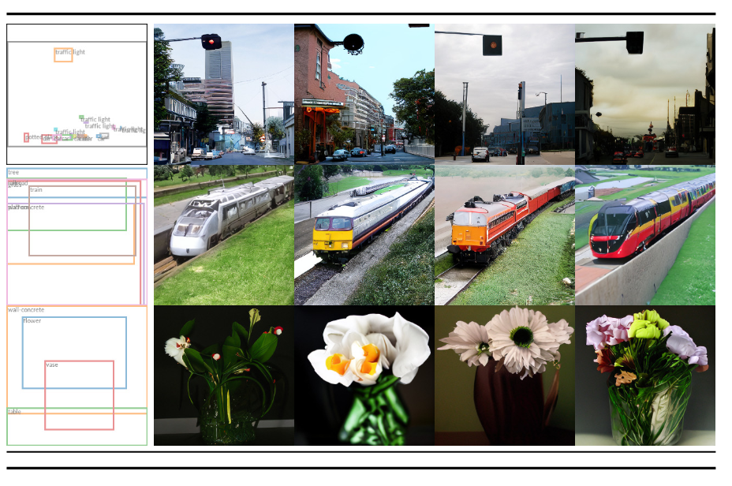

**图 8.** 在 COCO [Cae18] 上使用 *LDM* 进行布局到图像合成, 见[第 4.3.1 节](#section-4-3-1). 定量评估见补充材料[第 10.3 节](#section-10-3).

#### 4.3.1 LDM 的 Transformer 编码器

通过在 LDM 中引入基于交叉注意力的条件机制, 我们使其支持扩散模型此前较少探索的多种条件模态. 对于文本到图像建模, 我们在 LAION-400M [Sch21a] 上训练了一个 1.45B 参数的 *KL* 正则化 *LDM*, 以语言 prompt 为条件. 我们使用 BERT tokenizer [Dev18], 并将 $\tau_{\theta}$ 实现为 transformer [Vas17d], 推断一个通过 (多头) 交叉注意力映射到 UNet 的潜在编码, 见[第 3.3 节](#section-3-3). 这种用于学习语言表示的领域特定专家与视觉合成的结合形成了一个强大的模型, 能够很好地泛化到复杂的用户定义文本 prompt, 见[图 8](#figure-08) 和[图 5](#figure-05). 在定量分析中, 我们遵循之前的工作, 在 MS-COCO [Lin14a] 验证集上评估文本到图像生成, 我们的模型优于强大的 AR [Ram21, Din21] 和基于 GAN [Zho21a] 的方法, 见[表 2](#table-02). 我们注意到, 应用无分类器扩散引导 [Ho21] 会大幅提高样本质量, 因此有引导的 *LDM-KL-8-G* 与近期当前最先进的 AR [Gaf22] 和扩散模型 [Nic22] 在文本到图像合成上的表现相当, 同时显著减少了参数量. 为了进一步分析基于交叉注意力的条件机制的灵活性, 我们还在 OpenImages [Kuz18] 上训练了基于语义布局合成图像的模型, 并在 COCO [Cae18] 上进行微调, 见[图 8](#figure-08). 定量评估和实现细节见[第 10.3 节](#section-10-3).

最后, 遵循之前的工作 [Dha21, Bro19, Ess20a, Ess21], 我们在[表 3](#table-03), [图 4](#figure-04) 和[第 10.4 节](#section-10-4) 中评估了[第 4.1 节](#section-4-1) 中 $f\in\{4,8\}$ 的最佳类别条件 ImageNet 模型. 在这里, 我们在显著降低计算需求和参数量的同时, 超过了当前最先进的扩散模型 ADM [Dha21], 见[表 18](#table-18).

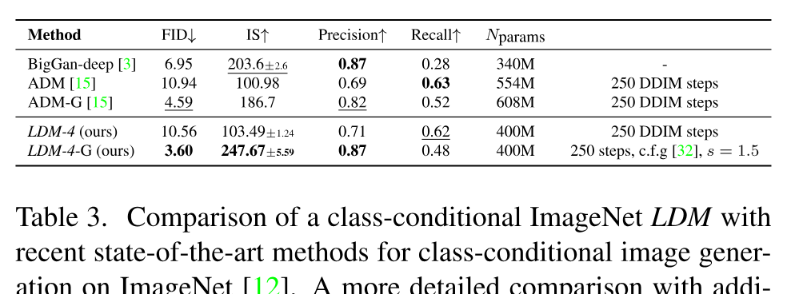

**表 3.** 类别条件 ImageNet *LDM* 与 ImageNet [Den09a] 上近期当前最先进类别条件图像生成方法的比较. 更详细的额外基线比较见[第 10.4 节](#section-10-4), [表 10](#table-10) 和[第 12 节](#section-12). *c.f.g.* 表示以 [Ho21] 提出的尺度 $s$ 进行无分类器引导.

#### 4.3.2 超越 $256^{2}$ 的卷积采样

通过将空间对齐的条件信息拼接到 $\epsilon_{\theta}$ 的输入上, *LDM* 可以作为高效的通用图像到图像转换模型. 我们利用这一点训练语义合成, 超分辨率 ([第 4.4 节](#section-4-4)) 和图像修复 ([第 4.5 节](#section-4-5)) 模型. 对于语义合成, 我们使用带有语义图的成对景观图像 [Par19c, Ess20a], 并将语义图的下采样版本与 $f=4$ 模型的潜在图像表示拼接 (VQ-reg., 见[表 8](#table-08)). 我们在 $256^{2}$ 的输入分辨率上训练 (从 $384^{2}$ 裁剪), 但发现模型可以泛化到更大分辨率, 以卷积方式评估时能够生成百万像素范围的图像, 见[图 9](#figure-09). 我们利用这一特性, 将[第 4.4 节](#section-4-4) 中的超分辨率模型和[第 4.5 节](#section-4-5) 中的图像修复模型也用于生成 $512^{2}$ 到 $1024^{2}$ 之间的大图像. 对于这一应用, 信噪比 (由潜在空间的尺度决定) 会显著影响结果. 在[第 10.1 节](#section-10-1) 中, 我们展示了在以下两种情况下学习 LDM 的效果: (i) 直接使用 $f=4$ 模型提供的潜在空间 (KL-reg., 见[表 8](#table-08)), (ii) 使用按分量标准差缩放后的潜在空间.

后者与无分类器引导 [Ho21] 结合后, 还支持文本条件 *LDM-KL-8-G* 直接合成 $>256^{2}$ 的图像, 如[图 13](#figure-13) 所示.

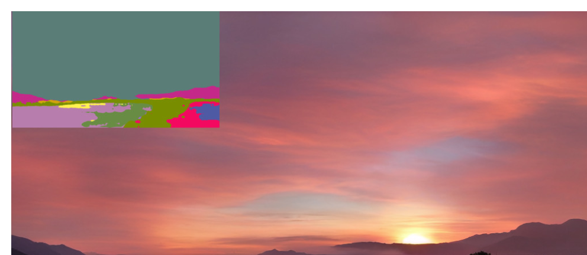

**图 9.** 在 $256^{2}$ 分辨率上训练的 *LDM* 可以泛化到更大分辨率 (这里为 $512\times 1024$), 用于景观图像语义合成等空间条件任务. 见[第 4.3.2 节](#section-4-3-2).

### 4.4 使用潜在扩散的超分辨率

通过拼接直接以低分辨率图像为条件, 可以高效训练 LDM 进行超分辨率 (*cf*. [第 3.3 节](#section-3-3)). 在第一个实验中, 我们遵循 SR3 [Sah21], 将图像退化固定为带有 $4\times$ 下采样的双三次插值, 并按照 SR3 的数据处理流程在 ImageNet 上训练. 我们使用在 OpenImages 上预训练的 $f=4$ 自动编码模型 (VQ-reg., *cf*. [表 8](#table-08)), 并将低分辨率条件 $y$ 与输入拼接到 UNet 中, 即 $\tau_{\theta}$ 是恒等映射. 我们的定性和定量结果 (见[图 10](#figure-10) 和[表 5](#table-05)) 显示了有竞争力的性能, LDM-SR 在 FID 上优于 SR3, 而 SR3 的 IS 更好. 简单的图像回归模型取得了最高的 PSNR 和 SSIM 分数, 但这些指标与人类感知并不十分一致 [Zha18d], 更偏好模糊而不是未完美对齐的高频细节 [Sah21]. 此外, 我们还进行了比较像素基线和 LDM-SR 的用户研究. 我们遵循 SR3 [Sah21] 的做法, 向受试者展示一张夹在两张高分辨率图像之间的低分辨率图像, 并让其选择偏好. [表 4](#table-04) 中的结果确认了 LDM-SR 的良好表现. 通过使用事后引导机制 [Dha21] 还可以提高 PSNR 和 SSIM, 我们通过感知损失实现了这种*基于图像的引导器*, 见[第 10.6 节](#section-10-6).

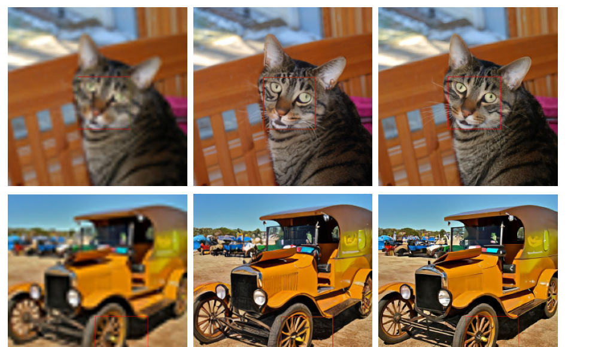

**图 10.** ImageNet-Val 上的 ImageNet 64$\rightarrow$256 超分辨率. *LDM-SR* 在渲染真实纹理方面具有优势, 但 SR3 能合成更连贯的精细结构. 更多样本和裁剪图见附录. SR3 结果来自 [Sah21].

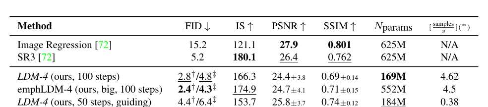

**表 4.** 任务 1: 向受试者展示真实图像和生成图像, 并让其选择偏好. 任务 2: 受试者需要在两张生成图像之间做出选择. 更多细节见[第 11.3.6 节](#section-11-3-6)

由于双三次退化过程无法很好地泛化到不符合该预处理的图像, 我们还使用更加多样的退化训练了一个通用模型 *LDM-BSR*. 结果见[第 10.6.1 节](#section-10-6-1).

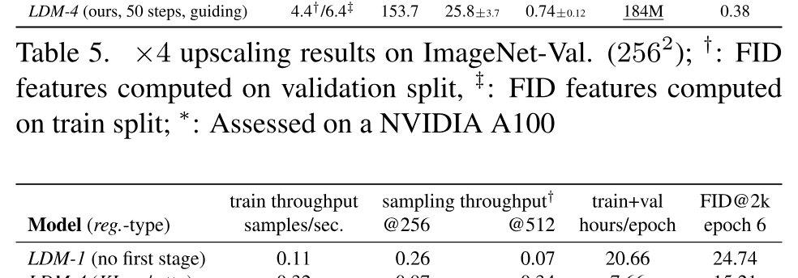

**表 5.** ImageNet-Val 上的 $\times 4$ 放大结果. ($256^{2}$); ^†: 在验证集划分上计算的 FID 特征, ^‡: 在训练集划分上计算的 FID 特征; ^∗: 在 NVIDIA A100 上评估

### 4.5 使用潜在扩散的图像修复

图像修复的任务是, 当图像的某些部分损坏, 或者需要替换图像中已有但不需要的内容时, 用新内容填充图像中的掩码区域. 我们评估通用条件图像生成方法与该任务中更专门的当前最先进方法的对比. 我们遵循 LaMa [Suv21] 的流程进行评估. LaMa 是近期的图像修复模型, 引入了依赖快速傅里叶卷积 [Chi20a] 的专用架构. [第 11.2.2 节](#section-11-2-2) 描述了在 Places [Zho18a] 上使用的确切训练和评估流程.

我们首先分析第一阶段的不同设计选择.

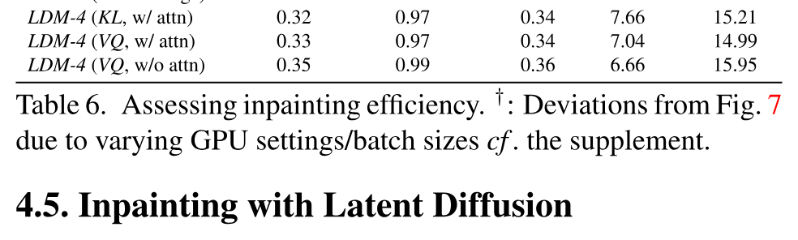

**表 6.** 图像修复效率评估. ^†: 与[图 7](#figure-07) 的差异来自不同的 GPU 设置和 batch size, *cf*. 补充材料.

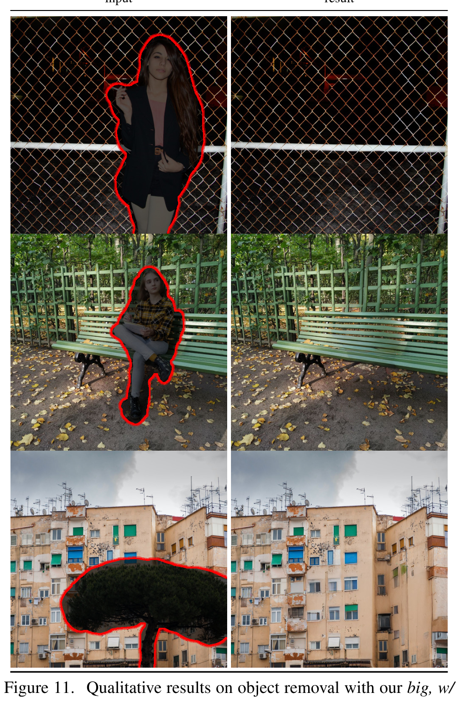

**图 11.** 使用我们的 *big, w/ ft* 图像修复模型进行目标移除的定性结果. 更多结果见[图 22](#figure-22).

具体而言, 我们比较了 *LDM-1* (即基于像素的条件 DM) 与 *LDM-4* 在 *KL* 和 *VQ* 正则化下的图像修复效率, 以及第一阶段不使用注意力的 *VQ-LDM-4* (见[表 8](#table-08)), 后者可以减少高分辨率解码时的 GPU 内存. 为便于比较, 我们固定所有模型的参数量. [表 6](#table-06) 报告了模型在 $256^{2}$ 和 $512^{2}$ 分辨率下的训练和采样吞吐量, 每个 epoch 的总训练时间 (小时) 以及训练六个 epoch 后验证集划分上的 FID 分数. 总体而言, 我们观察到, 基于像素和基于潜在空间的扩散模型之间的速度至少提高了 $2.7\times$, 同时 FID 分数至少提高了 $1.6\times$.

[表 7](#table-07) 中与其他图像修复方法的比较显示, 我们带有注意力的模型在 FID 衡量的整体图像质量上优于 [Suv21]. 未掩码图像与我们样本之间的 LPIPS 略高于 [Suv21]. 我们将其归因于 [Suv21] 只生成单个结果, 该结果相比我们的 LDM 生成的多样结果, 更倾向于恢复一张平均图像, 见[图 21](#figure-21). 此外, 在用户研究中 ([表 4](#table-04)), 人类受试者更偏好我们的结果, 而不是 [Suv21] 的结果.

基于这些初步结果, 我们还在不带注意力的 *VQ* 正则化第一阶段潜在空间中训练了一个更大的扩散模型 ([表 7](#table-07) 中的 *big*). 遵循 [Dha21], 该扩散模型的 UNet 在其特征层级的三个层次上使用注意力层, 使用 BigGAN [Bro19] 残差块进行上采样和下采样, 参数量为 387M, 而不是 215M. 训练后, 我们注意到模型在 $256^{2}$ 和 $512^{2}$ 分辨率下生成的样本质量存在差异, 我们推测这可能由额外的注意力模块造成. 但在 $512^{2}$ 分辨率上微调半个 epoch, 可以让模型适应新的特征统计, 并在图像修复上取得新的当前最先进 FID (*big, w/o attn, w/ ft* in [表 7](#table-07), [图 11](#figure-11)).

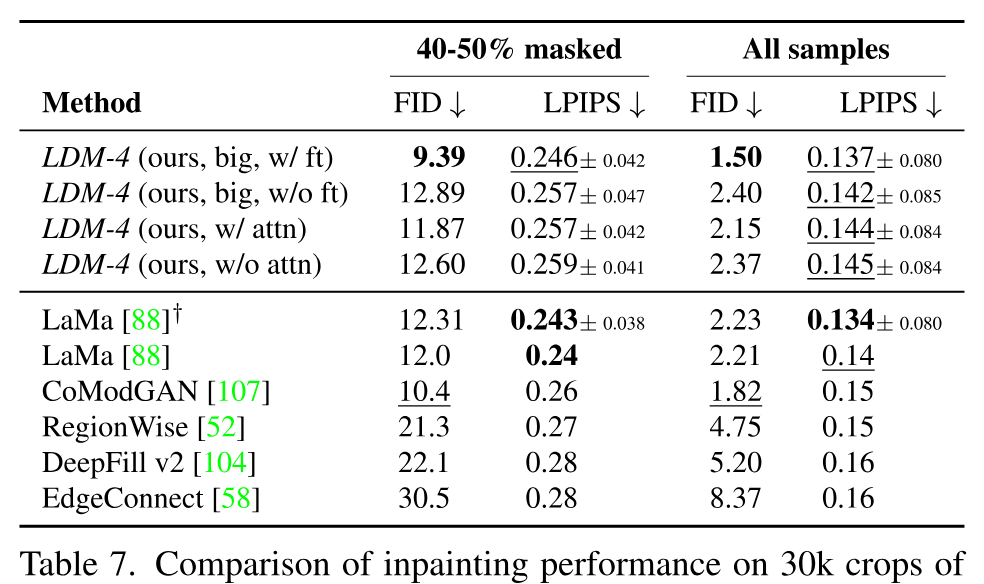

**表 7.** 在 Places [Zho18a] 测试图像中裁剪出的 30k 张 $512\times 512$ 图像上比较图像修复性能. *40-50%* 列报告了困难样本上的指标, 这些样本需要修复图像区域的 40-50%. ^† 在我们的测试集上重新计算, 因为 [Suv21] 使用的原始测试集不可用.

## 5 局限性与社会影响

**局限性.** 与基于像素的方法相比, LDM 显著降低了计算需求, 但其顺序采样过程仍然比 GAN 慢. 此外, 当需要高精度时, 使用 LDM 可能需要谨慎: 尽管我们的 $f=4$ 自动编码模型的图像质量损失很小 (见[图 1](#figure-01)), 但对于需要像素空间细粒度准确性的任务, 其重建能力可能成为瓶颈. 我们认为, 我们的超分辨率模型 ([第 4.4 节](#section-4-4)) 在这方面已经受到一定限制.

**社会影响.** 图像等媒体的生成模型是一把双刃剑: 一方面, 它们支持各种创意应用, 特别是像我们这样降低训练和推理成本的方法, 有可能让更多人接触到这项技术, 并促进对它的探索. 另一方面, 这也意味着创建和传播被篡改的数据, 或散播错误信息和垃圾内容, 会变得更容易. 特别是, 对图像进行蓄意操纵 ("deep fake") 是这一领域的常见问题, 女性受到的影响尤其不成比例 [Den21, Fra18a].

生成模型还可能泄露其训练数据 [Car21, Tin21]. 当数据包含敏感或个人信息, 且是在没有明确同意的情况下收集时, 这尤其令人担忧. 但这是否同样适用于图像 DM, 以及适用程度如何, 目前还没有完全弄清楚.

最后, 深度学习模块往往会复现或加剧数据中已经存在的偏见 [Efr11, Jai20b, Ess20]. 与基于 GAN 的方法相比, 扩散模型对数据分布的覆盖更好, 但我们这种结合对抗训练和基于似然目标的两阶段方法在多大程度上会歪曲数据, 仍是一个重要的研究问题.

关于深度生成模型伦理问题的更一般, 更详细的讨论, 见 *e.g*. [Den21].

## 6 结论

我们提出了潜在扩散模型, 这是一种简单而高效的方法, 可以在不降低去噪扩散模型质量的情况下, 显著提高其训练和采样效率. 基于这一方法和我们的交叉注意力条件机制, 实验表明, 在各种条件图像合成任务上, 无需针对任务设计专用架构, 我们的方法也能取得优于当前最先进方法的结果. [+ack] 这项工作得到了德国联邦经济事务和能源部项目 "KI-Absicherung - Safe AI for automated driving" 以及德国研究基金会 (DFG) 项目 421703927 的支持.

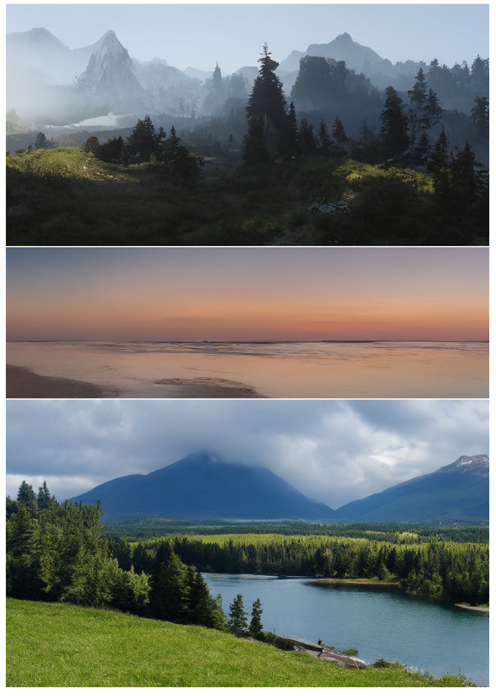

**图 12.** 语义景观模型的卷积样本, 与[第 4.3.2 节](#section-4-3-2) 相同, 在 $512^{2}$ 图像上进行了微调.

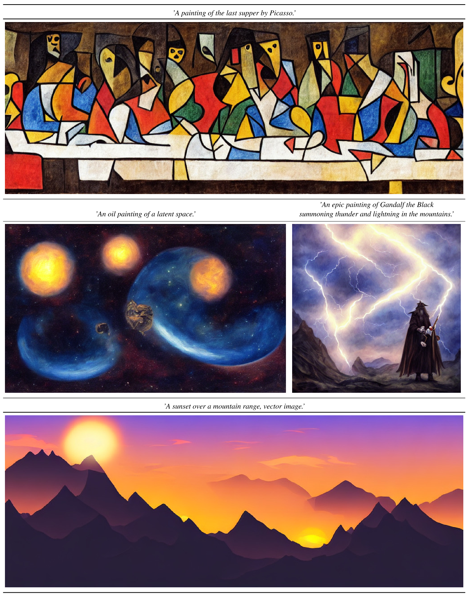

**图 13.** 将无分类器扩散引导与[第 4.3.2 节](#section-4-3-2) 的卷积采样策略结合后, 我们的 1.45B 参数文本到图像模型可以渲染大于模型训练时原生 $256^{2}$ 分辨率的图像.

## 7 修订记录

这里列出本文当前版本 (https://arxiv.org/abs/2112.10752v2) 与上一版本, 即 https://arxiv.org/abs/2112.10752v1, 之间的变化.

- • 我们更新了[第 4.3 节](#section-4-3) 中的文本到图像合成结果. 这些结果通过训练一个新的更大模型 (1.45B 参数) 获得. 其中还包括与在本文发表的同时 ([Nic22, Zho21a]) 或之后 ([Gaf22]) 在 arXiv 上发表的近期竞争方法在该任务上的新比较.
- • 我们更新了 ImageNet 类别条件合成结果, 见[第 4.1 节](#section-4-1) 和[表 3](#table-03) (另见[第 10.4 节](#section-10-4)), 这些结果通过使用更大的 batch size 重新训练模型获得. [图 26](#figure-26) 和[图 27](#figure-27) 中的相应定性结果也进行了更新. 更新后的文本到图像模型和类别条件模型现在都使用无分类器引导 [Ho21] 作为提高视觉保真度的手段.
- • 我们进行了一项用户研究 (遵循 Saharia 等人 [Sah21] 提出的方案), 为我们的图像修复 ([第 4.5 节](#section-4-5)) 和超分辨率模型 ([第 4.4 节](#section-4-4)) 提供了额外评估.
- • 将[图 5](#figure-05) 加入正文, 将[图 18](#figure-18) 移至附录, 并将[图 13](#figure-13) 加入附录.

## 8 去噪扩散模型的详细信息

扩散模型可以用信噪比 $\text{SNR}(t)=\frac{\alpha_{t}^{2}}{\sigma_{t}^{2}}$ 来描述, 它由序列 $(\alpha_{t})_{t=1}^{T}$ 和 $(\sigma_{t})_{t=1}^{T}$ 构成. 这些序列从数据样本 $x_{0}$ 开始, 将前向扩散过程 $q$ 定义为

$$
q(x_{t}|x_{0})=\mathcal{N}(x_{t}|\alpha_{t}x_{0},\sigma_{t}^{2}\mathbb{I})
$$

对于 $s<t$, 其马尔可夫结构为:

$$
\displaystyle q(x_{t}|x_{s})
$$

去噪扩散模型是生成模型 $p(x_{0})$, 它们以类似的马尔可夫结构随时间反向运行, 将上述过程逆转, 即其形式为

$$
p(x_{0})=\int_{z}p(x_{T})\prod_{t=1}^{T}p(x_{t-1}|x_{t})
$$

与该模型对应的证据下界 (ELBO) 随离散时间步分解为

$$
-\log p(x_{0})\leq\mathbb{KL}(q(x_{T}|x_{0})|p(x_{T}))+\sum_{t=1}^{T}\mathbb{E}_{q(x_{t}|x_{0})}\mathbb{KL}(q(x_{t-1}|x_{t},x_{0})|p(x_{t-1}|x_{t}))
$$

先验 $p(x_{T})$ 通常选择为标准正态分布, 因此 ELBO 的第一项只取决于最终信噪比 $\text{SNR}(T)$. 为了最小化其余各项, 一种常见的参数化 $p(x_{t-1}|x_{t})$ 的方式是使用真实后验 $q(x_{t-1}|x_{t},x_{0})$ 来定义它, 但将未知的 $x_{0}$ 替换为基于当前步骤 $x_{t}$ 的估计 $x_{\theta}(x_{t},t)$. 这给出了 [Kin21]

$$
\displaystyle p(x_{t-1}|x_{t})
$$

其中均值可以表示为

$$
\mu_{\theta}(x_{t},t)=\frac{\alpha_{t|t-1}\sigma_{t-1}^{2}}{\sigma_{t}^{2}}x_{t}+\frac{\alpha_{t-1}\sigma_{t|t-1}^{2}}{\sigma_{t}^{2}}x_{\theta}(x_{t},t).
$$

此时, ELBO 各项之和可简化为

$$
\sum_{t=1}^{T}\mathbb{E}_{q(x_{t}|x_{0})}\mathbb{KL}(q(x_{t-1}|x_{t},x_{0})|p(x_{t-1})=\sum_{t=1}^{T}\mathbb{E}_{\mathcal{N}(\epsilon|0,\mathbb{I})}\frac{1}{2}(\text{SNR}(t-1)-\text{SNR}(t))\|x_{0}-x_{\theta}(\alpha_{t}x_{0}+\sigma_{t}\epsilon,t)\|^{2}
$$

遵循 [Ho20a], 我们使用重参数化

$$
\epsilon_{\theta}(x_{t},t)=(x_{t}-\alpha_{t}x_{\theta}(x_{t},t))/\sigma_{t}
$$

将重建项表示为去噪目标,

$$
\|x_{0}-x_{\theta}(\alpha_{t}x_{0}+\sigma_{t}\epsilon,t)\|^{2}=\frac{\sigma_{t}^{2}}{\alpha_{t}^{2}}\|\epsilon-\epsilon_{\theta}(\alpha_{t}x_{0}+\sigma_{t}\epsilon,t)\|^{2}
$$

以及重新加权, 该重新加权为每一项分配相同权重, 并得到[公式 1](#equation-01).

## 9 图像引导机制

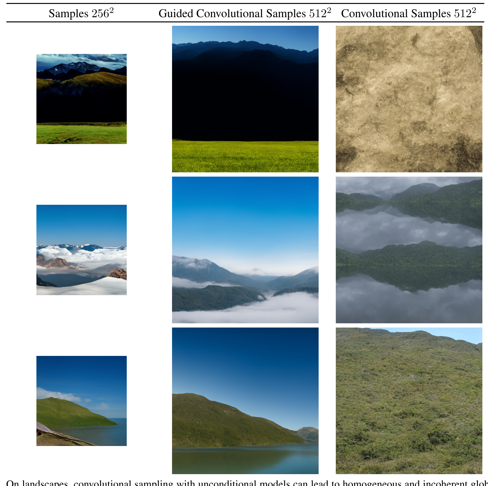

**图 14.** 在景观图像上, 使用无条件模型进行卷积采样可能导致均一且不连贯的全局结构 (见第 2 列). 使用低分辨率图像进行 $L_{2}$ 引导, 有助于重新建立连贯的全局结构.

扩散模型的一个有趣特性是, 无条件模型可以在测试时添加条件 [Son20, Soh15, Dha21]. 具体而言, [Dha21] 提出了一种算法, 使用在扩散过程的每个 $x_{t}$ 上训练的分类器 $\log p_{\Phi}(y|x_{t})$, 引导在 ImageNet 数据集上训练的无条件和条件模型. 我们直接基于这一形式, 引入事后*图像引导*:

对于方差固定的 epsilon 参数化模型, [Dha21] 中提出的引导算法为:

$$
\hat{\epsilon}\leftarrow\epsilon_{\theta}(z_{t},t)+\sqrt{1-\alpha_{t}^{2}}\;\nabla_{z_{t}}\log p_{\Phi}(y|z_{t})\;.
$$

这可以解释为一个更新, 用条件分布 $\log p_{\Phi}(y|z_{t})$ 修正 "score" $\epsilon_{\theta}$.

到目前为止, 这一场景只应用于单类别分类模型. 我们将引导分布 $p_{\Phi}(y|T(\mathcal{D}(z_{0}(z_{t}))))$ 重新解释为一个通用的图像到图像转换任务, 给定目标图像 $y$, 其中 $T$ 可以是针对当前图像到图像转换任务采用的任意可微变换, 例如恒等映射, 下采样操作或类似变换.  例如, 我们可以假设一个方差固定为 $\sigma^{2}=1$ 的高斯引导器, 此时

$$
\log p_{\Phi}(y|z_{t})=-\frac{1}{2}\|y-T(\mathcal{D}(z_{0}(z_{t})))\|^{2}_{2}
$$

变成一个 $L_{2}$ 回归目标.

[图 14](#figure-14) 展示了这种形式如何作为在 $256^{2}$ 图像上训练的无条件模型的上采样机制, 其中大小为 $256^{2}$ 的无条件样本引导 $512^{2}$ 图像的卷积合成, $T$ 是 $2\times$ 双三次下采样. 基于这一动机, 我们还试验了感知相似度引导, 将 $L_{2}$ 目标替换为 LPIPS [Zha18d] 指标, 见[第 4.4 节](#section-4-4).

## 10 其他结果

### 10.1 高分辨率合成的信噪比选择

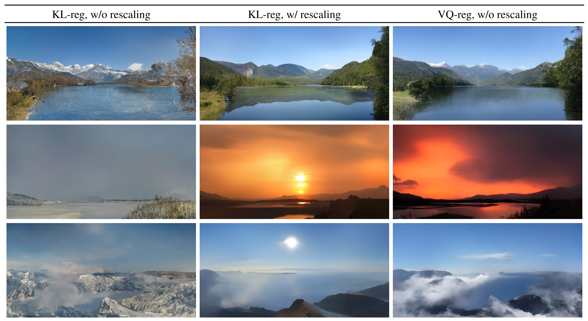

**图 15.** 说明潜在空间重缩放对卷积采样的影响, 这里的任务是景观图像语义合成. 见[第 4.3.2 节](#section-4-3-2) 和[第 10.1 节](#section-10-1).

如[第 4.3.2 节](#section-4-3-2) 所述, 潜在空间方差诱导的信噪比 (*i.e*. $\text{Var(z)}/\sigma^{2}_{t}$) 会显著影响卷积采样的结果. 例如, 当直接在 KL 正则化模型的潜在空间中训练 LDM 时 (见[表 8](#table-08)), 该比值很高, 因此模型会在反向去噪过程的早期分配大量语义细节. 相比之下, 当按照[第 13 节](#section-13) 所述, 使用潜在表示按分量的标准差对潜在空间进行重缩放时, SNR 会降低. 我们在[图 15](#figure-15) 中展示了这种变化对景观图像语义合成卷积采样的影响. 注意, VQ 正则化空间的方差接近 $1$, 因此不需要重缩放.

### 10.2 所有第一阶段模型的完整列表

我们在[表 8](#table-08) 中给出在 OpenImages 数据集上训练的各种自动编码模型的完整列表.

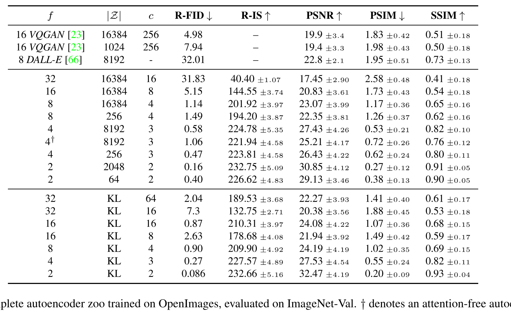

**表 8.** 在 OpenImages 上训练, 并在 ImageNet-Val 上评估的完整自动编码器集合. $\dagger$ 表示不带注意力的自动编码器.

### 10.3 布局到图像合成

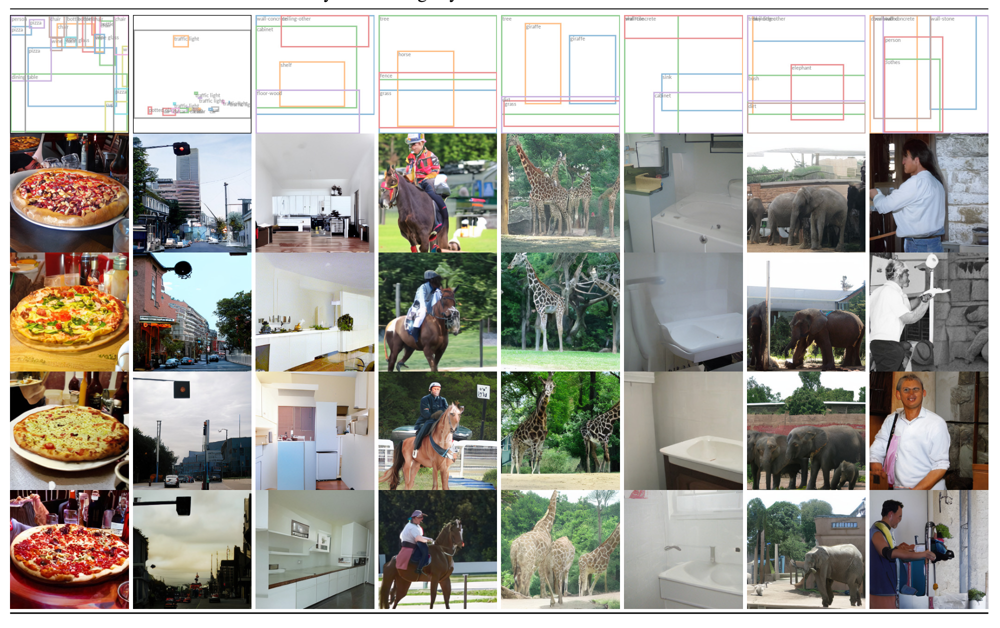

**图 16.** 我们用于布局到图像合成的最佳模型 *LDM-4* 的更多样本. 该模型在 OpenImages 数据集上训练, 并在 COCO 数据集上微调. 样本使用 100 个 DDIM 步骤和 $\eta=0$ 生成. 布局来自 COCO 验证集.

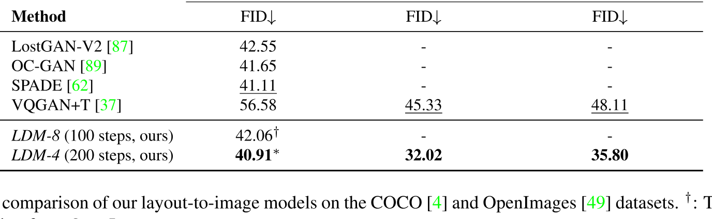

**表 9.** 我们的布局到图像模型在 COCO [Cae18] 和 OpenImages [Kuz18] 数据集上的定量比较. ^†: 在 COCO 上从头训练; ^∗: 从 OpenImages 进行微调.

这里给出[第 4.3.1 节](#section-4-3-1) 中布局到图像模型的定量评估和额外样本. 我们在 COCO [Cae18] 和 OpenImages [Kuz18] 数据集上各训练一个模型, 随后又在 COCO 上对其进行微调. [表 9](#table-09) 展示了结果. 按照其训练和评估流程 [Syl21] 时, 我们的 COCO 模型达到了近期布局到图像合成方法的性能. 从 OpenImages 模型微调后, 我们超过了这些方法. 我们的 OpenImages 模型在 FID 上超过了 Jahn 等人 [Jah21] 的结果, 差距接近 11. 在[图 16](#figure-16) 中, 我们展示了在 COCO 上微调后的模型的更多样本.

### 10.4 ImageNet 上的类别条件图像合成

[表 10](#table-10) 包含我们的类别条件 LDM 在 FID 和 Inception 分数 (IS) 上的结果. LDM-8 只需显著更少的参数和计算需求 (见[表 18](#table-18)), 就能达到很有竞争力的表现. 与之前的工作类似, 我们还可以在每个噪声尺度上训练一个分类器并使用它进行引导, 见[第 9 节](#section-9). 与基于像素的方法不同, 这个分类器在潜在空间中训练, 成本很低. 更多定性结果见[图 26](#figure-26) 和[图 27](#figure-27).

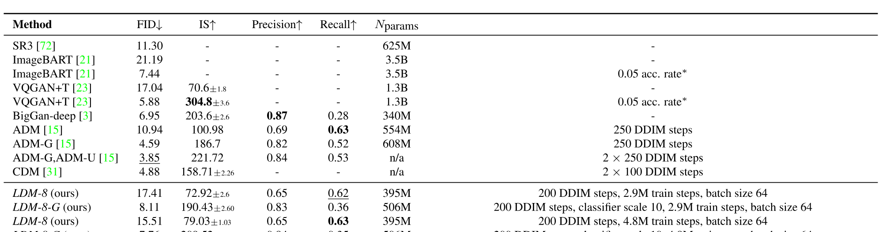

**表 10.** 类别条件 ImageNet *LDM* 与 ImageNet [Den09a] 数据集上近期当前最先进类别条件图像生成方法的比较. ^∗: 按照 [Raz19] 提出的方式, 使用给定拒绝率进行分类器拒绝采样.

### 10.5 样本质量与 V100 日 (续自第 4.1 节)

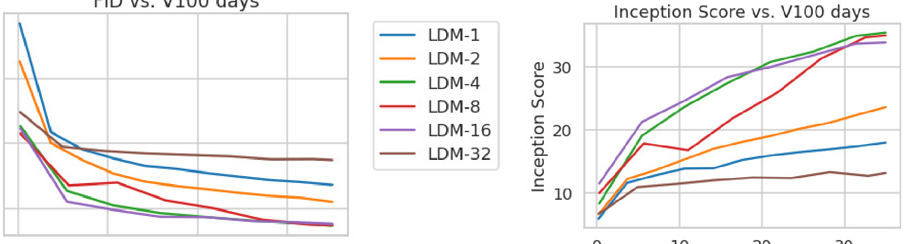

**图 17.** 为完整起见, 我们还报告了类别条件 *LDM* 在 ImageNet 数据集上固定 35 个 V100 日时的训练进展. 结果使用 100 个 DDIM 步骤 [Son21a] 和 $\kappa=0$ 获得. 出于效率原因, FID 在 5000 个样本上计算.

为了评估[第 4.1 节](#section-4-1) 中样本质量随训练进展的变化, 我们报告了 FID 和 IS 分数随训练步数变化的结果. 另一种做法是报告这些指标随使用的 V100 日资源变化的结果. [图 17](#figure-17) 提供了这种分析, 结果在定性上相似.

### 10.6 超分辨率

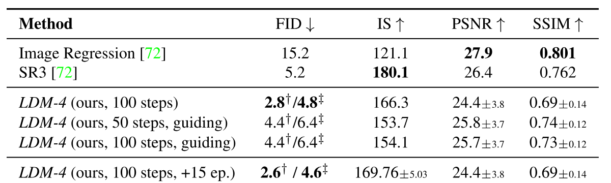

**表 11.** ImageNet-Val 上的 $\times 4$ 放大结果. ($256^{2}$); ^†: 在验证集划分上计算的 FID 特征, ^‡: 在训练集划分上计算的 FID 特征. 我们还加入了一个基于像素空间的基线, 它使用与 *LDM-4* 相同的计算量. 最后两行相比之前的结果额外训练了 15 个 epoch.

为了更好地比较 LDM 和像素空间中的扩散模型, 我们从[表 5](#table-05) 的分析出发, 比较训练步数相同且参数量相近的扩散模型与我们的 LDM [+1]. 这一比较的结果显示在[表 11](#table-11) 的最后两行, 说明 LDM 在取得更好性能的同时, 还支持明显更快的采样. [图 20](#figure-20) 给出了定性比较, 其中展示了 LDM 和像素空间扩散模型生成的随机样本.

#### 10.6.1 LDM-BSR: 通过多样图像退化实现通用超分辨率模型

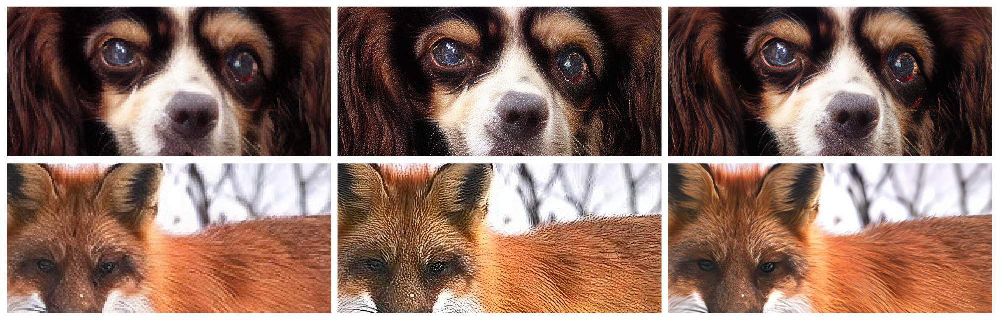

**图 18.** *LDM-BSR* 可以泛化到任意输入, 并作为通用上采样器使用, 将类别条件 *LDM* 的样本 (图像, *cf*. [图 4](#figure-04)) 放大到 $1024^{2}$ 分辨率. 相比之下, 使用固定的退化过程 (见[第 4.4 节](#section-4-4)) 会阻碍泛化.

为了评估 LDM-SR 的泛化能力, 我们将它同时应用于类别条件 ImageNet 模型 ([第 4.1 节](#section-4-1)) 生成的合成 LDM 样本和从互联网抓取的图像. 有趣的是, 我们观察到, 只使用双三次下采样条件训练的 LDM-SR, 如 [Sah21] 中所述, 无法很好地泛化到不遵循该预处理的图像. 因此, 为了获得一个适用于各种真实世界图像的超分辨率模型, 这些图像可能包含相机噪声, 压缩伪影, 模糊和插值的复杂叠加, 我们将 LDM-SR 中的双三次下采样操作替换为 [Zha21p] 中的退化流程. BSR 退化过程是一条退化流程, 它以随机顺序对图像应用 JPEG 压缩噪声, 相机传感器噪声, 不同的下采样图像插值方法, 高斯模糊核和高斯噪声. 我们发现, 使用 [Zha21p] 中的原始参数进行 BSR 退化会导致非常强的退化过程. 由于更温和的退化过程似乎更适合我们的应用, 我们调整了 BSR 退化的参数 (调整后的退化过程可在我们的代码库 https://github.com/CompVis/latent-diffusion 中找到). [图 18](#figure-18) 通过直接比较 *LDM-SR* 和 *LDM-BSR*, 展示了该方法的效果. 后者生成的图像比受固定预处理限制的模型清晰得多, 适合真实世界应用. [图 19](#figure-19) 还展示了 *LDM-BSR* 在 LSUN-cows 上的更多结果.

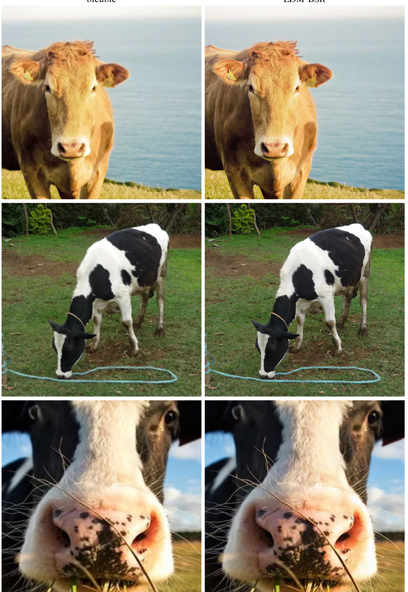

**图 19.** *LDM-BSR* 可以泛化到任意输入, 并作为通用上采样器使用, 将 LSUN-Cows 数据集的样本放大到 $1024^{2}$ 分辨率.

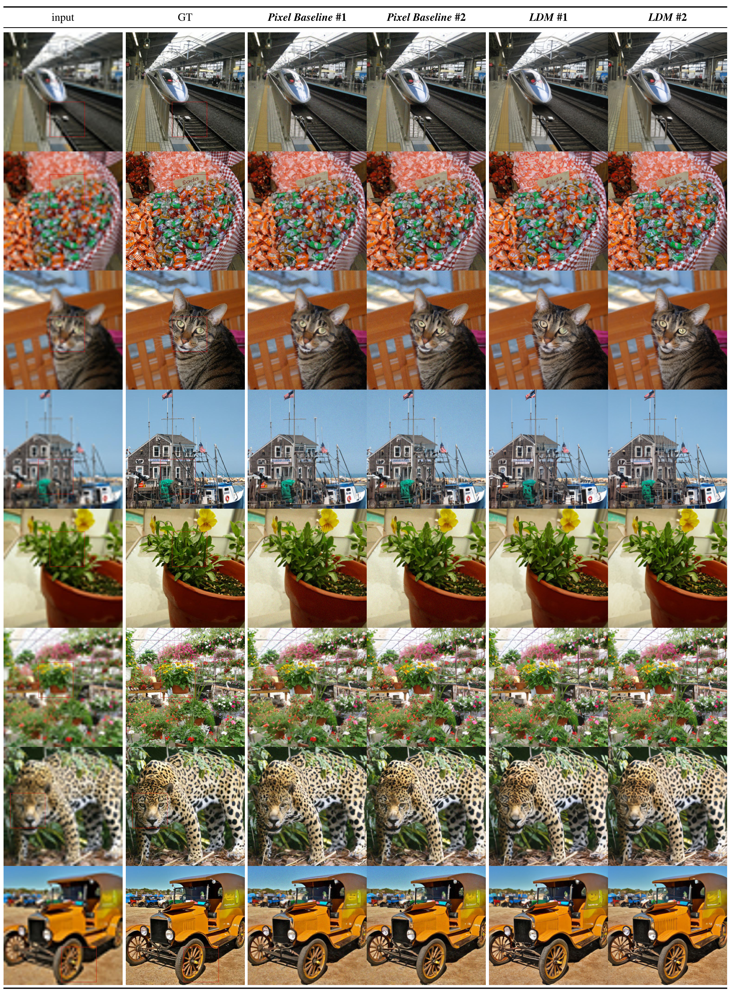

**图 20.** LDM-SR 和 Pixelspace 中 baseline-diffusionmodel 的两个随机样本的定性超分辨率比较. 在经过相同训练步数后, 于 imagenet 验证集上评估.

## 11 实现细节和超参数

### 11.1 超参数

我们在[表 12](#table-12), [表 13](#table-13), [表 14](#table-14) 和[表 15](#table-15) 中概述所有训练所得 *LDM* 模型的超参数.

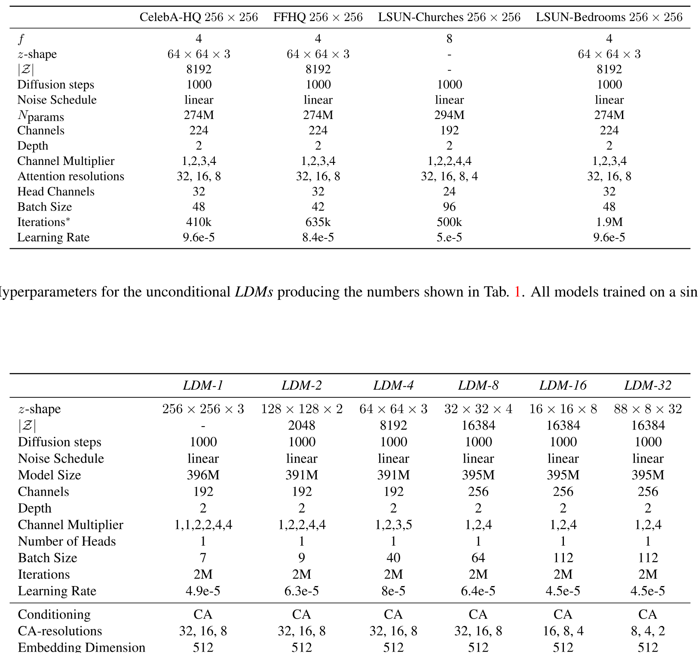

**表 12.** 生成[表 1](#table-01) 中数值的无条件 *LDM* 的超参数. 所有模型均在单个 NVIDIA A100 上训练.

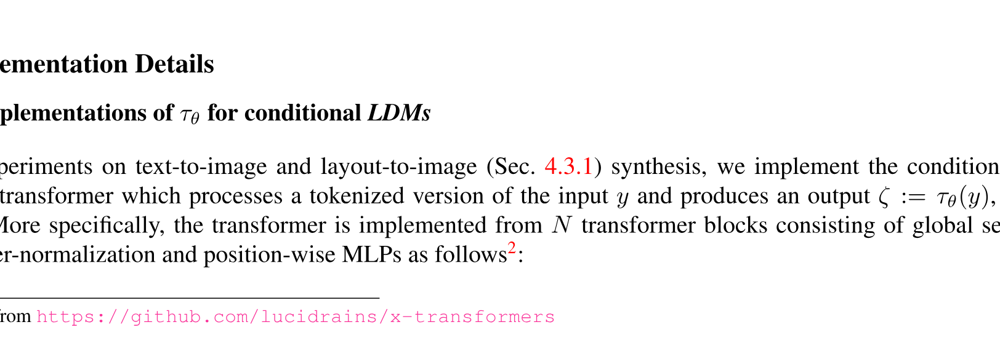

**表 13.** 为[第 4.1 节](#section-4-1) 中的分析在 ImageNet 数据集上训练的条件 *LDM* 的超参数. 所有模型均在单个 NVIDIA A100 上训练.

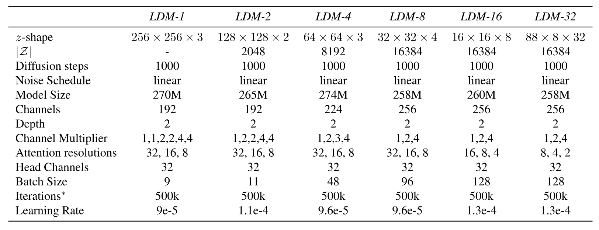

**表 14.** 为[图 7](#figure-07) 中的分析在 CelebA 数据集上训练的无条件 *LDM* 的超参数. 所有模型均在单个 NVIDIA A100 上训练. ^∗: 所有模型训练了 500k 次迭代. 如果模型更早收敛, 我们使用最佳检查点评估给出的 FID 分数.

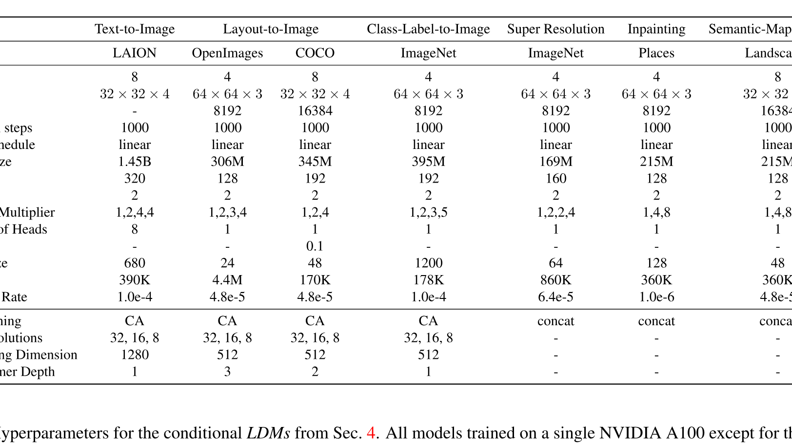

**表 15.** 来自[第 4 节](#section-4) 的条件 *LDM* 的超参数. 除图像修复模型在 8 个 V100 上训练外, 所有模型均在单个 NVIDIA A100 上训练.

### 11.2 实现细节

#### 11.2.1 条件 LDM 中 τθ\tau_{\theta} 的实现

对于文本到图像和布局到图像合成实验 ([第 4.3.1 节](#section-4-3-1)), 我们将条件器 $\tau_{\theta}$ 实现为一个无掩码 transformer, 它处理输入 $y$ 的 token 化版本并生成输出 $\zeta:=\tau_{\theta}(y)$, 其中 $\zeta\in\mathbb{R}^{M\times d_{\tau}}$. 更具体地说, transformer 由 $N$ 个 transformer block 构成, 每个 block 包含全局自注意力层, 层归一化和逐位置 MLP, 如下所示 [+2]:

$$
\displaystyle\zeta\leftarrow\text{TokEmb}(y)+\text{PosEmb(y)}
$$

得到 $\zeta$ 后, 如[图 3](#figure-03) 所示, 条件信息通过交叉注意力机制映射到 UNet 中. 我们修改 "ablated UNet" [Dha21] 架构, 用一个浅层 (无掩码) transformer 替换自注意力层. 该 transformer 由 $T$ 个 block 构成, 层交替为 (i) 自注意力, (ii) 逐位置 MLP, (iii) 交叉注意力层, 见[表 16](#table-16). 注意, 如果没有 (ii) 和 (iii), 该架构就等价于 "ablated UNet".

虽然还可以通过额外以时间步 $t$ 为条件来提高 $\tau_{\theta}$ 的表示能力, 但我们没有采用这种选择, 因为它会降低推理速度. 我们将对这一修改的更详细分析留给未来工作.

对于文本到图像模型, 我们使用一个公开可用的 [+3] tokenizer [Wol19]. 布局到图像模型将边界框的空间位置离散化, 并将每个框编码为 $(l,b,c)$ 元组, 其中 $l$ 表示 (离散的) 左上位置, $b$ 表示右下位置. 类别信息包含在 $c$ 中.  关于 $\tau_{\theta}$ 的超参数见[表 17](#table-17), 关于上述两个任务中 UNet 的超参数见[表 13](#table-13).  

注意, [第 4.1 节](#section-4-1) 所述的类别条件模型也通过交叉注意力实现, 其中 $\tau_{\theta}$ 是一个维度为 512 的单一可学习嵌入层, 将类别 $y$ 映射为 $\zeta\in\mathbb{R}^{1\times 512}$.

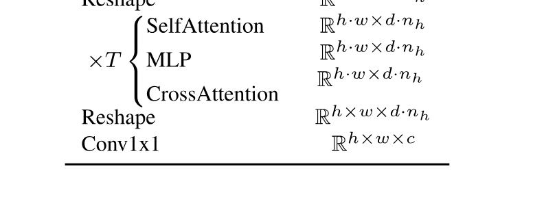

**表 16.** [第 11.2.1 节](#section-11-2-1) 所述 transformer block 的架构, 它替换了标准 "ablated UNet" 架构 [Dha21] 的自注意力层. 这里, $n_{h}$ 表示注意力头的数量, $d$ 表示每个头的维度.

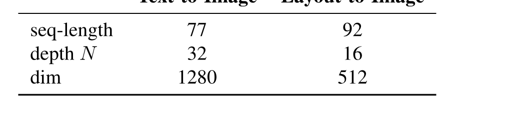

**表 17.** 使用 transformer 编码器进行[第 4.3 节](#section-4-3) 实验的超参数.

#### 11.2.2 图像修复

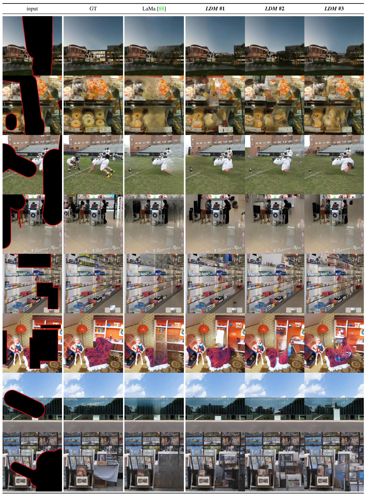

**图 21.** 图像修复的定性结果. 与 [Suv21] 不同, 我们的生成方法可以针对给定输入生成多个不同样本.

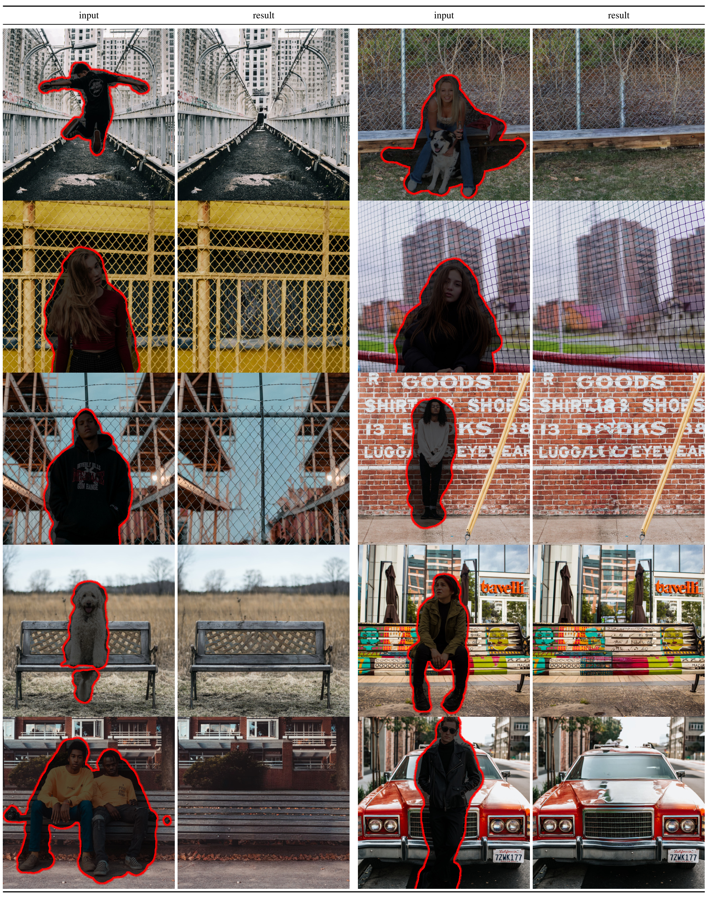

**图 22.** 更多目标移除定性结果, 如[图 11](#figure-11) 所示.

对于[第 4.5 节](#section-4-5) 中的图像修复实验, 我们使用 [Suv21] 的代码生成合成掩码. 我们使用 Places [Zho18a] 中固定的 2k 个验证样本和 30k 个测试样本. 训练期间, 我们使用大小为 $256\times 256$ 的随机裁剪, 并在大小为 $512\times 512$ 的裁剪上评估. 这遵循 [Suv21] 中的训练和测试流程, 并复现其报告的指标 (见[表 7](#table-07) 中的 ^†). 我们在[图 21](#figure-21) 中加入了 *LDM-4, w/ attn* 的额外定性结果, 并在[图 22](#figure-22) 中加入了 *LDM-4, w/o attn, big, w/ ft* 的额外定性结果.

### 11.3 评估细节

本节为[第 4 节](#section-4) 所示实验的评估提供额外细节.

#### 11.3.1 无条件和类别条件图像合成的定量结果

我们遵循常见做法, 根据模型生成的 50k 个样本以及所示每个数据集的完整训练集, 估计计算[表 1](#table-01) 和[表 10](#table-10) 中 FID, Precision 和 Recall 分数所需的统计量 [Heu17, Kyn19]. 计算 FID 分数时, 我们使用 torch-fidelity 包 [Obu20]. 但由于不同的数据处理流程可能导致不同结果 [Par21a], 我们还使用 Dhariwal 和 Nichol [Dha21] 提供的脚本评估模型. 我们发现结果总体一致, 但 ImageNet 和 LSUN-Bedrooms 数据集除外, 在这两个数据集上, 我们观察到分数略有变化, 分别为 7.76 (torch-fidelity) 对 7.77 (Nichol 和 Dhariwal), 以及 2.95 对 3.0. 对未来工作而言, 我们强调需要统一的样本质量评估流程. Precision 和 Recall 也使用 Nichol 和 Dhariwal 提供的脚本计算.

#### 11.3.2 文本到图像合成

遵循 [Ram21] 的评估流程, 我们通过将生成样本与 MS-COCO 数据集 [Lin14a] 验证集中的 30000 个样本进行比较, 计算[表 2](#table-02) 中文本到图像模型的 FID 和 Inception Score. FID 和 Inception Score 使用 torch-fidelity 计算.

#### 11.3.3 布局到图像合成

为了评估我们的布局到图像模型在 COCO 数据集上的样本质量, 见[表 9](#table-09), 我们遵循常见做法 [Syl21, Jah21, Wu20], 在 COCO Segmentation Challenge 划分中 2048 个未经增强的样本上计算 FID 分数. 为了提高可比性, 我们使用与 [Jah21] 完全相同的样本. 对于 OpenImages 数据集, 我们同样遵循其流程, 使用验证集中的 2048 张中心裁剪测试图像.

#### 11.3.4 超分辨率

我们按照 [Sah21] 建议的流程在 ImageNet 上评估超分辨率模型, *i.e*. 移除短边小于 $256$ px 的图像 (训练和评估均如此). 在 ImageNet 上, 低分辨率图像通过带抗锯齿的双三次插值生成. FID 使用 torch-fidelity [Obu20] 评估, 我们在验证集划分上生成样本. 对于 FID 分数, 我们还将其与在训练集划分上计算的参考特征进行比较, 见[表 5](#table-05) 和[表 11](#table-11).

#### 11.3.5 效率分析

出于效率原因, 我们根据 5k 个样本计算[图 6](#figure-06), [图 17](#figure-17) 和[图 7](#figure-07) 中绘制的样本质量指标. 因此, 结果可能与[表 1](#table-01) 和[表 10](#table-10) 中的结果不同. 如[表 13](#table-13) 和[表 14](#table-14) 所示, 所有模型的参数量相近. 我们将各模型的学习率提高到仍能稳定训练的最大值. 因此, 不同运行之间的学习率略有差异, *cf*. [表 13](#table-13) 和[表 14](#table-14).

#### 11.3.6 用户研究

对于[表 4](#table-04) 中的用户研究结果, 我们遵循 [Sah21] 的流程, 使用二选一强制选择范式评估两个不同任务中的人类偏好分数. 在任务 1 中, 受试者会看到一张低分辨率/带掩码图像, 它位于对应的真实高分辨率/无掩码版本和一张合成图像之间, 合成图像使用中间图像作为条件生成. 对于超分辨率, 我们向受试者提问: *"中间的低分辨率图像对应的两张图像中, 哪一张是更好的高质量版本?"*. 对于图像修复, 我们提问: *"两张图像中, 哪一张在中间图像中包含更真实的修复区域?"*. 在任务 2 中, 我们同样向受试者展示低分辨率/带掩码版本, 让他们在两个竞争方法生成的对应图像之间选择偏好. 与 [Sah21] 一样, 受试者在回答前观看图像 3 秒.

## 12 计算需求

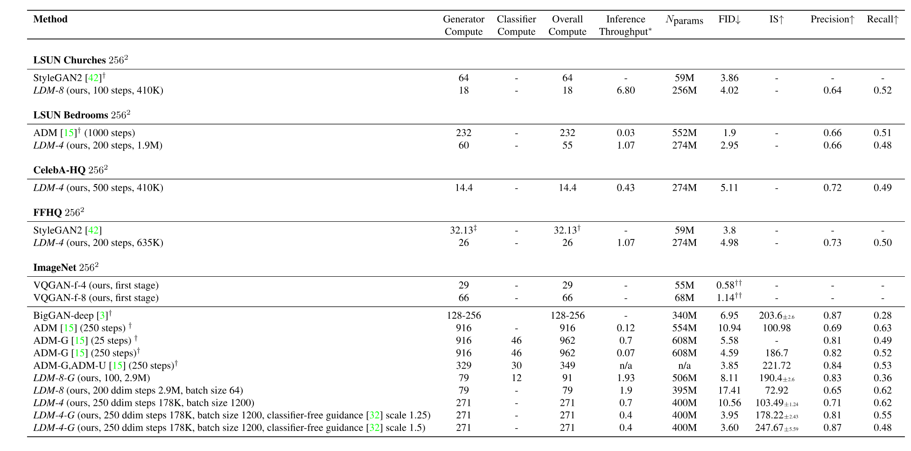

**表 18.** 比较当前最先进生成模型在训练期间的计算需求和推理吞吐量. 训练期间的计算量以 V100 日计, 竞争方法的数值取自 [Dha21], 除非另有说明;^∗: 在单个 NVIDIA A100 上以 samples/sec 计的吞吐量;^†: 数值取自 [Dha21];^‡: 假设使用 25M 个训练样本进行训练; ^††: 相对于 ImageNet 验证集的 R-FID

在[表 18](#table-18) 中, 我们对所使用的计算资源进行了更详细的分析, 并使用相关方法提供的数值, *cf*. [Dha21], 将我们在 CelebA-HQ, FFHQ, LSUN 和 ImageNet 数据集上表现最佳的模型与近期当前最先进模型进行比较. 由于相关工作报告的是 V100 日的计算量, 而我们的所有模型都在单个 NVIDIA A100 GPU 上训练, 因此我们假设 A100 相比 V100 的速度提升为 $\times 2.2$ [Sal20] [+4], 将 A100 日换算为 V100 日. 为评估样本质量, 我们还报告了所述数据集上的 FID 分数. 我们以显著更少的计算资源, 接近达到了 StyleGAN2 [Kar20b] 和 ADM [Dha21] 等当前最先进方法的性能.

## 13 自动编码模型的详细信息

我们遵循 [Ess20a], 以对抗方式训练所有自动编码模型, 使基于 patch 的判别器 $D_{\psi}$ 经过优化, 区分原始图像和重建图像 $\mathcal{D}(\mathcal{E}(x))$. 为避免潜在空间的尺度任意变化, 我们引入正则化损失项 $L_{reg}$, 使潜在表示 $z$ 以零为中心并具有较小方差.  我们研究两种不同的正则化方法: (i) 在 $q_{\mathcal{E}}(z|x)=\mathcal{N}(z;\mathcal{E}_{\mu},\mathcal{E}_{\sigma^{2}})$ 与标准正态分布 $\mathcal{N}(z;0,1)$ 之间使用低权重的 Kullback-Leibler 项, 类似标准变分自动编码器 [Kin14, Rez14]; (ii) 通过学习包含 $|\mathcal{Z}|$ 个不同样本的码本 [Oor17], 使用向量量化层对潜在空间进行正则化.  为了获得高保真重建, 两种情况下我们都只使用非常小的正则化, *i.e*. 要么给 $\mathbb{KL}$ 项乘以约 $10^{-6}$ 的因子, 要么选择较高的码本维度 $|\mathcal{Z}|$.

训练自动编码模型 $(\mathcal{E},\mathcal{D})$ 的完整目标为:

$$
L_{\text{Autoencoder}}=\min_{\mathcal{E},\mathcal{D}}\max_{\psi}\Big(L_{rec}(x,\mathcal{D}(\mathcal{E}(x)))-L_{adv}(\mathcal{D}(\mathcal{E}(x)))+\log D_{\psi}(x)+L_{reg}(x;\mathcal{E},\mathcal{D})\Big)
$$

**在潜在空间中训练 DM.** 注意, 为了在学习到的潜在空间上训练扩散模型, 当学习 $p(z)$ 或 $p(z|y)$ 时, 我们再次区分两种情况, 见[第 4.3 节](#section-4-3): (i) 对于 KL 正则化潜在空间, 我们采样 $z=\mathcal{E}_{\mu}(x)+\mathcal{E}_{\sigma}(x)\cdot\varepsilon=:\mathcal{E}(x)$, 其中 $\varepsilon\sim\mathcal{N}(0,1)$. 重缩放潜在表示时, 我们根据数据中的第一个 batch 估计逐分量方差

$$
\hat{\sigma}^{2}=\frac{1}{bchw}\sum_{b,c,h,w}(z^{b,c,h,w}-\hat{\mu})^{2}
$$

其中 $\hat{\mu}=\frac{1}{bchw}\sum_{b,c,h,w}z^{b,c,h,w}$. 我们对 $\mathcal{E}$ 的输出进行缩放, 使重缩放后的潜在表示具有单位标准差, *i.e*. $z\leftarrow\frac{z}{\hat{\sigma}}=\frac{\mathcal{E}(x)}{\hat{\sigma}}$. (ii) 对于 VQ 正则化潜在空间, 我们在量化层*之前*提取 $z$, 并将量化操作吸收到解码器中, *i.e*. 可以将其解释为 $\mathcal{D}$ 的第一层.

## 14 其他定性结果

最后, 我们为景观模型提供额外定性结果 ([图 12](#figure-12), [图 23](#figure-23), [图 24](#figure-24) 和[图 25](#figure-25)), 为类别条件 ImageNet 模型提供额外定性结果 ([图 26](#figure-26)-[图 27](#figure-27)), 并为 CelebA-HQ, FFHQ 和 LSUN 数据集上的无条件模型提供额外定性结果 ([图 28](#figure-28)-[图 31](#figure-31)). 与[第 4.5 节](#section-4-5) 中的图像修复模型类似, 我们还将[第 4.3.2 节](#section-4-3-2) 中的语义景观模型直接在 $512^{2}$ 图像上微调, 并在[图 12](#figure-12) 和[图 23](#figure-23) 中展示定性结果. 对于那些在规模相对较小的数据集上训练的模型, 我们还在 VGG [Sim15] 特征空间中展示模型样本的最近邻, 见[图 32](#figure-32)-[图 34](#figure-34).

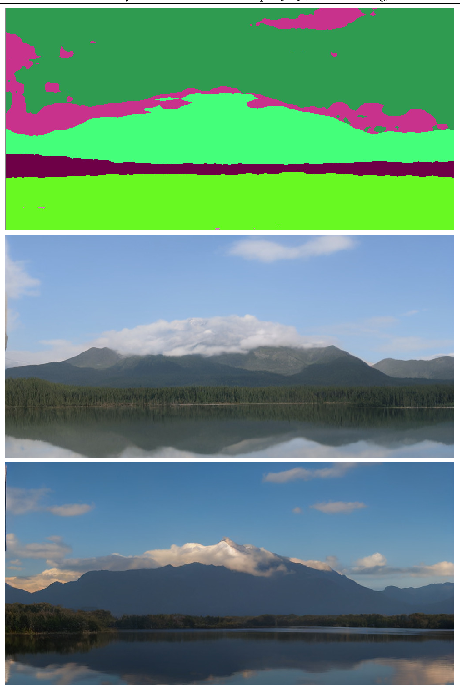

**图 23.** 语义景观模型的卷积样本, 与[第 4.3.2 节](#section-4-3-2) 相同, 在 $512^{2}$ 图像上进行了微调.

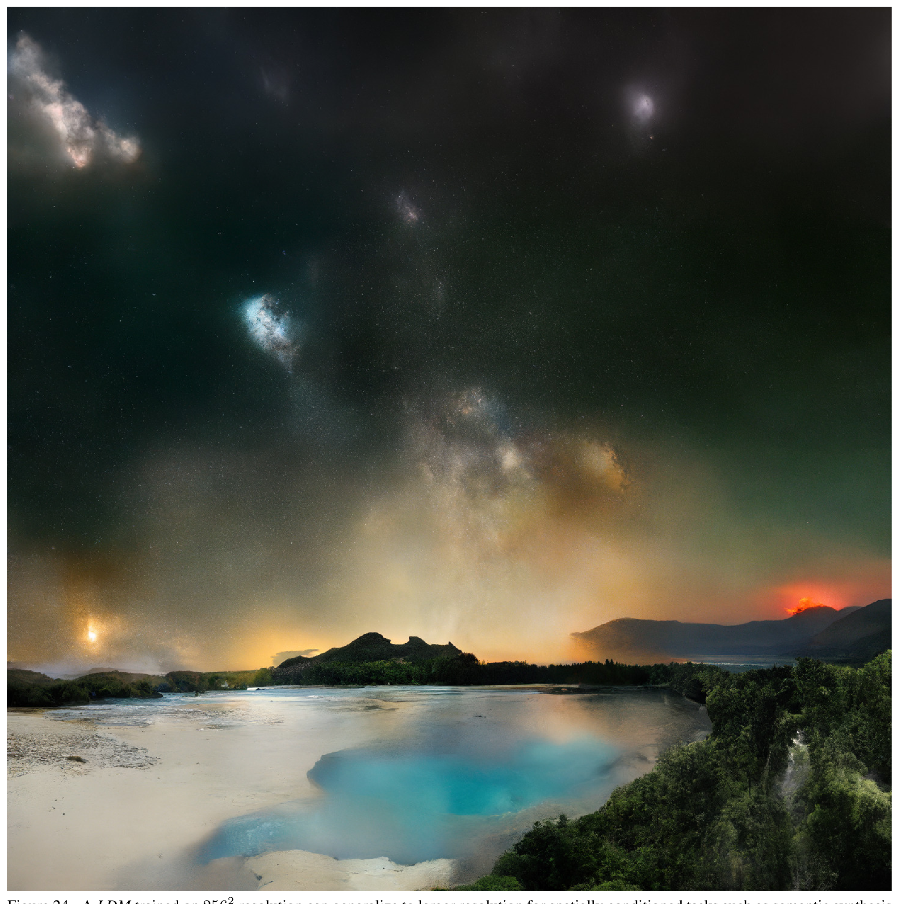

**图 24.** 在 $256^{2}$ 分辨率上训练的 *LDM* 可以泛化到更大分辨率, 用于景观图像语义合成等空间条件任务. 见[第 4.3.2 节](#section-4-3-2).

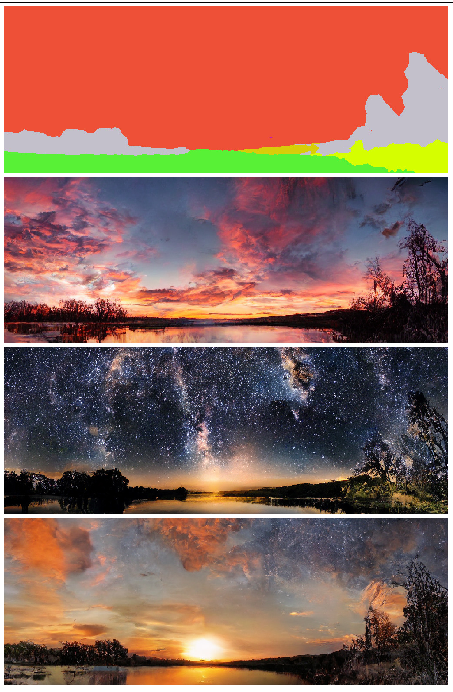

**图 25.** 以语义图为条件时, 我们的 *LDM* 可以泛化到明显大于训练时所见的分辨率. 尽管该模型在大小为 $256^{2}$ 的输入上训练, 它仍可用于生成此处所示的高分辨率样本, 其分辨率为 $1024\times 384$.

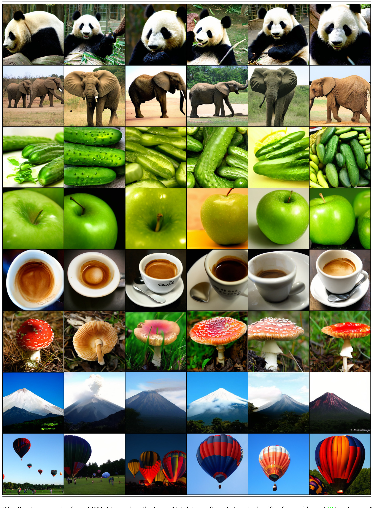

**图 26.** 在 ImageNet 数据集上训练的 *LDM-4* 的随机样本. 使用尺度 $s=5.0$ 的无分类器引导 [Ho21] 和 200 个 DDIM 步骤采样, $\eta=1.0$.

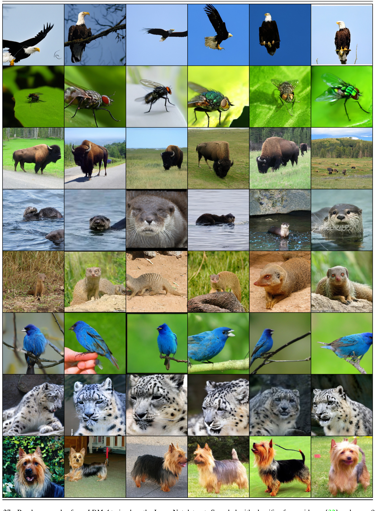

**图 27.** 在 ImageNet 数据集上训练的 *LDM-4* 的随机样本. 使用尺度 $s=3.0$ 的无分类器引导 [Ho21] 和 200 个 DDIM 步骤采样, $\eta=1.0$.

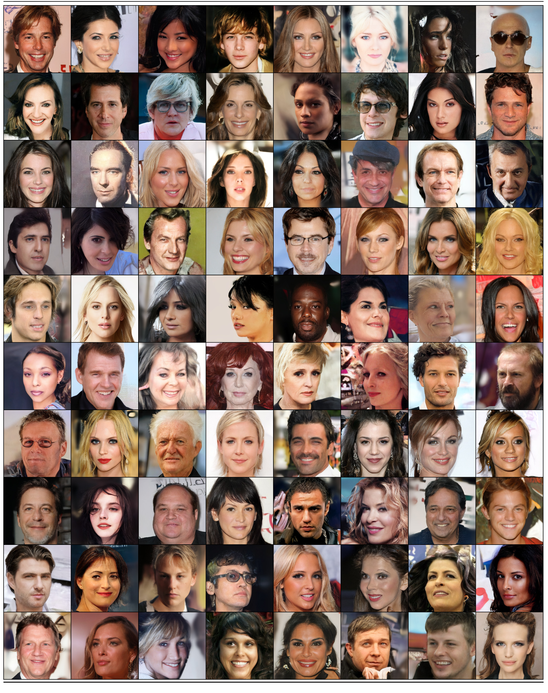

**图 28.** 我们在 CelebA-HQ 数据集上表现最佳的模型 *LDM-4* 的随机样本. 使用 500 个 DDIM 步骤和 $\eta=0$ 采样 (FID = 5.15).

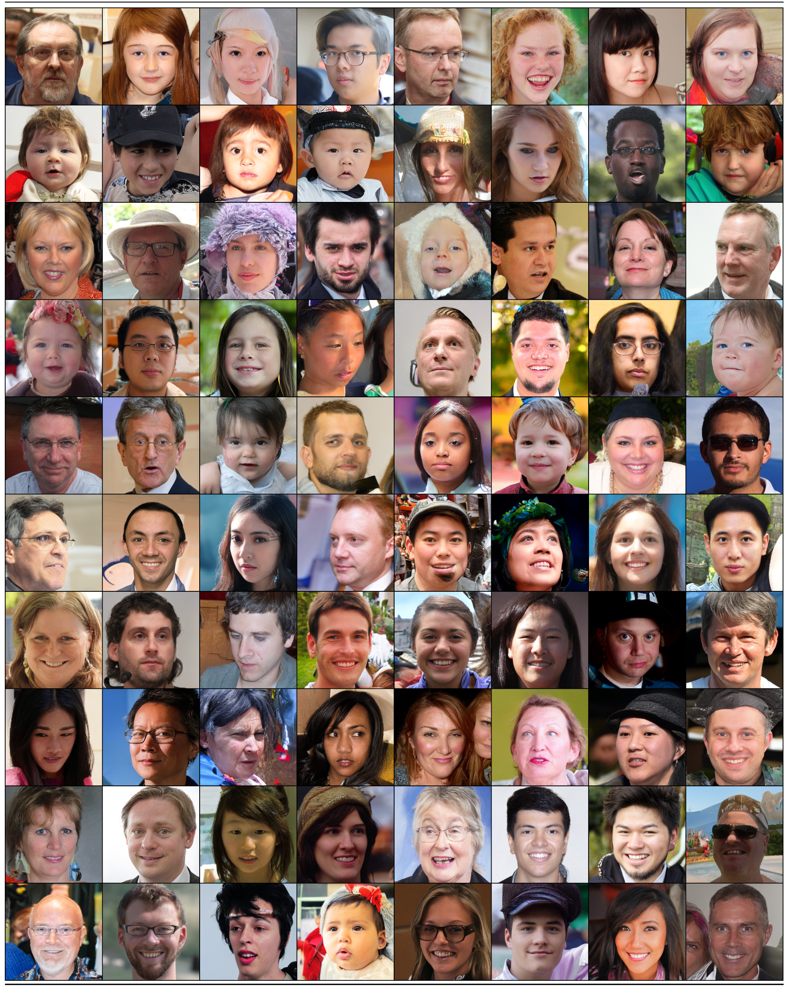

**图 29.** 我们在 FFHQ 数据集上表现最佳的模型 *LDM-4* 的随机样本. 使用 200 个 DDIM 步骤和 $\eta=1$ 采样 (FID = 4.98).

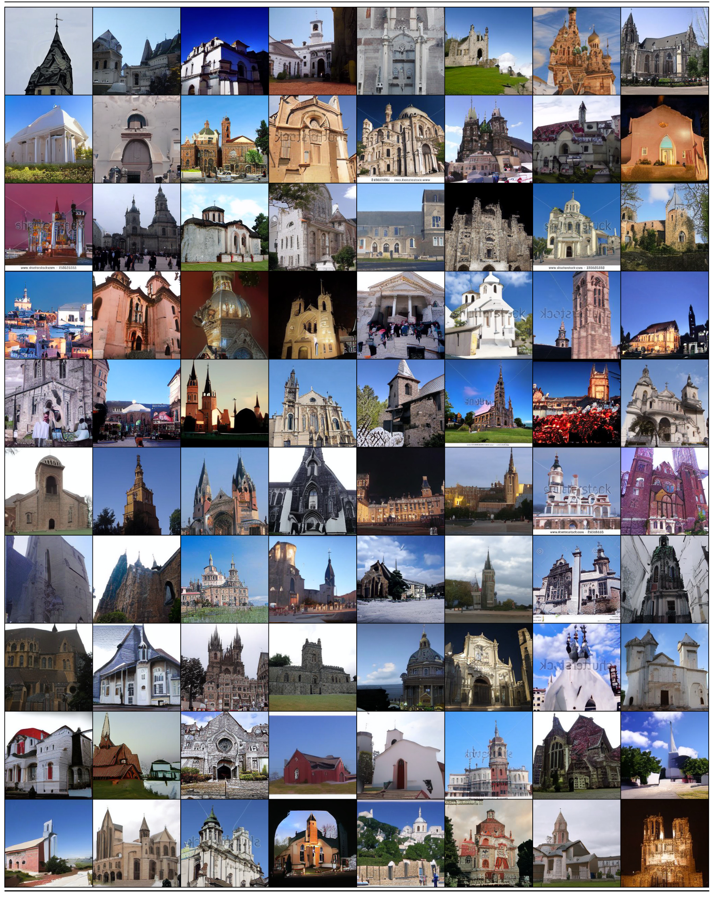

**图 30.** 我们在 LSUN-Churches 数据集上表现最佳的模型 *LDM-8* 的随机样本. 使用 200 个 DDIM 步骤和 $\eta=0$ 采样 (FID = 4.48).

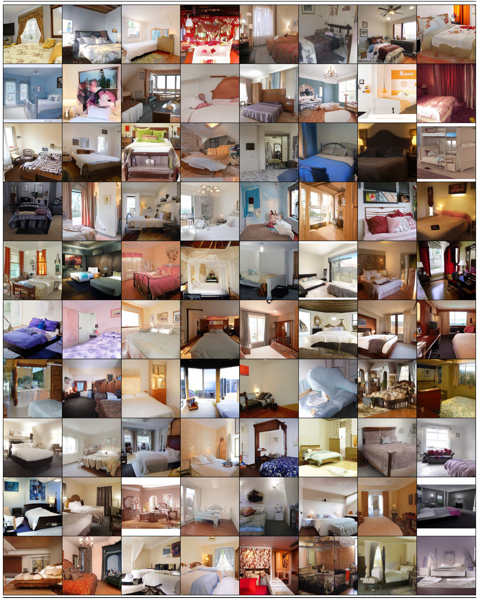

**图 31.** 我们在 LSUN-Bedrooms 数据集上表现最佳的模型 *LDM-4* 的随机样本. 使用 200 个 DDIM 步骤和 $\eta=1$ 采样 (FID = 2.95).

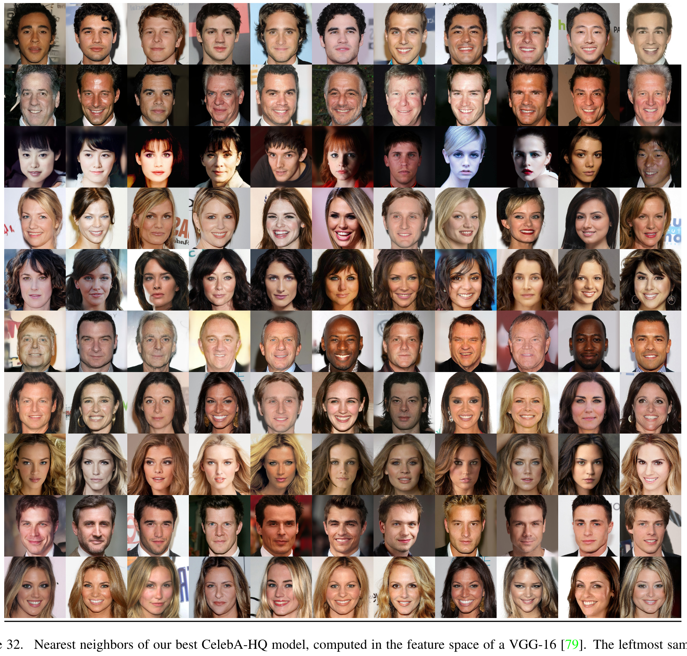

**图 32.** 我们最佳 CelebA-HQ 模型的最近邻, 在 VGG-16 [Sim15] 的特征空间中计算. 最左侧样本来自我们的模型. 每一行的其余样本是它的 10 个最近邻.

**图 33.** 我们最佳 FFHQ 模型的最近邻, 在 VGG-16 [Sim15] 的特征空间中计算. 最左侧样本来自我们的模型. 每一行的其余样本是它的 10 个最近邻.

**图 34.** 我们最佳 LSUN-Churches 模型的最近邻, 在 VGG-16 [Sim15] 的特征空间中计算. 最左侧样本来自我们的模型. 每一行的其余样本是它的 10 个最近邻.

[+equal-contribution]: 前两位作者对本文贡献相同.
[+ack]: 这项工作得到了德国联邦经济事务和能源部项目 "KI-Absicherung - Safe AI for automated driving" 以及德国研究基金会 (DFG) 项目 421703927 的支持.
[+1]: 由于扩散模型运行在像素空间中, 因此无法精确匹配两种架构.
[+2]: 改编自 <https://github.com/lucidrains/x-transformers>.
[+3]: <https://huggingface.co/transformers/model_doc/bert.html#berttokenizerfast>.
[+4]: 这一系数对应于 [Pat21a] 中图 1 所定义的 U-Net 在 A100 上相对于 V100 的加速比, 见[图 1](#figure-01).
