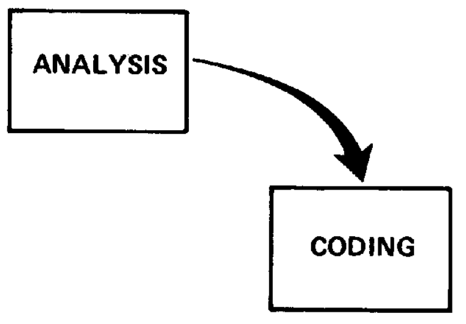
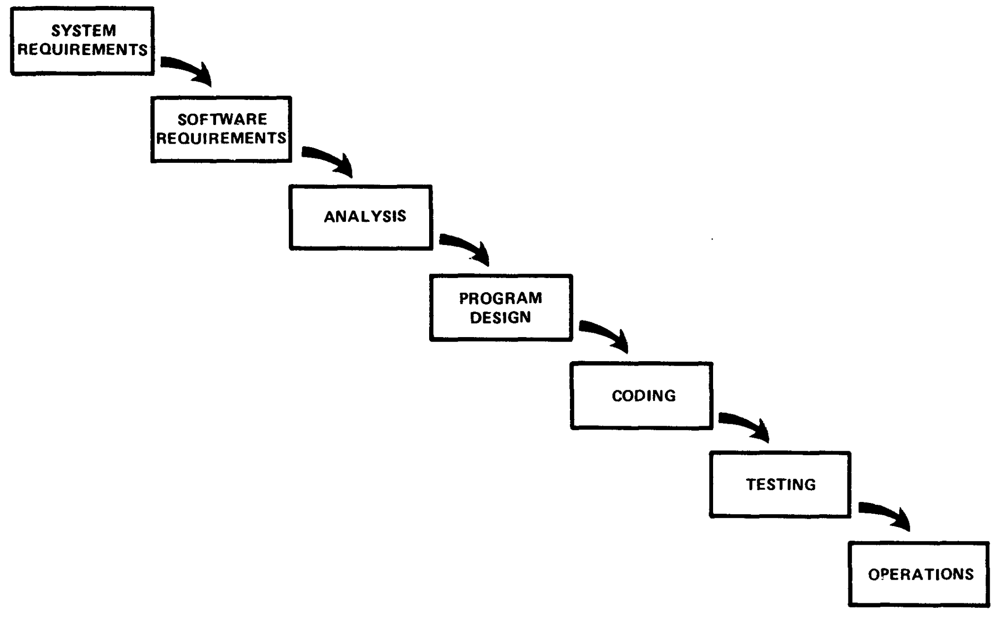
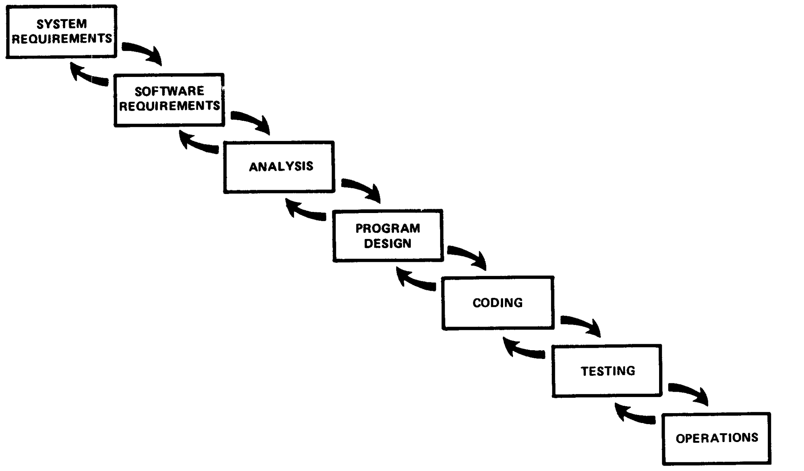
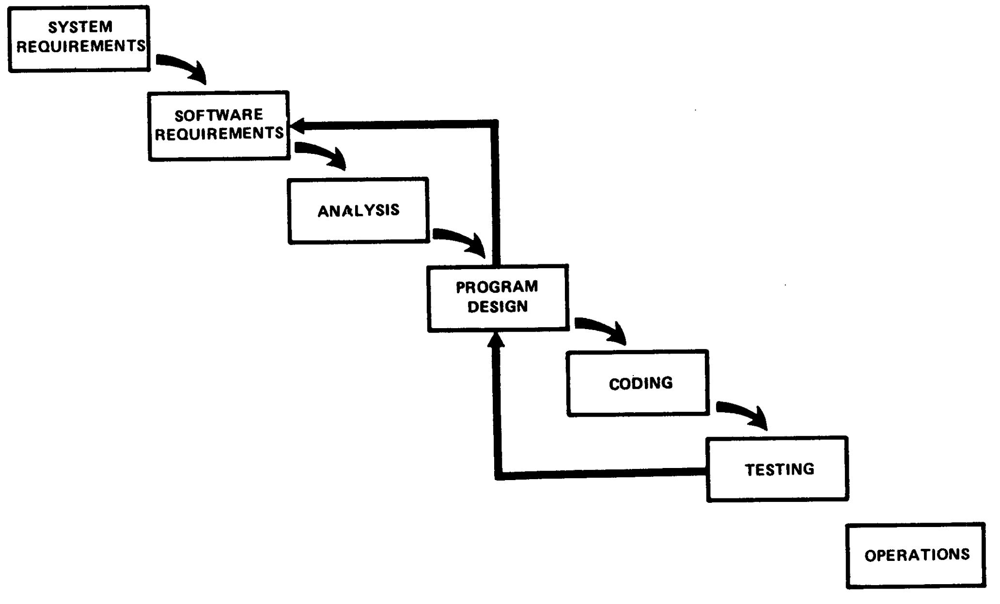
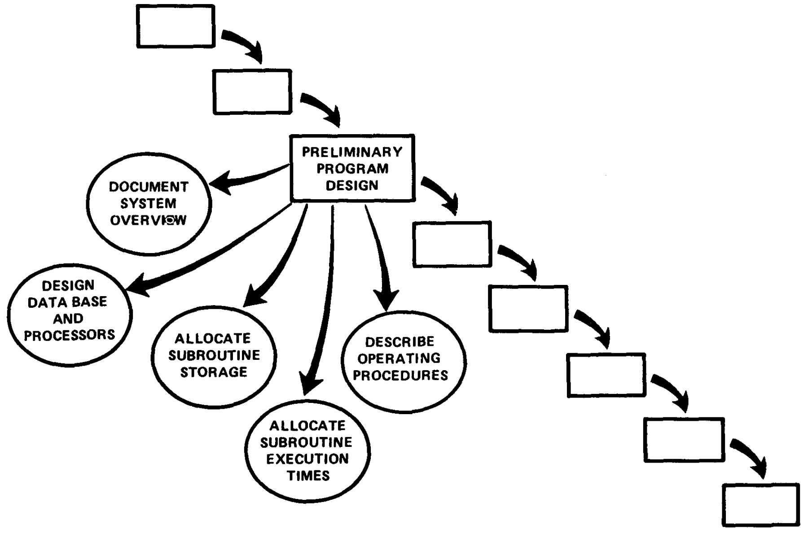
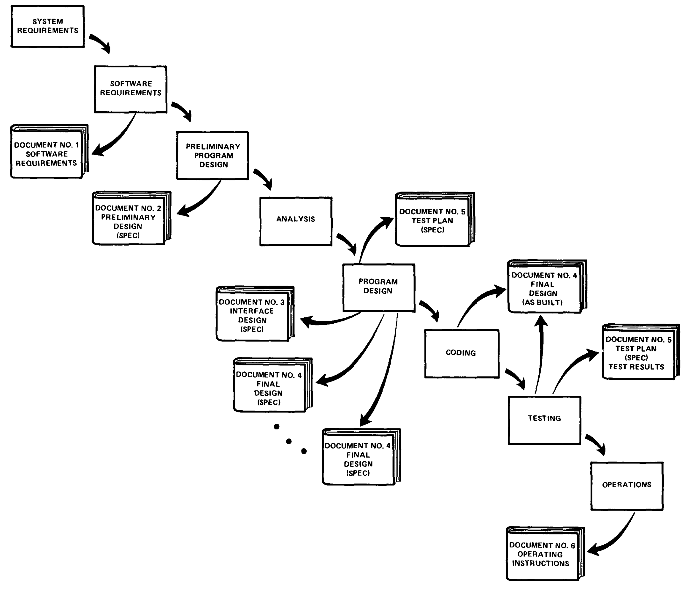
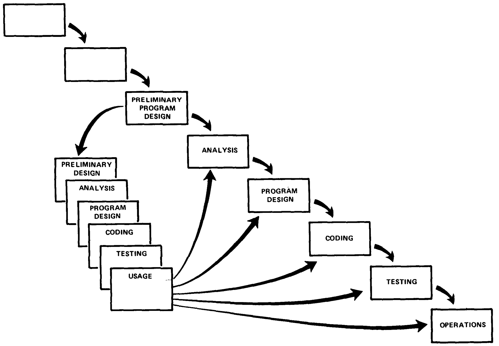
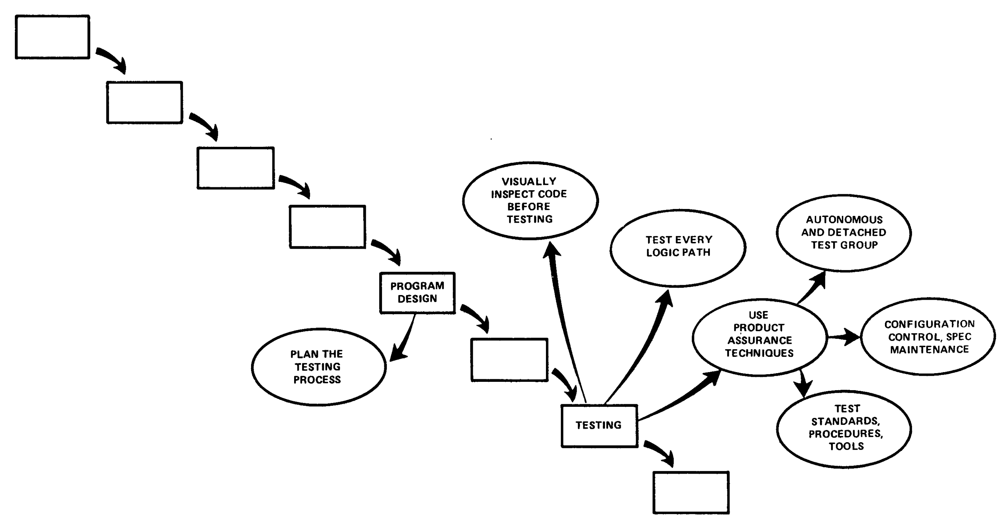
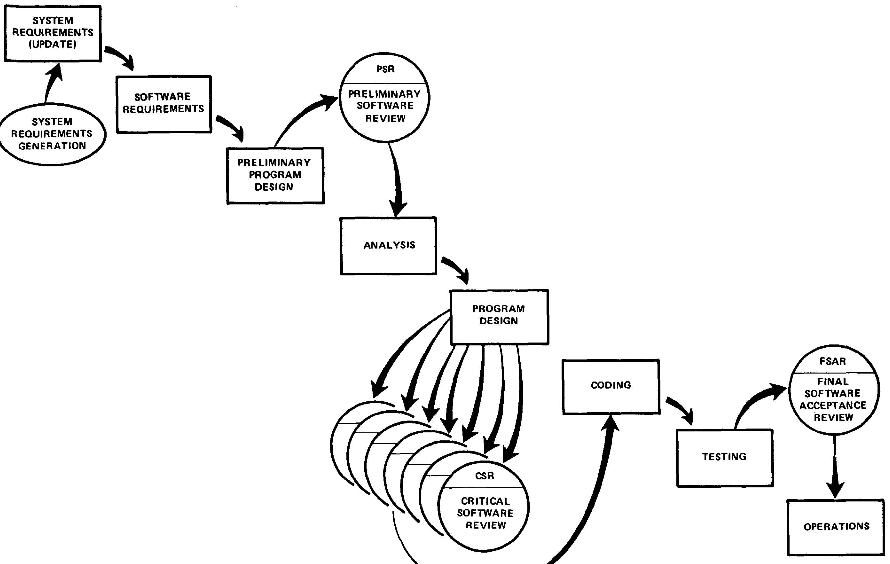
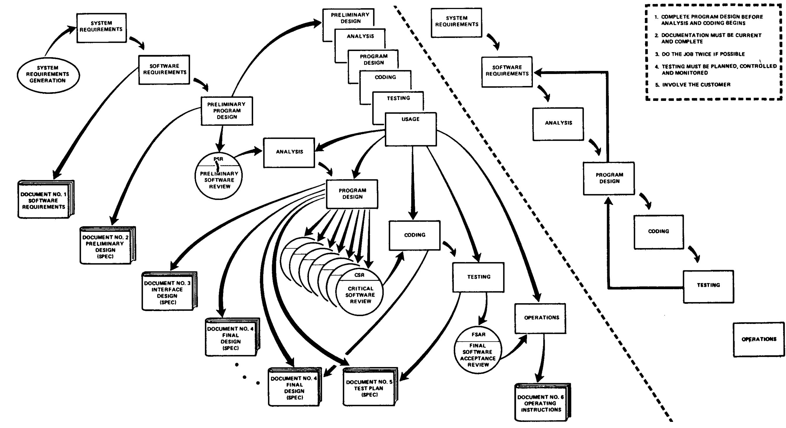

> [Winston W. Royce](https://dblp.org/pid/38/3947.html). *[Managing the Development of Large Software Systems](https://dl.acm.org/doi/10.5555/41765.41801)*. 首次发表于 *Proceedings, IEEE WESCON*, 1970 年 8 月, 第 1-9 页; 后重印于 *Proceedings of the 9th International Conference on Software Engineering (ICSE '87)*, 第 328-338 页. 最初由 TRW 出版. <a href="/paper/managing-large-software-systems.pdf" target="_blank" rel="noopener noreferrer">原始 PDF</a>. 本文没有 arXiv 记录或 TeX 源码; 准确措辞, 印刷版式和参考文献以发布的 PDF 为准.

## 1 引言

我将介绍自己对大型软件开发管理的看法. 过去 9 年里, 我承担过多项任务, 大多涉及航天器任务规划, 指挥和飞行后分析软件包的开发. 在这些任务中, 我曾以不同程度的成功让系统进入运行状态, 按时交付并控制在预算内. 这些经历使我形成了一些偏见, 我将在这次介绍中谈谈其中一部分.

## 2 计算机程序开发职能

无论规模或复杂度如何, 所有计算机程序开发都有两个基本步骤. 第一步是分析, 第二步是编码, 如[图 1](#figure-01) 所示. 如果工作量足够小, 而且最终产品由构建它的人来操作, 这种非常简单的实施概念其实已经足够, 内部使用的计算机程序通常就是这样开发的. 大多数客户也愿意为这种开发工作付费, 因为这两个步骤都包含真正的创造性劳动, 会直接提高最终产品的实用性. 不过, 若制造大型软件系统的实施计划只围绕这两个步骤制定, 它注定会失败. 开发还需要许多其他步骤; 它们都不像分析和编码那样直接作用于最终产品, 却都会推高开发成本. 客户人员通常不愿为这些步骤付费, 开发人员也不愿执行它们. 管理工作的首要职能, 是让双方接受这些概念, 随后要求开发人员遵照执行.

**图 1.** 为内部运行交付小型计算机程序的实施步骤.

[图 2](#figure-02) 展示一种更为宏大的软件开发方法. 图中仍有分析和编码步骤, 但它们之前增加了两级需求分析, 中间以程序设计步骤分隔, 后面还有测试步骤. 这些新增步骤与分析和编码分开处理, 因为它们的执行方式明显不同. 为了充分利用程序资源, 必须分别规划和配备人员.

**图 2.** 为向客户交付大型计算机程序而采用的实施步骤.

[图 3](#figure-03) 描绘这一方案中相邻开发阶段之间的迭代关系. 各步骤的顺序基于以下概念: 每个步骤向前推进, 设计逐渐细化时, 它会与前后相邻步骤迭代, 却很少与流程中距离更远的步骤迭代. 这样做的好处是, 随着设计推进, 变更过程的范围会缩小到可管理的限度. 需求分析完成后, 在设计过程的任何时点都会有一条确定而贴近当前状态, 同时不断移动的基线; 一旦遇到预料之外的设计困难, 便可以返回这条基线. 这提供了有效的退路, 尽可能保全前期完成且仍可挽救的工作.

**图 3.** 但愿各阶段间的迭代交互仅限于相邻步骤.

我认同这个概念, 但上述实施方式风险很高, 容易招致失败. [图 4](#figure-04) 说明了这个问题. 测试处在开发周期末尾, 而计时, 存储, 输入/输出传输等现象直到此时才第一次被实际经历, 此前只是接受分析. 这些现象无法精确分析. 例如, 它们不是数学物理标准偏微分方程的解. 可是一旦这些现象不满足各种外部约束, 就必然需要大规模重新设计. 简单打一个八进制补丁, 或重做某段孤立代码, 无法解决这类困难. 所需的设计变更很可能极具破坏性, 以致设计所依据, 并为一切工作提供理由的软件需求遭到违背. 此时必须修改需求, 或者对设计作出重大变更. 实际上, 开发过程已经回到起点, 进度和/或成本可能超支 100%.

**图 4.** 遗憾的是, 对图示过程而言, 设计迭代从来不会只限于相邻步骤.

有人可能会指出, 这里跳过了分析和编码阶段. 当然, 没有这些步骤就不可能开发软件, 但这些阶段通常比较容易管理, 对需求, 设计和测试的影响也不大. 按我的经验, 有些部门整天忙于轨道力学分析, 航天器姿态确定, 载荷活动的数学优化等复杂工作, 可是等这些部门完成艰难而复杂的工作后, 最终对应的程序步骤不过是几行串行算术代码. 如果分析人员在完成这些艰难而复杂的工作时犯了错误, 通常只需对代码作小幅修改就能纠正, 不会向其他开发基线产生破坏性反馈.

不过, 我认为图示方法的基础是可靠的. 下文提出 5 项必须添加到这种基本方法中的附加特性, 用以消除大部分开发风险.

## 3 步骤 1: 程序设计先行

[图 5](#figure-05) 展示解决问题的第一步. 软件需求生成阶段和分析阶段之间插入了一个初步程序设计阶段. 有人可能批评这种做法, 因为程序设计人员只能依据初始软件需求, 在没有现成分析的相对真空中设计. 因此, 与等到分析完成后再设计相比, 初步设计可能存在重大错误. 这种批评没有错, 但没有抓住要点. 采用这项技术, 程序设计人员可以保证软件不会因存储, 计时或数据流问题而失败. 分析进入下一个阶段后, 程序设计人员必须把存储, 计时和运行约束施加给分析人员, 使他切实感受到相应后果. 当他有正当理由要求更多这类资源来实现方程时, 必须同时从其他分析人员那里夺取这些资源. 这样, 所有分析人员和程序设计人员都会参与一个有实际意义的设计过程, 最终妥善分配执行时间和存储资源. 如果可用的总资源不足, 或尚处萌芽状态的运行设计有误, 问题会在这个较早阶段暴露出来, 从而能在最终设计, 编码和测试开始前重新迭代需求与初步设计.

如何执行这项流程? 需要完成以下步骤.

1. **从程序设计人员开始设计过程, 而不是从分析人员或程序员开始.**
2. **设计, 定义并分配数据处理模式**, 即使可能出错也要这样做. 分配处理和职能, 设计数据库, 定义数据库处理, 分配执行时间, 定义与操作系统交互的接口和处理模式, 说明输入与输出处理, 并定义初步运行规程.
3. **编写一份概述文档**, 要求内容易懂, 信息充分且保持最新. 每一名工作人员都必须对系统有基本认识. 至少要有一人深入了解系统, 而这种了解部分来自他不得不亲自编写概述文档的经历.

**图 5.** 步骤 1: 确保在分析开始前完成初步程序设计.

## 4 步骤 2: 记录设计

此时应该提出这样一个问题: "需要多少文档?" 我的看法是"相当多"; 肯定超过大多数程序员, 分析人员或程序设计人员在无人督促时愿意完成的数量. 管理软件开发的第一条规则, 是毫不留情地执行文档要求.

我偶尔会受邀审查其他软件设计工作的进展. 第一步是调查文档状况. 如果文档严重缺失, 我的第一项建议很简单. 更换项目管理人员. 停止一切与文档无关的活动. 让文档达到可接受的标准. 没有高度完备的文档, 软件管理根本无法进行. 下面用一组估算作比较. 采购价值 500 万美元的硬件设备时, 我认为 30 页规格说明已经能提供足够细节来控制采购. 采购价值 500 万美元的软件时, 我估计约 1500 页规格说明才能达到同等程度的控制.

为什么需要这么多文档?

1. 每位设计人员都必须与负责接口的设计人员, 管理层, 可能还有客户沟通. 口头记录过于虚无, 不能为接口或管理决策提供充分依据. 一份可接受的书面说明会迫使设计人员表明明确立场, 并提供已经完成工作的实在证据. 它不让设计人员月复一月地躲在"我已经完成 90%"的说法后面.
2. 在软件开发早期, 文档<u>就是</u>规格说明, <u>就是</u>设计. 编码开始前, 这三个名词 (文档, 规格说明, 设计) 指的是同一件事. 文档不好, 设计就不好. 文档尚不存在时, 设计也还不存在; 只有人们在思考和谈论设计, 这多少有点价值, 但不多.
3. 良好文档真正的经济价值, 从开发流程下游的测试阶段开始体现, 并延续到运行和重新设计. 文档的价值可以通过每位程序经理都会面对的 3 种具体情况来说明.
   1. **测试阶段**, 有了良好文档, 经理可以集中人员处理程序中的错误. 没有良好文档时, 每个错误无论大小都只能由一个人分析; 这个人很可能正是最初犯错的人, 因为只有他了解相应程序区域.
   2. **运行阶段**, 有了良好文档, 经理可以让面向运行的人员操作程序, 他们能以更低成本把工作做得更好. 没有良好文档时, 软件必须由构建它的人操作. 这些人通常对运行工作不太感兴趣, 做得也不如面向运行的人员有效. 这里还应指出, 在实际运行中一旦发生故障, 软件总是首先受到责备. 无论是要证明软件无责, 还是确定责任所在, 软件文档都必须清楚说明情况.
   3. **初次运行之后**, 需要改进系统时, 良好文档能支持有效的重新设计, 更新和现场改装. 如果没有文档, 即使变更相对较小, 通常也必须丢弃现有运行软件的整个框架.

[图 6](#figure-06) 展示一套与前述步骤对应的文档计划. 请注意, 这套计划会生成 6 份文档; 最终产品交付时, 第 1, 3, 4, 5 和 6 号文档都已更新且内容为最新版本.

**图 6.** 步骤 2: 确保文档保持最新且完整, 至少需要 6 份彼此不同的文档.

## 5 步骤 3: 做两遍

除文档之外, 成功的第二项重要标准在于产品是否完全原创. 如果相关计算机程序是首次开发, 就应作出安排, 使最终交付客户投入运行的版本, 至少在重要设计/运行领域实际上是第二个版本. [图 7](#figure-07) 展示如何利用模拟来做到这一点. 这个方法不过是把整个过程缩小执行一遍, 采用相对于总体工作较短的时间尺度. 这项工作的性质会有很大差异, 主要取决于整体时间尺度和需要建模的重要问题领域. 如果整个项目持续 30 个月, 早期试验模型的开发可以安排 10 个月. 在这样的进度下, 可以采用比较正式的控制和文档规程等. 但如果整个项目缩短到 12 个月, 试验工作也许可以压缩到 3 个月, 以便为主线开发提供足够帮助. 在这种情况下, 相关人员必须具备一种非常特殊的广泛能力. 他们必须对分析, 编码和程序设计有直觉. 他们必须迅速感知设计中的难点, 为这些难点及其备选方案建模, 放过设计中不值得在这个早期阶段研究的简单部分, 最后得到一个没有错误的程序. 无论哪种情况, 这样做的要点都和模拟一样: 原本只能依靠判断的计时, 存储等问题, 现在可以得到精确研究. 没有这项模拟, 项目经理只能受制于人的判断. 有了模拟, 他至少能对一些主要假设进行实验性检验, 缩小仍需依靠人工判断的范围; 在计算机程序设计领域, 人的判断总是过于乐观, 无论是估算起飞总重, 完工成本, 还是竞猜赛马结果.

**图 7.** 步骤 3: 尝试把工作做两遍, 第一次的结果可以作为最终产品的早期模拟.

## 6 步骤 4: 规划, 控制并监测测试

毫无疑问, 测试阶段消耗的项目资源最多, 无论资源是人力, 计算机时间还是管理判断. 按资金和进度衡量, 这也是风险最大的阶段. 它发生在进度计划最晚的位置, 此时几乎没有, 甚至完全没有备用方案.

前 3 项建议要求在分析和编码开始前设计程序, 完整记录程序, 并构建试验模型, 目的都是在进入测试阶段前发现并解决问题. 可是即便完成这些工作, 测试阶段仍然存在, 仍有重要工作要做. [图 8](#figure-08) 列出测试的其他一些方面. 规划测试时, 我建议考虑以下几点.

1. 测试过程的许多部分最好交给测试专家, 他们不一定参与过原始设计. 如果有人声称只有设计人员才能彻底测试, 因为只有他了解自己构建的部分, 这恰恰说明文档工作失败了. 文档良好时, 可以使用软件产品保证专家; 按我的判断, 他们的测试会比设计人员做得更好.
2. 大多数错误的性质都很明显, 通过目视检查即可发现. 分析和代码的每一部分都应由未参与原始分析或编码的另一人作简单目视检查, 找出漏写负号, 缺少 2 的倍数, 跳转到错误地址等问题, 这相当于校对分析和代码. 不要用计算机查找这类问题, 那样成本太高.
3. 至少用某种数值检查执行计算机程序中的每条逻辑路径一次. 如果我是客户, 在这项流程完成并得到认证前不会接受交付. 这一步会发现大部分编码错误.

这套测试流程听起来很简单, 但对于大型复杂计算机程序, 使用受控输入值遍历每条逻辑路径相当困难. 事实上, 有人会认为这几乎不可能做到. 即便如此, 我仍会坚持建议对每条逻辑路径至少作一次真实检查.

4. 排除简单错误后 (这类错误占大多数, 也会掩盖大错误), 就该把软件交给测试部门作检验了. 在开发过程中的适当时点, 交到合适的人手中时, 计算机本身是最好的检验设备. 管理层要决定的主要问题是: 什么时候进行最终检验, 由谁来做?

**图 8.** 步骤 4: 规划, 控制并监测计算机程序测试.

## 7 步骤 5: 让客户参与

不知为何, 即使先前已经达成一致, 人们对软件设计将完成什么工作仍会有相当不同的理解. 必须让客户以正式方式参与, 使他在最终交付前的较早时点作出承诺. 如果在需求定义与运行之间放任承包商自行其是, 就是在自找麻烦. [图 9](#figure-09) 标出需求定义后的 3 个时点, 客户可以在这些时点用自己的见解, 判断和承诺加强开发工作.

**图 9.** 步骤 5: 让客户参与, 这种参与应当正式, 深入并持续进行.

## 8 总结

[图 10](#figure-10) 总结了我认为将高风险开发过程转变为能够交付所需产品的过程时必须采取的 5 个步骤. 我要强调, 每一步都会增加一些成本. 如果没有这 5 项复杂措施的较简单流程也能成功, 那么额外投入当然不值得. 不过按我的经验, 较简单的方法从未在大型软件开发工作中成功, 而挽救失败所花的成本, 远远超过为上述 5 步流程提供资金所需的成本.

**图 10.** 总结.

准确的印刷版式和参考文献以原始 PDF 为准.
