> [Zixu Hao](https://scholar.google.com/citations?user=5C9woXAAAAAJ), [Jianyu Wei](https://kaleid-liner.github.io/about/more/), [Tuowei Wang](https://pairshoe.github.io/), [Minxing Huang](https://dblp.org/pid/61/3034), [Huiqiang Jiang](https://hqjiang.com/), [Shiqi Jiang](https://chrisplus.me/), [Ting Cao](https://tingcao952.github.io/) [+corresponding] 和 [Ju Ren](https://juren1987.github.io/) [+corresponding]. 作者单位: 清华大学, 中国科学技术大学, 微软研究院, 清华大学智能产业研究院 (AIR). 2025 年 9 月 27 日首次提交至 arXiv; 当前版本为 v1. 发表于 EuroSys 2026 (第 21 届欧洲计算机系统会议), 爱丁堡, 2026 年 4 月 27-30 日, 第 2157-2172 页. [Scaling LLM Test-Time Compute with Mobile NPU on Smartphones](https://arxiv.org/abs/2509.23324v1). <a href="/paper/mobile-npu-test-time-scaling.pdf" target="_blank" rel="noopener noreferrer">原始 PDF</a>. [DOI](https://doi.org/10.1145/3767295.3769382). [TeX 源文件](https://arxiv.org/src/2509.23324v1). [代码](https://github.com/haozixu/llama.cpp-npu). 具体印刷版式与参考文献以原始 PDF 为准.

[+corresponding]: 通讯作者.

## 摘要

在移动设备上部署大语言模型 (LLM) 时, 小模型性能不足, 大模型又会消耗过多资源. 本文指出, 在典型的 LLM 推理中, 移动端神经处理单元 (NPU) 的计算资源尚未得到充分利用, 尤其是其中的矩阵乘法单元. 为了利用这些闲置的计算能力, 我们提出在移动 NPU 上应用并行测试时扩展技术, 以提升较小 LLM 的性能. 但这种方法面临 NPU 固有的难题, 包括硬件对细粒度量化支持不足, 以及通用计算效率低下. 为此, 我们引入两项技术: 一种硬件感知的分块量化方案, 使分组量化与 NPU 的内存访问模式对齐; 以及基于高效查找表 (LUT) 的替代方案, 用来完成 Softmax 和反量化等复杂操作. 我们设计并实现了一套端到端推理系统, 利用 NPU 的计算能力, 在 Qualcomm Snapdragon 平台上支持测试时扩展. 实验表明, 我们的方法带来了显著加速: 混合精度 GEMM 最多加速 19.0×, Softmax 最多加速 2.2×. 更重要的是, 我们证明采用测试时扩展的小模型可以达到或超过大模型的准确率, 从而形成新的性能-成本 Pareto 前沿.

## 1 引言

随着通用硬件和算法不断进步, 在移动设备上部署大语言模型 (LLM) 越来越可行. 目前已经出现许多面向移动设备的语言模型, 包括 Llama 3.2 [Met24a], MiniCPM [Hu24, Yao24b] 和 Gemma [Gem24b, Gem25a]. 但这些模型的性能通常不及规模更大的模型. 提升模型性能最直接的办法是扩大模型规模, 可这会显著增加内存占用和带宽需求, 给资源受限的移动平台带来严峻挑战.

最近, 一种名为**测试时扩展**的新范式通过增加推理时计算量, 为提升 LLM 能力提供了新的可能. 并行测试时扩展方法会生成多条路径, 再从若干候选生成结果中选出最佳样本 [Wan22g, Wu24c, Sne24, Hug25, Bro24, Liu25ae, Xu25j, Che25af]. 到目前为止, 这些方法仅用于计算资源充足的云端或离线环境.

直观来看, 在移动设备上使用测试时扩展技术来提升 LLM 的生成质量似乎并不现实. 智能手机等移动设备通常被视为资源受限平台, 而 LLM 推理又以资源消耗高著称. 在此基础上, 运行时扩展计算资源还需要更多计算量.

不过, 近来移动 SoC 开始集成神经处理单元 (NPU), 情况也随之改变. Qualcomm, Intel 和 AMD 等厂商都已设计并集成 NPU, 用于加速 AI 工作负载 [Mah23a, Int24b, Ric24]. 这些 NPU 不仅峰值算力高, 而且迭代迅速: Qualcomm 称 Snapdragon X Elite 中的 Hexagon NPU 可提供 45 TOPS 的 INT8 性能 [Qua24a], 新一代 AMD NPU 的性能则提升了 $3.1\times$ [+1] [Amd25a]. 这些进展正在改变移动设备的计算能力.

我们发现, 移动 NPU 通过在大型矩阵分块上运行的专用矩阵乘法单元实现高峰值性能. 但在典型的 LLM 推理中, GEMM 操作常在解码阶段退化为 GEMV, 导致硬件利用率低下, 针对大型分块优化的矩阵单元算力被浪费. 这种低利用率提供了一个机会: 提高采样并行度的测试时扩展方法可以使用这些可用算力, 同时不会显著增加推理开销.

尽管如此, 要在移动 NPU 上高效实现测试时扩展, 仍会遇到重要的硬件难题, 我们将其归纳为两个方面:

**精度:** 移动 NPU 最初面向粗粒度量化模型设计, 原生不支持现代 LLM 低比特部署所必需的细粒度分组量化. 我们观察到, 采用传统逐通道方法量化的模型, 在测试时扩展所关注的推理任务中性能会严重下降.

**效率:** NPU 擅长矩阵乘法, 但其通用向量单元的计算吞吐量和内存带宽有限. 测试时扩展中的 LLM 推理包含许多关键的非矩阵计算, 这些计算必须在向量单元上运行, 因而成为明显的瓶颈. 宽 SIMD 向量组件与数据粒度不匹配, 再加上硬件的内存访问限制, 软件很难充分利用向量单元的算力, 问题也因此更加严重.

为解决这些难题, 我们提出一套端到端 LLM 推理系统, 利用移动 NPU 充足的计算能力来支持测试时扩展工作负载. 为满足端侧资源限制和精度要求, 我们主要采用仅权重 4 位细粒度分组量化. 针对由此产生的效率问题, 我们的方案包含以下技术:

**硬件感知的分块量化方案:** 我们提出一种同时感知矩阵单元和向量单元的新型量化布局. 通过在量化前后变换权重布局, 我们在硬件友好的分块上应用细粒度分组量化, 并与 NPU 的内存访问模式对齐, 从而尽量降低运行时内存访问开销, 提高向量计算利用率.

**基于 LUT 的高效计算:** 我们用高效的查找表 (LUT) 指令替代复杂的关键操作, 包括 Softmax 中的指数计算和混合精度 GEMM 中的反量化过程, 以缓解向量单元上的计算瓶颈.

我们在三代 Qualcomm Snapdragon 平台上评估了该系统. 与基线相比, 我们提出的技术分别可将混合精度 GEMM 最多加速 $19.0\times$, 将 Softmax 加速 $2.2\times$. 结果表明, 利用移动 NPU 运行 LLM 测试时扩展工作负载是有效的. 我们还发现, 测试时扩展能实现当前最佳的性能-成本权衡: 小模型采用测试时扩展后, 可以达到甚至超过未采用扩展的大模型. 据我们所知, 这是首项探索在移动设备上使用 NPU 为 LLM 实现测试时扩展的可行性, 并评估其权衡关系的工作. 我们的贡献如下:

- 我们分析了现代移动 NPU 的架构, 并发现专用矩阵单元在 LLM 解码阶段未得到充分利用.
- 我们提出两项技术: 硬件感知的分块量化方案和基于 LUT 的计算, 用于加速移动 NPU 上的 LLM 测试时扩展.
- 我们设计并实现了一套端到端 LLM 推理系统 [+2], 利用移动 NPU 支持测试时扩展工作负载, 同时尽量减少对专有软件栈的依赖.
- 我们证明, 测试时扩展可以有效利用原本闲置的 NPU 算力, 提升端侧小语言模型的生成质量; 与传统模型扩展相比, 其准确率和成本达到 Pareto 前沿. 这为在移动设备上部署 LLM 带来了新的可能.

## 2 背景

### 2.1 在测试时扩展 LLM 计算

并行测试时扩展已经成为一种常用且有效的新范式: 它不修改模型参数, 而是投入更多测试时计算来提高模型准确率. 最简单的测试时扩展方法是多数投票和自洽性 [Wan22g, Bro24], 用于从多组生成样本中选择最一致的答案. 对于结果可验证的数学或编程问题, 以及配有奖励模型 (即结果奖励模型) 的领域, 可以从已完成的样本集中选择得分最高的选项, 这种策略称为 Best-of-N [Sne24]. 借助前瞻 rollout, 类似 Monte Carlo Tree Search (MCTS) 的方法可以从部分生成的序列中选择最优路径, 由此产生直接为中间结果评分的过程奖励模型 (PRM) [Wan23a, Zhe24c, Sky24, Dwi23]. 在 PRM 的辅助下, 无需前瞻的步骤级 Beam Search [Sne24, Wu24c] 会动态丢弃低质量生成路径, 以平衡探索与利用. [图 1](#figure-01) 展示了两种常见测试时扩展方法的算法.

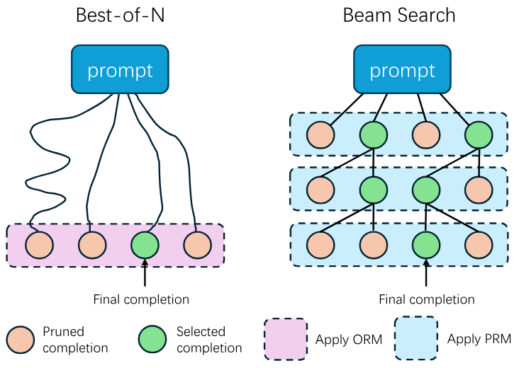

**图 1.** 两种典型的测试时扩展方法: Best-of-N 和 Beam Search.

### 2.2 神经处理单元

随着 AI 工作负载不断增长, 现代 SoC 越来越多地集成 NPU 来加速神经网络推理 [Mah23a, Ric24, Int24b]. NPU 专门加速低精度且计算密集的神经网络核心操作 (如 GEMM), 在保持良好能效的同时提供极高的计算吞吐量.

一种广泛采用的 NPU 架构是"向量 + 矩阵"组合: 矩阵单元加速矩阵乘法和卷积等操作, 向量单元负责归一化和复杂激活函数等通用计算. Qualcomm Hexagon NPU [Mah23a], Huawei Ascend NPU [Lia21b], AMD XDNA NPU [Ric24], Intel NPU [Int24b] 和 Intel Gaudi HPU [Int25b] 等知名实例都采用这种架构. 这类 NPU 的硬件执行模型与常见 GPU 差异很大. 如[图 2](#figure-02) 所示, 在 GPU 的 SIMT 模型中, 不同线程可以独立执行分支、内存访问和计算; 而在基于 SIMD 的 NPU 执行模型中, 单个线程会操作大型向量或矩阵数据块. 在硬件层面, NPU 通常使用较少的硬件线程, 并采用 VLIW 架构来降低控制逻辑开销. 与 GPU 相比, NPU 牺牲了编程灵活性和易用性, 换取更高的执行效率与能效.

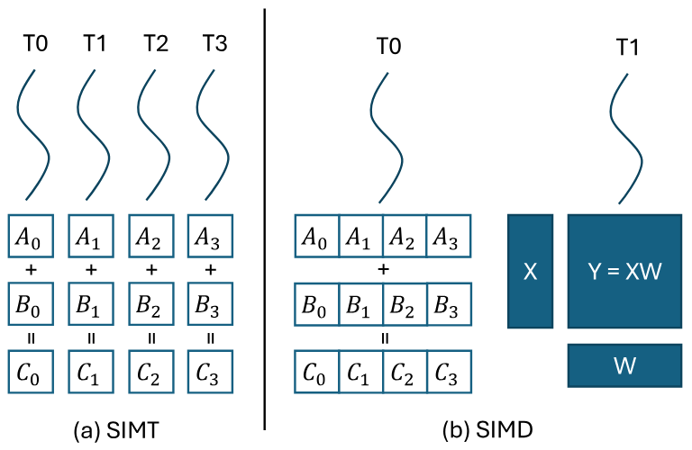

**图 2.** (a) GPU 的 SIMT 执行模型与 (b) NPU 的 SIMD 执行模型对比.

## 3 动机与挑战

本节首先介绍移动 NPU 的一些关键特征, 随后分析利用 NPU 闲置算力的机会, 以及为测试时扩展工作负载实现高效系统时面临的难题.

### 3.1 Qualcomm Hexagon NPU

Qualcomm Snapdragon SoC 中的 Hexagon NPU 架构典型、应用广泛, SDK 也相对易于获取, 因而是移动 NPU 的代表. 所以, 我们用它来说明移动 NPU 的核心特征.

#### 3.1.1 编程接口

为 Qualcomm Hexagon NPU 编程的主要方式是使用 Qualcomm AI Engine Direct [Qua25a] (通常称为 QNN), 这是一个专有的闭源 DNN 推理框架. 虽然 Hexagon SDK 提供了完整的 Hexagon NPU LLVM 工具链, 但由于矩阵单元的指令并未公开, 开发者在多数情况下仍无法定制高性能底层内核. 我们通过逆向分析二进制库中的未公开指令, 得以使用 FP16 矩阵单元.

#### 3.1.2 架构

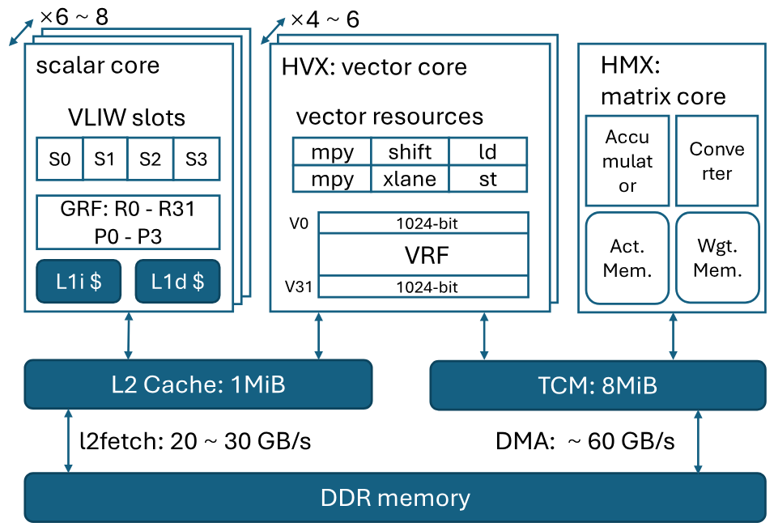

**图 3.** Hexagon NPU 架构.

**计算单元.** Hexagon NPU 采用典型的"向量 + 矩阵"混合架构. 其向量单元和矩阵单元分别称为 HVX (Hexagon Vector eXtension) 与 HMX (Hexagon Matrix eXtension). Hexagon NPU 包含 6 到 8 个用于逻辑控制的标量 VLIW 硬件线程. 所有向量或矩阵指令都从标量核心的 4 个 VLIW 槽位之一发出. HVX 单元上下文包含 32 个宽度为 1024 位的向量寄存器, 此类单元共有 4 到 6 个. 据推测, HMX 单元共有 1 或 2 个.

**内存子系统.** Hexagon NPU 包含共享的 1 MiB L2 缓存和 8 MiB TCM (紧耦合内存), 后者是一段由软件管理的片上内存. HVX 可以从 L2 缓存或 TCM 读取数据. 向量 scatter/gather 操作和所有 HMX 指令只能访问 TCM. 数据可以分别通过 `l2fetch` 指令和 DMA 机制从 DDR 内存加载到 L2 缓存与 TCM. 二者都支持异步传输一维或二维张量数据.

**HMX 单元.** Hexagon NPU 强大的矩阵乘法能力来自 HMX 组件. Qualcomm 表示, HMX 单元支持 INT4, INT8, INT16 和 FP16 等多种精度 [Mah23a]. 下文主要介绍 FP16 HMX, 相关信息来自逆向分析、Hexagon SDK、QNN SDK 以及 Qualcomm 公开的信息.

HMX 操作的基本数据单元是分块, 每个分块都包含一个特定尺寸的矩阵. 对于 FP16 HMX, 分块大小为 32\*32, 占用 2 KiB 空间. HMX 单元可以从 TCM 加载若干权重内存分块和激活内存分块. 它对每对矩阵分块执行矩阵乘法后, 会将结果累加到内部累加器中. 最后, 它输出与累加器对应的分块. 同时, HMX 单元可以独立缩放输出分块的各个通道 (列), 并添加偏置.

FP16 HMX 分块采用特殊的内存布局, 如[图 4](#figure-04) (a) 所示. 输入和输出分块都遵循这种布局. 构造这种布局的一种典型方法是使用 HVX 指令, 对原矩阵中每两行执行跨 lane 重排.

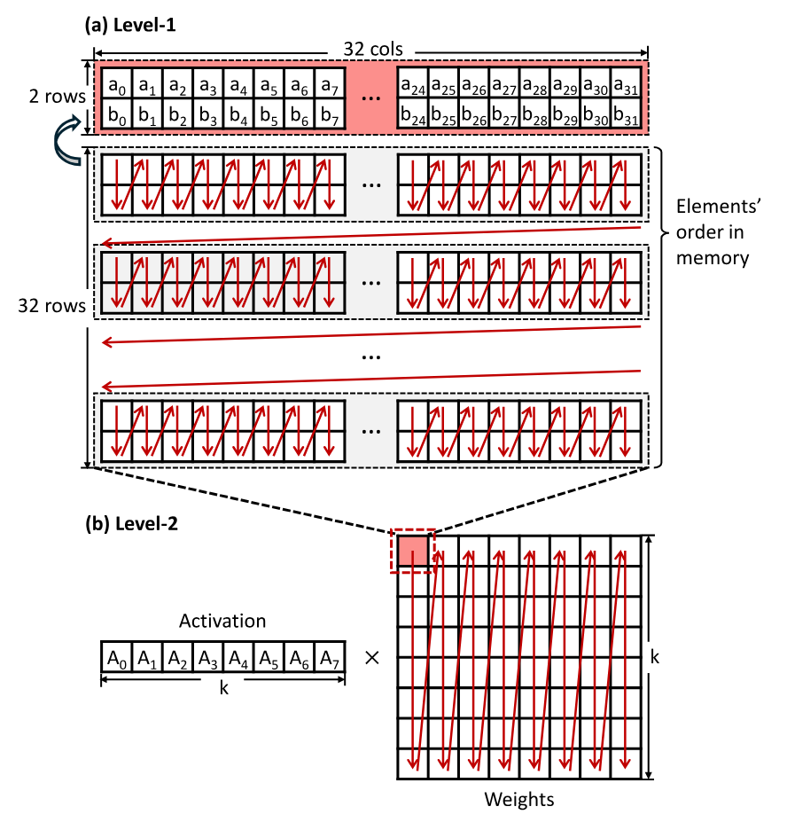

**图 4.** (a) FP16 HMX 分块的内存布局. 每个分块对应一个 32 * 32 矩阵, 占用 2048 字节. 每两行经过置换, 布局与转置后的 2 * 32 子矩阵相同. (b) 基于 HMX 的 GEMM 整体内存布局. 由于硬件在分块层面执行内积, 权重分块按列主序排列.

### 3.2 机会: LLM 解码期间的闲置矩阵算力

在自回归生成过程中, LLM 的输入通常只对应一个 token, 导致 GEMM 操作退化为 GEMV. 例如, 形状为 $[1, \texttt{hidden\_dim}]$ 的激活矩阵会与形状为 $[\texttt{hidden\_dim}, \texttt{proj\_dim}]$ 的权重矩阵相乘. 使用 FP16 HMX 时, 每个计算分块的有效尺寸为 $[1,32]\times[32,32]$. 由于硬件计算的基本单元是 $32\times32$ 分块, 输入激活分块中的 31 行没有实际有效内容, 造成矩阵单元利用率低下, 算力被浪费.

与此同时, 一些测试时扩展算法可以通过增加生成期间的计算量来改善生成质量, 包括 Self-Consistency, Best-of-N 和 Beam Search 等并行采样方法. 这些方法的特点是使用大于 1 的批量大小探索多条生成路径, 再通过某种方式 (如外部验证器) 选出更好的生成路径. [图 5](#figure-05) 给出了使用 Best-of-N 进行测试时扩展的示例. 随着生成预算 (即解码阶段的最大批量大小) 增加, 模型在 MATH500 数据集上的准确率显著提高.

据此, 我们提出在移动 NPU 上运行 LLM 的测试时扩展工作负载. 这样可以有效利用常规 LLM 生成过程中被浪费的 NPU 算力. 理论上, 解码开销不会明显增加, 而且无需修改模型权重便可在运行时改善模型的生成质量.

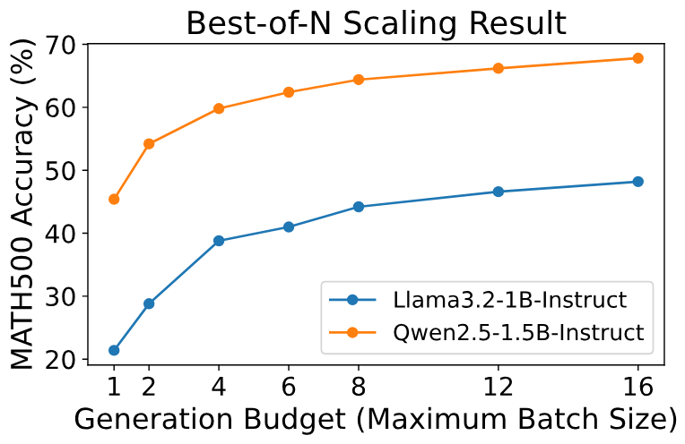

**图 5.** 两个模型的测试时扩展示例. 随着生成预算增加, MATH500 的准确率随之提高.

### 3.3 挑战

尽管理论上可以利用移动 NPU 实现测试时扩展, 但高效实现仍面临许多硬件难题. 这些难题概括如下.

**精度不足.** 虽然 HMX 单元支持 FP16 GEMM, 但在资源受限设备上部署 FP16 模型仍不现实, 因此通常会改用量化模型. 包括 HMX 在内, 多数移动 NPU 的矩阵单元最初都用于加速采用粗粒度量化方案的整数量化 DNN 模型, 例如逐张量或逐通道量化. 具体而言, Hexagon NPU 原生不支持现代 LLM 所必需的细粒度量化方法. 软件栈也体现了这一限制: QNN 仅支持逐张量或逐通道权重量化. 如果直接对 LLM 权重应用粗粒度低比特量化, 准确率可能显著下降.

如[表 1](#table-01) 所示, Llama 3.2 1B-Instruct 模型在 QNN 逐通道量化 [+3] 与 AWQ 逐组 4 位量化下的准确率结果 (二者均采用 W4A16 设置) 表明, 逐通道量化模型在高难度数学推理任务上的性能严重下降. 遗憾的是, 测试时扩展方法正是用于这类任务, 而 QNN 达到的基线准确率甚至无法满足性能扩展的最低要求.

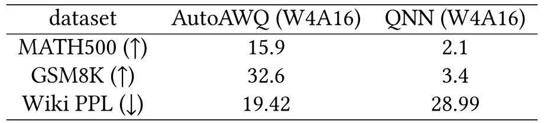

**表 1.** Llama3.2-1B-Instruct 在不同实现下的性能对比. QNN 的量化会严重损害模型的推理能力.

**通用计算能力和内存带宽较弱.** 在原生硬件不支持细粒度分组量化时, 常见做法是依靠通用计算单元处理此类计算. 但我们发现, NPU 内的通用向量单元与专用矩阵单元在计算和内存访问能力上存在巨大差距. 我们使用 1024$\times$1024$\times$1024 GEMM 操作, 在 Hexagon V75 NPU 上测量 HVX 和 HMX 的 FP16 GEMM 性能; 所有输入和输出都位于片上 TCM, 以反映硬件的峰值性能. 如[表 2](#table-02) 所示, 矩阵单元的 FP16 GEMM 吞吐量高达 12 TFLOPS, 比单个向量线程高出 300 多倍. 在内存带宽方面, 专用 DMA 引擎从 DDR 读取数据的带宽超过 60 GB/s, 而向量单元通过核心数据路径读取内存的带宽仍低于 30 GB/s. 不过, DMA 提供的高带宽仅适用于大型、规则的一维或二维数据块, 无法高效处理小规模或不规则的内存访问. 这些观察结果说明, 向量单元的通用计算和内存带宽不足以跟上专用矩阵单元的计算吞吐量, 这给细粒度量化下的高性能混合精度 GEMM 内核实现带来了重大挑战.

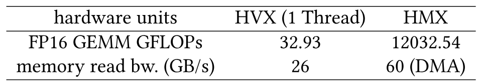

**表 2.** HVX 和 HMX 单元的性能指标, 包括 FP16 GEMM 算力 (GFLOPs) 和内存读取带宽 (GB/s).

## 4 设计概览

我们提出一套面向移动 NPU 的 LLM 推理系统, 并针对测试时扩展工作负载进行优化.

为解决准确率问题, 我们对主要权重采用 4 位细粒度分组量化, 同时让激活值保持浮点格式. 运行时, 我们动态地将权重即时反量化为浮点值, 利用 NPU 强大的 FP16 矩阵计算能力高效支持测试时扩展任务.

对于不可避免的通用计算, 向量处理单元的内存带宽和计算吞吐量有限, 因此我们的核心策略包括:

- 采用硬件感知的离线设计, 尽量降低运行时计算开销;
- 充分利用 SIMD 向量单元的内在能力, 弥合专用硬件与灵活软件需求之间的差距.

具体而言, 我们引入以下技术:

**硬件感知的细粒度分块量化方案.** 我们提出一种新的量化布局, 在细粒度矩形分块内执行分组量化, 不同于沿累加轴分组的传统方法. 为了与矩阵单元和向量单元的内存访问模式对齐, 我们引入一套离线流程, 包括权重量化前变换、量化和量化后变换. 这样可以提高运行时内存访问的连续性, 并消除不必要的计算开销.

**基于 LUT 的高效计算.** 对于更复杂的运行时操作, 我们利用向量单元的查找表 (LUT) 指令和通用 LUT 机制, 替代复杂的变换逻辑. 这种方法可加速测试时扩展工作负载中的关键瓶颈操作, 包括混合精度 GEMM 内的反量化以及 Attention 中的 Softmax 操作.

## 5 系统设计

### 5.1 硬件感知的细粒度分块量化方案

已有工作 [Liu25af, Li25ag] 表明, 量化误差会显著降低模型在数学推理等高难度任务中的性能. 但端侧资源限制十分严格, 全精度模型仍不可行, 因此必须使用细粒度量化来维持准确率.

遗憾的是, 在移动 NPU 上为细粒度量化实现基于反量化的高效 GEMM 内核, 会带来严峻的系统难题. 我们发现两个主要问题:

- 矩阵单元要求的权重布局与传统分组量化布局不匹配;
- 较小的分组大小导致宽向量寄存器利用率不佳.

为克服这些限制, 我们提出一种新的分块量化方案, 其中包含两个组成部分:

- 一种基于分块的量化策略, 用于对齐矩阵单元固有的数据布局;
- 一种量化后权重置换方法, 用于充分利用向量单元的处理能力.

#### 5.1.1 分块组量化

在传统量化 GEMM 中, 权重矩阵通常按列主序存储, 以配合 CPU 矩阵乘法使用的向量点积操作, 例如 llama.cpp CPU 后端中的实现. 权重沿列维度划分为连续的量化组, 大小通常为 32. 每组中的值经过量化后, 得到的整数权重及其对应的缩放与零点参数会交错存放在内存中, 同时保留矩阵原有的逐列顺序.

但在配备特殊矩阵单元的 NPU 上, 传统分组布局往往与硬件要求不一致. 如[图 6](#figure-06) 所示, 在传统布局中连续的元素进入片上 TCM 后会分散开来. 对 SIMD 向量单元而言, 这种非连续访问模式很难处理. 尽管现代向量引擎提供 gather/scatter 操作来缓解分散访问问题, 这些操作的成本依然很高. 仅对权重矩阵进行转置也无法解决布局不匹配, 因为矩阵单元要求的复杂多级数据布局仍会导致不连续的内存访问.

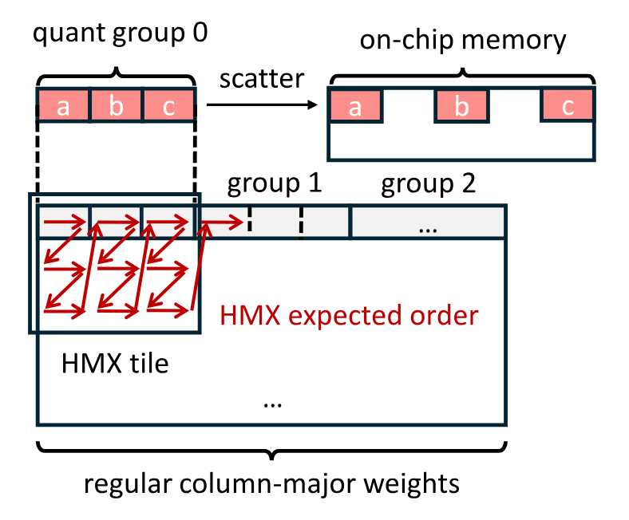

**图 6.** 量化分组布局与 HMX 分块布局不匹配的简化示意图.

为解决这个问题, 我们首先将权重置换为矩阵单元要求的布局, 再逐组应用四舍五入量化. 当分组大小为 32 时, 该方法实际上以 $2\times16$ 分块为单位执行分组量化. 典型模型的预训练权重大致服从零均值 Gaussian 分布, 因此与传统分组相比, 在重塑后的分块组内进行量化不会显著改变各组内的统计特性. 所以, 得到的量化误差仍然相近.

具体而言, 我们在量化前按照[图 4](#figure-04) 所示的布局排列权重, 该布局分为两个层级: 外层按分块的列主序排列, 与矩阵单元的分块级内积操作一致; 内层则在每个分块中对每两行进行重排. 随后, 我们按照新的内存顺序逐组量化权重.

#### 5.1.2 合并量化组以实现宽向量访问

默认情况下, 量化权重以结构数组 (AoS) 布局存储. 以 Q4_0 对称量化为例, 每个包含 32 个元素的分组由 16 字节 INT4 量化值和 2 字节 FP16 缩放值组成, 量化值与缩放值交错存放在内存中. NPU 架构的内存访问高度依赖由软件管理的局部一维或二维预取, 因此我们不采用数组结构 (SoA) 布局. 在 SoA 中, 量化值和缩放值分别位于两个大型连续数组中, 不符合硬件偏好的访问模式.

但细粒度量化组会与原生向量处理粒度不匹配: 单个量化组太小, 无法填满 128 字节宽的向量寄存器. 访问这样的小组需要多次内存操作, 或使用额外指令合并多个寄存器中的数据, 因而降低内存带宽利用率, 并增加计算开销.

为解决这一问题, 我们将 8 个量化组合并为一个更大的超组, 并重新组织其内容, 使 256 个连续元素的 INT4 值正好占满一个 HVX 寄存器. [图 7](#figure-07) 展示了这一过程.

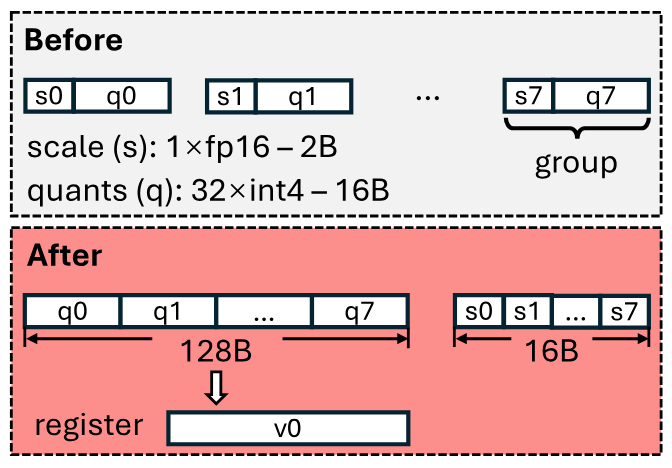

**图 7.** 将 8 个细粒度量化组重新打包为一个超块. INT4 量化值正好装入一个向量寄存器.

### 5.2 基于 LUT 的计算

鉴于向量单元的通用计算性能有限, 我们提出使用通用查找表 (LUT) 指令替代复杂计算, 从而减少指令数量和计算开销. 基于 LUT 的计算特别适合加速测试时扩展工作负载中的关键操作, 例如 Softmax 中的指数函数和反量化过程.

#### 5.2.1 通过向量 Gather 实现快速 Softmax

测试时扩展方法通常会提高采样并行度, 进而增大批量大小和上下文长度. 我们分析了这些扩展因素对生成期间基于 Transformer 的 LLM 中各主要算子的影响:

- GEMM. 根据前述 NPU 硬件特征, 在测试时扩展工作负载中适度增大批量大小, 不会显著增加 GEMM 延迟. GEMM 延迟也与上下文长度无关.
- 其他操作. 激活函数、LayerNorm、残差 Add 和 RoPE 等算子的计算开销大致与输入大小成正比, 但其计算量和内存访问量很小, 所以我们忽略它们的影响.
- Attention. Attention 的理论计算复杂度会随批量大小和上下文长度共同增长, 因而可能成为测试时扩展场景中的性能瓶颈.

我们使用 FP16 HMX 在 Hexagon NPU 上实现 FlashAttention [Dao23a], 并在 prompt 长度为 4096 时, 测量不同输入批量大小 (查询长度) 下的延迟构成, 如[图 8](#figure-08) 所示. 结果表明, 矩阵乘法对总延迟的贡献很小, 而查询长度增加后, Softmax 在 Attention 执行时间中占据主要部分.

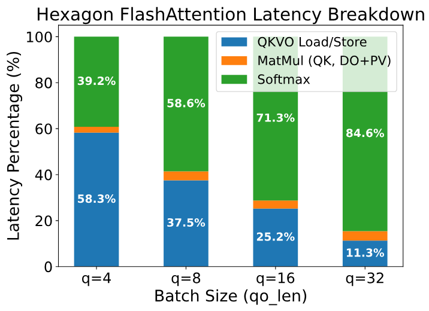

**图 8.** Hexagon NPU 上 FlashAttention 的延迟分解. 我们使用 Qwen2.5-1.5B, prompt 长度设为 4096.

我们的分析表明, 片上 Softmax 的主要瓶颈在指数计算上, 该计算必须应用于 $\Theta(N_q\times N_{kv})$ 个元素. 更棘手的是, 这些高成本指数操作必须在 HVX 上执行, 而 HVX 没有针对特殊数学函数的专用硬件支持. 按照常见做法, 我们用 `exp2` 替换 `exp`, 并将系数 $\log_2{e}$ 吸收到 $Q K^\top$ 的缩放因子 $\frac{1}{\sqrt{d}}$ 中. 对于分解为整数部分 $k$ 和小数部分 $f$ 的输入元素 $x$, 使用 Taylor 级数多项式展开来近似 $2^f$, 而 $k$ 则直接加到 $2^f$ 的 IEEE-754 表示的指数字段上. 但多项式求值包含连续依赖, 会限制 VLIW 架构下的指令级并行度.

为缓解指数计算瓶颈, 我们研究了用预计算查找表 (LUT) 替代显式指数计算的方法. HVX 提供 `vgather` 指令, 可以将 TCM 中分散位置的值收集到一段连续的 128 字节 TCM 区域. 虽然 `vgather` 可以实现大型 LUT, 但用 LUT 计算 $\operatorname{exp}$ 仍有困难: 为 32 位浮点数存储 $2^{32}$ 个元素并不现实. 同时, `vgather` 本身的延迟很高, 在 Hexagon V75 上需要 24 到 48 个指令包, 因此必须尽量减少使用次数.

为了用 LUT 实际计算 $\operatorname{exp}$, 我们设计了以下方法. 首先, 我们在整个 FlashAttention 中广泛使用 FP16, 片上计算过程如[算法 1](#algorithm-01) 所示. 矩阵 $S, P, O$ 和向量 $\vec m, \vec l$ 以 16 位浮点数存储, $\operatorname{exp}$ 计算的输入和输出也都是 16 位浮点数. 尤其是, FP16 HMX 在内部使用精度更高的浮点数进行累加; 对矩阵 $P$ 的逐行求和等关键操作, 我们会将元素提升到 32 位精度.

输入和输出采用 16 位后, LUT 被限制为 65536 个表项, 需要 128 KiB 存储空间, 可以放入 TCM. `vgather` 的一种变体支持用一条指令收集 64 个 2 字节元素, 最大地址偏移量为 65536 字节. 但 65536 个 FP16 表项占用 128 KiB, 直接寻址时有一半表项无法访问. 为解决这个问题, 我们利用 safe softmax [Mil18] 的性质: 通过减去逐行最大值 $m_i$, 可以保证 $\operatorname{exp}$ 的所有输入都不大于零. 因此, 我们只存储 $x\le0$ 时的值, 得到包含 32768 个表项 (64 KiB) 的 LUT. 使用 LUT 计算 $\operatorname{exp}$ 时, 我们忽略 FP16 输入的 MSB (符号位), 再将输入左移一位, 生成 `vgather` 所需的字节偏移量.

该 LUT 在系统初始化期间预计算, 不会给模型推理带来额外开销. 它在 TCM 中占用固定的 64 KiB 区域, 仅为 TCM 总容量的 $64\,\mathrm{KiB}/8\,\mathrm{MiB}\approx0.8\%$, 对其他操作可用的 TCM 空间影响很小.

**算法 1: 我们的 FP16 FlashAttention 片上计算 (省略不同的 head)**

- **输入:** Head 维度 $d$, Query 分块数量 $T_q$, KV 分块数量 $T_{kv}$, Query 分块大小 $B_q$, KV 分块大小 $B_{kv}$.
- **输入:** 矩阵 $Q_i$ (FP16) $\in \mathbb{R}^{B_q\times d}$, $K_j,V_j$ (FP16) $\in \mathbb{R}^{B_{kv}\times d}$.
- 初始化 $O_i^{(0)}=(\mathbf{0})\in\mathbb{R}^{B_q\times B_{kv}}$ (FP16), $m=(\mathbf{-\infty})\in\mathbb{R}^{B_q}$ (FP16), $l=(\mathbf{0})\in\mathbb{R}^{B_q}$ (FP16).
- $S_i^{(j)}=\mathrm{MatMul}(Q_i,K_j^\top,\mathrm{AccumType}=\mathrm{FP}32)\in\mathbb{R}^{B_q\times B_{lv}}$ (FP16).
- $m_i^{(j)}=\max(m_i^{(j-1)},\mathrm{rowmax}(S_i^{(j)}))\in\mathbb{R}^{B_q}$ (FP16).
- $P_i^{(j)}=\mathrm{LUT\_Exp}(S_i^{(j)}-m_i^{(j)})\in\mathbb{R}^{B_q\times B_{kv}}$ (FP16).
- $l_i^{(j)}=e^{m_i^{(j-1)}-m_i^{(j)}}l_i^{(j-1)}+\mathrm{rowsum}(P_i^{(j)},\mathrm{AccumType}=\mathrm{FP}32)\in\mathbb{R}^{B_q}$ (FP16).
- $O_i^{(j)}=\mathrm{diag}(e^{m_i^{(j-1)}-m_i^{(j)}})O_i^{(j-1)}+P_i^{(j)}V_j\in\mathbb{R}^{B_q\times d}$ (FP16, $\mathrm{AccumType}=\mathrm{FP}32$).
- **输出:** $O_i=\mathrm{diag}(l_i^{(T_{kv})})^{-1}O_i^{(T_{kv})}$.

#### 5.2.2 以 LUT 为核心的高效反量化

运行时 HVX 反量化需要精心设计, 才能避免额外开销. 我们提出一种基于 HVX 查找表指令的高效反量化过程. 对源向量寄存器中的每个 8 位索引, `vlut16` 指令都能在包含 16 个元素的表中执行查找. 每个输入字节会转换成一个 16 位值, 因此 `vlut16` 会得到一对寄存器.

**通过查找表快速将 INT4 转换为 FP16.** 借助 `vlut16` 指令, 我们直接将 Q4_0 量化方案中的 4 位量化值转换为 $[-8, 7]$ 范围内的 FP16 值, 避免传统的掩码-解包-转换指令序列. [图 9](#figure-09) 对比了两种方法. 在 V79 之前的 Hexagon NPU 上, 所有 HVX 浮点操作都会产生一种名为 qfloat 的内部格式, 需要额外指令才能转回标准 IEEE-754 格式. 使用查找表可以消除这些开销. 这种以 LUT 为核心的设计只需调整表中内容, 就能轻松支持不同的 4 位编码方案 (如 FP4, NF4 [Det23a] 以及 llama.cpp 使用的 IQ4_NL).

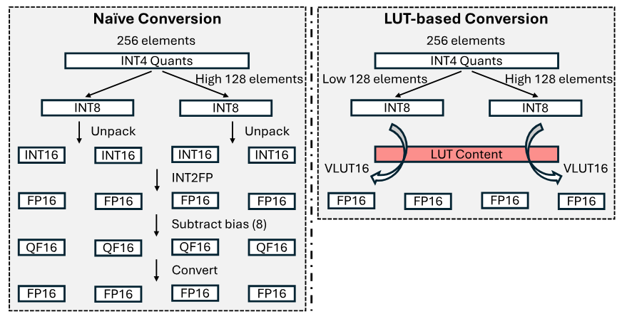

**图 9.** 通过查找表将 INT4 量化值转换为 FP16 数值.

**通过查找表广播缩放值.** 一个 128 字节的 HVX 寄存器可以容纳两个大小为 32 的 FP16 量化组. 因此, 传统方法会将标量缩放值广播到整个向量寄存器, 再拼接两个寄存器, 随后与量化值相乘. 不过, 将 4 个分组的缩放值用作 LUT 内容并应用预定义的常量索引, 只需一条 `vlut16` 指令就能广播 4 个分组的缩放值.

## 6 实现

我们的推理系统构建在 llama.cpp [Ger25] 之上, 使用 C/C++ 和内联汇编编写了约 7K 行代码. 我们使用 Hexagon SDK (版本 6.0.0.2) 中的 LLVM 工具链, 为 Hexagon NPU 生成代码. 特别需要说明的是, 我们的系统不依赖 Qualcomm QNN, 从而避开了不够灵活的静态固定形状计算图.

我们的实现主要由两个模块构成: 一个是 Hexagon NPU 算子库, 编译为独立的 Hexagon DSP 共享对象; 另一个集成在 CPU 侧的 llama.cpp 中. NPU 算子库实现了计算内核、电源管理、硬件资源管理和计算线程池. 我们为 llama.cpp 添加了 Hexagon NPU 后端, 并使用 `rpcmem` 共享内存作为底层缓冲区类型. `rpcmem` 是内核 dmabuf 内存的封装, 支持 CPU 与 NPU 共享物理内存. 相关的分配、释放和映射接口由 Android 系统供应商库中的 `libcdsprpc.so` 提供. 使用共享内存缓冲区可以消除不必要的处理器间数据复制, 并尽量复用现有的内存管理系统. 尚未在 NPU 上实现的算子还可以调度到 CPU 上运行, 从而与上层应用无缝集成.

在后端初始化阶段, 我们调用 Hexagon SDK 的 FastRPC [Fas25] 机制启动远程 NPU 会话, 并初始化一块用于通信的共享内存. 在 NPU 端, 一个线程持续轮询这块共享内存, 接收 CPU 发来的计算请求. 与默认 RPC 实现相比, 通过共享内存进行通信的延迟可以更低. CPU 将数据写入共享内存后, NPU 不会自动使对应区域的缓存失效, 因为 Snapdragon SoC 上的 CPU 与 NPU 之间只有单向一致性. 因此, 我们会在 NPU 轮询前手动清除缓存. 包含模型激活值的共享缓冲区也需要类似的缓存维护操作.

## 7 评估

### 7.1 实验设置

**设备.** NPU 性能实验在 3 台 Android 设备上进行: OnePlus Ace3, OnePlus 12 和 OnePlus Ace5 Pro. 部分准确率结果是在配备 NVIDIA RTX3090 GPU 的服务器测试平台上获得的.

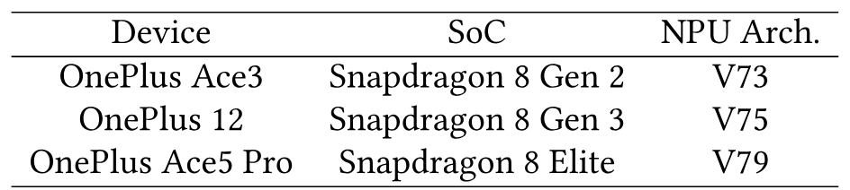

**表 3.** 评估所用的移动设备.

**模型.** 我们从 Qwen 2.5 [Yang24] 和 Llama 3.2 [Met24a] 模型家族中选择模型. 考虑移动设备的实际资源限制, 我们主要评估 1.5B 和 3B 规模的 Qwen 2.5, 以及 1B 和 3B 规模的 Llama 3.2, 这些都是实际可部署的模型规模. 评估测试时扩展方法的性能-成本权衡时, 我们还考虑了 7B 规模的 Qwen 2.5. 评估数学推理任务时, 我们使用 Qwen 2.5 和 Llama 3.2 的 Instruct 模型变体. 对于 Best-of-N 搜索和步骤级 beam search, 我们使用 Skywork-1.5B-PRM [Sky24] 作为结果奖励与过程奖励的评分器.

**数据集与指标.** 在测试时扩展任务中, 我们评估模型在 MATH500 [Hen21] 和 GSM8K [Cob21] 两项数学推理任务上的 pass@1 准确率, 并统一采用 0-shot CoT prompt. 对于其他准确率测量, 我们使用 `llama-perplexity` 工具评估 WinoGrande [Sak19] 准确率、MMLU [Hen20] 准确率和 Wikitext-2 困惑度.

**基线.** 由于我们关注测试时扩展任务, 主要展示本实现处理不同解码工作负载时的性能. 为说明使用 NPU 运行测试时扩展工作负载的优势, 我们选择近期的 llama.cpp OpenCL 后端 [+4] 作为基于 GPU 的对比系统. 该 OpenCL 后端包含针对 Snapdragon Adreno GPU 优化的 Q4_0 矩阵乘法内核. 现有的 NPU 系统在处理测试时扩展工作负载时都有一定限制, 因此我们没有将它们作为主要基线: `llm.npu` [Xu24f] 在解码阶段不使用 NPU 计算; 其他基于 QNN 的系统准确率较低 (如 PowerServe [Pow25]); Powerinfer-2 [Xue24] 和 HeteroLLM [Che25ah] 等系统则并不开源. 尽管如此, 我们仍在[第 7.2.4 节](#section-7-2-4) 中报告基于 QNN 的数据作为参考.

**设置.** 在 GEMM 的算子级评估中, 我们选择了 Qwen2.5-1.5B, Qwen2.5-3B, Llama3.2-1B 和 Llama3.2-3B 中线性层权重矩阵的尺寸. 具体包括 Attention 投影矩阵 $W_q,W_o$ 和前馈网络 (FFN) 中的 $W_{\mathrm{gate}}, W_{\mathrm{up}}, W_{\mathrm{down}}$. (对于使用 Grouped Query Attention (GQA) 的现代模型, 我们没有选择 Attention 中的投影矩阵 $W_k,W_v$, 因为其规模小于 $W_q,W_o$). 大多数矩阵采用 Q4_0 量化方案, 对应每权重 4.5 位 (BPW). 对于 FFN down 矩阵, 我们应用 Q8_0 量化方案 (8.5 BPW) 来减少量化误差, 因为已有工作表明它们对保持模型准确率十分重要 [Kov24, Lin24b, Lin23e].

### 7.2 整体性能

#### 7.2.1 测试时扩展的准确率-延迟权衡

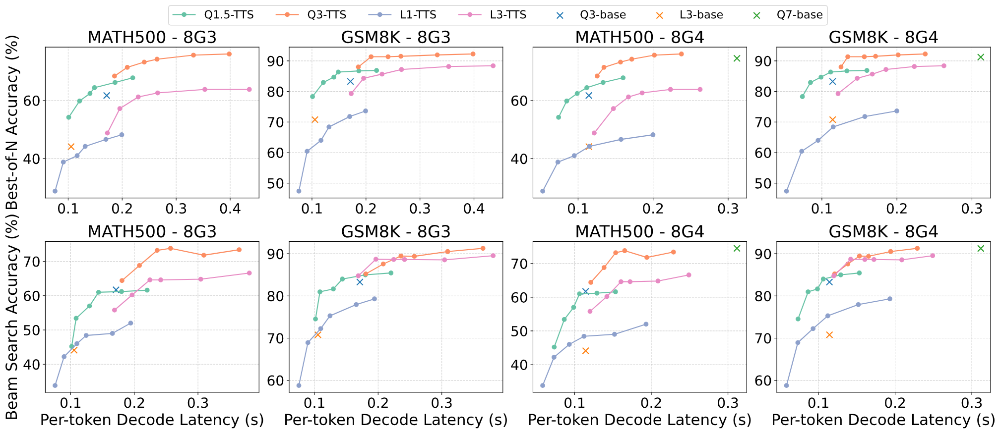

**图 10.** 不同数据集与硬件组合上各种测试时扩展方法的准确率-延迟权衡.

[图 10](#figure-10) 展示了测试时扩展方法的性能-成本权衡. 我们用 MATH500 和 GSM8K 上的准确率衡量生成质量, 用端侧模型的平均解码延迟衡量成本 (此处数据计入了 TTS 引起的上下文长度增加). 图中上排和下排分别对应 Best-of-N 与 Beam Search 的结果, "QN"/"LN" 表示包含 $N$ 十亿参数的 Qwen2.5 或 Llama3.2 模型. SoC 结果中排除了 "8G2", 因为 Snapdragon 8 Gen 2 存在已知的 NPU 虚拟地址空间限制 [Hao25c], 导致参数量达到 3B 或更大的模型无法运行. 标记为 "base" 的孤立点表示各模型通过常规采样得到的平均性能.

数据表明, 测试时扩展提供了一个权衡空间, 并在特定配置下形成更优的 Pareto 前沿, 从而取得更好的性能-成本平衡. 使用 Best-of-N 时, Qwen2.5 1.5B 和 3B 的扩展结果分别超过 3B 与 7B 模型的基线准确率. 使用 Beam Search 时, Qwen2.5-1.5B 和 Llama3.2-1B 的效率可以达到或略高于各自的 3B 版本. 我们的结果说明, 借助 NPU 算力和测试时扩展算法, 小型端侧模型在生成质量与推理成本两方面都有可能超过更大的模型.

#### 7.2.2 端侧解码性能

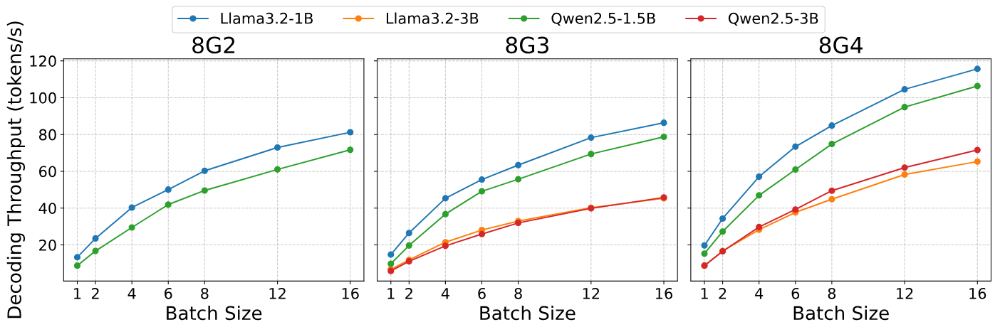

**图 11.** 不同批量大小和硬件设置下各模型的端到端解码吞吐量.

[图 11](#figure-11) 展示了不同模型在各种批量大小下的端侧解码吞吐量. 旧款 NPU 的虚拟地址空间限制为 2 GiB, 因此我们在 OnePlus Ace3 上仅评估 Qwen2.5-1.5B 和 Llama-3.2-1B.

数据表明, 对于这 3 台设备, 系统的端到端解码吞吐量都会随批量大小增加而显著提高. 解码吞吐量提高的根本原因是 HMX 单元的闲置算力得到了利用, 而核心 HMX 上的计算时间实际上完全没有增加. 但解码吞吐量并未严格线性增长, 因为推理过程中有些部分会随输入长度增加而大幅变慢. 具体而言, 在我们的实现中, `lm_head` 的权重 (从隐藏状态到词表的投影矩阵) 及相关激活值被保守地放在 CPU 上, 而不是 NPU 上. 现代 LLM 的词表很大, 因而 `lm_head` 和 logits 会占用大量空间. 遗憾的是, Hexagon NPU 只有 32 位虚拟地址空间, 所以将完整 logits 张量放在 NPU 上可能导致整个模型无法运行. 目前我们观察到, 当批量大小等于 16 时, CPU 上的 logits 计算时间占比接近或超过 50%. 我们预计, 解决 NPU 地址空间限制并将 logits 计算放到 NPU 上后, 系统会表现出更好的吞吐量扩展特性.

#### 7.2.3 功耗与能耗

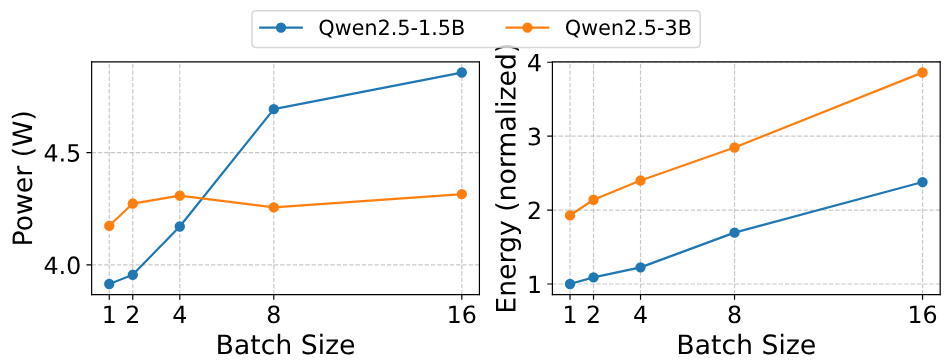

**图 12.** LLM 解码阶段的功耗和能耗.

我们在启用性能模式的 OnePlus 12 上, 通过 sysfs 接口测量 LLM 解码期间的功耗. 随着解码阶段的批量大小增加, 运行 1.5B Qwen 模型的功耗会升高, 但设备整体功耗仍不超过 5 W; 相比之下, 运行 3B Qwen 模型时的功耗稳定在 4.3 W 左右. [图 12](#figure-12) 展示了归一化能耗, 其计算方式是将相应功耗乘以相对解码延迟. 能耗随批量大小变化的扩展特性与解码延迟相似; 因此, 将[图 10](#figure-10) 中的成本指标替换为能耗后, 也会得到相近的准确率-成本权衡特性. 我们还观察到, 批量大小为 8 时, 1.5B 模型的解码能耗低于批量大小为 1 的 3B 模型; 而且在数学任务上, 1.5B 模型以批量大小 8 解码时的测试时扩展准确率, 与 3B 模型的基线准确率相当.

#### 7.2.4 与其他系统的比较

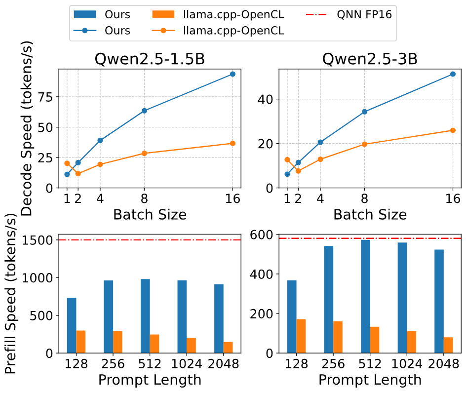

**图 13.** 推理吞吐量对比.

[图 13](#figure-13) 展示了本系统的解码与预填充性能. 我们将本系统与基于 GPU 的实现进行比较, 并加入 FP16 QNN 的性能作为参考. 在解码阶段, 尽管 GPU 在批量大小为 1 时解码更快, 但基于 NPU 的系统在较大批量大小下具有更高的解码吞吐量和更好的扩展特性, 体现了 NPU 用于测试时扩展工作负载的优势. 本系统的预填充吞吐量也始终高于基于 GPU 的系统, 在特定工作负载下可达到与专有 QNN 相当的性能.

### 7.3 准确率评估

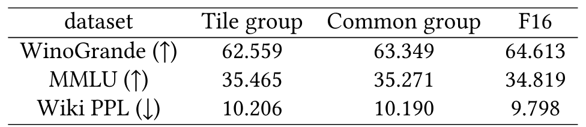

**表 4.** 采用适配 HMX 布局的分块量化组与采用传统量化组的模型准确率对比.

**量化方案.** 我们评估了 Qwen2.5-1.5B 模型在基于 HMX 布局的分块量化组与传统量化组下的准确率. 如[表 4](#table-04) 所示, 与采用传统布局的模型相比, 使用我们量化布局的模型在 MMLU 上准确率略高, 在 Winogrande 和 Wikitext PPL 上则仅略有下降. 而且, 这些准确率差异远小于量化本身造成的性能损失 (由 "F16" 列中的 Wikitext 困惑度体现). 总体而言, 使用我们提出的分块量化组不会使量化模型的准确率显著下降.

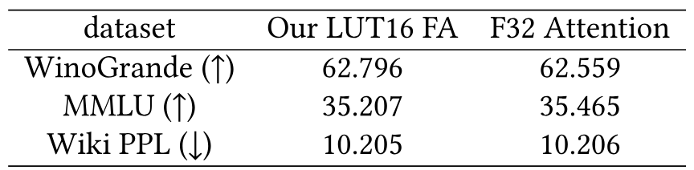

**表 5.** 使用基于 LUT 的 Softmax 的 F16 FlashAttention 模型与使用传统 F32 Attention 模型的准确率对比.

**Attention 实现.** [表 5](#table-05) 给出了基于 LUT 的 FP16 Attention 与传统 FP32 Attention 对应的模型准确率, 使用的模型和数据集与上文相同. 可以看到, 将 Attention 中的非关键部分 (累加除外) 换成精度较低的 FP16, 不会明显影响模型的端到端准确率.

### 7.4 消融研究

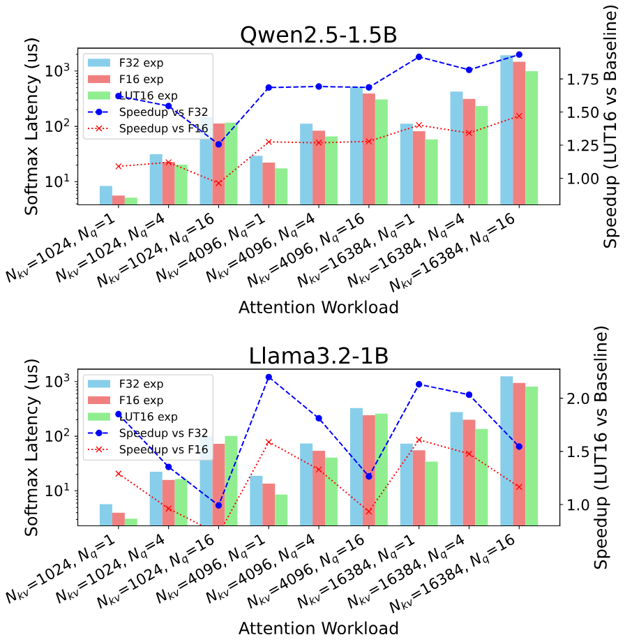

**图 14.** 我们提出的采用 LUT 指数计算的 F16 Attention 中片上 Softmax 的消融研究. 性能在 OnePlus 12 上测量.

**Attention 中的 Softmax.** [图 14](#figure-14) 展示了在不同 Attention 工作负载下, 使用不同方法计算指数函数 $\operatorname{exp}$ 时对应的片上 softmax 延迟. Attention 的输入 query 长度设为 1, 4 和 16, KV 长度设为 1024, 4096 或 16384. 图中显示, 与传统 32 位浮点 $\operatorname{exp}$ 相比, 基于 LUT 的指数计算可加速 1.26 到 2.19 倍; 与 16 位浮点 $\operatorname{exp}$ 相比, 最多可加速 $1.60\times$. 预计算 $\operatorname{exp}$ 查找表时, 可以使用宽度为 32 位或更高的浮点数计算中间结果. 因此, 基于 LUT 的 $\operatorname{exp}$ 比 16 位多项式近似的 $\operatorname{exp}$ 精度更高. 当上下文长度较短时, 较大的输入 query 会使加速比略有下降, 但 KV 长度增加后, 这一现象会有所缓解.

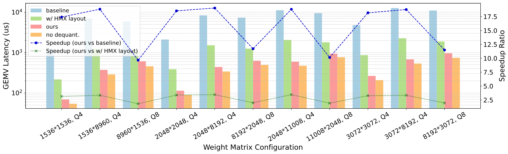

**图 15.** 所提 GEMM 反量化优化的消融研究. 我们在 OnePlus 12 上测量 GEMV 性能.

**基于反量化的 GEMM.** [图 15](#figure-15) 展示了 GEMM 反量化布局优化的消融实验. 基线方法采用传统内存布局, 其中按列主序存储的权重矩阵依据内存中的连续分组进行量化. GEMM 内核在运行时逐个反量化大小为 32 的分组, 再将元素 scatter 到 TCM 中的正确位置. "HMX layout" 项对 HMX 布局应用离线权重重排和分块量化组, 使 FP16 权重可以连续写入 TCM. "Ours" 是采用所有优化的版本, 包括量化组合并. 我们还加入了一组标为 "no dequantization" 的数据. 在该实现中, 不执行实际的权重反量化, 而是直接从内存读取量化权重, 再将其复制到片上内存, 中间不做任何计算. 这组数据可视为基于反量化方法的性能上界.

与基线相比, 我们的方法在不同矩阵尺寸下可加速 9.65 到 19.04 倍. 主要原因是基线中的 scatter 操作成本极高. 应用 HMX 布局后, 量化组合并与重排也有效减少了计算浪费, 带来 $1.82\times$ 到 $3.45\times$ 的加速. 尤其是, 与 "no dequantization" 组相比, 我们的方法平均仅慢 27%, 表明该实现已经接近反量化的性能上限.

### 7.5 开销与敏感性分析

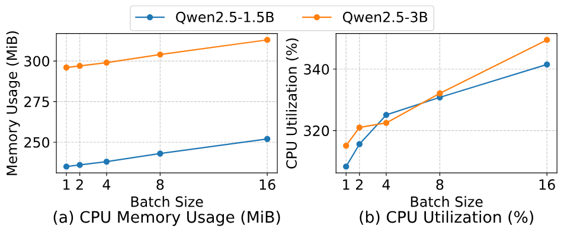

**图 16.** 解码阶段的 CPU 与内存使用情况.

**CPU 与内存使用情况.** 我们在 OnePlus 12 上评估 1.5B 和 3B Qwen2.5 模型在解码阶段的 CPU 利用率与内存占用. [图 16](#figure-16) 所示的 CPU 内存占用来自 `top` 命令报告的常驻内存大小. 我们还使用 `pmap` 测量 `dmabuf` (即 NPU 使用的内存) 的总大小; 在上下文预算为 4096 个 token 时, 1.5B 和 3B 模型分别恒定为 1056 MiB 与 2090 MiB. 1.5B 模型的总内存占用约为 1.3 GiB, 3B 模型约为 2.4 GiB. 由于 CPU 上的词表投影计算量增加, CPU 利用率会随批量大小上升, 但使用的核心数始终不超过 4 个.

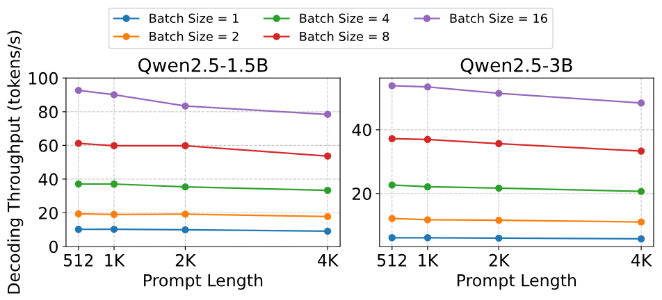

**图 17.** Prompt 长度对解码吞吐量的影响.

**Prompt 长度的影响.** [图 17](#figure-17) 展示了 prompt 长度对解码吞吐量的影响. 对于所有批量大小和两个模型, 随着 prompt 长度从 512 个 token 增加到 4096 个 token, 解码吞吐量都呈现轻微下降趋势. 不过, 在不超过 4096 个 token 的 prompt 长度范围内, 降幅仍然很小, 说明该区间内 prompt 长度对解码吞吐量的影响有限.

## 8 讨论

**对其他硬件的普适性.** 我们认为 NPU 的"向量 + 矩阵"架构具有一定普适性, 同时观察到 CPU 与 NPU 之间的界限正在逐渐模糊. 除 NPU 外, Intel AMX 和 ARM SME 等专用矩阵乘法单元也开始进入现代 CPU, 使其具备类似的"向量 + 矩阵"架构. 我们还注意到, 现代 AI 加速器的通用计算性能与专用低精度矩阵乘法能力之间通常差距显著 (如 NVIDIA GPU). 虽然具体硬件架构可能不同, 我们技术背后的核心思想仍然具有广泛适用性.

**系统性能与限制.** (a) 解码性能: 本系统目前的解码速度相对受限, 主要原因是反量化开销. 但这不影响测试时扩展的有效性. 基于 QNN 的量化 GEMM 通常只使用 DMA 与 HMX 组件, 不会引入 HVX 计算开销. 类似 T-MAC [Wei25j] 的方法可能让 NPU 高效执行采用细粒度分组量化的 GEMV, 从而加速 LLM 解码过程. (b) 预填充性能: 本系统目前的预填充性能仍有改进空间. 将更多算子卸载到 NPU, 通过算子融合减少内存访问和通信开销, 并优化矩阵乘法的分块与流水线策略, 都可以改善预填充性能. 这些优化留待未来工作处理. (c) 模型大小限制: 我们当前的实现受旧款设备上单个 NPU 会话 32 位地址空间的限制. 使用多个 NPU 会话可能有助于缓解这一问题.

**并行测试时扩展的应用范围.** 尽管并行测试时扩展方法目前主要用于数学推理任务, 近期研究 [Yan25p, Yao23a, Par23d, Hon23, Haf24, Che25ai] 表明, 这些方法可以扩展到更广泛的推理与规划领域, 具有可观的普适潜力.

## 9 相关工作

**使用 NPU 的端侧 LLM 推理.** `llm.npu` [Xu24f] 率先在 NPU 上使用逐张量量化的 INT8 GEMM 来加速 LLM 的预填充阶段, 同时由 CPU 协助计算离群值相关部分, 以保持准确率. HeteroLLM [Che25ah] 通过张量分区实现 GPU 与 NPU 协同推理. 开源推理框架 PowerServe [Pow25] 借助中间 ONNX 格式, 实现自定义的量化计算与浮点计算分区. ShadowAttn [Yin25b] 通过 NPU 与 CPU/GPU 协作来加速稀疏 Attention. ExecuTorch [Exe25, Or25] 是知名的开源端侧 DNN 推理框架, 支持 SpinQuant [Liu24b] 和 QNN 后端. 上述工作均基于 Qualcomm Hexagon NPU, 并将闭源 QNN [Qua25a] 用作后端. vivo 的工作 [Lu24b, Che25ag] 使用了 MediaTek NPU, 但由于 NeuroPilot SDK 不对外开放, 此类研究仍然很少.

**LLM 量化.** 最知名的训练后量化算法包括 GPTQ [Fra22] 和 AWQ [Lin24], 它们执行仅权重量化, 只需少量校准数据, 因而得到广泛应用. SmoothQuant [Xia23] 和 DuQuant [Lin24b] 等后续方法将范围扩展到权重-激活量化, 并针对更难处理的激活量化任务提出了缓解离群值分布问题的技术. 最近, QuaRot [Ash24] 和 SpinQuant [Liu24b] 等综合方法开始量化全部主要组件, 包括权重、激活值和关键的 KV 缓存, 精度通常低至 4 位. 这些方法利用旋转变换, 在整个模型中形成更适合量化的特征分布.

**推测解码.** 推测解码 [Lev23, Mia24a, Lu24c] 是一类 LLM 推理加速方法, 核心思想是在一次模型前向传播中验证多个推测 token, 缓解 LLM 解码受内存限制的问题. 推测解码存在多种扩展变体, 其中一些 [Hao24a, Lia25h] 已不再严格遵循目标模型的分布. 理论上, 广义推测解码和测试时扩展方法都属于广义的 Generate-then-Verify 框架, 本系统在理论上可以无缝支持这些应用.

## 10 结论

本工作证明, 可以利用移动 NPU 中未充分使用的计算能力, 尤其是 Qualcomm Hexagon NPU, 为 LLM 实现测试时扩展, 而且这种做法确实有效. 我们设计了一套端到端推理系统, 其中包含硬件感知的分块量化、权重布局优化, 以及基于 LUT 的关键算子加速; 结果表明, 加入测试时扩展的小模型在准确率和延迟两方面都可以超过按常规方式部署的大模型. 这种方法为在资源受限的移动设备上部署高性能语言模型提供了新途径, 推进了端侧 AI 效率与能力的 Pareto 前沿.

## 致谢

我们感谢所有匿名审稿人和 shepherd Yubin Xia 提出的深刻反馈与建议. 本工作获得清华大学 (AIR)-亚信科技 (中国) 有限公司 6G 网络与智能计算联合研究中心资助, 项目编号为 20233910006.

[+1]: 该值由 AMD Ryzen AI 9 HX 370 NPU 的 50 TOPS 除以 AMD Ryzen 7 8845HS NPU 的 16 TOPS 得到.

[+2]: 我们的代码位于 https://github.com/haozixu/llama.cpp-npu (主仓库) 和 https://github.com/haozixu/htp-ops-lib (算子库)

[+3]: 我们使用 PowerServe 发布的官方模型, 地址为 https://huggingface.co/PowerServe/Llama-3.2-1B-PowerServe-QNN29-8G3

[+4]: commit: 1caae7f
